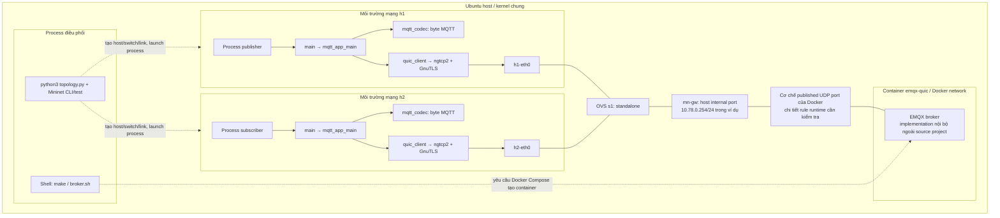

# Bản đồ nghiên cứu luồng thực thi MQTT over QUIC

Ngày đối chiếu: **10/11/2026, Asia/Bangkok**. Phạm vi là source hiện có của project, các header/thành phần phụ thuộc cài tại máy và log kiểm thử đã lưu. Đây là phân tích source, không phải báo cáo một lần khởi động hoặc benchmark mới.

## 1. Cách đọc bằng chứng

Các chương sử dụng bốn nhãn để tránh gộp thiết kế với thực nghiệm:

- **[SOURCE]**: xác minh trực tiếp qua dòng code, call site, header hoặc implementation thư viện có trong máy.
- **[CONFIG]**: có cấu hình/lệnh chuẩn bị tương ứng; chưa chứng minh nó đang có hiệu lực tại thời điểm đọc.
- **[HISTORICAL]**: có log/report lần chạy cũ; không suy ra trạng thái hiện tại hoặc số packet cụ thể.
- **[THEORY] / [UNVERIFIED]**: cơ chế của Linux/Docker/giao thức để giải thích, hoặc thông tin runtime chưa đo được. Chương 10 chỉ rõ cách kiểm tra.

Một liên kết như `clients/app.c:49-64` mở tại dòng đầu của đoạn bằng chứng. Tên file/số dòng trong nhãn chỉ phạm vi được đọc; đích liên kết là đường dẫn tuyệt đối để mở đúng source trên máy. Source ngoài project được ghi rõ là dependency hoặc Mininet cài trong hệ thống. Các đoạn code rút gọn giữ nguyên ý nghĩa, không phải một phiên bản source cần chép đè.

## 2. Bộ tài liệu và câu hỏi mỗi chương trả lời

| File | Câu hỏi chính | Điều nên làm khi đọc |
|---|---|---|
| [00-README.md](00-README.md) | Hệ thống thật gồm những process và tầng nào? | Nhận diện ranh giới gọi hàm và truyền mạng |
| [01-STARTUP-FLOW.md](01-STARTUP-FLOW.md) | Từ lệnh shell tới namespace, broker, process và socket như thế nào? | Theo dõi ai tạo tài nguyên nào |
| [02-CONNECTION-AND-HANDSHAKE.md](02-CONNECTION-AND-HANDSHAKE.md) | ngtcp2/GnuTLS được nối với nhau và handshake ra sao? | Theo nguồn mọi tham số connection/TLS/callback |
| [03-PACKET-SEND-FLOW.md](03-PACKET-SEND-FLOW.md) | Payload trở thành byte MQTT, QUIC packet và UDP datagram ra sao? | Phân biệt queue/consume/send/ACK |
| [04-PACKET-RECEIVE-FLOW.md](04-PACKET-RECEIVE-FLOW.md) | recv → ngtcp2 → callback → parser → subscriber diễn ra ra sao? | Theo buffer và return qua từng hàm |
| [05-NETWORK-PACKET-PATH.md](05-NETWORK-PACKET-PATH.md) | Packet đi qua interface/namespace nào? | Tách userspace khỏi OVS/kernel/Docker |
| [06-FUNCTION-CALL-GRAPH.md](06-FUNCTION-CALL-GRAPH.md) | Ai gọi ai, khi nào, rồi quay về đâu? | Đối chiếu call site và callback registration |
| [07-STATE-AND-DATA-FLOW.md](07-STATE-AND-DATA-FLOW.md) | Con trỏ trỏ tới ai; buffer/state sống bao lâu? | Vẽ lại pointer graph và state machine |
| [08-ERROR-TIMER-AND-CLOSE-FLOW.md](08-ERROR-TIMER-AND-CLOSE-FLOW.md) | Timeout, ACK, mất gói, signal và đóng kết nối được xử lý thế nào? | Theo cả success lẫn error unwind |
| [09-END-TO-END-WALKTHROUGH.md](09-END-TO-END-WALKTHROUGH.md) | Một lần truyền h1→EMQX→h2 chạy từng bước thế nào? | Đọc như nhật ký debugger, có byte/offset |
| [10-TRACEABILITY-AND-GAPS.md](10-TRACEABILITY-AND-GAPS.md) | Điều nào đã chứng minh, điều nào còn thiếu và debug ở đâu? | Kiểm tra nguồn, giới hạn và breakpoint |

Thứ tự đọc đầy đủ: **00 → 01 → 02 → 07 → 03 → 04 → 05 → 06 → 08 → 09 → 10**. Nếu muốn tiếp tục bài `on_data` đang học: đọc 07 (context/buffer), 04 (toàn bộ nhánh nhận/parser/header), rồi 06 (quay về call stack).

## 3. Kết luận kiến trúc có thể chứng minh bằng source

**[SOURCE] Có hai executable C độc lập**, publisher và subscriber, mỗi executable có `main()` và role riêng. Cả hai link với `app.o`, `mqtt_codec.o`, `quic_client.o`. Chia sẻ mã nguồn không đồng nghĩa chia sẻ đối tượng trong bộ nhớ. [clients/publisher.c:42-49](/home/nguyenluongduc/Github/QUIC/ZerotoHeroWithQUIC/src/PrgSocket/QUICSocket/mqtt-quic/clients/publisher.c:42), [clients/subscriber.c:113-125](/home/nguyenluongduc/Github/QUIC/ZerotoHeroWithQUIC/src/PrgSocket/QUICSocket/mqtt-quic/clients/subscriber.c:113), [clients/Makefile:13-24](/home/nguyenluongduc/Github/QUIC/ZerotoHeroWithQUIC/src/PrgSocket/QUICSocket/mqtt-quic/clients/Makefile:13).

**[SOURCE] Hai process đều đóng vai client QUIC**, tự mở UDP socket connected tới endpoint broker. Không có `bind/listen/accept` cho server C trong nhánh triển khai này; `socket_open()` dùng `socket(AF_INET, SOCK_DGRAM, 0)`, `connect()` và `getsockname()`. [clients/quic_client.c:212-236](/home/nguyenluongduc/Github/QUIC/ZerotoHeroWithQUIC/src/PrgSocket/QUICSocket/mqtt-quic/clients/quic_client.c:212). Server echo cũ là project khác, không phải nơi xử lý MQTT ở đây.

**[CONFIG] Broker là EMQX Enterprise 6.3.2 trong container `emqx-quic`**, công bố UDP 14567 trên địa chỉ IPv4 host, dashboard chỉ publish ở loopback; TCP/SSL/WS/WSS MQTT bị tắt trong config. Đây là cấu hình được kiểm tra, không phải kết quả kiểm tra container đang healthy hôm nay. [docker/compose.yaml:1-34](/home/nguyenluongduc/Github/QUIC/ZerotoHeroWithQUIC/src/PrgSocket/QUICSocket/mqtt-quic/docker/compose.yaml:1), [docker/emqx.conf:12-33](/home/nguyenluongduc/Github/QUIC/ZerotoHeroWithQUIC/src/PrgSocket/QUICSocket/mqtt-quic/docker/emqx.conf:12).

**[SOURCE] Topology có h1/h2 và một OVS switch s1 standalone**, không tạo router node hay controller. `mn-gw` là internal port gắn s1 và có IP trong namespace host Ubuntu. Nó không phải interface bên trong container. [mininet/topology.py:75-124](/home/nguyenluongduc/Github/QUIC/ZerotoHeroWithQUIC/src/PrgSocket/QUICSocket/mqtt-quic/mininet/topology.py:75), [mininet/topology.py:260-280](/home/nguyenluongduc/Github/QUIC/ZerotoHeroWithQUIC/src/PrgSocket/QUICSocket/mqtt-quic/mininet/topology.py:260).

**[SOURCE] Mỗi process C có một đối tượng `quic_client`, một UDP socket, một ngtcp2 connection và một stream ứng dụng**, với hai đầu stream trong từng connection. h1 và h2 dùng hai connection khác nhau tới broker; stream ID 0 trên hai connection không phải một stream chung. [clients/quic_client.c:24-39](/home/nguyenluongduc/Github/QUIC/ZerotoHeroWithQUIC/src/PrgSocket/QUICSocket/mqtt-quic/clients/quic_client.c:24), [clients/quic_client.c:338-347](/home/nguyenluongduc/Github/QUIC/ZerotoHeroWithQUIC/src/PrgSocket/QUICSocket/mqtt-quic/clients/quic_client.c:338), [clients/quic_client.c:542-570](/home/nguyenluongduc/Github/QUIC/ZerotoHeroWithQUIC/src/PrgSocket/QUICSocket/mqtt-quic/clients/quic_client.c:542).

## 4. Architecture diagram: process khác với module



Các mũi tên bên trong module C là quan hệ xử lý trong một process. Các đường qua interface/OVS/Docker là đường truyền mạng, không phải một hàm C gọi sang process khác. Nguồn cho phần C: [clients/app.c:115-167](/home/nguyenluongduc/Github/QUIC/ZerotoHeroWithQUIC/src/PrgSocket/QUICSocket/mqtt-quic/clients/app.c:115) và [clients/quic_client.c:452-539](/home/nguyenluongduc/Github/QUIC/ZerotoHeroWithQUIC/src/PrgSocket/QUICSocket/mqtt-quic/clients/quic_client.c:452). Nguồn cho phần topology/container: [mininet/topology.py:260-292](/home/nguyenluongduc/Github/QUIC/ZerotoHeroWithQUIC/src/PrgSocket/QUICSocket/mqtt-quic/mininet/topology.py:260), [docker/compose.yaml:4-34](/home/nguyenluongduc/Github/QUIC/ZerotoHeroWithQUIC/src/PrgSocket/QUICSocket/mqtt-quic/docker/compose.yaml:4). Sơ đồ mạng là cấu trúc từ source/config; tên Docker bridge, cặp veth container, IP container và firewall rule cụ thể chưa được đọc trực tiếp trong phiên phân tích.

## 5. Khảo sát entry point và process thực tế

| Entry point | Process/ngữ cảnh | Chuỗi vào chính | Bằng chứng |
|---|---|---|---|
| `make` | make, compiler, linker | Makefile root gọi make ở clients; link role + common objects | [Makefile:1-14](/home/nguyenluongduc/Github/QUIC/ZerotoHeroWithQUIC/src/PrgSocket/QUICSocket/mqtt-quic/Makefile:1), [clients/Makefile:1-35](/home/nguyenluongduc/Github/QUIC/ZerotoHeroWithQUIC/src/PrgSocket/QUICSocket/mqtt-quic/clients/Makefile:1) |
| `broker.sh up` | shell → Docker CLI/daemon/container | owner check → certificate → compose wait → listeners | [scripts/broker.sh:1-54](/home/nguyenluongduc/Github/QUIC/ZerotoHeroWithQUIC/src/PrgSocket/QUICSocket/mqtt-quic/scripts/broker.sh:1) |
| `gen-certs.sh` | shell → openssl | reuse/verify hoặc tạo CA + server cert | [scripts/gen-certs.sh:1-42](/home/nguyenluongduc/Github/QUIC/ZerotoHeroWithQUIC/src/PrgSocket/QUICSocket/mqtt-quic/scripts/gen-certs.sh:1) |
| `preflight.py` | Python kiểm tra chỉ đọc | parse_subnet → inspect → find_conflicts | [scripts/preflight.py:17-112](/home/nguyenluongduc/Github/QUIC/ZerotoHeroWithQUIC/src/PrgSocket/QUICSocket/mqtt-quic/scripts/preflight.py:17) |
| `topology.py` | Python root | options → preflight → lock → Mininet → CLI/test → finally | [mininet/topology.py:225-316](/home/nguyenluongduc/Github/QUIC/ZerotoHeroWithQUIC/src/PrgSocket/QUICSocket/mqtt-quic/mininet/topology.py:225) |
| `publisher.main(argc, argv)` | client h1 hoặc host | tạo pub/role → mqtt_app_main | [clients/publisher.c:42-49](/home/nguyenluongduc/Github/QUIC/ZerotoHeroWithQUIC/src/PrgSocket/QUICSocket/mqtt-quic/clients/publisher.c:42) |
| `subscriber.main(argc, argv)` | client h2 hoặc host | tạo subscriber/role → mqtt_app_main | [clients/subscriber.c:113-125](/home/nguyenluongduc/Github/QUIC/ZerotoHeroWithQUIC/src/PrgSocket/QUICSocket/mqtt-quic/clients/subscriber.c:113) |
| `tests/integration.py` | Python trên host | launch subscriber, readiness/keepalive, publisher, TLS-negative, signal test | [tests/integration.py:54-201](/home/nguyenluongduc/Github/QUIC/ZerotoHeroWithQUIC/src/PrgSocket/QUICSocket/mqtt-quic/tests/integration.py:54) |
| `tests/test_codec.c:main()` | executable unit test | encode vectors → parser chunks/coalescing → malformed input | [tests/test_codec.c:25-79](/home/nguyenluongduc/Github/QUIC/ZerotoHeroWithQUIC/src/PrgSocket/QUICSocket/mqtt-quic/tests/test_codec.c:25) |
| Python unittest discovery | test process | test preflight dữ liệu giả; mock side effects Mininet lifecycle | [tests/test_preflight.py:13-50](/home/nguyenluongduc/Github/QUIC/ZerotoHeroWithQUIC/src/PrgSocket/QUICSocket/mqtt-quic/tests/test_preflight.py:13), [tests/test_topology_lifecycle.py:21-85](/home/nguyenluongduc/Github/QUIC/ZerotoHeroWithQUIC/src/PrgSocket/QUICSocket/mqtt-quic/tests/test_topology_lifecycle.py:21) |

Không có daemon C tự viết cho router/broker/server trong inventory này. OVS/Docker/EMQX là thành phần bên ngoài được project gọi/cấu hình; không gán tên hàm nội bộ chưa đọc cho chúng.

## 6. Các giai đoạn có điều kiện chuyển tiếp cụ thể

1. **Chuẩn bị**: build binary, CA/certificate và broker listener. `broker.sh up` không tự mở Mininet. [scripts/broker.sh:22-36](/home/nguyenluongduc/Github/QUIC/ZerotoHeroWithQUIC/src/PrgSocket/QUICSocket/mqtt-quic/scripts/broker.sh:22).
2. **Topology**: chỉ tạo tài nguyên sau khi subnet, runtime, khóa và tên tài nguyên đã qua kiểm tra. [mininet/topology.py:250-265](/home/nguyenluongduc/Github/QUIC/ZerotoHeroWithQUIC/src/PrgSocket/QUICSocket/mqtt-quic/mininet/topology.py:250).
3. **Subscriber trước**: chế độ test launch h2 và đợi chuỗi `SUBACK accepted` trong log trước khi launch h1. Log chỉ là dấu readiness, không truyền payload giữa client. [mininet/topology.py:183-192](/home/nguyenluongduc/Github/QUIC/ZerotoHeroWithQUIC/src/PrgSocket/QUICSocket/mqtt-quic/mininet/topology.py:183).
4. **Transport init**: socket → ngtcp2 connection → TLS session → event_loop. [clients/quic_client.c:542-570](/home/nguyenluongduc/Github/QUIC/ZerotoHeroWithQUIC/src/PrgSocket/QUICSocket/mqtt-quic/clients/quic_client.c:542).
5. **QUIC ready**: verify TLS1.3/ALPN/certificate → c.handshake=1 → mở stream → callback ready. [clients/quic_client.c:122-143](/home/nguyenluongduc/Github/QUIC/ZerotoHeroWithQUIC/src/PrgSocket/QUICSocket/mqtt-quic/clients/quic_client.c:122), [clients/quic_client.c:338-347](/home/nguyenluongduc/Github/QUIC/ZerotoHeroWithQUIC/src/PrgSocket/QUICSocket/mqtt-quic/clients/quic_client.c:338).
6. **MQTT ready**: ready queue CONNECT; parser ghép CONNACK; on_packet xác nhận rồi gọi role.connected. QUIC-ready chưa đồng nghĩa MQTT-connected. [clients/app.c:37-64](/home/nguyenluongduc/Github/QUIC/ZerotoHeroWithQUIC/src/PrgSocket/QUICSocket/mqtt-quic/clients/app.c:37).
7. **Subscription**: role subscriber queue SUBSCRIBE; SUBACK đúng ID/QoS mới chuyển SUBSCRIBED. [clients/subscriber.c:20-48](/home/nguyenluongduc/Github/QUIC/ZerotoHeroWithQUIC/src/PrgSocket/QUICSocket/mqtt-quic/clients/subscriber.c:20).
8. **Publication**: publisher CONNACK → encode PUBLISH → queue → flush ngtcp2 → UDP; broker chuyển message theo subscription trên connection khác. Phần chuyển broker là ranh giới ngoài source; việc h2 nhận đúng payload có log lịch sử. [clients/publisher.c:11-19](/home/nguyenluongduc/Github/QUIC/ZerotoHeroWithQUIC/src/PrgSocket/QUICSocket/mqtt-quic/clients/publisher.c:11), [clients/quic_client.c:350-393](/home/nguyenluongduc/Github/QUIC/ZerotoHeroWithQUIC/src/PrgSocket/QUICSocket/mqtt-quic/clients/quic_client.c:350), [work/mininet-separated-clients/subscriber.log:1-10](/home/nguyenluongduc/Github/QUIC/ZerotoHeroWithQUIC/src/PrgSocket/QUICSocket/mqtt-quic/work/mininet-separated-clients/subscriber.log:1).
9. **Shutdown**: publisher đợi stream-byte ACK; subscriber tùy count/signal; queue DISCONNECT → drain/FIN/CLOSE → cleanup. [clients/publisher.c:29-39](/home/nguyenluongduc/Github/QUIC/ZerotoHeroWithQUIC/src/PrgSocket/QUICSocket/mqtt-quic/clients/publisher.c:29), [clients/subscriber.c:67-77](/home/nguyenluongduc/Github/QUIC/ZerotoHeroWithQUIC/src/PrgSocket/QUICSocket/mqtt-quic/clients/subscriber.c:67), [clients/app.c:24-34](/home/nguyenluongduc/Github/QUIC/ZerotoHeroWithQUIC/src/PrgSocket/QUICSocket/mqtt-quic/clients/app.c:24), [clients/quic_client.c:482-583](/home/nguyenluongduc/Github/QUIC/ZerotoHeroWithQUIC/src/PrgSocket/QUICSocket/mqtt-quic/clients/quic_client.c:482).

## 7. Bộ phụ thuộc được đối chiếu

**[SOURCE] Header cài của ngtcp2 ghi 1.25.0**, pkg-config cũng 1.25.0; GnuTLS header/pkg-config hiện có ghi 3.8.12. Không dùng tài liệu ngtcp2 latest để áp các signature cũ/mới tùy ý. [../demo/src/.deps/include/ngtcp2/version.h:39](/home/nguyenluongduc/Github/QUIC/ZerotoHeroWithQUIC/src/PrgSocket/QUICSocket/demo/src/.deps/include/ngtcp2/version.h:39), [../demo/src/.deps/lib/pkgconfig/libngtcp2.pc:31](/home/nguyenluongduc/Github/QUIC/ZerotoHeroWithQUIC/src/PrgSocket/QUICSocket/demo/src/.deps/lib/pkgconfig/libngtcp2.pc:31), [/usr/include/gnutls/gnutls.h:52](/usr/include/gnutls/gnutls.h:52), [/usr/lib/x86_64-linux-gnu/pkgconfig/gnutls.pc:20](/usr/lib/x86_64-linux-gnu/pkgconfig/gnutls.pc:20).

Makefile chỉ định prefix thư viện ở sibling demo, các package `libngtcp2 libngtcp2_crypto_gnutls gnutls`, cờ warning C11 và rpath. ELF publisher đang có cũng khai báo dependency các shared-library tương ứng và RUNPATH về prefix này qua kiểm tra `readelf -d`; điều này không thay thế kiểm tra dynamic loader thực tế của một process đang chạy. [clients/Makefile:4-24](/home/nguyenluongduc/Github/QUIC/ZerotoHeroWithQUIC/src/PrgSocket/QUICSocket/mqtt-quic/clients/Makefile:4).

ngtcp2 lo QUIC packet/ACK/loss recovery/stream/flow-control theo implementation thư viện; GnuTLS cùng crypto adapter cung cấp TLS/key/AEAD. Project tự lo socket I/O, giờ monotonic, scheduling event loop, buffer MQTT, parser và role dispatch. Call site: [clients/quic_client.c:239-320](/home/nguyenluongduc/Github/QUIC/ZerotoHeroWithQUIC/src/PrgSocket/QUICSocket/mqtt-quic/clients/quic_client.c:239), [clients/quic_client.c:350-393](/home/nguyenluongduc/Github/QUIC/ZerotoHeroWithQUIC/src/PrgSocket/QUICSocket/mqtt-quic/clients/quic_client.c:350), [clients/quic_client.c:452-539](/home/nguyenluongduc/Github/QUIC/ZerotoHeroWithQUIC/src/PrgSocket/QUICSocket/mqtt-quic/clients/quic_client.c:452). API macros versioned và contract: [../demo/src/.deps/include/ngtcp2/ngtcp2.h:4170-4201](/home/nguyenluongduc/Github/QUIC/ZerotoHeroWithQUIC/src/PrgSocket/QUICSocket/demo/src/.deps/include/ngtcp2/ngtcp2.h:4170), [../demo/src/.deps/include/ngtcp2/ngtcp2.h:5201-5357](/home/nguyenluongduc/Github/QUIC/ZerotoHeroWithQUIC/src/PrgSocket/QUICSocket/demo/src/.deps/include/ngtcp2/ngtcp2.h:5201).

## 8. Điều chưa được tuyên bố là đã đo hôm nay

Phiên phân tích không tạo interface, không khởi động/dừng container, không chạy client hay kiểm thử mạng. Lệnh chỉ đọc `ip -j -4 address show` bị chặn mở netlink, và `docker inspect emqx-quic` bị từ chối truy cập Docker API. Vì vậy không thể gán IP container, Docker bridge, PID client hoặc listener health hiện tại từ phiên này. Các câu hỏi đó được giữ mở và có lệnh kiểm tra trong chương 10.

Các log cũ ghi nhận h1/h2 nhận đúng payload và drain; report host ghi rõ scope loopback và ngày 09/11/2026. Hai nguồn này được phân loại lịch sử, không gộp lại thành một phép đo packet path hiện tại. [work/mininet-separated-clients.log:8-55](/home/nguyenluongduc/Github/QUIC/ZerotoHeroWithQUIC/src/PrgSocket/QUICSocket/mqtt-quic/work/mininet-separated-clients.log:8), [work/host-test-separated-clients/report.json:1-42](/home/nguyenluongduc/Github/QUIC/ZerotoHeroWithQUIC/src/PrgSocket/QUICSocket/mqtt-quic/work/host-test-separated-clients/report.json:1).

## 9. Những câu hỏi cần trả lời được sau khi đọc

- Vì sao `user` trong callback ngtcp2 trỏ `c`, còn `user` của `on_data` trỏ `app`?
- Vì sao queue một PUBLISH chưa chứng minh UDP đã gửi, QUIC đã ACK hoặc subscriber đã nhận?
- Vì sao `header()` trả 1 nhưng parser vẫn có thể chưa gọi `on_packet()`?
- Vì sao h1 gửi tới `.254` cần ARP/local connected route, nhưng không cần project tạo router để chuyển tới IP `.254`?
- Vì sao broker nhận QUIC connection A rồi gửi lại dữ liệu trên connection B, thay vì chuyển nguyên gói QUIC A cho h2?
- Vì sao payload/state/packet buffer phải có vòng đời khác nhau?

Mỗi câu có call site, tham số, trạng thái và giới hạn chứng cứ ở các chương chuyên sâu; dùng chương 09 để tự kể lại toàn bộ chuỗi rồi đối chiếu chương 10.

## 10. Biên bản kiểm tra tài liệu

- Có đủ 11 chương yêu cầu, hơn 4.900 dòng phân tích, 20 sơ đồ Mermaid và walkthrough 45 bước.
- Đã kiểm tra tự động 1.944 liên kết/đường dẫn, trong đó có 1.610 nhãn khoảng dòng: file tồn tại, điểm mở và khoảng dòng nằm trong source tương ứng; các liên kết điều hướng giữa 11 chương hợp lệ.
- Registry và nội dung tài liệu đề cập đủ 63 định nghĩa hàm C production, kể cả hai entry point main riêng. Các hàm quan trọng được phân tích signature, call site, tham số, ownership, điều kiện, state-change, return và error trong các chương chuyên sâu.
- Đã đối chiếu lại SHA-256 của 25 file source/config/test/ghi chú có trong manifest: không thay đổi so với trước khi làm tài liệu.
- Code fences và bảng Markdown đã được kiểm tra cấu trúc; các sơ đồ được rà theo call site, điều kiện và các ranh giới process/network. Đã sửa các cạnh dễ gây hiểu sai về header/body và thứ tự ACK so với delivery.
- Môi trường không có Mermaid parser/renderer cài sẵn. Mức kiểm tra sơ đồ là cấu trúc khối và rà thủ công cú pháp/ngữ nghĩa, **chưa xác minh bằng render**. Không cài thêm package hoặc thay môi trường để làm nhiệm vụ tài liệu.
- Không build/chạy lại client, không tạo mạng hoặc đổi Docker/OVS/firewall. Hai phép quan sát mạng/container chỉ đọc bị từ chối quyền, đã ghi rõ trong chương 10; kết quả end-to-end được dẫn là log lịch sử.

Nếu source được sửa sau mốc này, cần rà lại số dòng, call graph và phần nguồn tham số trước khi dùng tài liệu để debug hoặc thuyết trình.

## 11. Vị trí bàn giao thực tế

Bộ tài liệu được lưu tại `docs/code-flow/` trong thư mục làm việc Codex:

```text
/home/nguyenluongduc/Documents/Codex/2026-11-09/t/docs/code-flow/
```

Thư mục đích trong repo mà người dùng yêu cầu là:

```text
/home/nguyenluongduc/Github/QUIC/ZerotoHeroWithQUIC/src/PrgSocket/QUICSocket/mqtt-quic/docs/code-flow/
```

Phiên này chưa được cấp quyền ghi vào vị trí trong repo nên chưa thể lưu trực tiếp tại đó. Toàn bộ source/config/topology được giữ nguyên. Gói `CODE_FLOW_MQTT_QUIC.zip` kèm bộ tài liệu chỉ chứa 11 file Markdown dưới đường dẫn `docs/code-flow/`; có thể giải nén tại root project để đặt đúng cấu trúc. Các liên kết source trỏ tới source gốc; các liên kết giữa tài liệu là tương đối nên vẫn hoạt động sau khi chép.

Nếu muốn đưa bộ tài liệu vào repo từ terminal của máy, lệnh dưới chỉ giải nén các file tài liệu và không ghi đè file đã có:

```bash
unzip -n /home/nguyenluongduc/Documents/Codex/2026-11-09/t/docs/code-flow/CODE_FLOW_MQTT_QUIC.zip -d /home/nguyenluongduc/Github/QUIC/ZerotoHeroWithQUIC/src/PrgSocket/QUICSocket/mqtt-quic
```
