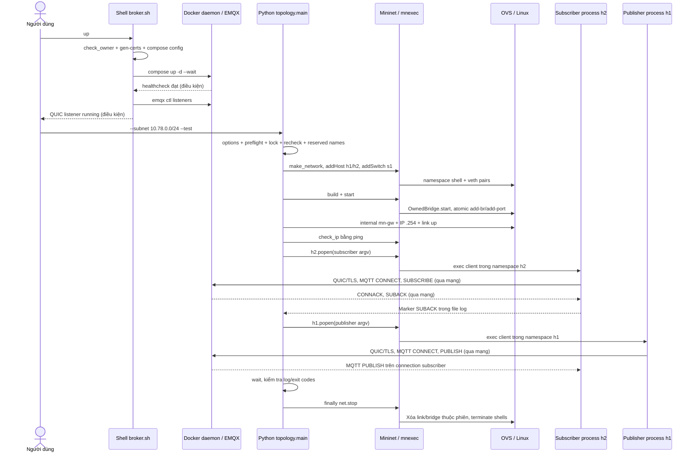

# 01 — Truy vết khởi động: từ lệnh người dùng tới MQTT sẵn sàng

[Bản đồ bộ tài liệu](00-README.md) · [Kết nối/handshake](02-CONNECTION-AND-HANDSHAKE.md) · [Đường mạng](05-NETWORK-PACKET-PATH.md) · [Đối chiếu/gaps](10-TRACEABILITY-AND-GAPS.md)

## 1. Phạm vi bằng chứng và thứ tự cần phân biệt

**SOURCE** là thao tác đã đọc trong source của project. **LIB** là hành vi thấy trong source thư viện Mininet đang cài. **CONFIG** là cấu hình được yêu cầu nhưng chưa chứng minh đang có hiệu lực. **HỆ ĐIỀU HÀNH** là giải thích cách Linux/Docker dự kiến thực hiện thao tác. Không có lần chạy broker/Mininet mới trong đợt lập tài liệu này. Quy trình dưới đây phải được đọc như truy vết tĩnh có điều kiện, không phải bản chụp tiến trình đang chạy.

Project có nhiều entry point độc lập. `make` không tự mở Mininet; topology không tự gọi `broker.sh`; publisher và subscriber có hai `main()` riêng. Chúng được phối hợp bằng lệnh người dùng hoặc Python test, không được ghép thành một process duy nhất. [Makefile:1–14](/home/nguyenluongduc/Github/QUIC/ZerotoHeroWithQUIC/src/PrgSocket/QUICSocket/mqtt-quic/Makefile:1) [mininet/topology.py:240–292](/home/nguyenluongduc/Github/QUIC/ZerotoHeroWithQUIC/src/PrgSocket/QUICSocket/mqtt-quic/mininet/topology.py:240) [clients/publisher.c:42–49](/home/nguyenluongduc/Github/QUIC/ZerotoHeroWithQUIC/src/PrgSocket/QUICSocket/mqtt-quic/clients/publisher.c:42) [clients/subscriber.c:113–125](/home/nguyenluongduc/Github/QUIC/ZerotoHeroWithQUIC/src/PrgSocket/QUICSocket/mqtt-quic/clients/subscriber.c:113)

| Entry point | Người gọi | Đầu vào thực tế | Process hoặc công việc tạo ra | Bằng chứng |
|---|---|---|---|---|
| `make` tại project | Shell người dùng | Target mặc định `all` | Gọi make con để build; chưa tạo client chạy mạng | [Makefile:2–3](/home/nguyenluongduc/Github/QUIC/ZerotoHeroWithQUIC/src/PrgSocket/QUICSocket/mqtt-quic/Makefile:2) |
| `scripts/broker.sh up` | Shell hoặc target `broker` | `$1=up`, đường dẫn script | Docker CLI/Compose điều khiển daemon; daemon chạy container broker | [Makefile:9–10](/home/nguyenluongduc/Github/QUIC/ZerotoHeroWithQUIC/src/PrgSocket/QUICSocket/mqtt-quic/Makefile:9) [scripts/broker.sh:20–32](/home/nguyenluongduc/Github/QUIC/ZerotoHeroWithQUIC/src/PrgSocket/QUICSocket/mqtt-quic/scripts/broker.sh:20) |
| `mininet/topology.py` | `/usr/bin/python3` dưới sudo | `sys.argv`, đặc biệt `--subnet`, `--test` | Process Python, các shell h1/h2/s1, veth/OVS; có thể chạy client | [mininet/topology.py:225–237](/home/nguyenluongduc/Github/QUIC/ZerotoHeroWithQUIC/src/PrgSocket/QUICSocket/mqtt-quic/mininet/topology.py:225) [mininet/topology.py:263–292](/home/nguyenluongduc/Github/QUIC/ZerotoHeroWithQUIC/src/PrgSocket/QUICSocket/mqtt-quic/mininet/topology.py:263) |
| `clients/subscriber` | `h2.popen()` hoặc shell h2 trong CLI | `argc`, `argv` | Một process C và một connection QUIC tới broker | [mininet/topology.py:186–188](/home/nguyenluongduc/Github/QUIC/ZerotoHeroWithQUIC/src/PrgSocket/QUICSocket/mqtt-quic/mininet/topology.py:186) [clients/subscriber.c:113–125](/home/nguyenluongduc/Github/QUIC/ZerotoHeroWithQUIC/src/PrgSocket/QUICSocket/mqtt-quic/clients/subscriber.c:113) |
| `clients/publisher` | `h1.popen()` hoặc shell h1 trong CLI | `argc`, `argv` | Một process C khác, connection QUIC khác | [mininet/topology.py:190–191](/home/nguyenluongduc/Github/QUIC/ZerotoHeroWithQUIC/src/PrgSocket/QUICSocket/mqtt-quic/mininet/topology.py:190) [clients/publisher.c:42–49](/home/nguyenluongduc/Github/QUIC/ZerotoHeroWithQUIC/src/PrgSocket/QUICSocket/mqtt-quic/clients/publisher.c:42) |
| `tests/integration.py` | Python/target `integration` | Endpoint mặc định loopback và output directory | Chạy client trên host, không khởi tạo Mininet | [Makefile:7–8](/home/nguyenluongduc/Github/QUIC/ZerotoHeroWithQUIC/src/PrgSocket/QUICSocket/mqtt-quic/Makefile:7) [tests/integration.py:54–95](/home/nguyenluongduc/Github/QUIC/ZerotoHeroWithQUIC/src/PrgSocket/QUICSocket/mqtt-quic/tests/integration.py:54) |

Một thứ tự thao tác có chủ ý để demo là build → broker ready → preflight → topology → subscriber ready → publisher. Thứ tự này được suy ra từ các điều kiện kiểm tra binary/certificate và chờ SUBACK trong test, không phải một hàm orchestration duy nhất có sẵn. [mininet/topology.py:136–142](/home/nguyenluongduc/Github/QUIC/ZerotoHeroWithQUIC/src/PrgSocket/QUICSocket/mqtt-quic/mininet/topology.py:136) [mininet/topology.py:168–198](/home/nguyenluongduc/Github/QUIC/ZerotoHeroWithQUIC/src/PrgSocket/QUICSocket/mqtt-quic/mininet/topology.py:168)

```bash
cd /home/nguyenluongduc/Github/QUIC/ZerotoHeroWithQUIC/src/PrgSocket/QUICSocket/mqtt-quic
make
/home/nguyenluongduc/Github/QUIC/ZerotoHeroWithQUIC/src/PrgSocket/QUICSocket/mqtt-quic/scripts/broker.sh up
/usr/bin/python3 /home/nguyenluongduc/Github/QUIC/ZerotoHeroWithQUIC/src/PrgSocket/QUICSocket/mqtt-quic/mininet/topology.py --subnet 10.78.0.0/24 --check-only
sudo /usr/bin/python3 /home/nguyenluongduc/Github/QUIC/ZerotoHeroWithQUIC/src/PrgSocket/QUICSocket/mqtt-quic/mininet/topology.py --subnet 10.78.0.0/24 --test
```

Đây là các lệnh để thực hiện sau khi kiểm tra môi trường, không phải các lệnh đã chạy trong đợt khảo sát. Subnet `.78` là lựa chọn minh họa phù hợp tình huống trước đây; code mặc định vẫn là `.77`. Một subnet vừa được dùng bởi phiên Mininet đang mở sẽ không được xem là clear. [scripts/preflight.py:12](/home/nguyenluongduc/Github/QUIC/ZerotoHeroWithQUIC/src/PrgSocket/QUICSocket/mqtt-quic/scripts/preflight.py:12) [scripts/preflight.py:85–91](/home/nguyenluongduc/Github/QUIC/ZerotoHeroWithQUIC/src/PrgSocket/QUICSocket/mqtt-quic/scripts/preflight.py:85)

## 2. Build chuẩn bị executable, không khởi tạo connection

### 2.1. Make cha và Make con

Target `all` của Makefile gốc gọi `$(MAKE) -C clients`; target mặc định trong Makefile con phụ thuộc cả `publisher` và `subscriber`. Đây là lời gọi chương trình build đồng bộ: make cha đợi kết quả make con. Lỗi biên dịch/liên kết khiến target thất bại trước khi demo chạy. [Makefile:2–3](/home/nguyenluongduc/Github/QUIC/ZerotoHeroWithQUIC/src/PrgSocket/QUICSocket/mqtt-quic/Makefile:2) [clients/Makefile:15–27](/home/nguyenluongduc/Github/QUIC/ZerotoHeroWithQUIC/src/PrgSocket/QUICSocket/mqtt-quic/clients/Makefile:15)

| Biến/đối số build | Giá trị và nguồn | Vì sao cần | Vòng đời/ảnh hưởng |
|---|---|---|---|
| `DEPS_PREFIX` | `abspath ../../demo/src/.deps`, tính từ thư mục `clients` | Tái sử dụng prefix thư viện cũ | Dùng lúc build và được ghi thành rpath; không sửa demo |
| `DEPS_PC` | Các thư mục pkgconfig `lib` và `lib64` dưới prefix | Cho pkg-config tìm metadata ngtcp2 | Biến make; không phải biến phiên MQTT |
| `PACKAGES` | `libngtcp2 libngtcp2_crypto_gnutls gnutls` | Lấy cflags/libs và kiểm tra dependency | Link QUIC/TLS thật vào hai executable |
| `CPPFLAGS` | `_POSIX_C_SOURCE=200809L` cộng cflags pkg-config | Khai báo POSIX/API và include paths | Compiler đọc, không truyền ra mạng |
| `CFLAGS` | C11, warning flags, mặc định `-O2 -g` | Chuẩn C, cảnh báo và thông tin debugger | Tác động code sinh ra |
| `LDFLAGS` | Hai `-Wl,-rpath,...` | Runtime loader tìm thư viện dưới prefix | Không cần dựa vào biến môi trường bị sudo lọc |
| `COMMON` | `app.o`, `mqtt_codec.o`, `quic_client.o` | Hai vai trò dùng chung implementation | Mỗi executable nhận code riêng, không dùng chung biến process |

Nguồn của toàn bộ bảng: [clients/Makefile:1–14](/home/nguyenluongduc/Github/QUIC/ZerotoHeroWithQUIC/src/PrgSocket/QUICSocket/mqtt-quic/clients/Makefile:1).

`check-deps` yêu cầu phiên bản tối thiểu `libngtcp2 >= 1.25.0`, crypto backend tương ứng và GnuTLS `>= 3.7.2`; đây là ràng buộc build, không tự chứng minh binary hiện tại đã link đúng thư viện hoặc server broker dùng ngtcp2. Các phiên bản cụ thể và header được phân tích ở tài liệu 02. [clients/Makefile:17–20](/home/nguyenluongduc/Github/QUIC/ZerotoHeroWithQUIC/src/PrgSocket/QUICSocket/mqtt-quic/clients/Makefile:17)

Rule `build/%.o: %.c` tạo thư mục build rồi gọi compiler với `$<` là source đầu vào và `$@` là object đích. Rule publisher link `publisher.o` với `COMMON`; subscriber link `subscriber.o` với cùng `COMMON`. Không có target tạo server C cho bài MQTT này. [clients/Makefile:21–27](/home/nguyenluongduc/Github/QUIC/ZerotoHeroWithQUIC/src/PrgSocket/QUICSocket/mqtt-quic/clients/Makefile:21)

### 2.2. Kiểm thử build khác với test mạng

`make test` chạy C codec test và Python unittest. `make integration` phụ thuộc build rồi chạy script integration host. Topology `--test` là entry point riêng cho h1/h2. Vì vậy PASS unit test không đủ chứng minh Docker, QUIC listener hoặc namespace đang thông. [Makefile:4–8](/home/nguyenluongduc/Github/QUIC/ZerotoHeroWithQUIC/src/PrgSocket/QUICSocket/mqtt-quic/Makefile:4) [clients/Makefile:28–32](/home/nguyenluongduc/Github/QUIC/ZerotoHeroWithQUIC/src/PrgSocket/QUICSocket/mqtt-quic/clients/Makefile:28) [tests/integration.py:2–6](/home/nguyenluongduc/Github/QUIC/ZerotoHeroWithQUIC/src/PrgSocket/QUICSocket/mqtt-quic/tests/integration.py:2) [mininet/topology.py:282–283](/home/nguyenluongduc/Github/QUIC/ZerotoHeroWithQUIC/src/PrgSocket/QUICSocket/mqtt-quic/mininet/topology.py:282)

## 3. Broker: shell chuẩn bị, Docker chạy server độc lập

### 3.1. `compose()`

Khai báo đầy đủ trong shell:

```bash
compose() { docker compose --project-name "$PROJECT" --project-directory "$COMPOSE_DIR" -f "$COMPOSE_DIR/compose.yaml" "$@"; }
```

Định nghĩa và call sites: [scripts/broker.sh:3–6](/home/nguyenluongduc/Github/QUIC/ZerotoHeroWithQUIC/src/PrgSocket/QUICSocket/mqtt-quic/scripts/broker.sh:3) [scripts/broker.sh:24–26](/home/nguyenluongduc/Github/QUIC/ZerotoHeroWithQUIC/src/PrgSocket/QUICSocket/mqtt-quic/scripts/broker.sh:24) [scripts/broker.sh:34–51](/home/nguyenluongduc/Github/QUIC/ZerotoHeroWithQUIC/src/PrgSocket/QUICSocket/mqtt-quic/scripts/broker.sh:34).

| Đầu vào | Nguồn/giá trị | Mutation/ownership | Mục đích và kết quả |
|---|---|---|---|
| `"$@"` | Các positional arguments của lần gọi hàm, ví dụ `up -d --wait --wait-timeout 90` | Mỗi argument giữ nguyên ranh giới do quoting; hàm không sửa | Chuyển nguyên hành động tới Compose |
| `PROJECT` | Global shell `mqtt-quic-testbed` | Chuỗi trong shell tới khi script thoát | Định danh ownership/group tài nguyên Compose |
| `COMPOSE_DIR` | `ROOT/docker`, ROOT suy từ vị trí script | Không phụ thuộc thư mục hiện tại của người dùng | Chọn đúng compose/config/cert của project |

Đây là lời gọi đồng bộ CLI Docker, không phải network callback. Docker daemon và process broker có vòng đời riêng; `compose up -d` có thể trả về trong khi container tiếp tục chạy. Source dùng `--wait` để yêu cầu điều kiện ready của Compose trước bước kiểm tra listener tiếp theo. [scripts/broker.sh:25–29](/home/nguyenluongduc/Github/QUIC/ZerotoHeroWithQUIC/src/PrgSocket/QUICSocket/mqtt-quic/scripts/broker.sh:25)

### 3.2. `check_owner()`

Khai báo `check_owner()` không có tham số tường minh; đọc các global và metadata container. Được dispatcher gọi trước `up`, `listeners`, `logs`, `stop`, `down`. [scripts/broker.sh:7–19](/home/nguyenluongduc/Github/QUIC/ZerotoHeroWithQUIC/src/PrgSocket/QUICSocket/mqtt-quic/scripts/broker.sh:7) [scripts/broker.sh:21–51](/home/nguyenluongduc/Github/QUIC/ZerotoHeroWithQUIC/src/PrgSocket/QUICSocket/mqtt-quic/scripts/broker.sh:21)

Thứ tự xử lý:

1. Thử `docker container inspect emqx-quic`; stdout/stderr được bỏ. Nếu container tồn tại và inspect thành công, đi vào kiểm tra labels.
2. Đọc ba label project, service, working directory vào biến local.
3. So với `mqtt-quic-testbed`, `emqx`, `COMPOSE_DIR` của script.
4. Nếu có một giá trị khác, in lỗi và `exit 1` toàn script; không tiếp tục Compose up/stop/down.
5. Nếu không có container inspect được, bỏ nhánh ownership; lệnh Docker tiếp theo vẫn có thể thất bại nếu daemon/quyền truy cập có lỗi.

Toàn bộ nhánh: [scripts/broker.sh:8–18](/home/nguyenluongduc/Github/QUIC/ZerotoHeroWithQUIC/src/PrgSocket/QUICSocket/mqtt-quic/scripts/broker.sh:8). Đây không phải bằng chứng an ninh rằng Docker daemon luôn hoạt động; nhánh `if` không tự phân biệt “không có container” với “inspect thất bại vì quyền”. Các lệnh sau cùng vẫn quyết định thành công/thất bại dưới `set -euo pipefail`. [scripts/broker.sh:2](/home/nguyenluongduc/Github/QUIC/ZerotoHeroWithQUIC/src/PrgSocket/QUICSocket/mqtt-quic/scripts/broker.sh:2) [scripts/broker.sh:22–27](/home/nguyenluongduc/Github/QUIC/ZerotoHeroWithQUIC/src/PrgSocket/QUICSocket/mqtt-quic/scripts/broker.sh:22)

### 3.3. Dispatcher của broker script

`case "${1:-up}"` nhận hành động từ người dùng, mặc định `up`. Script không có vòng lặp hoặc daemon MQTT riêng. Các hành động và return path: [scripts/broker.sh:20–54](/home/nguyenluongduc/Github/QUIC/ZerotoHeroWithQUIC/src/PrgSocket/QUICSocket/mqtt-quic/scripts/broker.sh:20).

| Hành động | Lời gọi tiếp theo | Điều kiện kết thúc |
|---|---|---|
| `up` | owner → cert script → compose config → up/wait → ps → EMQX ctl listeners | Listener QUIC phải được awk xác nhận running |
| `config` | `compose config` | Exit status CLI |
| `ps` | `compose ps` | Chỉ quan sát trạng thái Compose |
| `listeners` | owner → `docker exec emqx-quic emqx ctl listeners` | Quan sát listener, không tạo QUIC client |
| `logs` | owner → logs tail 100 | Quan sát log broker |
| `stop` | owner → compose stop | Container dừng; không mô tả xóa volumes |
| `down` | owner → compose down | Source cố ý giữ volumes, không truyền `-v` |
| Khác | usage → exit 2 | Sai CLI của script |

`awk` trong nhánh up chỉ đặt `ready=1` khi đang ở section `quic:default` và gặp dòng có cột 1 `running`, cột 3 `true`. Nếu không tìm thấy, script in lỗi và exit 1. Marker được đọc từ kết quả `emqx ctl`, không phải từ tên image hoặc việc container có PID. [scripts/broker.sh:27–31](/home/nguyenluongduc/Github/QUIC/ZerotoHeroWithQUIC/src/PrgSocket/QUICSocket/mqtt-quic/scripts/broker.sh:27)

### 3.4. Certificate script là một process shell con

`gen-certs.sh` chạy trước compose up, không nhận positional parameter. ROOT lấy từ vị trí script; CERTS trỏ tới thư mục cert của project. Nó quản lý các file trên đĩa, không tạo QUIC connection. Caller: [scripts/broker.sh:23](/home/nguyenluongduc/Github/QUIC/ZerotoHeroWithQUIC/src/PrgSocket/QUICSocket/mqtt-quic/scripts/broker.sh:23); implementation: [scripts/gen-certs.sh:1–42](/home/nguyenluongduc/Github/QUIC/ZerotoHeroWithQUIC/src/PrgSocket/QUICSocket/mqtt-quic/scripts/gen-certs.sh:1).

Nhánh dùng lại bộ certificate:

- Chỉ cần một trong bốn file tồn tại là vào nhánh kiểm tra bộ đang có.
- Yêu cầu cả `ca.pem`, `ca.key`, `broker.pem`, `broker.key` tồn tại và không rỗng; bộ dở dang gây exit 1 thay vì tự tạo đè.
- `openssl verify -CAfile ca.pem -verify_hostname broker.test broker.pem` kiểm tra chuỗi CA và tên.
- `openssl x509 ... -checkend 86400 -noout` yêu cầu server cert chưa hết hạn trong 24 giờ tới.
- Siết private key mode 0600, in reuse rồi exit 0. [scripts/gen-certs.sh:7–15](/home/nguyenluongduc/Github/QUIC/ZerotoHeroWithQUIC/src/PrgSocket/QUICSocket/mqtt-quic/scripts/gen-certs.sh:7)

Nhánh tạo mới:

| Thao tác/đối số quan trọng | Nguồn và ý nghĩa | Tác động/vòng đời |
|---|---|---|
| `umask 077` | Hằng cấu hình script | File mới chỉ owner được truy cập theo mask |
| `mktemp -d "$CERTS/.generate.XXXXXX"` | Tạo thư mục tạm dưới cert dir | TMP tồn tại tới EXIT trap |
| `trap ... EXIT` | Đăng ký cleanup shell | Xóa đúng TMP của lần sinh này khi script kết thúc |
| `openssl req -x509 -newkey rsa:2048 ... -days 3650` | Sinh CA cục bộ | Ghi CA key/cert vào TMP |
| `openssl req -new ... /CN=broker.test` | Sinh server key và CSR | Ghi broker.key/broker.csr tạm |
| `subjectAltName=DNS:broker.test` | Extension file trong heredoc | Danh tính DNS client sẽ xác minh |
| `openssl x509 -req -CA ... -CAkey ... -days 365` | CA ký cert server | Serial ngẫu nhiên 16 byte từ openssl rand |
| `mv` bốn file vào CERTS | Sau ký thành công | File cuối được dùng lại các lần sau |
| `chmod 644` cert, `600` key | Hằng script | Cert đọc được; key không world-readable |

Nguồn: [scripts/gen-certs.sh:17–42](/home/nguyenluongduc/Github/QUIC/ZerotoHeroWithQUIC/src/PrgSocket/QUICSocket/mqtt-quic/scripts/gen-certs.sh:17). Private key CA không được mount vào container theo Compose; chỉ CA certificate, broker certificate và broker private key được mount read-only. [docker/compose.yaml:14–18](/home/nguyenluongduc/Github/QUIC/ZerotoHeroWithQUIC/src/PrgSocket/QUICSocket/mqtt-quic/docker/compose.yaml:14)

**CONFIG chưa xác minh runtime:** Compose không có trường `user:`. Vì vậy UID broker thực tế do image quyết định; không suy ra UID chỉ từ tên project hoặc người chạy script. Docker mount `broker.key` mode 0600 chỉ dùng được nếu quyền thực tế phù hợp. Đợt này không đọc nội dung key và không chạy container inspect/exec để xác nhận UID. [docker/compose.yaml:3–20](/home/nguyenluongduc/Github/QUIC/ZerotoHeroWithQUIC/src/PrgSocket/QUICSocket/mqtt-quic/docker/compose.yaml:3) [scripts/gen-certs.sh:39–40](/home/nguyenluongduc/Github/QUIC/ZerotoHeroWithQUIC/src/PrgSocket/QUICSocket/mqtt-quic/scripts/gen-certs.sh:39)

### 3.5. Từ Compose tới listener

Compose yêu cầu image `emqx/emqx-enterprise:6.3.2`, tên container/hostname `emqx-quic`, node identity `emqx@127.0.0.1`, bridge network riêng `broker`, hai named volumes và healthcheck `emqx ctl status`. Những giá trị này là cấu hình khai báo, không phải source implementation broker. [docker/compose.yaml:1–34](/home/nguyenluongduc/Github/QUIC/ZerotoHeroWithQUIC/src/PrgSocket/QUICSocket/mqtt-quic/docker/compose.yaml:1)

`emqx.conf` tắt TCP/SSL/WS/WSS MQTT listener, bật QUIC tại `0.0.0.0:14567`, tối đa 16 connection và 2 acceptor; TLS certificate paths trùng các mount của Compose. `verify_none` là phía broker không yêu cầu client certificate; không làm client ngừng kiểm tra certificate broker. Client verification được cấu hình riêng trong transport. [docker/emqx.conf:12–30](/home/nguyenluongduc/Github/QUIC/ZerotoHeroWithQUIC/src/PrgSocket/QUICSocket/mqtt-quic/docker/emqx.conf:12) [clients/quic_client.c:284–320](/home/nguyenluongduc/Github/QUIC/ZerotoHeroWithQUIC/src/PrgSocket/QUICSocket/mqtt-quic/clients/quic_client.c:284)

Port mapping là UDP `0.0.0.0:14567 → container:14567`; dashboard TCP chỉ bind host loopback `127.0.0.1:18083`. Chuỗi `0.0.0.0` là bind wildcard, không phải địa chỉ đích mà client truyền vào inet_pton. [docker/compose.yaml:11–13](/home/nguyenluongduc/Github/QUIC/ZerotoHeroWithQUIC/src/PrgSocket/QUICSocket/mqtt-quic/docker/compose.yaml:11) [clients/quic_client.c:217–223](/home/nguyenluongduc/Github/QUIC/ZerotoHeroWithQUIC/src/PrgSocket/QUICSocket/mqtt-quic/clients/quic_client.c:217)

## 4. Parse CLI topology và kiểm tra subnet trước khi tạo mạng

### 4.1. `options()` và `parse_subnet(value)`

`options()` không có tham số tường minh; `argparse` đọc argv của process Python. Caller là dòng đầu `main()`. Nó trả Namespace `args`, không tạo mạng. [mininet/topology.py:225–241](/home/nguyenluongduc/Github/QUIC/ZerotoHeroWithQUIC/src/PrgSocket/QUICSocket/mqtt-quic/mininet/topology.py:225)

| Trường args | Giá trị mặc định | Nguồn ghi đè và tác động |
|---|---|---|
| `subnet` | `parse_subnet(DEFAULT_SUBNET)` với `.77/24` | `--subnet`, quyết định IP h1/h2/mn-gw và endpoint |
| `check_only` | false | `--check-only`, chỉ chạy require_clear rồi return |
| `test` | false | `--test`, tự chạy trao đổi MQTT và dọn |
| `timeout` | 25.0 | `--timeout`, giới hạn đợi các bước process/test, không ghi vào QUIC options C |
| `log_dir` | None | Đường dẫn mới/rỗng để giữ log test |
| `ca_file` | ROOT/docker/certs/ca.pem | `--ca-file`, được expanduser/resolve thành đường dẫn tuyệt đối |

Nguồn bảng: [mininet/topology.py:227–237](/home/nguyenluongduc/Github/QUIC/ZerotoHeroWithQUIC/src/PrgSocket/QUICSocket/mqtt-quic/mininet/topology.py:227). Điều kiện `1 <= timeout <= 300` cũng loại NaN/infinity bằng kết quả so sánh; lỗi đi qua `parser.error`, chưa khởi tạo Mininet. [mininet/topology.py:234–235](/home/nguyenluongduc/Github/QUIC/ZerotoHeroWithQUIC/src/PrgSocket/QUICSocket/mqtt-quic/mininet/topology.py:234)

`def parse_subnet(value)` nhận chuỗi từ CLI/default, tạo `IPv4Network(..., strict=True)`. Nó yêu cầu subnet private `/24` thẳng hàng, trả object mạng nếu hợp lệ, hoặc ném `ArgumentTypeError` cho argparse. Nó không sửa chuỗi/mạng đầu vào và không cấp phát interface. [scripts/preflight.py:17–25](/home/nguyenluongduc/Github/QUIC/ZerotoHeroWithQUIC/src/PrgSocket/QUICSocket/mqtt-quic/scripts/preflight.py:17)

### 4.2. `require_clear(subnet)` và chuỗi gọi kiểm tra

Định nghĩa: `def require_clear(subnet)`. Caller: hai lần trong topology main, trước và sau khi lấy lock. `subnet` là IPv4Network đã parse, còn sống trong `args` suốt main. Hàm không sửa subnet; gọi inspect, rồi chỉ ném RuntimeError nếu có xung đột; thành công trả None. [scripts/preflight.py:85–91](/home/nguyenluongduc/Github/QUIC/ZerotoHeroWithQUIC/src/PrgSocket/QUICSocket/mqtt-quic/scripts/preflight.py:85) [mininet/topology.py:251–258](/home/nguyenluongduc/Github/QUIC/ZerotoHeroWithQUIC/src/PrgSocket/QUICSocket/mqtt-quic/mininet/topology.py:251)

```text
main
  → require_clear(args.subnet)
      → inspect(subnet)
          → read_json(ip address)
          → read_json(ip route table all)
          → subprocess.run(docker network ls)
          → read_json(docker network inspect ...)
          → find_conflicts(subnet, addresses, routes, networks)
      → RuntimeError nếu conflicts không rỗng
```

Chuỗi này là các lời gọi Python/CLI đồng bộ, không phải callback hoặc packet forwarding. Bằng chứng: [scripts/preflight.py:28–35](/home/nguyenluongduc/Github/QUIC/ZerotoHeroWithQUIC/src/PrgSocket/QUICSocket/mqtt-quic/scripts/preflight.py:28) [scripts/preflight.py:69–91](/home/nguyenluongduc/Github/QUIC/ZerotoHeroWithQUIC/src/PrgSocket/QUICSocket/mqtt-quic/scripts/preflight.py:69).

`def read_json(command)` nhận list argument do inspect tạo; subprocess không dùng shell. `text=True` giải mã đầu ra thành chuỗi, `capture_output=True` giữ stdout/stderr, `timeout=10` chặn treo vô hạn. Exit code khác 0 hoặc JSON sai trở thành RuntimeError. Kết quả trả về là list/dict JSON mới mà caller giữ; command không bị chỉnh sửa. [scripts/preflight.py:28–35](/home/nguyenluongduc/Github/QUIC/ZerotoHeroWithQUIC/src/PrgSocket/QUICSocket/mqtt-quic/scripts/preflight.py:28)

`def inspect(subnet)` nhận cùng subnet và trả list mô tả conflicts. Nó kiểm tra có lệnh ip/docker, đọc địa chỉ IPv4, mọi bảng route IPv4, Docker IPAM. Nếu Docker không truy cập được thì báo lỗi thay vì tự giả định không có mạng Docker. Các tên interface/IP trong kết quả lấy từ máy tại lúc kiểm tra, không hardcode. [scripts/preflight.py:69–82](/home/nguyenluongduc/Github/QUIC/ZerotoHeroWithQUIC/src/PrgSocket/QUICSocket/mqtt-quic/scripts/preflight.py:69)

### 4.3. `find_conflicts(subnet, addresses, routes, docker_networks)`

Định nghĩa: [scripts/preflight.py:38–66](/home/nguyenluongduc/Github/QUIC/ZerotoHeroWithQUIC/src/PrgSocket/QUICSocket/mqtt-quic/scripts/preflight.py:38). Caller: [scripts/preflight.py:82](/home/nguyenluongduc/Github/QUIC/ZerotoHeroWithQUIC/src/PrgSocket/QUICSocket/mqtt-quic/scripts/preflight.py:82). Đây là hàm so sánh dữ liệu đã đọc; bản thân nó không gọi ip, Docker hoặc sửa hệ thống.

| Tham số | Nguồn trong lần gọi thực tế | Nội dung/ownership/mutation | Vai trò |
|---|---|---|---|
| `subnet` | `args.subnet` qua inspect | IPv4Network immutable theo cách dùng, không sửa | Mạng dự định cấp cho lab |
| `addresses` | JSON `ip -json -4 address show` | List/dict do read_json tạo, chỉ đọc | Phát hiện prefix đã gán vào interface |
| `routes` | JSON `ip -json -4 route show table all` | Chỉ đọc; route malformed bị bỏ | Phát hiện cả route hẹp hơn/supernet trùng |
| `docker_networks` | JSON Docker network inspect | Chỉ đọc IPAM.Config, có thể rỗng | Tránh đụng subnet Docker hiện có |

Các nhánh: bỏ địa chỉ không phải inet; so overlaps với assigned prefix; bỏ route default để không cho `0/0` chặn mọi lab; bỏ route không parse được/IPv6; so IPAM subnet IPv4. Nó tạo list conflicts riêng và trả `sorted(set(...))` để loại trùng, không thay đổi mạng. [scripts/preflight.py:40–66](/home/nguyenluongduc/Github/QUIC/ZerotoHeroWithQUIC/src/PrgSocket/QUICSocket/mqtt-quic/scripts/preflight.py:40)

Khi `mn-gw` đã dùng `.78/24`, chính route connected/local/broadcast của phiên đó có thể làm require_clear từ chối phiên mới. Source không gọi cleanup trong preflight và không quyết định hộ rằng tài nguyên đang có là “rác”. [scripts/preflight.py:72–73](/home/nguyenluongduc/Github/QUIC/ZerotoHeroWithQUIC/src/PrgSocket/QUICSocket/mqtt-quic/scripts/preflight.py:72) [scripts/preflight.py:85–91](/home/nguyenluongduc/Github/QUIC/ZerotoHeroWithQUIC/src/PrgSocket/QUICSocket/mqtt-quic/scripts/preflight.py:85)

## 5. Các điều kiện an toàn trước Mininet

### 5.1. `main()` và signal handler `terminate(signum, frame)`

Entry point cuối file là `sys.exit(main())`. Main không có tham số tường minh, đọc Namespace từ options, tạo UUID `owner`, khởi tạo `net=None`, `lock=None`, `gateway_created=False` để finally biết bước nào đã hoàn tất. [mininet/topology.py:240–249](/home/nguyenluongduc/Github/QUIC/ZerotoHeroWithQUIC/src/PrgSocket/QUICSocket/mqtt-quic/mininet/topology.py:240) [mininet/topology.py:315–316](/home/nguyenluongduc/Github/QUIC/ZerotoHeroWithQUIC/src/PrgSocket/QUICSocket/mqtt-quic/mininet/topology.py:315)

Handler lồng `terminate(signum, frame)` được signal module gọi khi SIGTERM tới process topology. Hai tham số do Python cung cấp là số signal và frame hiện tại; code cố ý bỏ qua chúng rồi raise KeyboardInterrupt. Handler không nhận packet và không trực tiếp xóa network. KeyboardInterrupt được main bắt và dẫn qua finally. [mininet/topology.py:242–245](/home/nguyenluongduc/Github/QUIC/ZerotoHeroWithQUIC/src/PrgSocket/QUICSocket/mqtt-quic/mininet/topology.py:242) [mininet/topology.py:294–312](/home/nguyenluongduc/Github/QUIC/ZerotoHeroWithQUIC/src/PrgSocket/QUICSocket/mqtt-quic/mininet/topology.py:294)

Main gọi `require_clear` trước root/runtime check và trước tạo interface. `--check-only` in CLEAR rồi return 0; finally lúc đó không có net/lock/gateway để dọn. Không cần quyền root theo kiểm tra của source, nhưng quyền đọc Docker vẫn là yêu cầu thực tế của preflight. [mininet/topology.py:251–258](/home/nguyenluongduc/Github/QUIC/ZerotoHeroWithQUIC/src/PrgSocket/QUICSocket/mqtt-quic/mininet/topology.py:251) [scripts/preflight.py:74–81](/home/nguyenluongduc/Github/QUIC/ZerotoHeroWithQUIC/src/PrgSocket/QUICSocket/mqtt-quic/scripts/preflight.py:74)

### 5.2. `require_runtime()`

Không tham số, caller main sau check-only branch. Nó đọc effective UID và PATH, yêu cầu root cùng các lệnh `mnexec`, `ovs-vsctl`, `ip`, `ping`. Trả None nếu đủ; RuntimeError nếu không đủ. Nó chưa chứng minh OVS daemon hoạt động; kiểm tra đó nằm ở check_reserved_names. [mininet/topology.py:66–72](/home/nguyenluongduc/Github/QUIC/ZerotoHeroWithQUIC/src/PrgSocket/QUICSocket/mqtt-quic/mininet/topology.py:66) [mininet/topology.py:255–258](/home/nguyenluongduc/Github/QUIC/ZerotoHeroWithQUIC/src/PrgSocket/QUICSocket/mqtt-quic/mininet/topology.py:255)

### 5.3. `acquire_lock()`

Không tham số, trả một file descriptor integer do `os.open()` tạo. Đây là lock fd của topology, khác hoàn toàn UDP fd của client C. Caller gán vào biến `lock` và giữ tới finally. [mininet/topology.py:39–52](/home/nguyenluongduc/Github/QUIC/ZerotoHeroWithQUIC/src/PrgSocket/QUICSocket/mqtt-quic/mininet/topology.py:39) [mininet/topology.py:256](/home/nguyenluongduc/Github/QUIC/ZerotoHeroWithQUIC/src/PrgSocket/QUICSocket/mqtt-quic/mininet/topology.py:256) [mininet/topology.py:311–312](/home/nguyenluongduc/Github/QUIC/ZerotoHeroWithQUIC/src/PrgSocket/QUICSocket/mqtt-quic/mininet/topology.py:311)

| Argument/thao tác | Giá trị và nguồn | Lý do | Kết quả/lỗi |
|---|---|---|---|
| path | `/run/lock/mqtt-quic-mininet.lock` | Một tên phối hợp cho s1/mn-gw | Không xóa file sau khi dùng |
| open flags | O_CREAT, O_RDWR, O_NOFOLLOW | Tạo/mở lock, từ chối đi theo symlink | Trả fd hoặc OSError |
| mode | 0600 | Lock file thuộc root của lab | Chỉ áp dụng mode khi tạo mới |
| fstat | fd vừa mở | Yêu cầu regular file và UID 0 | Đóng fd và RuntimeError nếu sai |
| flock | LOCK_EX \| LOCK_NB | Giữ khóa độc quyền, không chờ phiên khác | Nếu đã khóa: đóng fd và RuntimeError |

Source không unlink lock file vì xóa inode đang khóa có thể cho hai process khóa hai inode khác nhau cùng tên. Đóng fd nhả khóa; sự tồn tại của file không tự chứng minh phiên còn chạy. [mininet/topology.py:39–52](/home/nguyenluongduc/Github/QUIC/ZerotoHeroWithQUIC/src/PrgSocket/QUICSocket/mqtt-quic/mininet/topology.py:39) [mininet/topology.py:311–312](/home/nguyenluongduc/Github/QUIC/ZerotoHeroWithQUIC/src/PrgSocket/QUICSocket/mqtt-quic/mininet/topology.py:311)

Sau khi giữ khóa, main chạy require_clear lần hai để giảm khoảng trống giữa kiểm tra và tạo mạng đối với các phiên cùng tuân thủ lock. Lock này không ngăn ứng dụng quản trị khác sửa OVS/network; UUID vẫn cần cho cleanup. [mininet/topology.py:256–258](/home/nguyenluongduc/Github/QUIC/ZerotoHeroWithQUIC/src/PrgSocket/QUICSocket/mqtt-quic/mininet/topology.py:256) [mininet/topology.py:303–306](/home/nguyenluongduc/Github/QUIC/ZerotoHeroWithQUIC/src/PrgSocket/QUICSocket/mqtt-quic/mininet/topology.py:303)

### 5.4. `check_reserved_names()`, `checked(command)`, `ovs(*arguments)`

`check_reserved_names()` không tham số; caller main sau lock và recheck. Nó gọi ovs-vsctl show để kiểm tra truy cập OVS, đọc list-br và Interface table, so các tên dự trữ với cả OVS DB và `/sys/class/net`. Nếu có s1/mn-gw/veth trùng, ném lỗi, không tự xóa. [mininet/topology.py:55–63](/home/nguyenluongduc/Github/QUIC/ZerotoHeroWithQUIC/src/PrgSocket/QUICSocket/mqtt-quic/mininet/topology.py:55) [mininet/topology.py:258](/home/nguyenluongduc/Github/QUIC/ZerotoHeroWithQUIC/src/PrgSocket/QUICSocket/mqtt-quic/mininet/topology.py:258)

`def checked(command)` nhận list argv do caller tạo, gọi subprocess đồng bộ với text/capture/timeout 10 giây, trả stdout đã strip nếu code 0; code khác 0 được bọc RuntimeError với stderr. Timeout/OSError được caller main hoặc cleanup bắt. Command list không bị sửa. [mininet/topology.py:28–32](/home/nguyenluongduc/Github/QUIC/ZerotoHeroWithQUIC/src/PrgSocket/QUICSocket/mqtt-quic/mininet/topology.py:28) [mininet/topology.py:297–308](/home/nguyenluongduc/Github/QUIC/ZerotoHeroWithQUIC/src/PrgSocket/QUICSocket/mqtt-quic/mininet/topology.py:297)

`def ovs(*arguments)` nhận tuple các argument từ lời gọi như `ovs("list-br")`; tạo list mới với prefix `ovs-vsctl --timeout=5` rồi gọi checked. Hàm là wrapper thực thi command, không phải switch datapath xử lý từng packet. [mininet/topology.py:35–36](/home/nguyenluongduc/Github/QUIC/ZerotoHeroWithQUIC/src/PrgSocket/QUICSocket/mqtt-quic/mininet/topology.py:35)

## 6. Tạo Mininet object, namespace và veth thực tế

Source Mininet đang cài tự khai báo `VERSION = "2.3.0"`; các đường gọi LIB bên dưới được đối chiếu với chính các file đang cài, không lấy implementation trên nhánh latest của Internet. [LIB/net.py:112](/usr/lib/python3/dist-packages/mininet/net.py:112)

### 6.1. `make_network(owner)`

Caller main đưa UUID vừa tạo vào. Tham số `owner` là chuỗi sống trong closure các method của `OwnedBridge`; không bị sửa. Hàm import Mininet/OVSBridge/Switch, định nghĩa subclass, tạo `Mininet(controller=None, switch=OwnedBridge, build=False, autoSetMacs=True)` rồi trả object net. ImportError trở thành RuntimeError đề nghị đúng interpreter. [mininet/topology.py:75–124](/home/nguyenluongduc/Github/QUIC/ZerotoHeroWithQUIC/src/PrgSocket/QUICSocket/mqtt-quic/mininet/topology.py:75) [mininet/topology.py:263](/home/nguyenluongduc/Github/QUIC/ZerotoHeroWithQUIC/src/PrgSocket/QUICSocket/mqtt-quic/mininet/topology.py:263)

| Đối số Mininet đã truyền | Giá trị | Tác động chính xác |
|---|---|---|
| `controller` | None | Không tự tạo OpenFlow controller |
| `switch` | class OwnedBridge | Chọn implementation start/stop có ownership |
| `build` | False | Main giữ object net trước khi tạo host/link; không build từ topo ngay |
| `autoSetMacs` | True | Mininet tạo MAC mặc định cho host từ bộ đếm nextIP |

Các default thư viện còn lại quan trọng: `link=Link`, `host=Host`, `inNamespace=False` cho switch/controller, `autoStaticArp=False`; không cấu hình TCLink hoặc defaultRoute trong constructor của project. [LIB/net.py:118–123](/usr/lib/python3/dist-packages/mininet/net.py:118) [mininet/topology.py:123](/home/nguyenluongduc/Github/QUIC/ZerotoHeroWithQUIC/src/PrgSocket/QUICSocket/mqtt-quic/mininet/topology.py:123)

**LIB có tác động ngoài project:** dù build=False, constructor Mininet vẫn gọi `Mininet.init()`. Lần đầu, init yêu cầu root và gọi `fixLimits()`, có thể chỉnh rlimit/sysctl về file descriptors, process, buffer mạng, ARP/backlog/PTY. Đây là hành vi thư viện, không phải rule mạng do topology tự viết; chưa kiểm chứng giá trị nào đã đổi trên máy. Không được suy rộng câu “project không sửa default route/firewall” thành “Mininet không đụng bất kỳ cấu hình hệ thống nào”. [LIB/net.py:174–178](/usr/lib/python3/dist-packages/mininet/net.py:174) [LIB/net.py:931–937](/usr/lib/python3/dist-packages/mininet/net.py:931) [LIB/util.py:487–537](/usr/lib/python3/dist-packages/mininet/util.py:487)

### 6.2. `net.addHost(name, cls=None, **params)`

Main gọi lần lượt h1/h2 với ip network_address+11 và +12, rồi thêm switch. Với subnet `.78/24`, IP yêu cầu là `.11/24`, `.12/24`. Objects trả về được giữ trong h1/h2, cũng nằm trong net.hosts/nameToNode. [mininet/topology.py:264–266](/home/nguyenluongduc/Github/QUIC/ZerotoHeroWithQUIC/src/PrgSocket/QUICSocket/mqtt-quic/mininet/topology.py:264) [LIB/net.py:212–235](/usr/lib/python3/dist-packages/mininet/net.py:212)

Mininet tạo defaults IP/MAC, tăng `nextIP`, rồi `defaults.update(params)`: IP explicit của project ghi đè IP tự sinh, nhưng MAC vẫn từ nextIP ban đầu 1 và 2. Với code/thứ tự hiện tại, host MAC được suy ra là `00:00:00:00:00:01` và `...:02`, không phải `...:0b`/`...:0c`. Đây là suy ra từ source cài, chưa phải kết quả `ip link` runtime. [LIB/net.py:149–153](/usr/lib/python3/dist-packages/mininet/net.py:149) [LIB/net.py:219–232](/usr/lib/python3/dist-packages/mininet/net.py:219) [LIB/util.py:363–367](/usr/lib/python3/dist-packages/mininet/util.py:363)

### 6.3. `Node.__init__(name, inNamespace=True, **params)` và `startShell(mnopts=None)`

Host class dùng Node mặc định `inNamespace=True`; Node lưu name/params/interface dict rồi gọi startShell và mountPrivateDirs. Với project, name h1/h2 và IP/MAC defaults được truyền vào params; không truyền privateDirs. [LIB/node.py:83–124](/usr/lib/python3/dist-packages/mininet/node.py:83)

`startShell` chuẩn bị argv `mnexec -cdn env PS1=... bash --norc --noediting -is mininet:h1`, tạo pseudo-terminal và Popen. `self.pid` là PID shell được tạo, dùng làm điểm neo namespace. Nó chờ prompt sentinel rồi cấu hình shell không ghi HISTFILE, tắt echo/job notification. [LIB/node.py:141–188](/usr/lib/python3/dist-packages/mininet/node.py:141)

Theo manpage **đang cài** [mnexec.1.gz](/usr/share/man/man1/mnexec.1.gz), `-n` tạo network **và mount** namespace mới; `-a PID` vào network/mount namespace của PID. Không có cờ tạo PID namespace trong argv trên. Do đó h1/h2 không phải VM hoặc container PID-isolated; chúng chia sẻ PID namespace với host theo đường khởi động này. Mount namespace riêng không đồng nghĩa nội dung mọi file được copy riêng. `privateDirs` mặc định rỗng và implementation chỉ tạo bind/tmpfs khi có phần tử. [LIB/node.py:93–94](/usr/lib/python3/dist-packages/mininet/node.py:93) [LIB/node.py:190–206](/usr/lib/python3/dist-packages/mininet/node.py:190)

### 6.4. `net.addLink(node1, node2, port1=None, port2=None, cls=None, **params)`

Caller main lần lượt truyền `(h1, switch)` và `(h2, switch)`, không chỉ định port, link class hoặc traffic shaping. Mininet chọn Link mặc định, sinh địa chỉ MAC khởi tạo cho hai đầu link rồi tạo object. [mininet/topology.py:267–268](/home/nguyenluongduc/Github/QUIC/ZerotoHeroWithQUIC/src/PrgSocket/QUICSocket/mqtt-quic/mininet/topology.py:267) [LIB/net.py:381–408](/usr/lib/python3/dist-packages/mininet/net.py:381)

| Tham số ở call site | Giá trị thực | Ai tạo/giữ | Ảnh hưởng |
|---|---|---|---|
| node1 | h1 hoặc h2 | addHost trả object, net giữ | Đầu link trong host namespace |
| node2 | switch s1 | addSwitch trả object | Đầu link trong host Ubuntu namespace |
| port1/port2 | Không truyền → None | Link gọi newPort | Tạo hậu tố ethN |
| cls | Không truyền → Link | Mininet constructor default | Không tự có netem/bandwidth shaping |
| params | Rỗng từ project, library thêm intf/addr1/addr2 | Dict mới | Interface class/MAC khởi tạo |

Node host bắt đầu port 0, Switch bắt đầu port 1. Link tạo tên `node.name + '-eth' + repr(port)`, nên hai cặp là h1-eth0↔s1-eth1 và h2-eth0↔s1-eth2. [LIB/node.py:81](/usr/lib/python3/dist-packages/mininet/node.py:81) [LIB/node.py:443–447](/usr/lib/python3/dist-packages/mininet/node.py:443) [LIB/node.py:899](/usr/lib/python3/dist-packages/mininet/node.py:899) [LIB/link.py:439–446](/usr/lib/python3/dist-packages/mininet/link.py:439) [LIB/link.py:481–485](/usr/lib/python3/dist-packages/mininet/link.py:481)

### 6.5. `Link.__init__(...)` → `makeIntfPair(...)`

Signature đầy đủ của Link constructor có node1/node2, port1/port2, intfName1/intfName2, addr1/addr2, intf, cls1/cls2, params1/params2, fast và **params. Ở project chỉ node1/node2 được chọn trực tiếp; các tham số còn lại lấy default/library-generated như bảng trên. [LIB/link.py:413–428](/usr/lib/python3/dist-packages/mininet/link.py:413)

Default `fast=True` khiến Link gọi makeIntfPair với node1/node2 và `deleteIntfs=False`. Utility chọn `runCmd=node1.cmd`, `netns=node2.pid`, tạo veth từ shell của node1 và đặt peer vào namespace của node2 bằng `ip link add ... type veth peer ... netns PID`. Nó **không phải** luôn tạo cả hai đầu ở root rồi mới move. Interface object nhận moveIntfFn `_ignore` ở fast path vì việc đặt namespace đã làm lúc tạo cặp. [LIB/link.py:452–469](/usr/lib/python3/dist-packages/mininet/link.py:452) [LIB/link.py:488–502](/usr/lib/python3/dist-packages/mininet/link.py:488) [LIB/util.py:237–271](/usr/lib/python3/dist-packages/mininet/util.py:237)

`makeIntfPair(intf1, intf2, addr1=None, addr2=None, node1=None, node2=None, deleteIntfs=True, runCmd=None)` nhận tên hai interface, MAC khởi tạo, hai Node objects, cờ xóa và callback chạy command. Trong call thực tế, deleteIntfs=False nên không chạy nhánh xóa interface có sẵn của utility. Các args chỉ dùng để tạo command; lỗi đầu ra command gây exception. [LIB/util.py:237–271](/usr/lib/python3/dist-packages/mininet/util.py:237)

### 6.6. `net.build()` → `configHosts()` → `configDefault()`

Main chủ động gọi build sau khi thêm hai link. Vì không truyền Topo object và switch không ở namespace riêng, build đi vào configHosts: mỗi host có default interface thì gọi configDefault. configDefault dùng params lưu từ addHost để set MAC/IP, bật loopback; defaultRoute chỉ được gọi nếu khác None. [mininet/topology.py:269](/home/nguyenluongduc/Github/QUIC/ZerotoHeroWithQUIC/src/PrgSocket/QUICSocket/mqtt-quic/mininet/topology.py:269) [LIB/net.py:505–517](/usr/lib/python3/dist-packages/mininet/net.py:505) [LIB/net.py:434–443](/usr/lib/python3/dist-packages/mininet/net.py:434) [LIB/node.py:589–632](/usr/lib/python3/dist-packages/mininet/node.py:589)

`Intf.setIP(ipstr, prefixLen=None)` nhận chuỗi có `/24`, tách self.ip/self.prefixLen rồi gọi `ifconfig <ifname> <ip/prefix> up`. Địa chỉ và connected route là kết quả cấu hình Linux, không phải project có một hàm router C. [LIB/link.py:76–88](/usr/lib/python3/dist-packages/mininet/link.py:76)

## 7. Start switch có ownership và tạo mn-gw

### 7.1. `net.start()` và `OwnedBridge.start(self, controllers)`

Main gọi net.start. Mininet lặp controller list (rỗng ở project), rồi gọi switch.start(self.controllers), sau đó có thể gọi batchStartup theo class. Đây là dispatch method Python, chưa phải forwarding packet của s1. [mininet/topology.py:270](/home/nguyenluongduc/Github/QUIC/ZerotoHeroWithQUIC/src/PrgSocket/QUICSocket/mqtt-quic/mininet/topology.py:270) [LIB/net.py:543–563](/usr/lib/python3/dist-packages/mininet/net.py:543)

`OwnedBridge.start(self, controllers)` nhận self là object s1; controllers là list rỗng từ net, bị bỏ qua. Closure owner là UUID main tạo. Hàm tạo argv một transaction: add-br s1; set fail_mode standalone, disable-in-band, owner; add-port cho interface có port khác 0 và chưa có IP. Loopback control intf port 0 không bị add vào datapath như veth. [mininet/topology.py:97–107](/home/nguyenluongduc/Github/QUIC/ZerotoHeroWithQUIC/src/PrgSocket/QUICSocket/mqtt-quic/mininet/topology.py:97) [LIB/node.py:910–911](/usr/lib/python3/dist-packages/mininet/node.py:910)

`self.owned=True` được đặt **trước** lệnh ovs để hỗ trợ trường hợp OVS DB đã commit nhưng CLI báo timeout. add-br không dùng del-br trước; bridge đang có sẽ làm transaction từ chối. Thành công không có return value hữu ích; Mininet.start tiếp tục. Lỗi RuntimeError/timeout đi ra main và finally vẫn có net để stop. [mininet/topology.py:99–107](/home/nguyenluongduc/Github/QUIC/ZerotoHeroWithQUIC/src/PrgSocket/QUICSocket/mqtt-quic/mininet/topology.py:99) [mininet/topology.py:297–310](/home/nguyenluongduc/Github/QUIC/ZerotoHeroWithQUIC/src/PrgSocket/QUICSocket/mqtt-quic/mininet/topology.py:297)

`batchStartup(cls, switches)` và `batchShutdown(cls, switches)` nhận class và tuple các switch do Mininet groupby tạo. Cả hai bỏ switches và trả list rỗng: startup không lặp transaction đã làm; shutdown không cho batch implementation gốc bỏ qua stop có ownership. Trả rỗng cũng khiến Mininet.stop tiếp tục gọi stop của từng switch. [mininet/topology.py:85–95](/home/nguyenluongduc/Github/QUIC/ZerotoHeroWithQUIC/src/PrgSocket/QUICSocket/mqtt-quic/mininet/topology.py:85) [LIB/net.py:556–563](/usr/lib/python3/dist-packages/mininet/net.py:556) [LIB/net.py:583–596](/usr/lib/python3/dist-packages/mininet/net.py:583)

### 7.2. mn-gw không được tạo bằng `net.addHost()`

Sau net.start, main thực hiện một transaction OVS khác:

```text
add-port s1 mn-gw
set Interface mn-gw type=internal external_ids:mqtt-quic-owner=<UUID>
```

Lệnh này tạo internal interface của OVS ở namespace Ubuntu đang chạy command. Sau khi lệnh trả thành công, `gateway_created=True`; rồi main gán IP network_address+254 bằng `ip address add`, bật interface và đọc lại fail_mode để xác nhận standalone. [mininet/topology.py:271–278](/home/nguyenluongduc/Github/QUIC/ZerotoHeroWithQUIC/src/PrgSocket/QUICSocket/mqtt-quic/mininet/topology.py:271)

| Argument | Nguồn | Tác động |
|---|---|---|
| `s1` | Tên switch trong source | Bridge nhận internal port |
| `mn-gw` | Tên cố định/reserved | Interface Linux của host Ubuntu |
| `type=internal` | Hằng cấu hình | Nối datapath OVS với IP stack Ubuntu |
| owner UUID | main tạo một lần | Cleanup nhận diện đúng phiên |
| `10.78.0.254/24` trong ví dụ | subnet + 254 | Endpoint mà hai client kết nối |
| `up` | Hằng lệnh ip | Yêu cầu interface hoạt động |

Tên “gateway” trong code không tự cấu hình default gateway cho h1/h2. Hai client gửi tới một địa chỉ **cùng subnet** và thuộc host Ubuntu; quan hệ Docker forwarding xảy ra tiếp ở root namespace. Chi tiết ở [05](05-NETWORK-PACKET-PATH.md). Cơ sở: addHost không truyền defaultRoute và client_commands dùng `.254` làm host đích. [mininet/topology.py:128–132](/home/nguyenluongduc/Github/QUIC/ZerotoHeroWithQUIC/src/PrgSocket/QUICSocket/mqtt-quic/mininet/topology.py:128) [mininet/topology.py:264–276](/home/nguyenluongduc/Github/QUIC/ZerotoHeroWithQUIC/src/PrgSocket/QUICSocket/mqtt-quic/mininet/topology.py:264)

## 8. Kiểm tra readiness và tạo process client

### 8.1. `check_ip(h1, h2, gateway)`

Caller main sau khi IP internal port đã gán. Tham số h1/h2 là Node objects thuộc net; gateway là chuỗi IP `.254`. Hàm chỉ đọc các object và chạy process ping, không đổi IP/route. [mininet/topology.py:209–222](/home/nguyenluongduc/Github/QUIC/ZerotoHeroWithQUIC/src/PrgSocket/QUICSocket/mqtt-quic/mininet/topology.py:209) [mininet/topology.py:281](/home/nguyenluongduc/Github/QUIC/ZerotoHeroWithQUIC/src/PrgSocket/QUICSocket/mqtt-quic/mininet/topology.py:281)

Nó duyệt ba cặp `(h1,gateway)`, `(h2,gateway)`, `(h1,h2.IP())`; mỗi lần `host.popen([ping,-c,3,-W,2,target], stdout=PIPE, stderr=STDOUT, text=True)` chạy ping trong namespace host đó. communicate timeout 10 giây để lấy output; quá hạn thì kill/reap và RuntimeError, returncode khác 0 cũng lỗi. Thành công mới in IP PASS và đi sang test/CLI. Đây chưa phải bằng chứng QUIC/TLS/MQTT. [mininet/topology.py:210–222](/home/nguyenluongduc/Github/QUIC/ZerotoHeroWithQUIC/src/PrgSocket/QUICSocket/mqtt-quic/mininet/topology.py:210)

### 8.2. `client_commands(args)` và `check_clients(args)`

`client_commands(args)` nhận Namespace còn sống suốt main, chỉ đọc subnet/ca_file; tạo list mới subscriber/publisher. Gateway là subnet+254; common có host/port/CA/server-name/topic. Subscriber test có count 1; publisher có message cố định từ MESSAGE Python. Nó không spawn process. [mininet/topology.py:127–133](/home/nguyenluongduc/Github/QUIC/ZerotoHeroWithQUIC/src/PrgSocket/QUICSocket/mqtt-quic/mininet/topology.py:127)

`check_clients(args)` kiểm tra hai binary có file và execute bit, cùng CA file tồn tại; trả None hoặc RuntimeError. Nó không build và không đọc/xác minh nội dung certificate. Main gọi trước tạo mạng nếu --test và run_test gọi lại trước spawn. [mininet/topology.py:136–142](/home/nguyenluongduc/Github/QUIC/ZerotoHeroWithQUIC/src/PrgSocket/QUICSocket/mqtt-quic/mininet/topology.py:136) [mininet/topology.py:259–260](/home/nguyenluongduc/Github/QUIC/ZerotoHeroWithQUIC/src/PrgSocket/QUICSocket/mqtt-quic/mininet/topology.py:259) [mininet/topology.py:169](/home/nguyenluongduc/Github/QUIC/ZerotoHeroWithQUIC/src/PrgSocket/QUICSocket/mqtt-quic/mininet/topology.py:169)

### 8.3. `run_test(h1, h2, args)`

Caller chỉ khi `args.test=True`. h1/h2 là Node references; args là cấu hình parse; các object này do main/net giữ, hàm không sở hữu việc xóa host. Hàm sở hữu hai Popen handle và file log nó tạo. [mininet/topology.py:168–206](/home/nguyenluongduc/Github/QUIC/ZerotoHeroWithQUIC/src/PrgSocket/QUICSocket/mqtt-quic/mininet/topology.py:168) [mininet/topology.py:282–283](/home/nguyenluongduc/Github/QUIC/ZerotoHeroWithQUIC/src/PrgSocket/QUICSocket/mqtt-quic/mininet/topology.py:282)

Thứ tự không được đảo:

1. Chọn log_dir: mặc định mkdtemp dưới ROOT/work; explicit directory phải rỗng, không ghi đè dữ liệu cũ.
2. Tạo hai command list, mở log bằng mode w.
3. `subscriber = h2.popen(...)`, cwd=ROOT và stdout/stderr vào subscriber.log.
4. Đợi SUBACK thực sự xuất hiện trong log bằng wait_subscribed.
5. `publisher = h1.popen(...)`, cùng cwd và log riêng.
6. Đợi publisher rồi subscriber kết thúc theo timeout.
7. Kiểm tra hai exit code, dòng topic/payload đúng và marker QUIC ACK publisher.
8. In PASS; finally dừng những process thuộc hai handle nếu còn chạy.

Nguồn tuần tự: [mininet/topology.py:170–206](/home/nguyenluongduc/Github/QUIC/ZerotoHeroWithQUIC/src/PrgSocket/QUICSocket/mqtt-quic/mininet/topology.py:170). Log là kênh quan sát readiness/kết quả, không phải kênh truyền MQTT giữa hai client. Byte MQTT đi qua socket C như các tài liệu 03–05 truy vết.

### 8.4. `wait_subscribed(process, log_path, timeout)`

| Tham số | Nguồn | Vì sao cần / mutation và ownership |
|---|---|---|
| `process` | Popen subscriber h2 vừa tạo | poll xem chết sớm; không tạo process mới, không sở hữu host |
| `log_path` | Path subscriber.log của run_test | Đọc text với errors=replace; không ghi file trong helper |
| `timeout` | args.timeout, mặc định 25s | Tạo deadline theo monotonic; không phải timeout MQTT trên wire |

Caller: [mininet/topology.py:188](/home/nguyenluongduc/Github/QUIC/ZerotoHeroWithQUIC/src/PrgSocket/QUICSocket/mqtt-quic/mininet/topology.py:188); định nghĩa: [mininet/topology.py:156–165](/home/nguyenluongduc/Github/QUIC/ZerotoHeroWithQUIC/src/PrgSocket/QUICSocket/mqtt-quic/mininet/topology.py:156). Hàm poll log mỗi khoảng 50 ms, trả None khi thấy `SUBACK accepted`; process chết trước marker hoặc quá hạn thì RuntimeError. Marker do callback subscriber in sau khi decoder kiểm tra ID/QoS, không phải chỉ sau socket connect. [clients/subscriber.c:37–47](/home/nguyenluongduc/Github/QUIC/ZerotoHeroWithQUIC/src/PrgSocket/QUICSocket/mqtt-quic/clients/subscriber.c:37)

### 8.5. `Node.popen(*args, **kwargs)` đi vào namespace thế nào?

Mininet nhận command list từ run_test; mặc định shell=False, nên message có dấu cách vẫn giữ trong một argv element. Nó prepend `mnexec -da <self.pid>`, rồi `_popen` gọi subprocess.Popen. PID shell h2 làm điểm neo để client vào namespace h2; executable nằm trên filesystem chung. stdout/cwd do run_test ghi đè các default. [LIB/node.py:397–423](/usr/lib/python3/dist-packages/mininet/node.py:397) [LIB/node.py:216–224](/usr/lib/python3/dist-packages/mininet/node.py:216) [mininet/topology.py:186–191](/home/nguyenluongduc/Github/QUIC/ZerotoHeroWithQUIC/src/PrgSocket/QUICSocket/mqtt-quic/mininet/topology.py:186)

Trong CLI, source chỉ **in lệnh gợi ý** rồi `CLI(net)`, chưa tự chạy subscriber/publisher. `subscriber[:-2]` bỏ `--count 1` của lệnh test để subscriber tương tác dùng mặc định count 0. Người dùng gõ h2/h1 thì CLI.default nhận Node theo từ đầu, gọi node.sendCmd và đợi node; `sh ...` dùng shell host. [mininet/topology.py:285–292](/home/nguyenluongduc/Github/QUIC/ZerotoHeroWithQUIC/src/PrgSocket/QUICSocket/mqtt-quic/mininet/topology.py:285) [LIB/cli.py:416–439](/usr/lib/python3/dist-packages/mininet/cli.py:416) [LIB/cli.py:172–176](/usr/lib/python3/dist-packages/mininet/cli.py:172)

## 9. Bước chuyển vào C: cùng source, hai trạng thái riêng

Subscriber main tạo `subscriber_context` ở stack và bảng mqtt_role, rồi gọi mqtt_app_main với `&role`, `&subscriber`; publisher main tạo context publisher khác và bảng role khác. Đây là hai lời gọi trong hai process, không phải subscriber main gọi publisher main. [clients/subscriber.c:113–124](/home/nguyenluongduc/Github/QUIC/ZerotoHeroWithQUIC/src/PrgSocket/QUICSocket/mqtt-quic/clients/subscriber.c:113) [clients/publisher.c:42–48](/home/nguyenluongduc/Github/QUIC/ZerotoHeroWithQUIC/src/PrgSocket/QUICSocket/mqtt-quic/clients/publisher.c:42)

Signature chung:

```c
int mqtt_app_main(int argc, char **argv, const mqtt_role *role, void *role_data);
```

Khai báo/định nghĩa: [clients/app.h:34](/home/nguyenluongduc/Github/QUIC/ZerotoHeroWithQUIC/src/PrgSocket/QUICSocket/mqtt-quic/clients/app.h:34) [clients/app.c:115](/home/nguyenluongduc/Github/QUIC/ZerotoHeroWithQUIC/src/PrgSocket/QUICSocket/mqtt-quic/clients/app.c:115).

| Tham số | Nguồn thực tế | Ý nghĩa/vòng đời/mutation |
|---|---|---|
| argc | C runtime từ argv do h2/h1.popen truyền | Số argument bao gồm argv[0]; chỉ đọc trong logic CLI |
| argv | Các chuỗi argument của process | getopt_long cập nhật trạng thái parse và có thể sắp xếp argv theo implementation; app giữ con trỏ optarg khi dùng |
| role | Địa chỉ bảng const trong main của đúng executable | Chọn hành vi subscriber/publisher; main còn trên stack tới khi mqtt_app_main return |
| role_data | Địa chỉ context subscriber hoặc publisher | Opaque trong session; role callback chuyển về kiểu gốc để đổi trạng thái |

App_main tạo quic_options defaults, client_id[64] dạng mqtt-role-PID, mqtt_app có parser zero-init và liên kết role/role_data; getopt_long ghi đè theo CLI. Python topology truyền `--host .78.254`, nên giá trị này thắng default C `.77.254`; CA cũng là absolute path từ args. [clients/app.c:116–155](/home/nguyenluongduc/Github/QUIC/ZerotoHeroWithQUIC/src/PrgSocket/QUICSocket/mqtt-quic/clients/app.c:116) [mininet/topology.py:128–132](/home/nguyenluongduc/Github/QUIC/ZerotoHeroWithQUIC/src/PrgSocket/QUICSocket/mqtt-quic/mininet/topology.py:128)

Sau validate, stdout chuyển line-buffered để marker log xuất hiện theo dòng, ghi started theo monotonic ms, tạo quic_callbacks và gọi quic_client_run đồng bộ. `on_ready`/on_data/on_tick/on_interrupt chỉ được gắn địa chỉ ở đây; chưa chạy ngay tại initializer. [clients/app.c:156–161](/home/nguyenluongduc/Github/QUIC/ZerotoHeroWithQUIC/src/PrgSocket/QUICSocket/mqtt-quic/clients/app.c:156)

### 9.1. `quic_client_run(options, callbacks, user)`

Khai báo tại [clients/quic_client.h:30](/home/nguyenluongduc/Github/QUIC/ZerotoHeroWithQUIC/src/PrgSocket/QUICSocket/mqtt-quic/clients/quic_client.h:30), định nghĩa/call tại [clients/quic_client.c:542–570](/home/nguyenluongduc/Github/QUIC/ZerotoHeroWithQUIC/src/PrgSocket/QUICSocket/mqtt-quic/clients/quic_client.c:542) [clients/app.c:161](/home/nguyenluongduc/Github/QUIC/ZerotoHeroWithQUIC/src/PrgSocket/QUICSocket/mqtt-quic/clients/app.c:161).

| Tham số | Giá trị tại startup | Quyền sở hữu/vòng đời |
|---|---|---|
| options | &options stack của mqtt_app_main sau CLI | Transport mượn, không free; hợp lệ trong run đồng bộ |
| callbacks | &callbacks stack của mqtt_app_main | Mượn bảng function pointers |
| user | &app stack của mqtt_app_main | Transport giữ c->user để gửi lại callbacks, không copy app |

Hàm validate pointer/options, calloc quic_client, lưu ba pointer, fd/stream_id=-1, started=now_ns. Sau gnutls_global_init và đăng ký signal handlers, chuỗi short-circuit gọi socket_open → connection_init → tls_init; một bước lỗi ngăn bước sau và đi cleanup. Nếu đủ ba bước thì in connecting rồi event_loop. [clients/quic_client.c:543–571](/home/nguyenluongduc/Github/QUIC/ZerotoHeroWithQUIC/src/PrgSocket/QUICSocket/mqtt-quic/clients/quic_client.c:543)

### 9.2. Socket sẵn sàng chưa đồng nghĩa QUIC/MQTT ready

`socket_open(quic_client *c)` được run gọi với object vừa calloc. Nó parse port, inet_pton IPv4 numeric, htons port, tạo socket AF_INET/SOCK_DGRAM/0, bật O_NONBLOCK, gọi UDP connect và getsockname để ghi local address thực. Source **không gọi bind, listen hoặc accept** ở client. [clients/quic_client.c:212–236](/home/nguyenluongduc/Github/QUIC/ZerotoHeroWithQUIC/src/PrgSocket/QUICSocket/mqtt-quic/clients/quic_client.c:212)

Các mốc readiness được tách rõ:

| Mốc | Điều kiện source | Tác động tiếp |
|---|---|---|
| Socket mở | socket/connect/getsockname thành công | Có fd/local/remote để ngtcp2 dùng |
| QUIC handshake verified | handshake_completed kiểm tra TLS1.3/ALPN/cert | c->handshake=1 |
| Stream ready | open_stream mở thành công | c->ready=1, gọi on_ready |
| MQTT CONNECT queued | on_ready encode và mqtt_app_send thành công | connect_sent=1, deadline CONNACK |
| MQTT connected | on_packet chấp nhận CONNACK | app.connected=1, gọi role.connected |
| Subscriber ready | subscriber_packet chấp nhận SUBACK đúng ID/QoS | state=SUBSCRIBED, marker SUBACK |

Bằng chứng: [clients/quic_client.c:122–142](/home/nguyenluongduc/Github/QUIC/ZerotoHeroWithQUIC/src/PrgSocket/QUICSocket/mqtt-quic/clients/quic_client.c:122) [clients/quic_client.c:338–347](/home/nguyenluongduc/Github/QUIC/ZerotoHeroWithQUIC/src/PrgSocket/QUICSocket/mqtt-quic/clients/quic_client.c:338) [clients/app.c:37–63](/home/nguyenluongduc/Github/QUIC/ZerotoHeroWithQUIC/src/PrgSocket/QUICSocket/mqtt-quic/clients/app.c:37) [clients/subscriber.c:37–47](/home/nguyenluongduc/Github/QUIC/ZerotoHeroWithQUIC/src/PrgSocket/QUICSocket/mqtt-quic/clients/subscriber.c:37). Chi tiết từng API TLS/ngtcp2 xem tài liệu 02, không được gộp các mốc này thành “connect thành công”.

## 10. Sequence diagram khởi động và ranh giới process



Các mũi tên Docker/EMQX↔client trong sơ đồ là **giao tiếp mạng giữa các process**, không phải Python gọi một hàm C của broker. Mũi tên marker là ghi/đọc log để đợi readiness. Source spawn/wait/log được thể hiện tại [mininet/topology.py:180–206](/home/nguyenluongduc/Github/QUIC/ZerotoHeroWithQUIC/src/PrgSocket/QUICSocket/mqtt-quic/mininet/topology.py:180); network startup tại [mininet/topology.py:263–281](/home/nguyenluongduc/Github/QUIC/ZerotoHeroWithQUIC/src/PrgSocket/QUICSocket/mqtt-quic/mininet/topology.py:263); mức MQTT tại [clients/app.c:37–69](/home/nguyenluongduc/Github/QUIC/ZerotoHeroWithQUIC/src/PrgSocket/QUICSocket/mqtt-quic/clients/app.c:37) và [clients/subscriber.c:20–47](/home/nguyenluongduc/Github/QUIC/ZerotoHeroWithQUIC/src/PrgSocket/QUICSocket/mqtt-quic/clients/subscriber.c:20).

## 11. Đường kết thúc startup, lỗi và cleanup

### 11.1. `stop_process(process)`

Caller finally của run_test, lần lượt publisher rồi subscriber. Tham số là Popen handle do hàm test tạo hoặc None; helper không chọn process bằng tên toàn máy. Nếu None/đã exit thì trả ngay, còn chạy thì SIGINT, wait 4 giây, quá hạn kill và wait thêm 3 giây để reap. Signal đầu cho phép C đi qua graceful path, kill là fallback khi không kết thúc kịp. [mininet/topology.py:145–153](/home/nguyenluongduc/Github/QUIC/ZerotoHeroWithQUIC/src/PrgSocket/QUICSocket/mqtt-quic/mininet/topology.py:145) [mininet/topology.py:204–206](/home/nguyenluongduc/Github/QUIC/ZerotoHeroWithQUIC/src/PrgSocket/QUICSocket/mqtt-quic/mininet/topology.py:204)

### 11.2. Main finally và `OwnedBridge.stop(self, deleteIntfs=True)`

Main chỉ thử xóa internal port nếu gateway_created. Nó đọc owner của Interface mn-gw và chỉ del-port khi UUID bằng owner hiện tại; exception cleanup được ghi warning. Sau đó net.stop nếu đã có object, rồi đóng lock fd. [mininet/topology.py:300–312](/home/nguyenluongduc/Github/QUIC/ZerotoHeroWithQUIC/src/PrgSocket/QUICSocket/mqtt-quic/mininet/topology.py:300)

OwnedBridge.stop nhận self s1 và deleteIntfs mặc định True do Mininet.stop gọi. Nó chỉ del-br nếu `self.owned` và owner hiện tại khớp; owner khác thì giữ bridge, OVS error thì warning. Cuối cùng gọi Switch.stop để dọn interface do Node này quản lý. UUID bảo vệ việc xóa bridge; không nên diễn giải rằng mọi thao tác cleanup bên trong Mininet đều có UUID riêng. [mininet/topology.py:109–120](/home/nguyenluongduc/Github/QUIC/ZerotoHeroWithQUIC/src/PrgSocket/QUICSocket/mqtt-quic/mininet/topology.py:109) [LIB/node.py:957–961](/usr/lib/python3/dist-packages/mininet/node.py:957)

Mininet.stop dừng links trước, batchShutdown trả rỗng nên gọi từng switch.stop/terminate, cuối cùng terminate hosts. Link.stop gọi delete hai interface, Node.terminate gửi SIGHUP process group shell và cleanup PTY. Đó là lý do nên dừng subscriber có kiểm soát trước khi exit CLI nếu muốn quan sát DISCONNECT/FIN, thay vì xem SIGHUP lúc dọn host là cùng một quy trình graceful MQTT. [LIB/net.py:578–602](/usr/lib/python3/dist-packages/mininet/net.py:578) [LIB/link.py:504–513](/usr/lib/python3/dist-packages/mininet/link.py:504) [LIB/node.py:275–281](/usr/lib/python3/dist-packages/mininet/node.py:275)

Main trả 0 khi test/CLI kết thúc bình thường; KeyboardInterrupt trả 130; RuntimeError/OSError/SubprocessError trả 1. `sys.exit(main())` đưa mã đó ra shell. Nếu có lỗi ở finally không thuộc nhánh được bắt, nó vẫn có thể che mã trả về trước; source không phải một hệ thống recovery bất khả thất bại. [mininet/topology.py:293–316](/home/nguyenluongduc/Github/QUIC/ZerotoHeroWithQUIC/src/PrgSocket/QUICSocket/mqtt-quic/mininet/topology.py:293)

### 11.3. Bằng chứng test và giới hạn của nó

Lifecycle tests dùng dispatch Mininet cài thật nhưng mock thao tác shell/interface/OVS: có test scope owner, foreign bridge và timeout sau khi transaction commit. Chúng kiểm chứng logic control flow, không chứng minh packet đã qua kernel. [tests/test_topology_lifecycle.py:23–81](/home/nguyenluongduc/Github/QUIC/ZerotoHeroWithQUIC/src/PrgSocket/QUICSocket/mqtt-quic/tests/test_topology_lifecycle.py:23)

Preflight tests truyền list địa chỉ/route/IPAM giả lập để kiểm tra overlap/default/IPv6/private /24. Đây là unit evidence cho điều kiện kiểm tra, không phải scan trạng thái mạng hiện tại. [tests/test_preflight.py:13–46](/home/nguyenluongduc/Github/QUIC/ZerotoHeroWithQUIC/src/PrgSocket/QUICSocket/mqtt-quic/tests/test_preflight.py:13)

Integration host chạy hai binary và broker đã có, đợi SUBACK/PINGRESP rồi gửi publication; scope được ghi rõ host-published-port. Không được dùng test host để thay thế chứng minh namespace h1/h2. [tests/integration.py:2–6](/home/nguyenluongduc/Github/QUIC/ZerotoHeroWithQUIC/src/PrgSocket/QUICSocket/mqtt-quic/tests/integration.py:2) [tests/integration.py:107–137](/home/nguyenluongduc/Github/QUIC/ZerotoHeroWithQUIC/src/PrgSocket/QUICSocket/mqtt-quic/tests/integration.py:107)

## 12. Những điều chưa được startup source chứng minh

- Image/container đang chạy và UID broker hiện tại: Compose chỉ khai báo image/ports/mount; phải inspect runtime nếu cần. [docker/compose.yaml:3–28](/home/nguyenluongduc/Github/QUIC/ZerotoHeroWithQUIC/src/PrgSocket/QUICSocket/mqtt-quic/docker/compose.yaml:3)
- Docker bridge subnet, container IP, host-side veth name và NAT rule cụ thể: không được hardcode trong Compose này. [docker/compose.yaml:27–34](/home/nguyenluongduc/Github/QUIC/ZerotoHeroWithQUIC/src/PrgSocket/QUICSocket/mqtt-quic/docker/compose.yaml:27)
- Một lệnh CLI in trên màn hình đã được người dùng thực hiện: nhánh tương tác chỉ print rồi vào CLI. [mininet/topology.py:285–292](/home/nguyenluongduc/Github/QUIC/ZerotoHeroWithQUIC/src/PrgSocket/QUICSocket/mqtt-quic/mininet/topology.py:285)
- Lệnh check-only đã qua được quyền Docker: code không yêu cầu root cho nhánh này nhưng inspect vẫn cần quyền daemon. [mininet/topology.py:251–255](/home/nguyenluongduc/Github/QUIC/ZerotoHeroWithQUIC/src/PrgSocket/QUICSocket/mqtt-quic/mininet/topology.py:251) [scripts/preflight.py:74–81](/home/nguyenluongduc/Github/QUIC/ZerotoHeroWithQUIC/src/PrgSocket/QUICSocket/mqtt-quic/scripts/preflight.py:74)
- Hành vi nội bộ EMQX parse QUIC/MQTT: không có source server broker trong project; ở đây chỉ chứng minh cấu hình và giao tiếp dự kiến. [docker/compose.yaml:4](/home/nguyenluongduc/Github/QUIC/ZerotoHeroWithQUIC/src/PrgSocket/QUICSocket/mqtt-quic/docker/compose.yaml:4) [docker/emqx.conf:17–30](/home/nguyenluongduc/Github/QUIC/ZerotoHeroWithQUIC/src/PrgSocket/QUICSocket/mqtt-quic/docker/emqx.conf:17)

Đọc tiếp [02 — Kết nối và handshake](02-CONNECTION-AND-HANDSHAKE.md), rồi [03 — Gửi packet](03-PACKET-SEND-FLOW.md). Khi cần phân biệt một method call với một hop mạng, đối chiếu [05](05-NETWORK-PACKET-PATH.md) và [06](06-FUNCTION-CALL-GRAPH.md).
