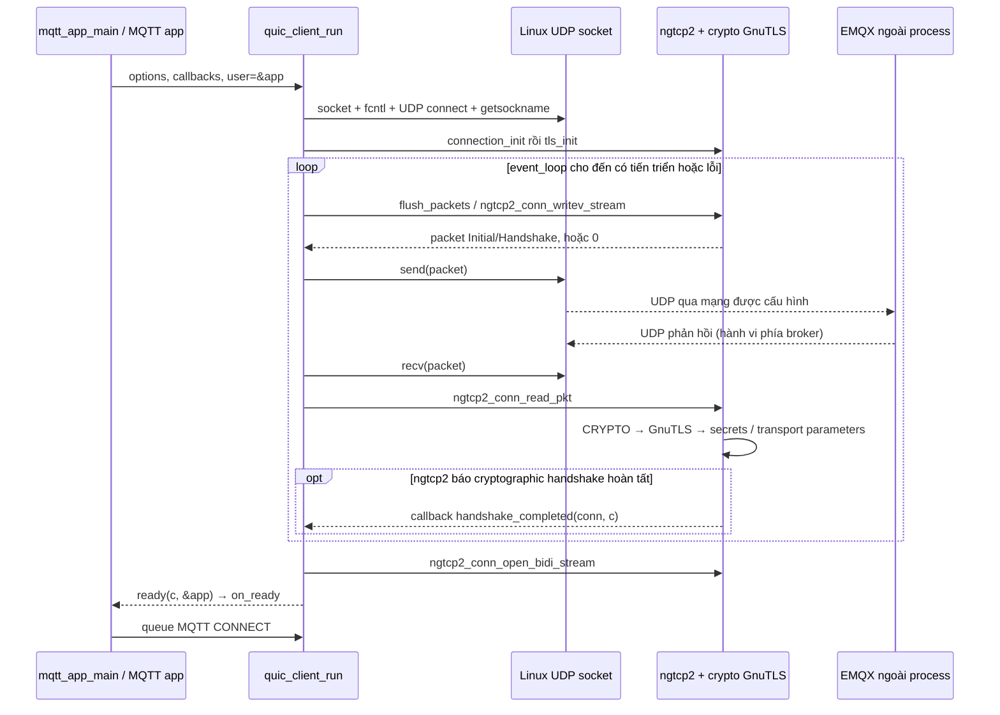
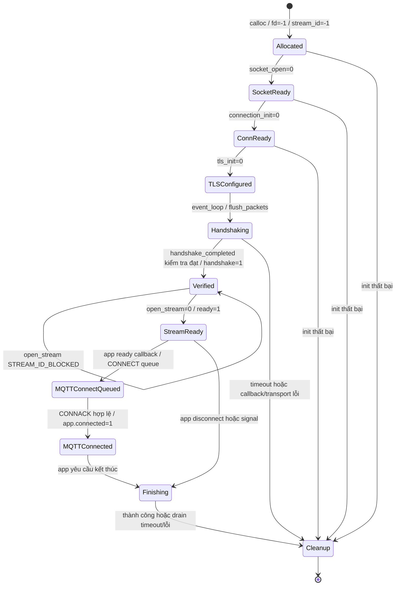

# 02 — Connection, socket và QUIC/TLS handshake

[Trở về bản đồ](00-README.md) · [Khởi động](01-STARTUP-FLOW.md) · [Gửi packet](03-PACKET-SEND-FLOW.md) · [Lỗi/timer/close](08-ERROR-TIMER-AND-CLOSE-FLOW.md)

## 1. Phạm vi chứng cứ và phiên bản

Tài liệu đọc trực tiếp source client C của project. Ký hiệu **SOURCE** là hành vi có câu lệnh thực hiện; **THƯ VIỆN** là hợp đồng/API hoặc implementation ngtcp2 được đối chiếu; **CONFIG** là cấu hình có trong repository; **CHƯA XÁC MINH** là điều không được đo trong lần phân tích này. Không chạy một handshake mới để viết tài liệu này.

- **SOURCE:** Makefile liên kết `libngtcp2`, `libngtcp2_crypto_gnutls`, `gnutls`, mặc định lấy prefix thư viện của demo cũ; hai executable được link cùng module transport. [Makefile:4–18](/home/nguyenluongduc/Github/QUIC/ZerotoHeroWithQUIC/src/PrgSocket/QUICSocket/mqtt-quic/clients/Makefile:4)
- **THƯ VIỆN:** header đã cài ghi ngtcp2 **1.25.0**, pkg-config cũng ghi **1.25.0**; GnuTLS header máy này ghi **3.8.12**. Header ngtcp2 đã cài được đối chiếu byte với header source `third_party/ngtcp2/lib/includes/ngtcp2/ngtcp2.h`. Đây là đối chiếu phiên bản/API, không phải bằng chứng build tái lập của mọi shared object. [version.h:39–49](/home/nguyenluongduc/Github/QUIC/ZerotoHeroWithQUIC/src/PrgSocket/QUICSocket/demo/src/.deps/include/ngtcp2/version.h:39) [libngtcp2.pc:23–31](/home/nguyenluongduc/Github/QUIC/ZerotoHeroWithQUIC/src/PrgSocket/QUICSocket/demo/src/.deps/lib/pkgconfig/libngtcp2.pc:23) [gnutls.h:52](/usr/include/gnutls/gnutls.h:52)
- **CONFIG:** phía server là image EMQX Enterprise **6.3.2**, publish UDP 14567; listener QUIC và certificate được cấu hình, không có server C MQTT trong các source client được phân tích. Không gán các callback ngtcp2 của client cho nội bộ EMQX. [compose.yaml:3–18](/home/nguyenluongduc/Github/QUIC/ZerotoHeroWithQUIC/src/PrgSocket/QUICSocket/mqtt-quic/docker/compose.yaml:3) [emqx.conf:12–30](/home/nguyenluongduc/Github/QUIC/ZerotoHeroWithQUIC/src/PrgSocket/QUICSocket/mqtt-quic/docker/emqx.conf:12)

## 2. Trước tiên tách bốn mức “kết nối”

| Mức | Điều vừa xảy ra | Điều chưa được phép suy ra |
|---|---|---|
| UDP `connect()` thành công | Kernel gắn peer và chọn địa chỉ local cho socket | Broker chưa nhất thiết tồn tại; chưa có TLS |
| `handshake_completed()` thành công | Callback xác minh TLS 1.3, ALPN mqtt và certificate, đặt `c->handshake=1` | Chưa chắc `c->ready=1`; MQTT chưa connected |
| `open_stream()` thành công | Có stream ID, đặt `c->ready=1`, gọi callback `ready` | Broker chưa trả CONNACK |
| `on_packet()` chấp nhận CONNACK | Đặt `app->connected=1`, gọi role `connected` | Subscriber còn cần SUBACK để nhận PUBLISH theo state machine |

Các mốc trên nằm ở bốn khối code khác nhau; không dùng cùng một từ “connected” để thay thế cả bốn. [quic_client.c:212–236](/home/nguyenluongduc/Github/QUIC/ZerotoHeroWithQUIC/src/PrgSocket/QUICSocket/mqtt-quic/clients/quic_client.c:212) [quic_client.c:122–142](/home/nguyenluongduc/Github/QUIC/ZerotoHeroWithQUIC/src/PrgSocket/QUICSocket/mqtt-quic/clients/quic_client.c:122) [quic_client.c:338–347](/home/nguyenluongduc/Github/QUIC/ZerotoHeroWithQUIC/src/PrgSocket/QUICSocket/mqtt-quic/clients/quic_client.c:338) [app.c:37–63](/home/nguyenluongduc/Github/QUIC/ZerotoHeroWithQUIC/src/PrgSocket/QUICSocket/mqtt-quic/clients/app.c:37)



Các mũi tên trong process là lời gọi đồng bộ. Mũi tên UDP là giao tiếp giữa process/máy ảo mạng, không phải lời gọi C sang broker. Số datagram, số lần lặp và thứ tự ACK/CRYPTO thực tế tùy thư viện và mạng; sơ đồ không giả định “một ClientHello tương ứng đúng một UDP packet”. Chỗ queue CONNECT chưa thực hiện `send()` ngay, lần flush tiếp theo mới tạo packet. [quic_client.c:350–393](/home/nguyenluongduc/Github/QUIC/ZerotoHeroWithQUIC/src/PrgSocket/QUICSocket/mqtt-quic/clients/quic_client.c:350) [quic_client.c:452–479](/home/nguyenluongduc/Github/QUIC/ZerotoHeroWithQUIC/src/PrgSocket/QUICSocket/mqtt-quic/clients/quic_client.c:452) [quic_client.c:482–539](/home/nguyenluongduc/Github/QUIC/ZerotoHeroWithQUIC/src/PrgSocket/QUICSocket/mqtt-quic/clients/quic_client.c:482) [app.c:37–45](/home/nguyenluongduc/Github/QUIC/ZerotoHeroWithQUIC/src/PrgSocket/QUICSocket/mqtt-quic/clients/app.c:37)

## 3. `quic_client_run()` giữ những gì và gọi gì trước?

### A. Định nghĩa, caller và thời điểm

```c
int quic_client_run(const quic_options *options,
                    const quic_callbacks *callbacks,
                    void *user);
```

Khai báo public ở header; định nghĩa ở `quic_client.c`; caller là `mqtt_app_main()` sau khi parse CLI và tạo bảng callback. Đây là lời gọi đồng bộ: `mqtt_app_main()` chưa return khi event loop đang chạy. [quic_client.h:28–30](/home/nguyenluongduc/Github/QUIC/ZerotoHeroWithQUIC/src/PrgSocket/QUICSocket/mqtt-quic/clients/quic_client.h:28) [quic_client.c:542–582](/home/nguyenluongduc/Github/QUIC/ZerotoHeroWithQUIC/src/PrgSocket/QUICSocket/mqtt-quic/clients/quic_client.c:542) [app.c:156–167](/home/nguyenluongduc/Github/QUIC/ZerotoHeroWithQUIC/src/PrgSocket/QUICSocket/mqtt-quic/clients/app.c:156)

### B. Toàn bộ tham số

| Tham số | Nguồn thực tế | Tác dụng/thay đổi | Quyền sở hữu và vòng đời |
|---|---|---|---|
| `const quic_options *options` | `&options`, local của `mqtt_app_main` sau CLI | Lưu con trỏ ở `c->options`; đọc host/port/CA/SNI/timeouts; không sửa options qua con trỏ này | App sở hữu, còn sống tới khi run return |
| `const quic_callbacks *callbacks` | `&callbacks` local của app | Lưu con trỏ ở `c->callbacks`; sau đó gọi ready/data/tick/interrupt | App sở hữu bảng; không copy bảng này ở lớp wrapper |
| `void *user` | `&app`, địa chỉ `mqtt_app` của process đang chạy | Lưu nguyên giá trị ở `c->user`; gửi lại các callback app | Không free, không coi là `quic_client*`; phía app mới chuyển thành `mqtt_app*` |

Phép gán ba con trỏ và lời gọi từ app là chứng cứ trực tiếp. Việc object local còn sống dựa trên call stack đồng bộ chưa return; không có worker thread mới được tạo tại đây. [quic_client.c:548–555](/home/nguyenluongduc/Github/QUIC/ZerotoHeroWithQUIC/src/PrgSocket/QUICSocket/mqtt-quic/clients/quic_client.c:548) [app.c:122–125](/home/nguyenluongduc/Github/QUIC/ZerotoHeroWithQUIC/src/PrgSocket/QUICSocket/mqtt-quic/clients/app.c:122) [app.c:158–166](/home/nguyenluongduc/Github/QUIC/ZerotoHeroWithQUIC/src/PrgSocket/QUICSocket/mqtt-quic/clients/app.c:158)

### C. Thao tác tuần tự

1. Từ chối thiếu options/bảng callback/host/port/CA/SNI, SNI rỗng hoặc handshake/idle timeout bằng 0. Những guard này không xác minh CA đọc được hay host đúng IPv4; các hàm sau mới làm việc đó. [quic_client.c:543–546](/home/nguyenluongduc/Github/QUIC/ZerotoHeroWithQUIC/src/PrgSocket/QUICSocket/mqtt-quic/clients/quic_client.c:543)
2. `calloc(1,sizeof(*c))` cấp một object heap và zero các trường; sau đó lưu con trỏ, đặt fd và stream ID bằng −1, ghi timestamp bắt đầu. Buffer tx 1 MiB là một trường trong object này. [quic_client.c:21–38](/home/nguyenluongduc/Github/QUIC/ZerotoHeroWithQUIC/src/PrgSocket/QUICSocket/mqtt-quic/clients/quic_client.c:21) [quic_client.c:548–555](/home/nguyenluongduc/Github/QUIC/ZerotoHeroWithQUIC/src/PrgSocket/QUICSocket/mqtt-quic/clients/quic_client.c:548)
3. `gnutls_global_init()`; nếu lỗi, free c và return −1. Cài signal handler SIGINT/SIGTERM và giữ bản cũ để khôi phục khi cleanup. Chi tiết signal ở tài liệu 08. [quic_client.c:556–566](/home/nguyenluongduc/Github/QUIC/ZerotoHeroWithQUIC/src/PrgSocket/QUICSocket/mqtt-quic/clients/quic_client.c:556)
4. Biểu thức `socket_open(c) || connection_init(c) || tls_init(c)` chạy trái sang phải, short-circuit: chỉ gọi hàm sau nếu hàm trước trả 0. Cùng một biến `rv` giữ return code của hàm đã chạy. Nếu lỗi trong ba hàm init, nhảy thẳng `done`, không đi vào event loop. [quic_client.c:567–572](/home/nguyenluongduc/Github/QUIC/ZerotoHeroWithQUIC/src/PrgSocket/QUICSocket/mqtt-quic/clients/quic_client.c:567)
5. Chỉ khi cả ba init thành công mới in endpoint, rồi `event_loop(c)`. Event loop trả lỗi mới gọi `close_error(c,rv)`; sau đó luôn cleanup các object đã có. [quic_client.c:568–582](/home/nguyenluongduc/Github/QUIC/ZerotoHeroWithQUIC/src/PrgSocket/QUICSocket/mqtt-quic/clients/quic_client.c:568)

### D. Return và bước kế tiếp

`run` chuẩn hóa thành 0 hoặc −1; app kiểm tra parser còn packet dang dở, free parser, rồi chuyển thành exit 0 hoặc 1. Đây là return khỏi lời gọi ban đầu, không phải một sự kiện chạy ở luồng khác. [quic_client.c:572–582](/home/nguyenluongduc/Github/QUIC/ZerotoHeroWithQUIC/src/PrgSocket/QUICSocket/mqtt-quic/clients/quic_client.c:572) [app.c:161–167](/home/nguyenluongduc/Github/QUIC/ZerotoHeroWithQUIC/src/PrgSocket/QUICSocket/mqtt-quic/clients/app.c:161)

## 4. Clock: `now_ns()` và `quic_client_now_ms()`

```c
static ngtcp2_tstamp now_ns(void);
uint64_t quic_client_now_ms(void);
```

Hai hàm không nhận tham số. `now_ns` lấy `CLOCK_MONOTONIC` vào `struct timespec ts` trên stack; trả `tv_sec * NGTCP2_SECONDS + tv_nsec`. Lỗi `clock_gettime` in perror rồi abort, không trả lỗi mềm. `quic_client_now_ms` chia cho `NGTCP2_MILLISECONDS`; app dùng ms, ngtcp2 dùng ns. [quic_client.c:43–52](/home/nguyenluongduc/Github/QUIC/ZerotoHeroWithQUIC/src/PrgSocket/QUICSocket/mqtt-quic/clients/quic_client.c:43)

| Đối số API bên trong | Giá trị trong project | Vì sao cần |
|---|---|---|
| `clock_gettime.clock_id` | `CLOCK_MONOTONIC` | Đo khoảng thời gian không lệ thuộc chỉnh wall clock |
| `clock_gettime.tp` | `&ts` | Kernel ghi giây/nanosecond vào biến stack |

Nguyên tắc ngtcp2 là app phải cấp timestamp, cùng clock với `settings.initial_ts`; bản thư viện không tự đi hỏi OS trong API timestamp. Vì vậy `c->started`, write/read/expiry và drain đều sử dụng cùng nguồn monotonic. Không lấy giờ lịch hiện tại để so với các giá trị ns này. [programmers-guide.rst:517–547](/home/nguyenluongduc/Github/QUIC/ZerotoHeroWithQUIC/src/PrgSocket/QUICSocket/third_party/ngtcp2/doc/source/programmers-guide.rst:517) [quic_client.c:261–262](/home/nguyenluongduc/Github/QUIC/ZerotoHeroWithQUIC/src/PrgSocket/QUICSocket/mqtt-quic/clients/quic_client.c:261) [quic_client.c:377–378](/home/nguyenluongduc/Github/QUIC/ZerotoHeroWithQUIC/src/PrgSocket/QUICSocket/mqtt-quic/clients/quic_client.c:377) [quic_client.c:463–464](/home/nguyenluongduc/Github/QUIC/ZerotoHeroWithQUIC/src/PrgSocket/QUICSocket/mqtt-quic/clients/quic_client.c:463)

## 5. `socket_open()` — UDP socket cụ thể được tạo ra sao?

### A. Signature và call site

```c
static int socket_open(quic_client *c);
```

Định nghĩa tại 212; caller trực tiếp ở 567, trước tạo ngtcp2 và TLS. Đây là setup đồng bộ, không phải callback. [quic_client.c:212–237](/home/nguyenluongduc/Github/QUIC/ZerotoHeroWithQUIC/src/PrgSocket/QUICSocket/mqtt-quic/clients/quic_client.c:212) [quic_client.c:567](/home/nguyenluongduc/Github/QUIC/ZerotoHeroWithQUIC/src/PrgSocket/QUICSocket/mqtt-quic/clients/quic_client.c:567)

### B. Tham số

`c` là địa chỉ object calloc của run. Hàm đọc `c->options`, ghi `c->remote`, `c->fd`, `c->local`; object tồn tại tới cleanup run. Chưa có quyền sở hữu riêng được chuyển cho helper. Khi lỗi sau socket, fd vẫn nằm trong c để cleanup đóng. [quic_client.c:215–234](/home/nguyenluongduc/Github/QUIC/ZerotoHeroWithQUIC/src/PrgSocket/QUICSocket/mqtt-quic/clients/quic_client.c:215) [quic_client.c:548–555](/home/nguyenluongduc/Github/QUIC/ZerotoHeroWithQUIC/src/PrgSocket/QUICSocket/mqtt-quic/clients/quic_client.c:548) [quic_client.c:577](/home/nguyenluongduc/Github/QUIC/ZerotoHeroWithQUIC/src/PrgSocket/QUICSocket/mqtt-quic/clients/quic_client.c:577)

### C. Từng lời gọi và TẤT CẢ đối số

| Lời gọi | Đối số thực tế và nguồn | Kết quả và cách xử lý |
|---|---|---|
| `strtoul(text,&end,10)` | `text=c->options->port` từ default/CLI; `&end` nhận vị trí ký tự chưa parse; cơ số 10 | `errno=0` trước gọi; từ chối errno, chuỗi rỗng, ký tự dư, port 0 hoặc >65535 |
| `inet_pton(AF_INET,text,dst)` | Họ IPv4; `text=c->options->host`; `dst=&c->remote.sin_addr` | Phải bằng 1; không resolve DNS; từ chối địa chỉ ANY |
| `htonl(INADDR_ANY)` | Hằng địa chỉ IPv4 0 | So sánh dạng network order để cấm endpoint đích 0.0.0.0 |
| `htons((uint16_t)port)` | Port đã kiểm tra 1..65535 | Ghi `sin_port` theo network order |
| `socket(AF_INET,SOCK_DGRAM,0)` | IPv4, datagram, protocol mặc định cho cặp này | fd local lưu `c->fd`; fd<0 in lỗi và return −1 |
| `fcntl(fd,F_GETFL,0)` | fd vừa tạo, lệnh lấy flags, đối số thứ ba 0 | Trả flags cũ hoặc lỗi |
| `fcntl(fd,F_SETFL,flags\|O_NONBLOCK)` | Giữ flags cũ, bật nonblocking | Không chờ vô hạn trong recv/send; lỗi return −1 |
| `connect(fd,remote,sizeof(remote))` | fd UDP; `(sockaddr*)&c->remote`; kích thước `sockaddr_in` | Thiết lập peer mặc định cho send/recv; lỗi return −1 |
| `getsockname(fd,local,&length)` | `(sockaddr*)&c->local`; `length=sizeof(c->local)` trước gọi | Kernel ghi local IP/port và độ dài vào object/output |

Các đối số và nhánh kiểm tra được thực hiện liền trong source. `length` ở đây là độ dài cấu trúc địa chỉ, không phải payload. `sin_family=AF_INET` được đặt trước. [quic_client.c:213–235](/home/nguyenluongduc/Github/QUIC/ZerotoHeroWithQUIC/src/PrgSocket/QUICSocket/mqtt-quic/clients/quic_client.c:213)

**SOURCE:** Không có lời gọi `bind()`, `listen()`, `accept()`, `recvfrom()` hoặc `sendto()` trong helper này; dữ liệu về sau đi qua `recv()`/`send()` trên socket connected. Không cần dựng một chuỗi server TCP không tồn tại trong project. [quic_client.c:212–236](/home/nguyenluongduc/Github/QUIC/ZerotoHeroWithQUIC/src/PrgSocket/QUICSocket/mqtt-quic/clients/quic_client.c:212) [quic_client.c:322–335](/home/nguyenluongduc/Github/QUIC/ZerotoHeroWithQUIC/src/PrgSocket/QUICSocket/mqtt-quic/clients/quic_client.c:322) [quic_client.c:452–464](/home/nguyenluongduc/Github/QUIC/ZerotoHeroWithQUIC/src/PrgSocket/QUICSocket/mqtt-quic/clients/quic_client.c:452)

**HÀNH VI LINUX DỰ KIẾN:** UDP connect không thực hiện TCP handshake. Kernel chọn local source IP theo routing trong network namespace hiện tại và cấp ephemeral source port khi cần; `getsockname` lấy kết quả thật. Với h1/h2 của lab, dự kiến source IP là `.11`/`.12`, nhưng source port chỉ biết sau chạy. Không gán cứng “port 4321” hoặc một MAC từ tưởng tượng. Việc source chọn đúng interface/route và NAT cụ thể cần lệnh mạng ở tài liệu 05/10 để quan sát. Source chỉ chứng minh remote, connect và getsockname được dùng. [quic_client.c:223–234](/home/nguyenluongduc/Github/QUIC/ZerotoHeroWithQUIC/src/PrgSocket/QUICSocket/mqtt-quic/clients/quic_client.c:223)

### D. Return và bước kế tiếp

Thành công trả 0, c có local/remote/fd. Run mới gọi `connection_init(c)`; nếu lỗi không tiến sang TLS. Các địa chỉ này là dữ liệu đầu vào cho QUIC path, không phải nội dung MQTT. [quic_client.c:230–236](/home/nguyenluongduc/Github/QUIC/ZerotoHeroWithQUIC/src/PrgSocket/QUICSocket/mqtt-quic/clients/quic_client.c:230) [quic_client.c:567](/home/nguyenluongduc/Github/QUIC/ZerotoHeroWithQUIC/src/PrgSocket/QUICSocket/mqtt-quic/clients/quic_client.c:567)

## 6. `path_for()` — trả cấu trúc có con trỏ thế nào?

```c
static ngtcp2_path path_for(quic_client *c);
```

Caller setup tại 277 và caller receive tại 461. Tham số c là object transport đã có địa chỉ socket; helper không đổi c. Nó trả `ngtcp2_path` theo giá trị, gồm `.local.addr=&c->local`, `.remote.addr=&c->remote`, hai addrlen tương ứng `sizeof(sockaddr_in)`, `.user_data=NULL`. [quic_client.c:90–97](/home/nguyenluongduc/Github/QUIC/ZerotoHeroWithQUIC/src/PrgSocket/QUICSocket/mqtt-quic/clients/quic_client.c:90) [quic_client.c:277–279](/home/nguyenluongduc/Github/QUIC/ZerotoHeroWithQUIC/src/PrgSocket/QUICSocket/mqtt-quic/clients/quic_client.c:277) [quic_client.c:461–464](/home/nguyenluongduc/Github/QUIC/ZerotoHeroWithQUIC/src/PrgSocket/QUICSocket/mqtt-quic/clients/quic_client.c:461)

Struct `path` cục bộ hết vòng đời khi helper return, nhưng các con trỏ bên trong trỏ vào c còn sống, không trỏ vào bản sao sockaddr trên stack helper. Khi tạo conn, implementation ngtcp2 thiết lập path từ dữ liệu này và chép địa chỉ handshake local; không yêu cầu biến path local của caller tồn tại suốt connection. [ngtcp2_conn.c:1416–1422](/home/nguyenluongduc/Github/QUIC/ZerotoHeroWithQUIC/src/PrgSocket/QUICSocket/third_party/ngtcp2/lib/ngtcp2_conn.c:1416) [quic_client.c:90–96](/home/nguyenluongduc/Github/QUIC/ZerotoHeroWithQUIC/src/PrgSocket/QUICSocket/mqtt-quic/clients/quic_client.c:90)

**Giới hạn:** wrapper gửi UDP qua fd connected, không sử dụng đường dẫn đầu ra do ngtcp2_conn_writev_stream trả để chọn một socket/address mới. Không có hàm migration do project gọi; `disable_active_migration=1` được quảng bá. Điều này không có nghĩa mọi khía cạnh path validation của QUIC bị loại khỏi thư viện. [quic_client.c:274](/home/nguyenluongduc/Github/QUIC/ZerotoHeroWithQUIC/src/PrgSocket/QUICSocket/mqtt-quic/clients/quic_client.c:274) [quic_client.c:374–390](/home/nguyenluongduc/Github/QUIC/ZerotoHeroWithQUIC/src/PrgSocket/QUICSocket/mqtt-quic/clients/quic_client.c:374) [quic_client.c:322–325](/home/nguyenluongduc/Github/QUIC/ZerotoHeroWithQUIC/src/PrgSocket/QUICSocket/mqtt-quic/clients/quic_client.c:322)

## 7. `random_cid()`, `random_bytes()` và `new_cid()`

### 7.1. Tạo hai CID ban đầu

```c
static int random_cid(ngtcp2_cid *cid, size_t length);
```

Caller connection_init gọi `random_cid(&dcid,16)` rồi `random_cid(&scid,16)`; helper cũng được callback new_cid gọi. `cid` là output struct do caller sở hữu; `length` là số byte ngẫu nhiên cần sinh. Helper tạo `bytes[NGTCP2_MAX_CIDLEN]` trên stack, kiểm tra length không vượt buffer, gọi GnuTLS random, rồi `ngtcp2_cid_init(cid,bytes,length)` để khởi tạo output. Trả 0 hoặc −1; setup dừng nếu một trong hai lỗi. [quic_client.c:99–105](/home/nguyenluongduc/Github/QUIC/ZerotoHeroWithQUIC/src/PrgSocket/QUICSocket/mqtt-quic/clients/quic_client.c:99) [quic_client.c:112–119](/home/nguyenluongduc/Github/QUIC/ZerotoHeroWithQUIC/src/PrgSocket/QUICSocket/mqtt-quic/clients/quic_client.c:112) [quic_client.c:275–279](/home/nguyenluongduc/Github/QUIC/ZerotoHeroWithQUIC/src/PrgSocket/QUICSocket/mqtt-quic/clients/quic_client.c:275)

| API | Đối số trong project | Tác dụng/lifetime |
|---|---|---|
| `gnutls_rnd(level,data,len)` | `GNUTLS_RND_RANDOM`, stack bytes, length | Ghi byte ngẫu nhiên vào output; không phải payload MQTT; declaration GnuTLS có ba đối số này |
| `ngtcp2_cid_init(cid,data,len)` | output CID, bytes vừa sinh, độ dài | Khởi tạo CID; bytes stack chỉ cần trong lời gọi |

[quic_client.c:99–104](/home/nguyenluongduc/Github/QUIC/ZerotoHeroWithQUIC/src/PrgSocket/QUICSocket/mqtt-quic/clients/quic_client.c:99) [crypto.h:190](/usr/include/gnutls/crypto.h:190)

DCID đầu tiên là đích do client chọn ngẫu nhiên trước khi biết CID server; SCID là định danh nguồn client. Cả hai 16 byte trong project, không phải MQTT client ID, không phải IP/port và không phải packet number. ngtcp2 giữ state CID riêng trong connection. Source thư viện tạo `rcid=*dcid`, đặt state client initial và next client bidirectional stream ID=0. [programmers-guide.rst:132–145](/home/nguyenluongduc/Github/QUIC/ZerotoHeroWithQUIC/src/PrgSocket/QUICSocket/third_party/ngtcp2/doc/source/programmers-guide.rst:132) [ngtcp2_conn.c:1647–1651](/home/nguyenluongduc/Github/QUIC/ZerotoHeroWithQUIC/src/PrgSocket/QUICSocket/third_party/ngtcp2/lib/ngtcp2_conn.c:1647)

### 7.2. CID thay đổi sau phản hồi đầu tiên như thế nào?

**THƯ VIỆN:** DCID random ban đầu không nhất thiết là CID mà client dùng suốt connection. Khi ngtcp2 xử lý Initial đầu tiên của server và chưa có INITIAL_PKT_PROCESSED, nhánh client cập nhật `conn->dcid.current.cid = hd.scid`. Vì vậy packet client tiếp theo có thể hướng tới CID do server chọn. Wrapper không tự sửa c->remote/IP để làm việc này; CID là state QUIC bên trong conn. [ngtcp2_conn.c:6913–6918](/home/nguyenluongduc/Github/QUIC/ZerotoHeroWithQUIC/src/PrgSocket/QUICSocket/third_party/ngtcp2/lib/ngtcp2_conn.c:6913)

Nếu có Retry, thư viện kiểm tra Retry integrity tag trước; sau đó cập nhật current DCID sang Retry SCID **trước khi** gọi recv_retry callback vì crypto helper phải derive Initial keys theo DCID mới. Đăng ký callback Retry là khả năng xử lý nếu peer gửi, không chứng minh broker luôn phát Retry. [ngtcp2_conn.c:5540–5548](/home/nguyenluongduc/Github/QUIC/ZerotoHeroWithQUIC/src/PrgSocket/QUICSocket/third_party/ngtcp2/lib/ngtcp2_conn.c:5540) [ngtcp2_conn.c:5563–5570](/home/nguyenluongduc/Github/QUIC/ZerotoHeroWithQUIC/src/PrgSocket/QUICSocket/third_party/ngtcp2/lib/ngtcp2_conn.c:5563)

### 7.3. Callback random của thư viện

```c
static void random_bytes(uint8_t *dest, size_t length,
                         const ngtcp2_rand_ctx *ctx);
```

Đăng ký `.rand=random_bytes`. ngtcp2 cấp buffer dest và số byte cần ghi; ctx là context random trong settings, project không dùng. Helper ghi vào dest bằng GnuTLS random; lỗi `abort()` vì callback có return type void. Buffer do caller thư viện sở hữu, chỉ ghi length byte, không free hoặc giữ lại. Thư viện có call site dùng callback này ngay lúc tạo connection để lấy fixed-bit randomness; không phải chỉ gọi khi có packet đến. [quic_client.c:107–110](/home/nguyenluongduc/Github/QUIC/ZerotoHeroWithQUIC/src/PrgSocket/QUICSocket/mqtt-quic/clients/quic_client.c:107) [quic_client.c:250](/home/nguyenluongduc/Github/QUIC/ZerotoHeroWithQUIC/src/PrgSocket/QUICSocket/mqtt-quic/clients/quic_client.c:250) [ngtcp2_conn.c:1582–1584](/home/nguyenluongduc/Github/QUIC/ZerotoHeroWithQUIC/src/PrgSocket/QUICSocket/third_party/ngtcp2/lib/ngtcp2_conn.c:1582)

### 7.4. Callback yêu cầu CID tiếp theo

```c
static int new_cid(ngtcp2_conn *conn, ngtcp2_cid *cid,
                   ngtcp2_stateless_reset_token *token,
                   size_t length, void *user);
```

| Tham số | Nguồn và điều kiện | Thay đổi/quyền sở hữu |
|---|---|---|
| `conn` | ngtcp2 gọi khi cần CID mới | Không dùng ở helper này; vẫn là conn hiện tại |
| `cid` | Output CID do ngtcp2 cung cấp | random_cid ghi đúng length byte vào CID |
| `token` | Output stateless-reset token do ngtcp2 cung cấp | GnuTLS ghi toàn `sizeof(token->data)` |
| `length` | Độ dài CID thư viện yêu cầu | Không hardcode 16 ở callback; dùng đúng yêu cầu |
| `user` | c từ constructor | Project chủ ý không dùng ở callback này |

Đăng ký `.get_new_connection_id2=new_cid`. API 1.25 yêu cầu CID mới chưa dùng cùng token; project sinh ngẫu nhiên, không có bảng server để demultiplex nhiều conn vì mỗi process chỉ có một conn. Ngẫu nhiên không được diễn giải thành kiểm tra trùng tường minh trong code. Return 0 hoặc `NGTCP2_ERR_CALLBACK_FAILURE`, làm ngtcp2 API đang chạy trả lỗi. [quic_client.c:112–119](/home/nguyenluongduc/Github/QUIC/ZerotoHeroWithQUIC/src/PrgSocket/QUICSocket/mqtt-quic/clients/quic_client.c:112) [quic_client.c:251](/home/nguyenluongduc/Github/QUIC/ZerotoHeroWithQUIC/src/PrgSocket/QUICSocket/mqtt-quic/clients/quic_client.c:251) [ngtcp2.h:3577–3592](/home/nguyenluongduc/Github/QUIC/ZerotoHeroWithQUIC/src/PrgSocket/QUICSocket/demo/src/.deps/include/ngtcp2/ngtcp2.h:3577)

## 8. `connection_init()` — tạo ngtcp2_conn và giữ bản sao các cấu hình

```c
static int connection_init(quic_client *c);
```

Caller run sau socket thành công, trước TLS. Tham số c là object đã có local/remote; hàm ghi `c->conn`, không mở socket thứ hai. [quic_client.c:239–281](/home/nguyenluongduc/Github/QUIC/ZerotoHeroWithQUIC/src/PrgSocket/QUICSocket/mqtt-quic/clients/quic_client.c:239) [quic_client.c:567](/home/nguyenluongduc/Github/QUIC/ZerotoHeroWithQUIC/src/PrgSocket/QUICSocket/mqtt-quic/clients/quic_client.c:567)

### 8.1. Hai bảng callback khác nhau

Bảng `ngtcp2_callbacks callbacks` trong connection_init **khác** bảng `quic_callbacks` mà app truyền vào run. Bảng đầu để ngtcp2 gọi; bảng sau do wrapper gọi. Tên local đều là callbacks nhưng khác scope/kiểu/vai trò. [quic_client.c:240–258](/home/nguyenluongduc/Github/QUIC/ZerotoHeroWithQUIC/src/PrgSocket/QUICSocket/mqtt-quic/clients/quic_client.c:240) [quic_client.h:20–26](/home/nguyenluongduc/Github/QUIC/ZerotoHeroWithQUIC/src/PrgSocket/QUICSocket/mqtt-quic/clients/quic_client.h:20) [app.c:158–161](/home/nguyenluongduc/Github/QUIC/ZerotoHeroWithQUIC/src/PrgSocket/QUICSocket/mqtt-quic/clients/app.c:158)

| Trường ngtcp2 | Hàm gắn thực tế | Sự kiện/nhiệm vụ | Context |
|---|---|---|---|
| client_initial | ngtcp2_crypto_client_initial_cb | Cài Initial secrets, khởi động TLS | conn, c |
| recv_crypto_data | ngtcp2_crypto_recv_crypto_data_cb | CRYPTO nhận → GnuTLS | conn, encryption level, offset, bytes, c |
| handshake_completed | handshake_completed | Kiểm tra TLS/ALPN/certificate | conn, c |
| encrypt/decrypt/hp_mask | Các ngtcp2_crypto_*_cb tương ứng | Packet protection / header protection | Buffer và crypto ctx do thư viện cấp |
| recv_stream_data | receive_stream | Stream bytes → callback data app | conn, stream ID/offset/flags/bytes, c |
| acked_stream_data_offset | acked_stream | ACK stream bytes/empty FIN | conn, stream ID/offset/length, c |
| recv_retry | ngtcp2_crypto_recv_retry_cb | Cài lại Initial keys theo Retry | conn, packet header, c |
| rand | random_bytes | Cấp random bytes | dest,length,rand ctx |
| get_new_connection_id2 | new_cid | CID/reset token mới | conn, output structs, length,c |
| update_key | ngtcp2_crypto_update_key_cb | Sinh khóa ứng dụng thế hệ tiếp | conn, secrets/ctx/buffers,c |
| delete_crypto_aead_ctx/delete_crypto_cipher_ctx | Hai crypto delete callbacks | Hủy crypto context thư viện sở hữu | conn,ctx,c |
| get_path_challenge_data2 | ngtcp2_crypto_get_path_challenge_data2_cb | Random PATH_CHALLENGE bytes | conn,output,c |
| version_negotiation | ngtcp2_crypto_version_negotiation_cb | Initial keys cho phiên bản đang negotiate | conn,version,client DCID,c |
| stream_close2 | stream_closed | Kiểm tra stream đóng đúng kỳ vọng | conn,flags,id,rx/tx error,c,stream user |

Danh sách đăng ký là source; mô tả nghĩa callback theo header/guide đúng 1.25. Đăng ký không chứng minh mỗi callback đã được kích hoạt trong một lần chạy cụ thể. `stream_close2` mới có từ 1.25; đây là lý do không đối chiếu API cũ tùy ý. [quic_client.c:240–258](/home/nguyenluongduc/Github/QUIC/ZerotoHeroWithQUIC/src/PrgSocket/QUICSocket/mqtt-quic/clients/quic_client.c:240) [programmers-guide.rst:40–75](/home/nguyenluongduc/Github/QUIC/ZerotoHeroWithQUIC/src/PrgSocket/QUICSocket/third_party/ngtcp2/doc/source/programmers-guide.rst:40) [ngtcp2.h:3685–3719](/home/nguyenluongduc/Github/QUIC/ZerotoHeroWithQUIC/src/PrgSocket/QUICSocket/demo/src/.deps/include/ngtcp2/ngtcp2.h:3685)

### 8.2. Settings: cấu hình cục bộ của thuật toán

`ngtcp2_settings_default(&settings)` khởi tạo trước khi override. Constructor copy settings; không giữ con trỏ tới biến stack này. Mặc định ngtcp2 1.25 dùng **CUBIC**, project không đổi `cc_algo`, nên CUBIC là lựa chọn được suy ra từ default thực tế, không phải “project tự viết congestion control”. [quic_client.c:259–265](/home/nguyenluongduc/Github/QUIC/ZerotoHeroWithQUIC/src/PrgSocket/QUICSocket/mqtt-quic/clients/quic_client.c:259) [ngtcp2.h:7110–7129](/home/nguyenluongduc/Github/QUIC/ZerotoHeroWithQUIC/src/PrgSocket/QUICSocket/demo/src/.deps/include/ngtcp2/ngtcp2.h:7110) [ngtcp2_settings.c:32–50](/home/nguyenluongduc/Github/QUIC/ZerotoHeroWithQUIC/src/PrgSocket/QUICSocket/third_party/ngtcp2/lib/ngtcp2_settings.c:32) [ngtcp2_conn.c:1434–1444](/home/nguyenluongduc/Github/QUIC/ZerotoHeroWithQUIC/src/PrgSocket/QUICSocket/third_party/ngtcp2/lib/ngtcp2_conn.c:1434)

| Field được project ghi | Giá trị | Ý nghĩa và tác động |
|---|---|---|
| initial_ts | c->started | Mốc ns từ monotonic; làm cơ sở timer |
| handshake_timeout | option 15s × NGTCP2_SECONDS | Hạn handshake ở thư viện; còn guard riêng ở event loop |
| max_tx_udp_payload_size | 1200 | Trần UDP payload do ngtcp2 tạo; packet buffer 1500 không biến thành payload 1500 |
| no_pmtud | 1 | Tắt Path MTU Discovery của connection |
| log_write | quic_log nếu verbose | Log thư viện ra stderr; không phải qlog export |

Nguồn default option 15s và 60s ở app; các CLI hiện tại không có tùy chọn đổi trực tiếp hai field QUIC này. [app.c:115–119](/home/nguyenluongduc/Github/QUIC/ZerotoHeroWithQUIC/src/PrgSocket/QUICSocket/mqtt-quic/clients/app.c:115) [app.c:126–153](/home/nguyenluongduc/Github/QUIC/ZerotoHeroWithQUIC/src/PrgSocket/QUICSocket/mqtt-quic/clients/app.c:126) [quic_client.c:259–265](/home/nguyenluongduc/Github/QUIC/ZerotoHeroWithQUIC/src/PrgSocket/QUICSocket/mqtt-quic/clients/quic_client.c:259)

### 8.3. Transport parameters: quảng bá cho peer

```c
ngtcp2_transport_params_default(&params);
```

| Field | Giá trị project | Peer được phép làm gì? |
|---|---:|---|
| initial_max_stream_data_bidi_local | 1 MiB | Giới hạn nhận ban đầu trên stream bidirectional do client mở |
| initial_max_data | 1 MiB | Giới hạn nhận ban đầu cấp connection |
| initial_max_streams_bidi | 0 | Peer không tự mở bidirectional application stream mới |
| initial_max_streams_uni | 0 | Peer không mở unidirectional stream |
| max_idle_timeout | 60s theo option | Quảng bá idle timeout, không phải runtime tối đa |
| active_connection_id_limit | 2 | Giới hạn CID active mà endpoint muốn nhận từ peer |
| disable_active_migration | 1 | Thông báo không cho peer chủ động migration theo transport parameter |

Đây là local receive limits gửi trong TLS extension; không phải tín dụng gửi của client. Khả năng client mở stream/gửi bao nhiêu byte do remote transport params và trạng thái thư viện quyết định. Vì vậy `initial_max_streams_bidi=0` không cấm chính client mở stream 0. Wrapper tăng flow-control limits khi dữ liệu đã được callback nhận xử lý. [quic_client.c:266–274](/home/nguyenluongduc/Github/QUIC/ZerotoHeroWithQUIC/src/PrgSocket/QUICSocket/mqtt-quic/clients/quic_client.c:266) [quic_client.c:159–162](/home/nguyenluongduc/Github/QUIC/ZerotoHeroWithQUIC/src/PrgSocket/QUICSocket/mqtt-quic/clients/quic_client.c:159) [ngtcp2.h:4162–4186](/home/nguyenluongduc/Github/QUIC/ZerotoHeroWithQUIC/src/PrgSocket/QUICSocket/demo/src/.deps/include/ngtcp2/ngtcp2.h:4162)

### 8.4. Constructor: mọi đối số của lời gọi thực tế

```c
int rv = ngtcp2_conn_client_new(
    &c->conn, &dcid, &scid, &path, NGTCP2_PROTO_VER_V1,
    &callbacks, &settings, &params, NULL, c);
```

| Đối số | Kiểu/vai trò và nguồn | Sở hữu/lifetime |
|---|---|---|
| `&c->conn` | `ngtcp2_conn**`, nơi nhận object cấp phát | run phải ngtcp2_conn_del khi xong |
| `&dcid` | const CID đầu đích, random16 | Input stack; thư viện chép state |
| `&scid` | const CID nguồn, random16 | Input stack; thư viện lưu bản CID |
| `&path` | cặp địa chỉ local/remote từ path_for | Địa chỉ trỏ vào c; constructor thiết lập path riêng |
| `NGTCP2_PROTO_VER_V1` | uint32 version client chọn | QUIC v1, không phải MQTT version |
| `&callbacks` | bảng ngtcp2 callback local | Constructor copy bảng; khác wrapper callbacks chỉ được giữ con trỏ |
| `&settings` | cấu hình sau default/override | Constructor copy |
| `&params` | local transport parameters | Constructor copy và gửi khi handshake |
| `NULL` | `const ngtcp2_mem*` | Dùng allocator mặc định của ngtcp2 |
| `c` | `void* user_data` | Borrow object wrapper; ngtcp2 trả lại các callback; c sống lâu hơn conn |

Hợp đồng API và implementation xác nhận copy callbacks/settings/params và lưu user_data. Tên public là macro chọn struct-version, thực tế gọi `ngtcp2_conn_client_new_versioned`, không phải hai lần tạo connection. [quic_client.c:275–281](/home/nguyenluongduc/Github/QUIC/ZerotoHeroWithQUIC/src/PrgSocket/QUICSocket/mqtt-quic/clients/quic_client.c:275) [ngtcp2.h:4162–4203](/home/nguyenluongduc/Github/QUIC/ZerotoHeroWithQUIC/src/PrgSocket/QUICSocket/demo/src/.deps/include/ngtcp2/ngtcp2.h:4162) [ngtcp2.h:7390–7400](/home/nguyenluongduc/Github/QUIC/ZerotoHeroWithQUIC/src/PrgSocket/QUICSocket/demo/src/.deps/include/ngtcp2/ngtcp2.h:7390) [ngtcp2_conn.c:1391](/home/nguyenluongduc/Github/QUIC/ZerotoHeroWithQUIC/src/PrgSocket/QUICSocket/third_party/ngtcp2/lib/ngtcp2_conn.c:1391) [ngtcp2_conn.c:1460](/home/nguyenluongduc/Github/QUIC/ZerotoHeroWithQUIC/src/PrgSocket/QUICSocket/third_party/ngtcp2/lib/ngtcp2_conn.c:1460) [ngtcp2_conn.c:1580–1592](/home/nguyenluongduc/Github/QUIC/ZerotoHeroWithQUIC/src/PrgSocket/QUICSocket/third_party/ngtcp2/lib/ngtcp2_conn.c:1580)

Return 0: c->conn đã hợp lệ, chuyển tls_init. Return khác0: in ngtcp2_strerror rồi quay về cleanup run. Library constructor có nhánh tự hủy và đặt output NULL nếu commit transport parameters thất bại. [quic_client.c:278–281](/home/nguyenluongduc/Github/QUIC/ZerotoHeroWithQUIC/src/PrgSocket/QUICSocket/mqtt-quic/clients/quic_client.c:278) [ngtcp2_conn.c:1632–1661](/home/nguyenluongduc/Github/QUIC/ZerotoHeroWithQUIC/src/PrgSocket/QUICSocket/third_party/ngtcp2/lib/ngtcp2_conn.c:1632)

## 9. `tls_init()` — GnuTLS và ngtcp2 liên kết hai chiều

```c
static int tls_init(quic_client *c);
```

Caller run sau khi c->conn đã tồn tại. c là input/output object; hàm tạo credentials và tls, không tạo TLS-over-TCP connection. Cấu hình TLS1.3 nằm ở `TLS_PRIORITY`; thư viện crypto được cấu hình cho QUIC, không dùng gnutls_record_send để gửi MQTT. [quic_client.c:22](/home/nguyenluongduc/Github/QUIC/ZerotoHeroWithQUIC/src/PrgSocket/QUICSocket/mqtt-quic/clients/quic_client.c:22) [quic_client.c:284–319](/home/nguyenluongduc/Github/QUIC/ZerotoHeroWithQUIC/src/PrgSocket/QUICSocket/mqtt-quic/clients/quic_client.c:284) [quic_client.c:567](/home/nguyenluongduc/Github/QUIC/ZerotoHeroWithQUIC/src/PrgSocket/QUICSocket/mqtt-quic/clients/quic_client.c:567)

### 9.1. Toàn bộ giá trị truyền vào các API setup

| API và đối số | Nguồn/ý nghĩa cụ thể | Output, nhánh lỗi và lifetime |
|---|---|---|
| `gnutls_certificate_allocate_credentials(&c->credentials)` | Địa chỉ field credentials ban đầu NULL | Ghi handle; rv<0 tới failed; cleanup run free nếu có |
| `gnutls_certificate_set_x509_trust_file(c->credentials,c->options->ca_file,GNUTLS_X509_FMT_PEM)` | Credentials vừa tạo, đường dẫn CA từ CLI/default, định dạng PEM | Code yêu cầu rv>0; <=0 in lỗi/không có cert rồi return−1 |
| `gnutls_init(&c->tls,GNUTLS_CLIENT\|GNUTLS_NO_END_OF_EARLY_DATA)` | Output handle và cờ client phục vụ QUIC backend | rv<0 failed; cờ này không tự bật 0-RTT; project không cài session resumption/early-data params |
| `ngtcp2_crypto_gnutls_configure_client_session(c->tls)` | Session vừa tạo | Cài hook QUIC; nonzero lỗi |
| `gnutls_priority_set_direct(c->tls,TLS_PRIORITY,NULL)` | Chuỗi NORMAL chỉ TLS1.3, tắt TLS1.3 compatibility mode; không lấy vị trí lỗi | rv<0 failed |
| `gnutls_credentials_set(c->tls,GNUTLS_CRD_CERTIFICATE,c->credentials)` | Nối session với certificate credentials | rv<0 failed; credentials được giữ tới khi tls đã hủy |
| `gnutls_server_name_set(c->tls,GNUTLS_NAME_DNS,c->options->server_name,strlen(...))` | Loại DNS, bytes `broker.test` mặc định, độ dài không gồm NUL | Cài SNI; không đổi remote.sin_addr, không resolve broker.test |
| `gnutls_session_set_verify_cert(c->tls,c->options->server_name,0)` | Cùng danh tính broker, flags0 | Yêu cầu verification trong handshake; API trả void |
| `gnutls_alpn_set_protocols(c->tls,&alpn,1,GNUTLS_ALPN_MANDATORY)` | alpn datum chỉ 4 bytes mqtt, một protocol, bắt buộc chọn | rv<0 failed; không HTTP/3 |
| `gnutls_session_set_ptr(c->tls,&c->conn_ref)` | Địa chỉ conn_ref sống trong c | Backend GnuTLS có thể tìm lại conn qua callback get_conn |
| `ngtcp2_conn_set_tls_native_handle(c->conn,c->tls)` | Conn ngtcp2 giữ opaque TLS handle | Crypto helper tìm session theo conn; không chuyển nghĩa thành tự hủy TLS thay app |

Các API được gọi theo đúng thứ tự trong code. GnuTLS header kiểm tra chữ ký verify/session pointers và hooks; source ngtcp2 crypto kiểm tra phần bridge. Các chi tiết kiểm tra chain certificate nội bộ GnuTLS 3.8.12 không được tái dựng từ tên hàm; tại đây chứng minh project bật verification và kiểm tra status, chưa audit toàn bộ GnuTLS. [quic_client.c:284–319](/home/nguyenluongduc/Github/QUIC/ZerotoHeroWithQUIC/src/PrgSocket/QUICSocket/mqtt-quic/clients/quic_client.c:284) [gnutls.h:1908–1915](/usr/include/gnutls/gnutls.h:1908) [gnutls.h:2441](/usr/include/gnutls/gnutls.h:2441) [ngtcp2.h:6420–6428](/home/nguyenluongduc/Github/QUIC/ZerotoHeroWithQUIC/src/PrgSocket/QUICSocket/demo/src/.deps/include/ngtcp2/ngtcp2.h:6420)

### 9.2. `get_conn()` và conn_ref — vì sao cần hai con trỏ user khác nhau?

```c
static ngtcp2_conn *get_conn(ngtcp2_crypto_conn_ref *ref) {
    return ((quic_client *)ref->user_data)->conn;
}
```

Tham số ref là địa chỉ `c->conn_ref`, được crypto backend lấy từ `gnutls_session_get_ptr(session)`. `ref->user_data` đã gắn c; helper không cấp phát/không thay đổi state, chỉ trả c->conn còn sống. Hàm được gọi qua con trỏ `conn_ref.get_conn`, không phải app trực tiếp gọi mỗi lần nhận MQTT. [quic_client.c:86–88](/home/nguyenluongduc/Github/QUIC/ZerotoHeroWithQUIC/src/PrgSocket/QUICSocket/mqtt-quic/clients/quic_client.c:86) [quic_client.c:312–315](/home/nguyenluongduc/Github/QUIC/ZerotoHeroWithQUIC/src/PrgSocket/QUICSocket/mqtt-quic/clients/quic_client.c:312) [gnutls.c:598–605](/home/nguyenluongduc/Github/QUIC/ZerotoHeroWithQUIC/src/PrgSocket/QUICSocket/third_party/ngtcp2/crypto/gnutls/gnutls.c:598)

```text
gnutls_session
  └── app pointer → &c->conn_ref
                      ├── get_conn → hàm get_conn
                      └── user_data → c
                                         └── conn → ngtcp2_conn
```

Chiều ngược lại: ngtcp2_conn native TLS handle → c->tls. Không nhầm `conn_ref.user_data=c` với `c->user=&app`. Contract yêu cầu app set ref/get_conn được ghi ngay trong header crypto GnuTLS. [ngtcp2_crypto_gnutls.h:84–102](/home/nguyenluongduc/Github/QUIC/ZerotoHeroWithQUIC/src/PrgSocket/QUICSocket/demo/src/.deps/include/ngtcp2/ngtcp2_crypto_gnutls.h:84) [ngtcp2_crypto.h:1041–1065](/home/nguyenluongduc/Github/QUIC/ZerotoHeroWithQUIC/src/PrgSocket/QUICSocket/demo/src/.deps/include/ngtcp2/ngtcp2_crypto.h:1041) [quic_client.c:550–552](/home/nguyenluongduc/Github/QUIC/ZerotoHeroWithQUIC/src/PrgSocket/QUICSocket/mqtt-quic/clients/quic_client.c:550)

### 9.3. Hook mà thư viện crypto cài, không phải code MQTT tự viết

Backend `ngtcp2_crypto_gnutls_configure_client_session()` gọi cấu hình chung: secret/read/alert hooks và TLS extension QUIC Transport Parameters. [gnutls.c:694–718](/home/nguyenluongduc/Github/QUIC/ZerotoHeroWithQUIC/src/PrgSocket/QUICSocket/third_party/ngtcp2/crypto/gnutls/gnutls.c:694)

| Hook thư viện | Mọi tham số và nguồn | Thao tác/kết quả |
|---|---|---|
| `secret_func(session,gtls_level,rx_secret,tx_secret,secretlen)` | GnuTLS cấp session và encryption level; secret rx/tx có thể NULL; số byte secret; buffer do TLS quản lý trong callback | Lấy ref→conn; đổi encryption level; derive/install RX hoặc TX keys nếu secret có; return0 hoặc−1 |
| `read_func(session,gtls_level,htype,data,datalen)` | GnuTLS cung cấp handshake message **đang gửi**, loại message, level và bytes | Bỏ ChangeCipherSpec; submit CRYPTO data cho ngtcp2; lỗi ghi TLS error; tên read_func không có nghĩa đọc UDP socket |
| `alert_read_func(session,gtls_level,alert_level,alert_desc)` | GnuTLS cung cấp thông tin alert | Lấy conn rồi ghi TLS alert vào ngtcp2; level fields không dùng |
| `tp_recv_func(session,data,datalen)` | TLS extension bytes nhận từ peer | Decode/set remote transport params vào conn; nếu lỗi set TLS error |
| `tp_send_func(session,extdata)` | TLS cho extension output buffer | Encode local params vào stack buf256 rồi append vào TLS extension; return0 hoặc−1 |

Chữ ký và lời gọi nội bộ được đọc trực tiếp; input buffers là mượn trong callback, output keys/params được thư viện tiếp nhận qua API tương ứng. Không đặt breakpoint tìm các hàm này trong app.c vì chúng thuộc thư viện. [gnutls.c:598–691](/home/nguyenluongduc/Github/QUIC/ZerotoHeroWithQUIC/src/PrgSocket/QUICSocket/third_party/ngtcp2/crypto/gnutls/gnutls.c:598) [gnutls.h:3189–3234](/usr/include/gnutls/gnutls.h:3189)

## 10. ClientHello được tạo khi nào nếu code không gọi `gnutls_handshake()`?

Lần đầu event loop gọi flush_packets, `id=-1` khi chưa ready, datav không có MQTT mới. Nhưng `ngtcp2_conn_writev_stream()` cũng thực hiện handshake theo hợp đồng API. ngtcp2 gọi client_initial callback khi ghi client Initial. [quic_client.c:350–378](/home/nguyenluongduc/Github/QUIC/ZerotoHeroWithQUIC/src/PrgSocket/QUICSocket/mqtt-quic/clients/quic_client.c:350) [ngtcp2.h:5201–5211](/home/nguyenluongduc/Github/QUIC/ZerotoHeroWithQUIC/src/PrgSocket/QUICSocket/demo/src/.deps/include/ngtcp2/ngtcp2.h:5201) [ngtcp2_conn.c:3067–3075](/home/nguyenluongduc/Github/QUIC/ZerotoHeroWithQUIC/src/PrgSocket/QUICSocket/third_party/ngtcp2/lib/ngtcp2_conn.c:3067) [ngtcp2_conn.c:566–576](/home/nguyenluongduc/Github/QUIC/ZerotoHeroWithQUIC/src/PrgSocket/QUICSocket/third_party/ngtcp2/lib/ngtcp2_conn.c:566)

Crypto callback này lấy DCID và TLS handle từ conn, derive/install Initial keys, set local transport params, rồi gọi `ngtcp2_crypto_read_write_crypto_data(conn, INITIAL, NULL, 0)`. GnuTLS implementation gọi `gnutls_handshake(session)` khi handshake chưa hoàn thành. Vì vậy không thấy gnutls_handshake trong code app không có nghĩa TLS không chạy. [shared.c:1695–1715](/home/nguyenluongduc/Github/QUIC/ZerotoHeroWithQUIC/src/PrgSocket/QUICSocket/third_party/ngtcp2/crypto/shared.c:1695) [gnutls.c:508–539](/home/nguyenluongduc/Github/QUIC/ZerotoHeroWithQUIC/src/PrgSocket/QUICSocket/third_party/ngtcp2/crypto/gnutls/gnutls.c:508)

Khi broker gửi CRYPTO, ngtcp2 invokes recv_crypto_data callback. Wrapper crypto chuyển `encryption_level,data,datalen` vào backend; backend `gnutls_handshake_write()` cung cấp handshake input cho GnuTLS, tiếp tục gnutls_handshake khi cần. GnuTLS gọi hook read_func để xuất handshake bytes quay lại ngtcp2, hook secret_func cài traffic keys, hooks transport params trao đổi giới hạn. [shared.c:1776–1785](/home/nguyenluongduc/Github/QUIC/ZerotoHeroWithQUIC/src/PrgSocket/QUICSocket/third_party/ngtcp2/crypto/shared.c:1776) [gnutls.c:508–539](/home/nguyenluongduc/Github/QUIC/ZerotoHeroWithQUIC/src/PrgSocket/QUICSocket/third_party/ngtcp2/crypto/gnutls/gnutls.c:508) [gnutls.c:598–705](/home/nguyenluongduc/Github/QUIC/ZerotoHeroWithQUIC/src/PrgSocket/QUICSocket/third_party/ngtcp2/crypto/gnutls/gnutls.c:598)

### Tham số của hai crypto callback handshake

```c
int ngtcp2_crypto_client_initial_cb(ngtcp2_conn *conn, void *user_data);
int ngtcp2_crypto_recv_crypto_data_cb(
    ngtcp2_conn *conn, ngtcp2_encryption_level encryption_level,
    uint64_t offset, const uint8_t *data, size_t datalen, void *user_data);
```

| Tham số | Nguồn thực tế | Đọc/ghi/lifetime |
|---|---|---|
| conn | c->conn do ngtcp2 đang xử lý | Mutable connection; callback không free |
| user_data | c từ constructor | Hai helper này không dùng trực tiếp; session tìm qua conn |
| encryption_level | Level của CRYPTO frame do ngtcp2 cung cấp | Chọn Initial/Handshake/Application TLS input đúng cấp |
| offset | CRYPTO stream offset ngtcp2 cung cấp | Wrapper shared.c không dùng vì ngtcp2 đã sắp dữ liệu cho callback |
| data | Byte TLS handshake nhận, không phải MQTT | Mượn trong callback; feed GnuTLS, không free |
| datalen | Số byte crypto input | 0 ở lần client_initial kick-start; >0 khi input thực tế có bytes |

Nếu TLS trả nonfatal “cần thêm input”, backend trả0 để loop tiếp tục; fatal thì gửi alert phù hợp vào cơ chế TLS/ngtcp2 rồi trả−1, shared callback đổi sang mã lỗi ngtcp2. TLS handshake hoàn tất báo `ngtcp2_conn_tls_handshake_completed(conn)`. [shared.c:1695–1715](/home/nguyenluongduc/Github/QUIC/ZerotoHeroWithQUIC/src/PrgSocket/QUICSocket/third_party/ngtcp2/crypto/shared.c:1695) [shared.c:1776–1785](/home/nguyenluongduc/Github/QUIC/ZerotoHeroWithQUIC/src/PrgSocket/QUICSocket/third_party/ngtcp2/crypto/shared.c:1776) [gnutls.c:514–539](/home/nguyenluongduc/Github/QUIC/ZerotoHeroWithQUIC/src/PrgSocket/QUICSocket/third_party/ngtcp2/crypto/gnutls/gnutls.c:514)

### Packet protection và các callback crypto còn lại

Những chữ ký sau được đăng ký nguyên vẹn từ thư viện; project không tự cài AEAD/HKDF. Tất cả pointer input là mượn từ ngtcp2 và output là buffer/ctx mà ngtcp2 chuẩn bị. [quic_client.c:244–256](/home/nguyenluongduc/Github/QUIC/ZerotoHeroWithQUIC/src/PrgSocket/QUICSocket/mqtt-quic/clients/quic_client.c:244) [shared.c:845–900](/home/nguyenluongduc/Github/QUIC/ZerotoHeroWithQUIC/src/PrgSocket/QUICSocket/third_party/ngtcp2/crypto/shared.c:845)

```c
int ngtcp2_crypto_encrypt_cb(uint8_t *dest, const ngtcp2_crypto_aead *aead,
    const ngtcp2_crypto_aead_ctx *aead_ctx, const uint8_t *plaintext,
    size_t plaintextlen, const uint8_t *nonce, size_t noncelen,
    const uint8_t *aad, size_t aadlen);
int ngtcp2_crypto_decrypt_cb(uint8_t *dest, const ngtcp2_crypto_aead *aead,
    const ngtcp2_crypto_aead_ctx *aead_ctx, const uint8_t *ciphertext,
    size_t ciphertextlen, const uint8_t *nonce, size_t noncelen,
    const uint8_t *aad, size_t aadlen);
int ngtcp2_crypto_hp_mask_cb(uint8_t *dest, const ngtcp2_crypto_cipher *hp,
    const ngtcp2_crypto_cipher_ctx *hp_ctx, const uint8_t *sample);
```

- `dest`: output mã hóa/giải mã/mask; `aead`/`hp`: thuật toán thư viện chọn; `aead_ctx`/`hp_ctx`: context khóa đã cài; không phải credentials certificate.
- `plaintext/plaintextlen` hoặc `ciphertext/ciphertextlen`: phần packet cần bảo vệ/xác minh; `nonce/noncelen`: nonce thư viện chuẩn bị; `aad/aadlen`: associated data/header cần xác thực.
- `sample`: sample ciphertext dùng tạo header-protection mask; số byte được quy định bởi crypto API, không do app.message cung cấp.
- Encrypt/hp lỗi → `NGTCP2_ERR_CALLBACK_FAILURE`; decrypt lỗi → `NGTCP2_ERR_DECRYPT` để lớp QUIC xử lý packet không hợp lệ. Không nói mọi decrypt-failure đều làm app đóng ngay, vì quyết định tiếp theo nằm trong ngtcp2. [shared.c:845–875](/home/nguyenluongduc/Github/QUIC/ZerotoHeroWithQUIC/src/PrgSocket/QUICSocket/third_party/ngtcp2/crypto/shared.c:845)

```c
int ngtcp2_crypto_update_key_cb(ngtcp2_conn *conn,
    uint8_t *rx_secret, uint8_t *tx_secret,
    ngtcp2_crypto_aead_ctx *rx_aead_ctx, uint8_t *rx_iv,
    ngtcp2_crypto_aead_ctx *tx_aead_ctx, uint8_t *tx_iv,
    const uint8_t *current_rx_secret, const uint8_t *current_tx_secret,
    size_t secretlen, void *user_data);
```

`conn` chọn connection; current_rx/current_tx_secret là input secret thế hệ hiện tại; secretlen là độ dài; rx/tx_secret, rx/tx_aead_ctx, rx/tx_iv là output thế hệ mới. `user_data=c` không dùng trực tiếp. Helper có rx_key/tx_key stack rồi xóa an toàn trước return. Đăng ký update_key không chứng minh lab ngắn đã kích hoạt key update. [shared.c:878–900](/home/nguyenluongduc/Github/QUIC/ZerotoHeroWithQUIC/src/PrgSocket/QUICSocket/third_party/ngtcp2/crypto/shared.c:878)

Hai delete callback có signature `(ngtcp2_conn *conn, ngtcp2_crypto_aead_ctx *aead_ctx, void *user_data)` và `(ngtcp2_conn *conn, ngtcp2_crypto_cipher_ctx *cipher_ctx, void *user_data)`: conn/c không dùng, ctx là output crypto trước đó nay thư viện yêu cầu giải phóng. Helper gọi crypto context free; không free c->tls/c->credentials thay project. [shared.c:1759–1774](/home/nguyenluongduc/Github/QUIC/ZerotoHeroWithQUIC/src/PrgSocket/QUICSocket/third_party/ngtcp2/crypto/shared.c:1759)

Retry callback `(conn,const ngtcp2_pkt_hd *hd,user_data)` cài lại Initial keys dựa `hd->scid`; version-negotiation callback `(conn,uint32_t version,const ngtcp2_cid *client_dcid,user_data)` derive keys cho version đó. Không có logic app khởi động connection mới để hỗ trợ mọi phiên bản bất tương thích. PATH_CHALLENGE callback `(conn,ngtcp2_path_challenge_data *data,user_data)` điền output random theo API; registration không chứng minh có migration. [shared.c:1718–1728](/home/nguyenluongduc/Github/QUIC/ZerotoHeroWithQUIC/src/PrgSocket/QUICSocket/third_party/ngtcp2/crypto/shared.c:1718) [shared.c:1745–1757](/home/nguyenluongduc/Github/QUIC/ZerotoHeroWithQUIC/src/PrgSocket/QUICSocket/third_party/ngtcp2/crypto/shared.c:1745) [ngtcp2_crypto.h:1008–1033](/home/nguyenluongduc/Github/QUIC/ZerotoHeroWithQUIC/src/PrgSocket/QUICSocket/demo/src/.deps/include/ngtcp2/ngtcp2_crypto.h:1008)

## 11. `handshake_completed()` — lúc nào được coi là an toàn để gửi MQTT?

```c
static int handshake_completed(ngtcp2_conn *conn, void *user);
```

Đăng ký ở connection_init, do ngtcp2 gọi khi cryptographic handshake hoàn tất. Implementation thư viện gọi `conn->callbacks.handshake_completed(conn,conn->user_data)` và đổi return khác0 thành callback failure. [quic_client.c:243](/home/nguyenluongduc/Github/QUIC/ZerotoHeroWithQUIC/src/PrgSocket/QUICSocket/mqtt-quic/clients/quic_client.c:243) [ngtcp2.h:2741–2748](/home/nguyenluongduc/Github/QUIC/ZerotoHeroWithQUIC/src/PrgSocket/QUICSocket/demo/src/.deps/include/ngtcp2/ngtcp2.h:2741) [ngtcp2_conn.c:118–130](/home/nguyenluongduc/Github/QUIC/ZerotoHeroWithQUIC/src/PrgSocket/QUICSocket/third_party/ngtcp2/lib/ngtcp2_conn.c:118)

| Tham số | Nguồn | Cách dùng/ownership |
|---|---|---|
| conn | c->conn hiện đang hoàn tất handshake | Project không dùng trực tiếp ở hàm này; không free |
| user | c từ constructor | Chuyển về quic_client*, đọc tls/options và ghi handshake |

Các thao tác theo thứ tự:

1. Lấy phiên bản TLS: phải bằng TLS1.3.
2. `gnutls_alpn_get_selected_protocol(c->tls,&alpn)`: nhận datum mượn từ session; yêu cầu size4 và memcmp bằng mqtt.
3. `gnutls_certificate_verify_peers3(c->tls,c->options->server_name,&status)`: cùng danh tính broker.test, status output khởi tạo0. rv<0 là lỗi API; status khác0 là kết quả verification không đạt; đều trả callback failure.
4. Chỉ sau cả ba kiểm tra mới đặt `c->handshake=1`, in log verified, return0. [quic_client.c:122–142](/home/nguyenluongduc/Github/QUIC/ZerotoHeroWithQUIC/src/PrgSocket/QUICSocket/mqtt-quic/clients/quic_client.c:122)

Danh tính broker.test được kiểm tra riêng với host IP endpoint. App không sửa `/etc/hosts` để resolver broker.test; host phải IPv4 số theo socket_open. CONNECT chưa được gửi trong callback handshake_completed; nó chỉ mở điều kiện cho open_stream. [quic_client.c:218–220](/home/nguyenluongduc/Github/QUIC/ZerotoHeroWithQUIC/src/PrgSocket/QUICSocket/mqtt-quic/clients/quic_client.c:218) [quic_client.c:305–315](/home/nguyenluongduc/Github/QUIC/ZerotoHeroWithQUIC/src/PrgSocket/QUICSocket/mqtt-quic/clients/quic_client.c:305) [quic_client.c:338–347](/home/nguyenluongduc/Github/QUIC/ZerotoHeroWithQUIC/src/PrgSocket/QUICSocket/mqtt-quic/clients/quic_client.c:338)

**THƯ VIỆN:** handshake completion và handshake confirmation là các mốc khác nhau. Guide nói mỗi phía tuyên bố completion độc lập, phía client có handshake_confirmed event sau đó. Project chỉ đăng ký handshake_completed, không đăng ký handshake_confirmed; không tự thêm bước chờ callback không tồn tại. [programmers-guide.rst:335–346](/home/nguyenluongduc/Github/QUIC/ZerotoHeroWithQUIC/src/PrgSocket/QUICSocket/third_party/ngtcp2/doc/source/programmers-guide.rst:335) [quic_client.c:240–258](/home/nguyenluongduc/Github/QUIC/ZerotoHeroWithQUIC/src/PrgSocket/QUICSocket/mqtt-quic/clients/quic_client.c:240)

## 12. `open_stream()` — bridge QUIC ready sang MQTT CONNECT

```c
static int open_stream(quic_client *c);
```

Caller trực tiếp event_loop tại505 và read_packets tại476. Hàm đầu tiên return0 nếu chưa handshake hoặc đã ready; vì thế gọi nhiều lần không mở nhiều application stream. [quic_client.c:338–347](/home/nguyenluongduc/Github/QUIC/ZerotoHeroWithQUIC/src/PrgSocket/QUICSocket/mqtt-quic/clients/quic_client.c:338) [quic_client.c:475–477](/home/nguyenluongduc/Github/QUIC/ZerotoHeroWithQUIC/src/PrgSocket/QUICSocket/mqtt-quic/clients/quic_client.c:475) [quic_client.c:505–506](/home/nguyenluongduc/Github/QUIC/ZerotoHeroWithQUIC/src/PrgSocket/QUICSocket/mqtt-quic/clients/quic_client.c:505)

| Đối số của API | Nguồn/ý nghĩa | Output/lifetime |
|---|---|---|
| `c->conn` | Connection đã handshake | Thư viện ghi state stream |
| `&c->stream_id` | Output int64 nằm trong c | Nhận ID, client bidi đầu tiên là0 theo constructor |
| `NULL` | stream_user_data không dùng | receive/acked/close callbacks nhận NULL cho context stream này |

API `ngtcp2_conn_open_bidi_stream(conn,pstream_id,stream_user_data)` trả0 nếu mở được, `NGTCP2_ERR_STREAM_ID_BLOCKED` nếu peer chưa cấp tín dụng mở stream. Wrapper coi blocked là chờ tiếp, không lỗi; lỗi khác truyền lên. Khi thành công đặt ready1 trước khi gọi callback ready để app có thể queue bytes. [quic_client.c:339–346](/home/nguyenluongduc/Github/QUIC/ZerotoHeroWithQUIC/src/PrgSocket/QUICSocket/mqtt-quic/clients/quic_client.c:339) [ngtcp2.h:5006–5029](/home/nguyenluongduc/Github/QUIC/ZerotoHeroWithQUIC/src/PrgSocket/QUICSocket/demo/src/.deps/include/ngtcp2/ngtcp2.h:5006) [ngtcp2_conn.c:1648–1650](/home/nguyenluongduc/Github/QUIC/ZerotoHeroWithQUIC/src/PrgSocket/QUICSocket/third_party/ngtcp2/lib/ngtcp2_conn.c:1648)

Lời gọi tiếp:

```c
c->callbacks->ready(c, c->user)
```

Ở đây c->callbacks là **quic_callbacks của app**, nên gọi on_ready(client=c,user=&app). on_ready ghi app->quic=c, encode MQTT CONNECT keepalive20, queue qua mqtt_app_send/quic_client_send, đặt connect_sent1 và deadline now_ms+15000. Nonzero từ ready đổi thành ngtcp2 callback failure để event loop dừng. [quic_client.c:343–347](/home/nguyenluongduc/Github/QUIC/ZerotoHeroWithQUIC/src/PrgSocket/QUICSocket/mqtt-quic/clients/quic_client.c:343) [app.c:37–46](/home/nguyenluongduc/Github/QUIC/ZerotoHeroWithQUIC/src/PrgSocket/QUICSocket/mqtt-quic/clients/app.c:37) [app.c:158–161](/home/nguyenluongduc/Github/QUIC/ZerotoHeroWithQUIC/src/PrgSocket/QUICSocket/mqtt-quic/clients/app.c:158)

Đặc biệt read_packets gọi open_stream ngay sau mỗi ngtcp2_conn_read_pkt thành công, trước xử lý datagram tiếp theo. Đó là vị trí code chủ ý bảo đảm ready có thể được thiết lập sau datagram handshake rồi mới nhận application data ở datagram sau. Nó không thay ranh giới datagram thành ranh giới MQTT packet. [quic_client.c:463–477](/home/nguyenluongduc/Github/QUIC/ZerotoHeroWithQUIC/src/PrgSocket/QUICSocket/mqtt-quic/clients/quic_client.c:463)

## 13. State diagram đọc đúng các field của wrapper



Đây là mô hình giải thích từ các boolean thực tế, không phải một enum trạng thái được project khai báo. Các field `handshake`, `ready`, `finishing` thuộc c; `connect_sent`, `connected`, `stopping` thuộc app. Không gộp state MQTT với state TLS ngầm trong GnuTLS. [quic_client.c:24–38](/home/nguyenluongduc/Github/QUIC/ZerotoHeroWithQUIC/src/PrgSocket/QUICSocket/mqtt-quic/clients/quic_client.c:24) [quic_client.c:78–83](/home/nguyenluongduc/Github/QUIC/ZerotoHeroWithQUIC/src/PrgSocket/QUICSocket/mqtt-quic/clients/quic_client.c:78) [app.c:37–63](/home/nguyenluongduc/Github/QUIC/ZerotoHeroWithQUIC/src/PrgSocket/QUICSocket/mqtt-quic/clients/app.c:37) [app.c:24–34](/home/nguyenluongduc/Github/QUIC/ZerotoHeroWithQUIC/src/PrgSocket/QUICSocket/mqtt-quic/clients/app.c:24)

## 14. Những điểm được xác minh và điểm dừng phân tích phía broker

**Đã xác minh source:** client có một UDP fd/QUIC conn, hai CID random16 ban đầu, ngtcp2 callback table, cấu hình TLS1.3/ALPN mqtt/CA/SNI, verification trước ready, một stream client bidi và CONNECT qua queue. Cả publisher và subscriber dùng đường này trong process riêng. [quic_client.c:24–38](/home/nguyenluongduc/Github/QUIC/ZerotoHeroWithQUIC/src/PrgSocket/QUICSocket/mqtt-quic/clients/quic_client.c:24) [quic_client.c:239–315](/home/nguyenluongduc/Github/QUIC/ZerotoHeroWithQUIC/src/PrgSocket/QUICSocket/mqtt-quic/clients/quic_client.c:239) [quic_client.c:338–347](/home/nguyenluongduc/Github/QUIC/ZerotoHeroWithQUIC/src/PrgSocket/QUICSocket/mqtt-quic/clients/quic_client.c:338) [app.c:158–161](/home/nguyenluongduc/Github/QUIC/ZerotoHeroWithQUIC/src/PrgSocket/QUICSocket/mqtt-quic/clients/app.c:158)

**Đã cấu hình, chưa kiểm tra runtime mới:** EMQX listener UDP14567, certificate mount, verify_none phía server không yêu cầu client certificate. Điều này không hủy kiểm tra certificate của client. Chưa quan sát flight handshake, negotiated cipher, CIDs cụ thể, source port hoặc extension trên packet capture ở lần nghiên cứu này. [compose.yaml:11–18](/home/nguyenluongduc/Github/QUIC/ZerotoHeroWithQUIC/src/PrgSocket/QUICSocket/mqtt-quic/docker/compose.yaml:11) [emqx.conf:17–30](/home/nguyenluongduc/Github/QUIC/ZerotoHeroWithQUIC/src/PrgSocket/QUICSocket/mqtt-quic/docker/emqx.conf:17) [quic_client.c:309–310](/home/nguyenluongduc/Github/QUIC/ZerotoHeroWithQUIC/src/PrgSocket/QUICSocket/mqtt-quic/clients/quic_client.c:309)

**Không có trong project:** ngtcp2 server C MQTT, broker connection lookup implementation, bridge mã hóa client↔client, HTTP/3, 0-RTT session-cache/resumption, logic chủ động migration. Những gì xảy ra trong EMQX phải được đánh dấu broker behavior/config hoặc kiểm tra riêng, không đặt tên hàm EMQX giả. [quic_client.h:28–30](/home/nguyenluongduc/Github/QUIC/ZerotoHeroWithQUIC/src/PrgSocket/QUICSocket/mqtt-quic/clients/quic_client.h:28) [quic_client.c:240–274](/home/nguyenluongduc/Github/QUIC/ZerotoHeroWithQUIC/src/PrgSocket/QUICSocket/mqtt-quic/clients/quic_client.c:240) [emqx.conf:12–30](/home/nguyenluongduc/Github/QUIC/ZerotoHeroWithQUIC/src/PrgSocket/QUICSocket/mqtt-quic/docker/emqx.conf:12)

**Cần kiểm tra khi debug:** breakpoint socket_open:232/233 để xem local/remote, constructor:278 để xem dcid/scid/settings, tls_init:309 để xem CA/SNI, handshake_completed:127/133/139 để phân biệt TLS/ALPN/verify, open_stream:340/343 để xem tín dụng và stream ID. Không in private keys hoặc traffic secrets để học control flow. [quic_client.c:232–233](/home/nguyenluongduc/Github/QUIC/ZerotoHeroWithQUIC/src/PrgSocket/QUICSocket/mqtt-quic/clients/quic_client.c:232) [quic_client.c:278–279](/home/nguyenluongduc/Github/QUIC/ZerotoHeroWithQUIC/src/PrgSocket/QUICSocket/mqtt-quic/clients/quic_client.c:278) [quic_client.c:305–315](/home/nguyenluongduc/Github/QUIC/ZerotoHeroWithQUIC/src/PrgSocket/QUICSocket/mqtt-quic/clients/quic_client.c:305) [quic_client.c:127–139](/home/nguyenluongduc/Github/QUIC/ZerotoHeroWithQUIC/src/PrgSocket/QUICSocket/mqtt-quic/clients/quic_client.c:127) [quic_client.c:340–345](/home/nguyenluongduc/Github/QUIC/ZerotoHeroWithQUIC/src/PrgSocket/QUICSocket/mqtt-quic/clients/quic_client.c:340)

Đọc tiếp [03 — Gửi packet](03-PACKET-SEND-FLOW.md) để theo byte MQTT vào ring buffer/ngtcp2/UDP; đọc [08 — Timer, ACK và close](08-ERROR-TIMER-AND-CLOSE-FLOW.md) để theo vòng lặp sau handshake.
