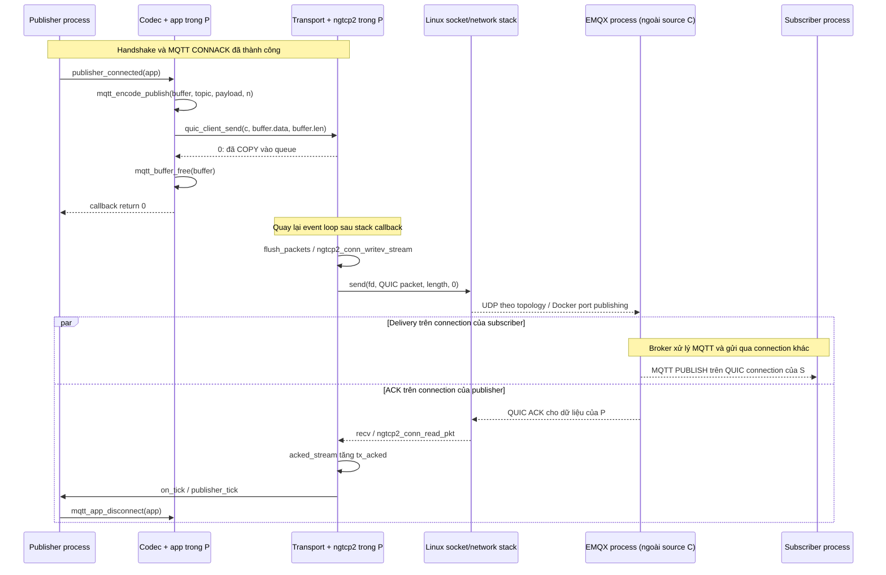

# 03 — Luồng gửi: từ chuỗi message tới UDP datagram

[Đọc bản đồ](00-README.md) · [Trước: connection/handshake](02-CONNECTION-AND-HANDSHAKE.md) · [Tiếp: receive](04-PACKET-RECEIVE-FLOW.md)

## 1. Phạm vi và mức bằng chứng

**[SOURCE]** Luồng chính được truy vết là executable publisher gửi `Temperature = 28.5 C` lên topic `lab/temperature` sau CONNACK; hai giá trị là default trong app và có thể bị CLI ghi đè. Publisher không gọi server echo C của demo cũ. [app.c:122–124](/home/nguyenluongduc/Github/QUIC/ZerotoHeroWithQUIC/src/PrgSocket/QUICSocket/mqtt-quic/clients/app.c:122) [app.c:145–147](/home/nguyenluongduc/Github/QUIC/ZerotoHeroWithQUIC/src/PrgSocket/QUICSocket/mqtt-quic/clients/app.c:145) [publisher.c:11–19](/home/nguyenluongduc/Github/QUIC/ZerotoHeroWithQUIC/src/PrgSocket/QUICSocket/mqtt-quic/clients/publisher.c:11)

**[SOURCE]** Các byte MQTT được chép vào queue transport, sau đó event loop dùng ngtcp2 tạo QUIC packet và `send()` gửi qua socket UDP. Không có `send()` raw MQTT trực tiếp từ publisher. [app.c:13–21](/home/nguyenluongduc/Github/QUIC/ZerotoHeroWithQUIC/src/PrgSocket/QUICSocket/mqtt-quic/clients/app.c:13) [quic_client.c:63–75](/home/nguyenluongduc/Github/QUIC/ZerotoHeroWithQUIC/src/PrgSocket/QUICSocket/mqtt-quic/clients/quic_client.c:63) [quic_client.c:350–393](/home/nguyenluongduc/Github/QUIC/ZerotoHeroWithQUIC/src/PrgSocket/QUICSocket/mqtt-quic/clients/quic_client.c:350) [quic_client.c:322–335](/home/nguyenluongduc/Github/QUIC/ZerotoHeroWithQUIC/src/PrgSocket/QUICSocket/mqtt-quic/clients/quic_client.c:322)

**[SOURCE — THƯ VIỆN]** Quyền giữ buffer, ý nghĩa `pdatalen`, callback ACK và API write được đối chiếu với installed header ngtcp2 **1.25.0**, không suy ra từ tài liệu latest. Makefile cho phép dependency `>=1.25.0`, nên nếu đổi prefix cần kiểm tra lại header/runtime thay vì giả sử luôn đúng phiên bản này. [version.h:39–49](/home/nguyenluongduc/Github/QUIC/ZerotoHeroWithQUIC/src/PrgSocket/QUICSocket/demo/src/.deps/include/ngtcp2/version.h:39) [Makefile:4–18](/home/nguyenluongduc/Github/QUIC/ZerotoHeroWithQUIC/src/PrgSocket/QUICSocket/mqtt-quic/clients/Makefile:4) [ngtcp2.h:5201–5355](/home/nguyenluongduc/Github/QUIC/ZerotoHeroWithQUIC/src/PrgSocket/QUICSocket/demo/src/.deps/include/ngtcp2/ngtcp2.h:5201)

**[UNVERIFIED]** Tài liệu là phân tích source; không tạo publication hay packet capture mới. Giá trị cổng nguồn, CID bytes, packet number và kích thước từng UDP datagram không được hardcode thành số giả. Chúng phát sinh khi socket/ngtcp2 chạy. [quic_client.c:212–236](/home/nguyenluongduc/Github/QUIC/ZerotoHeroWithQUIC/src/PrgSocket/QUICSocket/mqtt-quic/clients/quic_client.c:212) [quic_client.c:275–279](/home/nguyenluongduc/Github/QUIC/ZerotoHeroWithQUIC/src/PrgSocket/QUICSocket/mqtt-quic/clients/quic_client.c:275) [quic_client.c:377–390](/home/nguyenluongduc/Github/QUIC/ZerotoHeroWithQUIC/src/PrgSocket/QUICSocket/mqtt-quic/clients/quic_client.c:377)

## 2. Ranh giới process và các thứ tự được code bảo đảm



Mũi tên trong cùng process là lời gọi đồng bộ; hai mũi tên qua mạng không phải lời gọi C trực tiếp. Source chứng minh callback CONNACK gọi role, callback publisher queue byte và event loop flush; chi tiết dispatch nội bộ EMQX không có trong project này. [app.c:49–63](/home/nguyenluongduc/Github/QUIC/ZerotoHeroWithQUIC/src/PrgSocket/QUICSocket/mqtt-quic/clients/app.c:49) [publisher.c:11–19](/home/nguyenluongduc/Github/QUIC/ZerotoHeroWithQUIC/src/PrgSocket/QUICSocket/mqtt-quic/clients/publisher.c:11) [quic_client.c:507–510](/home/nguyenluongduc/Github/QUIC/ZerotoHeroWithQUIC/src/PrgSocket/QUICSocket/mqtt-quic/clients/quic_client.c:507) [quic_client.c:174–187](/home/nguyenluongduc/Github/QUIC/ZerotoHeroWithQUIC/src/PrgSocket/QUICSocket/mqtt-quic/clients/quic_client.c:174)

Khối `par` thể hiện hai tiến trình giao thức có thể xen kẽ: source không bảo đảm subscriber nhận PUBLISH trước hoặc sau thời điểm publisher nhận QUIC ACK. ACK xác nhận stream bytes ở transport phía broker; delivery trên connection subscriber là nhánh khác. Đây không phải khẳng định client tự tạo thread cho hai việc đó. Vì vậy test cần kiểm cả log subscriber và trạng thái publisher, không lấy thứ tự mũi tên trên giấy làm bằng chứng thời gian. [publisher.c:29–39](/home/nguyenluongduc/Github/QUIC/ZerotoHeroWithQUIC/src/PrgSocket/QUICSocket/mqtt-quic/clients/publisher.c:29), [integration.py:121–136](/home/nguyenluongduc/Github/QUIC/ZerotoHeroWithQUIC/src/PrgSocket/QUICSocket/mqtt-quic/tests/integration.py:121).

Không gọi `ngtcp2_conn_writev_stream()` ngay bên trong callback nhận. API ngtcp2 cấm gọi writev từ callback, và project tránh việc đó bằng cách callback chỉ COPY/queue, rồi outer event loop mới flush. Đây là một lý do kiến trúc quan trọng của `mqtt_app_send()`/`quic_client_send()`. [ngtcp2.h:5318–5323](/home/nguyenluongduc/Github/QUIC/ZerotoHeroWithQUIC/src/PrgSocket/QUICSocket/demo/src/.deps/include/ngtcp2/ngtcp2.h:5318) [quic_client.c:63–75](/home/nguyenluongduc/Github/QUIC/ZerotoHeroWithQUIC/src/PrgSocket/QUICSocket/mqtt-quic/clients/quic_client.c:63) [quic_client.c:507–510](/home/nguyenluongduc/Github/QUIC/ZerotoHeroWithQUIC/src/PrgSocket/QUICSocket/mqtt-quic/clients/quic_client.c:507)

## 3. `publisher_connected`: nguồn message và lần gọi đầu của nhánh gửi

### A. Hàm, caller, điều kiện

```c
static int publisher_connected(mqtt_app *app)
```

Định nghĩa là static trong translation unit publisher; địa chỉ được gắn vào `role.connected` khi `main()` chuẩn bị role. Không có public prototype riêng. App gọi qua `app->role->connected(app)` chỉ sau khi decode CONNACK thành công, session_present bằng 0 và return_code bằng 0. [publisher.c:11–19](/home/nguyenluongduc/Github/QUIC/ZerotoHeroWithQUIC/src/PrgSocket/QUICSocket/mqtt-quic/clients/publisher.c:11) [publisher.c:42–48](/home/nguyenluongduc/Github/QUIC/ZerotoHeroWithQUIC/src/PrgSocket/QUICSocket/mqtt-quic/clients/publisher.c:42) [app.c:49–61](/home/nguyenluongduc/Github/QUIC/ZerotoHeroWithQUIC/src/PrgSocket/QUICSocket/mqtt-quic/clients/app.c:49)

### B. Toàn bộ tham số

| Tham số | Giá trị thực và nguồn | Vì sao cần / thay đổi | Ownership và vòng đời |
|---|---|---|---|
| `mqtt_app *app` | Địa chỉ `mqtt_app app` ở stack `mqtt_app_main`, chuyển qua transport user và parser arg | Lấy `topic`, `message`, `role_data`, `quic`; gián tiếp cập nhật `last_tx`; con trỏ cục bộ không đổi | Borrowed; không free app; hợp lệ vì `quic_client_run` chưa return |

Nguồn con trỏ và lifetime: [app.c:122–125](/home/nguyenluongduc/Github/QUIC/ZerotoHeroWithQUIC/src/PrgSocket/QUICSocket/mqtt-quic/clients/app.c:122) [app.c:158–166](/home/nguyenluongduc/Github/QUIC/ZerotoHeroWithQUIC/src/PrgSocket/QUICSocket/mqtt-quic/clients/app.c:158) [quic_client.c:548–552](/home/nguyenluongduc/Github/QUIC/ZerotoHeroWithQUIC/src/PrgSocket/QUICSocket/mqtt-quic/clients/quic_client.c:548) [publisher.c:12–17](/home/nguyenluongduc/Github/QUIC/ZerotoHeroWithQUIC/src/PrgSocket/QUICSocket/mqtt-quic/clients/publisher.c:12)

### C. Từng thao tác

1. `publisher *pub = app->role_data` phục hồi địa chỉ `pub` được tạo ở `publisher.main`; không cấp phát publisher mới. [publisher.c:12–13](/home/nguyenluongduc/Github/QUIC/ZerotoHeroWithQUIC/src/PrgSocket/QUICSocket/mqtt-quic/clients/publisher.c:12) [publisher.c:43–48](/home/nguyenluongduc/Github/QUIC/ZerotoHeroWithQUIC/src/PrgSocket/QUICSocket/mqtt-quic/clients/publisher.c:43)
2. `mqtt_buffer buffer = {0}` tạo owner tạm với `data=NULL`, `len=0`; nhờ vậy cleanup vẫn an toàn nếu encoder từ chối trước malloc. [publisher.c:13–16](/home/nguyenluongduc/Github/QUIC/ZerotoHeroWithQUIC/src/PrgSocket/QUICSocket/mqtt-quic/clients/publisher.c:13) [mqtt_codec.c:28–35](/home/nguyenluongduc/Github/QUIC/ZerotoHeroWithQUIC/src/PrgSocket/QUICSocket/mqtt-quic/clients/mqtt_codec.c:28)
3. `strlen(app->message)` tính số byte đến NUL đầu tiên, không bao gồm NUL; CLI nhận message như chuỗi C nên nhánh executable này không phát payload chứa NUL giữa chuỗi. Codec cấp thấp vẫn nhận payload nhị phân kèm độ dài. [publisher.c:14–15](/home/nguyenluongduc/Github/QUIC/ZerotoHeroWithQUIC/src/PrgSocket/QUICSocket/mqtt-quic/clients/publisher.c:14) [mqtt_codec.h:28](/home/nguyenluongduc/Github/QUIC/ZerotoHeroWithQUIC/src/PrgSocket/QUICSocket/mqtt-quic/clients/mqtt_codec.h:28)
4. Cast `(const uint8_t *)app->message` diễn giải cùng vùng nhớ như byte read-only, không copy hoặc mã hóa tại phép cast. [publisher.c:14–15](/home/nguyenluongduc/Github/QUIC/ZerotoHeroWithQUIC/src/PrgSocket/QUICSocket/mqtt-quic/clients/publisher.c:14)
5. Encoder chuẩn bị wire bytes; `mqtt_app_send` queue một bản sao và free buffer encode. [publisher.c:14–16](/home/nguyenluongduc/Github/QUIC/ZerotoHeroWithQUIC/src/PrgSocket/QUICSocket/mqtt-quic/clients/publisher.c:14) [app.c:13–20](/home/nguyenluongduc/Github/QUIC/ZerotoHeroWithQUIC/src/PrgSocket/QUICSocket/mqtt-quic/clients/app.c:13)
6. Chỉ sau queue thành công, đặt `publish_deadline = now_ms + 15000`; log “sent” ở đây có nghĩa đã encode/queue, chưa tự chứng minh send syscall hoặc delivery. [publisher.c:16–18](/home/nguyenluongduc/Github/QUIC/ZerotoHeroWithQUIC/src/PrgSocket/QUICSocket/mqtt-quic/clients/publisher.c:16)

### D. Return và bước tiếp theo

`-1` từ encode/queue làm connected callback, `on_packet`, feed, on_data rồi receive_stream cùng báo lỗi theo chuỗi trả về. `0` quay lại callback nhận, ngtcp2 read và outer event loop; message được flush ở đó. `pub->publish_deadline` là trạng thái duy nhất của role publisher. [publisher.c:16–19](/home/nguyenluongduc/Github/QUIC/ZerotoHeroWithQUIC/src/PrgSocket/QUICSocket/mqtt-quic/clients/publisher.c:16) [app.c:61–73](/home/nguyenluongduc/Github/QUIC/ZerotoHeroWithQUIC/src/PrgSocket/QUICSocket/mqtt-quic/clients/app.c:61) [mqtt_codec.c:85](/home/nguyenluongduc/Github/QUIC/ZerotoHeroWithQUIC/src/PrgSocket/QUICSocket/mqtt-quic/clients/mqtt_codec.c:85) [quic_client.c:156–157](/home/nguyenluongduc/Github/QUIC/ZerotoHeroWithQUIC/src/PrgSocket/QUICSocket/mqtt-quic/clients/quic_client.c:156) [quic_client.c:507–510](/home/nguyenluongduc/Github/QUIC/ZerotoHeroWithQUIC/src/PrgSocket/QUICSocket/mqtt-quic/clients/quic_client.c:507)

## 4. `mqtt_encode_publish`: layout chính xác của MQTT PUBLISH

### A. Hàm và call site

```c
int mqtt_encode_publish(mqtt_buffer *b, const char *topic,
                        const uint8_t *payload, size_t n)
```

Public declaration dùng tên độ dài `len`, definition dùng `n`; chúng là cùng vị trí tham số. Caller nghiệp vụ là publisher_connected, caller kiểm thử tạo nhiều độ dài/boundary. [mqtt_codec.h:28](/home/nguyenluongduc/Github/QUIC/ZerotoHeroWithQUIC/src/PrgSocket/QUICSocket/mqtt-quic/clients/mqtt_codec.h:28) [mqtt_codec.c:49–53](/home/nguyenluongduc/Github/QUIC/ZerotoHeroWithQUIC/src/PrgSocket/QUICSocket/mqtt-quic/clients/mqtt_codec.c:49) [publisher.c:14–15](/home/nguyenluongduc/Github/QUIC/ZerotoHeroWithQUIC/src/PrgSocket/QUICSocket/mqtt-quic/clients/publisher.c:14) [test_codec.c:38–62](/home/nguyenluongduc/Github/QUIC/ZerotoHeroWithQUIC/src/PrgSocket/QUICSocket/mqtt-quic/tests/test_codec.c:38)

### B. Tham số và nguồn

| Tham số | Giá trị trong luồng mẫu | Sử dụng / thay đổi | Ownership |
|---|---|---|---|
| `b` | `&buffer` cục bộ publisher | Ghi `b->data`, `b->len` qua allocate | Caller sở hữu buffer encode; mqtt_app_send free sau copy |
| `topic` | `app->topic`, default hoặc argv override | `strlen`, valid_topic, memcpy; không sửa chuỗi | Borrowed C string NUL-terminated |
| `payload` | Cùng địa chỉ `app->message` sau cast | Copy đúng `n` byte; không sửa nguồn | Borrowed input; không giữ sau encoder |
| `n` | `strlen(app->message)` = 20 cho message mẫu | Kiểm giới hạn và tính Remaining Length | Truyền bằng giá trị; không sửa caller |

Nguồn dữ liệu và cách dùng: [app.c:123](/home/nguyenluongduc/Github/QUIC/ZerotoHeroWithQUIC/src/PrgSocket/QUICSocket/mqtt-quic/clients/app.c:123) [app.c:145–147](/home/nguyenluongduc/Github/QUIC/ZerotoHeroWithQUIC/src/PrgSocket/QUICSocket/mqtt-quic/clients/app.c:145) [publisher.c:14–15](/home/nguyenluongduc/Github/QUIC/ZerotoHeroWithQUIC/src/PrgSocket/QUICSocket/mqtt-quic/clients/publisher.c:14) [mqtt_codec.c:49–53](/home/nguyenluongduc/Github/QUIC/ZerotoHeroWithQUIC/src/PrgSocket/QUICSocket/mqtt-quic/clients/mqtt_codec.c:49)

### C. Điều kiện và layout

`nt = strlen(topic)`, rồi kiểm topic hợp lệ, payload không vượt lab bound, và không chấp nhận `payload=NULL` khi `n>0`. Nếu payload rỗng, NULL được phép ở codec này. `allocate(b, 0x30, 2+nt+n, &p)` tạo packet với PUBLISH QoS 0, DUP=0, RETAIN=0. [mqtt_codec.c:49–53](/home/nguyenluongduc/Github/QUIC/ZerotoHeroWithQUIC/src/PrgSocket/QUICSocket/mqtt-quic/clients/mqtt_codec.c:49)

Body được ghi như sau:

```text
p + 0          p + 2                    p + 2 + nt
  │              │                         │
  ▼              ▼                         ▼
[topic_len:2B][topic: nt byte][payload: n byte]
```

`put16(p, nt)` ghi độ dài topic; `memcpy(p+2, topic, nt)` không ghi terminator NUL; payload cũng không kèm NUL của chuỗi CLI. [mqtt_codec.c:5](/home/nguyenluongduc/Github/QUIC/ZerotoHeroWithQUIC/src/PrgSocket/QUICSocket/mqtt-quic/clients/mqtt_codec.c:5) [mqtt_codec.c:53](/home/nguyenluongduc/Github/QUIC/ZerotoHeroWithQUIC/src/PrgSocket/QUICSocket/mqtt-quic/clients/mqtt_codec.c:53)

### D. Return

`0` nghĩa packet đã ở heap `b->data`, không có network I/O trong encoder. `-1` có thể từ validation, size guard hoặc malloc; publisher vẫn gọi mqtt_app_send với `encoding_result` để cleanup thống nhất. [mqtt_codec.c:30–35](/home/nguyenluongduc/Github/QUIC/ZerotoHeroWithQUIC/src/PrgSocket/QUICSocket/mqtt-quic/clients/mqtt_codec.c:30) [mqtt_codec.c:49–53](/home/nguyenluongduc/Github/QUIC/ZerotoHeroWithQUIC/src/PrgSocket/QUICSocket/mqtt-quic/clients/mqtt_codec.c:49) [publisher.c:14–16](/home/nguyenluongduc/Github/QUIC/ZerotoHeroWithQUIC/src/PrgSocket/QUICSocket/mqtt-quic/clients/publisher.c:14)

## 5. Các helper được encoder gọi thật

### 5.1. `valid_topic`

```c
static int valid_topic(const uint8_t *p, size_t n)
```

Định nghĩa/caller: encode SUBSCRIBE/PUBLISH và decode PUBLISH; không có global prototype. [mqtt_codec.c:25–26](/home/nguyenluongduc/Github/QUIC/ZerotoHeroWithQUIC/src/PrgSocket/QUICSocket/mqtt-quic/clients/mqtt_codec.c:25) [mqtt_codec.c:46–51](/home/nguyenluongduc/Github/QUIC/ZerotoHeroWithQUIC/src/PrgSocket/QUICSocket/mqtt-quic/clients/mqtt_codec.c:46) [mqtt_codec.c:110](/home/nguyenluongduc/Github/QUIC/ZerotoHeroWithQUIC/src/PrgSocket/QUICSocket/mqtt-quic/clients/mqtt_codec.c:110)

| Tham số | Nguồn | Tác dụng và lifetime |
|---|---|---|
| `p` | Chuỗi topic cast sang bytes hoặc body+2 phía decode | Borrowed read-only; đọc n byte, không sở hữu/free |
| `n` | strlen(topic) khi encode; get16(body) khi decode | Kích thước đã biết; không tự tìm NUL trong decoder |

`return n && n<=UINT16_MAX && valid_utf8(p,n) && !memchr(p,'+',n) && !memchr(p,'#',n)` có short circuit: topic rỗng/quá dài bị loại trước helper sau. Code lab không hỗ trợ wildcard subscription dù MQTT nói chung có wildcard filter. `memchr` tìm byte trong đúng n byte, kết quả khác NULL làm topic bị từ chối. Return 1 hợp lệ, 0 không hợp lệ; encoder đổi false thành -1. [mqtt_codec.c:25–26](/home/nguyenluongduc/Github/QUIC/ZerotoHeroWithQUIC/src/PrgSocket/QUICSocket/mqtt-quic/clients/mqtt_codec.c:25) [mqtt_codec.c:46–51](/home/nguyenluongduc/Github/QUIC/ZerotoHeroWithQUIC/src/PrgSocket/QUICSocket/mqtt-quic/clients/mqtt_codec.c:46)

### 5.2. `valid_utf8`

```c
static int valid_utf8(const uint8_t *p, size_t n)
```

Caller encode_connect và valid_topic. Hai input đều borrowed; p không đổi nội dung, n truyền giá trị; local index i tiến qua bytes. [mqtt_codec.c:8–23](/home/nguyenluongduc/Github/QUIC/ZerotoHeroWithQUIC/src/PrgSocket/QUICSocket/mqtt-quic/clients/mqtt_codec.c:8) [mqtt_codec.c:26](/home/nguyenluongduc/Github/QUIC/ZerotoHeroWithQUIC/src/PrgSocket/QUICSocket/mqtt-quic/clients/mqtt_codec.c:26) [mqtt_codec.c:40](/home/nguyenluongduc/Github/QUIC/ZerotoHeroWithQUIC/src/PrgSocket/QUICSocket/mqtt-quic/clients/mqtt_codec.c:40)

| Tham số | Nguồn runtime | Vai trò |
|---|---|---|
| `p` | Client ID hoặc topic | Byte UTF-8 cần kiểm, không phải payload tùy ý |
| `n` | strlen hoặc độ dài topic từ wire | Giới hạn đọc, không đọc quá n |

Diễn tiến: byte ASCII đi thẳng thành code point; lead byte c2–df/e0–ef/f0–f4 chọn 1/2/3 continuation và mức min; lead không hợp lệ từ 0x80 trở lên trả 0. Kiểm còn đủ continuation; mỗi continuation phải có hai bit cao `10`. Ghép cp bằng shift 6/OR, rồi loại NUL, overlong, surrogate, quá U+10FFFF và các noncharacter mà code liệt kê. Đây là policy validation đang viết trong lab. Return 1 sau khi duyệt hết; false được caller dùng để reject. [mqtt_codec.c:9–23](/home/nguyenluongduc/Github/QUIC/ZerotoHeroWithQUIC/src/PrgSocket/QUICSocket/mqtt-quic/clients/mqtt_codec.c:9)

Payload không đi qua valid_utf8, vì MQTT payload có thể là binary; chương trình CLI chỉ giới hạn đầu vào bởi cách dùng strlen. [mqtt_codec.c:49–53](/home/nguyenluongduc/Github/QUIC/ZerotoHeroWithQUIC/src/PrgSocket/QUICSocket/mqtt-quic/clients/mqtt_codec.c:49) [publisher.c:14–15](/home/nguyenluongduc/Github/QUIC/ZerotoHeroWithQUIC/src/PrgSocket/QUICSocket/mqtt-quic/clients/publisher.c:14)

### 5.3. `allocate`

```c
static int allocate(mqtt_buffer *b, uint8_t header,
                    size_t remaining, uint8_t **body)
```

Caller là năm encoder CONNECT/SUBSCRIBE/PUBLISH/PINGREQ/DISCONNECT; mỗi caller tạo b zero trước khi encode ở app/role. [mqtt_codec.c:30–56](/home/nguyenluongduc/Github/QUIC/ZerotoHeroWithQUIC/src/PrgSocket/QUICSocket/mqtt-quic/clients/mqtt_codec.c:30) [app.c:27–29](/home/nguyenluongduc/Github/QUIC/ZerotoHeroWithQUIC/src/PrgSocket/QUICSocket/mqtt-quic/clients/app.c:27) [app.c:40–42](/home/nguyenluongduc/Github/QUIC/ZerotoHeroWithQUIC/src/PrgSocket/QUICSocket/mqtt-quic/clients/app.c:40) [subscriber.c:22–26](/home/nguyenluongduc/Github/QUIC/ZerotoHeroWithQUIC/src/PrgSocket/QUICSocket/mqtt-quic/clients/subscriber.c:22)

| Tham số | Giá trị PUBLISH mẫu | Thay đổi / ownership |
|---|---|---|
| `b` | Địa chỉ mqtt_buffer của publisher | Ghi owner pointer và tổng len; caller free heap sau copy |
| `header` | `0x30` | Byte fixed-header đầu tiên, chỉ đọc |
| `remaining` | `2+15+20=37` | Số byte body, không tính fixed header |
| `body` | `&p` local encoder | Output pointer tới phần body trong cùng allocation; không có allocation body riêng |

`encoded[4]` là scratch stack; Remaining Length được tách base128 bằng `%128`, `/128`, bit 0x80 báo còn byte. Guard từ chối >268435455 hoặc >MQTT_MAX_PACKET_SIZE-5; giới hạn thứ hai bảo thủ vì reserve tối đa 5 byte header. Sau `malloc(1+nh+remaining)`, ghi header và encoded RL; `*body` chỉ là view vào phần sau fixed header. Hàm không giải phóng nội dung b cũ trước khi ghi: caller hiện dùng b zero, không tái sử dụng b chứa allocation chưa free. [mqtt_codec.c:30–36](/home/nguyenluongduc/Github/QUIC/ZerotoHeroWithQUIC/src/PrgSocket/QUICSocket/mqtt-quic/clients/mqtt_codec.c:30)

Return -1 trước ghi body khi size/malloc thất bại; return 0 bảo đảm b.data và *body trỏ vào allocation mới. Khi `remaining=0`, vòng do/while vẫn encode một byte RL `00`. [mqtt_codec.c:31–36](/home/nguyenluongduc/Github/QUIC/ZerotoHeroWithQUIC/src/PrgSocket/QUICSocket/mqtt-quic/clients/mqtt_codec.c:31)

### 5.4. `put16`

```c
static void put16(uint8_t *p, uint16_t n)
```

Caller encode_connect tại offsets 8/10, encode_subscribe tại offsets 0/2 và encode_publish offset 0. Tham số p là output vùng body đã malloc; n là keepalive, packet ID hoặc độ dài chuỗi đã qua range validation. [mqtt_codec.c:5](/home/nguyenluongduc/Github/QUIC/ZerotoHeroWithQUIC/src/PrgSocket/QUICSocket/mqtt-quic/clients/mqtt_codec.c:5) [mqtt_codec.c:42–53](/home/nguyenluongduc/Github/QUIC/ZerotoHeroWithQUIC/src/PrgSocket/QUICSocket/mqtt-quic/clients/mqtt_codec.c:42)

Hàm ghi `p[0]=(uint8_t)(n>>8)`, `p[1]=(uint8_t)n`: big-endian hai byte cố định. Caller bảo đảm có ít nhất hai byte writable. Không return trạng thái. Ví dụ topic_len=15 thành `00 0f`; đây là field length trong body, khác Remaining Length base128 do allocate ghi. [mqtt_codec.c:5](/home/nguyenluongduc/Github/QUIC/ZerotoHeroWithQUIC/src/PrgSocket/QUICSocket/mqtt-quic/clients/mqtt_codec.c:5) [mqtt_codec.c:33](/home/nguyenluongduc/Github/QUIC/ZerotoHeroWithQUIC/src/PrgSocket/QUICSocket/mqtt-quic/clients/mqtt_codec.c:33) [mqtt_codec.c:53](/home/nguyenluongduc/Github/QUIC/ZerotoHeroWithQUIC/src/PrgSocket/QUICSocket/mqtt-quic/clients/mqtt_codec.c:53)

## 6. Wire vector PUBLISH mẫu: đếm từng byte

Với topic ASCII `lab/temperature`, nt=15; message `Temperature = 28.5 C`, n=20. Phép tính xuất phát từ strlen và công thức allocate thực tế. [app.c:123](/home/nguyenluongduc/Github/QUIC/ZerotoHeroWithQUIC/src/PrgSocket/QUICSocket/mqtt-quic/clients/app.c:123) [publisher.c:14–15](/home/nguyenluongduc/Github/QUIC/ZerotoHeroWithQUIC/src/PrgSocket/QUICSocket/mqtt-quic/clients/publisher.c:14) [mqtt_codec.c:49–53](/home/nguyenluongduc/Github/QUIC/ZerotoHeroWithQUIC/src/PrgSocket/QUICSocket/mqtt-quic/clients/mqtt_codec.c:49)

```text
30 25                            fixed header: type3/flags0, RL=37
00 0f                            topic length = 15
6c 61 62 2f 74 65 6d 70 65 72 61 74 75 72 65
54 65 6d 70 65 72 61 74 75 72 65 20 3d 20 32 38 2e 35 20 43
```

| Vùng | Offset trong MQTT packet | Số byte | Nguồn |
|---|---:|---:|---|
| Type/flags | 0 | 1 | constant 0x30 |
| Remaining Length | 1 | 1 | allocate base128 encode 37 = 0x25 |
| Topic length | 2–3 | 2 | put16(15) |
| Topic | 4–18 | 15 | memcpy app.topic |
| Payload | 19–38 | 20 | memcpy app.message |
| Tổng | 0–38 | 39 | 1+1+2+15+20 |

Đây là vector **suy ra trực tiếp từ encoder**, không phải packet capture của UDP. QUIC có thể tách hoặc gộp byte stream theo frame/packet; không được kết luận “một PUBLISH 39 byte tạo đúng một UDP packet 39 byte”. [mqtt_codec.c:33–35](/home/nguyenluongduc/Github/QUIC/ZerotoHeroWithQUIC/src/PrgSocket/QUICSocket/mqtt-quic/clients/mqtt_codec.c:33) [mqtt_codec.c:53](/home/nguyenluongduc/Github/QUIC/ZerotoHeroWithQUIC/src/PrgSocket/QUICSocket/mqtt-quic/clients/mqtt_codec.c:53) [ngtcp2.h:5225–5250](/home/nguyenluongduc/Github/QUIC/ZerotoHeroWithQUIC/src/PrgSocket/QUICSocket/demo/src/.deps/include/ngtcp2/ngtcp2.h:5225)

## 7. `mqtt_app_send`: chuyển ownership từ encode sang transport

### A. Hàm và caller

```c
int mqtt_app_send(mqtt_app *app, mqtt_buffer *buffer, int encoding_result)
```

Declaration tại app.h, definition app.c. Caller: on_ready gửi CONNECT, subscriber_connected gửi SUBSCRIBE, publisher_connected gửi PUBLISH, subscriber_tick gửi PINGREQ, mqtt_app_disconnect gửi DISCONNECT. [app.h:31–34](/home/nguyenluongduc/Github/QUIC/ZerotoHeroWithQUIC/src/PrgSocket/QUICSocket/mqtt-quic/clients/app.h:31) [app.c:13–21](/home/nguyenluongduc/Github/QUIC/ZerotoHeroWithQUIC/src/PrgSocket/QUICSocket/mqtt-quic/clients/app.c:13) [app.c:28–42](/home/nguyenluongduc/Github/QUIC/ZerotoHeroWithQUIC/src/PrgSocket/QUICSocket/mqtt-quic/clients/app.c:28) [subscriber.c:25–26](/home/nguyenluongduc/Github/QUIC/ZerotoHeroWithQUIC/src/PrgSocket/QUICSocket/mqtt-quic/clients/subscriber.c:25) [subscriber.c:103–104](/home/nguyenluongduc/Github/QUIC/ZerotoHeroWithQUIC/src/PrgSocket/QUICSocket/mqtt-quic/clients/subscriber.c:103) [publisher.c:14–16](/home/nguyenluongduc/Github/QUIC/ZerotoHeroWithQUIC/src/PrgSocket/QUICSocket/mqtt-quic/clients/publisher.c:14)

### B. Mọi tham số

| Tham số | Nguồn | Tác dụng / thay đổi / lifetime |
|---|---|---|
| `app` | Context session caller | Borrowed; dùng app.quic, cập nhật last_tx khi thành công |
| `buffer` | Địa chỉ local mqtt_buffer caller vừa encode | Hàm nhận trách nhiệm free data ở cả success và failure; descriptor vẫn là local caller |
| `encoding_result` | Return của encoder ngay trước lời gọi | Nonzero ngăn gọi quic_client_send nhờ short circuit; giá trị truyền bản sao |

Nguồn và ownership được thể hiện bởi các call site cùng free trên cả hai nhánh. [app.c:13–21](/home/nguyenluongduc/Github/QUIC/ZerotoHeroWithQUIC/src/PrgSocket/QUICSocket/mqtt-quic/clients/app.c:13) [publisher.c:13–16](/home/nguyenluongduc/Github/QUIC/ZerotoHeroWithQUIC/src/PrgSocket/QUICSocket/mqtt-quic/clients/publisher.c:13)

### C. Logic

`encoding_result || quic_client_send(...)` không gọi queue nếu encoder đã lỗi. Nếu queue lỗi, free buffer, in lỗi và return -1. Nếu queue thành công, free buffer và ghi last_tx bằng monotonic ms. Do queue COPY dữ liệu, free ở đây không làm mất byte ngtcp2 cần truyền lại. [app.c:14–20](/home/nguyenluongduc/Github/QUIC/ZerotoHeroWithQUIC/src/PrgSocket/QUICSocket/mqtt-quic/clients/app.c:14) [quic_client.c:70–74](/home/nguyenluongduc/Github/QUIC/ZerotoHeroWithQUIC/src/PrgSocket/QUICSocket/mqtt-quic/clients/quic_client.c:70)

### D. Return

`0` xác nhận encode/queue thành công; không chờ ACK. `-1` được role/app callback trả ngược lên transport. `last_tx` là thời điểm queue MQTT thành công, không phải timestamp syscall send và không đổi khi transport chỉ gửi ACK/retransmission. [app.c:13–21](/home/nguyenluongduc/Github/QUIC/ZerotoHeroWithQUIC/src/PrgSocket/QUICSocket/mqtt-quic/clients/app.c:13) [subscriber.c:101–107](/home/nguyenluongduc/Github/QUIC/ZerotoHeroWithQUIC/src/PrgSocket/QUICSocket/mqtt-quic/clients/subscriber.c:101)

### Hàm được gọi để dọn buffer

```c
void mqtt_buffer_free(mqtt_buffer *b)
```

Declaration codec.h:22, definition codec.c:28. b là descriptor caller sở hữu; free(b->data), gán NULL/0 để không để lại dangling pointer trong descriptor. free(NULL) phù hợp với b zero khi encoder từ chối; hàm không free chính địa chỉ b ở stack. Không có return value; caller tiếp tục theo nhánh success/error của mqtt_app_send. [mqtt_codec.h:22](/home/nguyenluongduc/Github/QUIC/ZerotoHeroWithQUIC/src/PrgSocket/QUICSocket/mqtt-quic/clients/mqtt_codec.h:22) [mqtt_codec.c:28](/home/nguyenluongduc/Github/QUIC/ZerotoHeroWithQUIC/src/PrgSocket/QUICSocket/mqtt-quic/clients/mqtt_codec.c:28) [app.c:14–20](/home/nguyenluongduc/Github/QUIC/ZerotoHeroWithQUIC/src/PrgSocket/QUICSocket/mqtt-quic/clients/app.c:14)

## 8. `quic_client_send`: COPY vào retransmission ring

### A. API thật

```c
int quic_client_send(quic_client *c, const uint8_t *data, size_t length)
```

Public declaration h:34, definition c:63; mqtt_app_send là caller nghiệp vụ. Đây là hàm do project tự viết, không phải ngtcp2 API. [quic_client.h:32–34](/home/nguyenluongduc/Github/QUIC/ZerotoHeroWithQUIC/src/PrgSocket/QUICSocket/mqtt-quic/clients/quic_client.h:32) [quic_client.c:63–75](/home/nguyenluongduc/Github/QUIC/ZerotoHeroWithQUIC/src/PrgSocket/QUICSocket/mqtt-quic/clients/quic_client.c:63) [app.c:14](/home/nguyenluongduc/Github/QUIC/ZerotoHeroWithQUIC/src/PrgSocket/QUICSocket/mqtt-quic/clients/app.c:14)

### B. Tham số

| Tham số | Nguồn runtime | Vai trò và lifetime |
|---|---|---|
| `c` | `app->quic`, gán từ on_ready | Owner heap c còn sống suốt run; sửa tx array/counters, không free c |
| `data` | `buffer->data` của encoder | Borrowed read-only trong lời gọi; được copy, không giữ pointer nguồn |
| `length` | `buffer->len` tổng MQTT packet | Số byte copy; không phải chỉ payload, không bao gồm QUIC/UDP/IP headers |

Nguồn và copy: [app.c:39](/home/nguyenluongduc/Github/QUIC/ZerotoHeroWithQUIC/src/PrgSocket/QUICSocket/mqtt-quic/clients/app.c:39) [app.c:14](/home/nguyenluongduc/Github/QUIC/ZerotoHeroWithQUIC/src/PrgSocket/QUICSocket/mqtt-quic/clients/app.c:14) [quic_client.c:63–74](/home/nguyenluongduc/Github/QUIC/ZerotoHeroWithQUIC/src/PrgSocket/QUICSocket/mqtt-quic/clients/quic_client.c:63)

### C. Guard và thao tác

- Chưa ready hoặc đã finishing: reject. Không queue MQTT trước verified stream hoặc sau yêu cầu shutdown. [quic_client.c:64](/home/nguyenluongduc/Github/QUIC/ZerotoHeroWithQUIC/src/PrgSocket/QUICSocket/mqtt-quic/clients/quic_client.c:64)
- `!data && length`: reject NULL có độ dài; không đồng nghĩa payload có byte NUL là lỗi. [quic_client.c:64](/home/nguyenluongduc/Github/QUIC/ZerotoHeroWithQUIC/src/PrgSocket/QUICSocket/mqtt-quic/clients/quic_client.c:64)
- `length > QUEUE_CAPACITY - pending`: không ghi đè byte chưa ACK. Capacity=1MiB, pending=queued-acked. [quic_client.c:21](/home/nguyenluongduc/Github/QUIC/ZerotoHeroWithQUIC/src/PrgSocket/QUICSocket/mqtt-quic/clients/quic_client.c:21) [quic_client.c:59–66](/home/nguyenluongduc/Github/QUIC/ZerotoHeroWithQUIC/src/PrgSocket/QUICSocket/mqtt-quic/clients/quic_client.c:59)
- `UINT64_MAX - tx_queued < length`: chặn overflow absolute stream offset. [quic_client.c:66](/home/nguyenluongduc/Github/QUIC/ZerotoHeroWithQUIC/src/PrgSocket/QUICSocket/mqtt-quic/clients/quic_client.c:66)
- `pos = tx_queued % capacity`; first=min(length,capacity-pos); copy đoạn đầu tới tx+pos, copy phần wrap tới tx[0]. [quic_client.c:70–73](/home/nguyenluongduc/Github/QUIC/ZerotoHeroWithQUIC/src/PrgSocket/QUICSocket/mqtt-quic/clients/quic_client.c:70)
- Chỉ tăng tx_queued, không tăng tx_sent/tx_acked. Return 0 sau copy. [quic_client.c:74–75](/home/nguyenluongduc/Github/QUIC/ZerotoHeroWithQUIC/src/PrgSocket/QUICSocket/mqtt-quic/clients/quic_client.c:74)

### D. Return và lý do giữ dữ liệu

Return -1 làm mqtt_app_send free encode buffer và fail connection. Return 0 cho phép free nguồn; bản COPY ở c.tx phải được giữ nguyên tới ACK hoặc transport bị hủy. Đây là yêu cầu API ngtcp2 về `pdatalen` bytes đã được nhận để tạo STREAM frame. [app.c:14–19](/home/nguyenluongduc/Github/QUIC/ZerotoHeroWithQUIC/src/PrgSocket/QUICSocket/mqtt-quic/clients/app.c:14) [ngtcp2.h:5243–5250](/home/nguyenluongduc/Github/QUIC/ZerotoHeroWithQUIC/src/PrgSocket/QUICSocket/demo/src/.deps/include/ngtcp2/ngtcp2.h:5243) [quic_client.c:35–36](/home/nguyenluongduc/Github/QUIC/ZerotoHeroWithQUIC/src/PrgSocket/QUICSocket/mqtt-quic/clients/quic_client.c:35)

### `quic_client_pending`

```c
uint64_t quic_client_pending(const quic_client *c)
```

c borrowed read-only; return `tx_queued-tx_acked`. Bao gồm byte chưa đưa vào ngtcp2 lẫn đã gửi nhưng chưa ACK. Callers là queue guard, flush FIN gate, publisher_tick, close checks; nó không đọc mạng hoặc hỏi broker về MQTT delivery. [quic_client.h:35](/home/nguyenluongduc/Github/QUIC/ZerotoHeroWithQUIC/src/PrgSocket/QUICSocket/mqtt-quic/clients/quic_client.h:35) [quic_client.c:59–60](/home/nguyenluongduc/Github/QUIC/ZerotoHeroWithQUIC/src/PrgSocket/QUICSocket/mqtt-quic/clients/quic_client.c:59) [quic_client.c:65](/home/nguyenluongduc/Github/QUIC/ZerotoHeroWithQUIC/src/PrgSocket/QUICSocket/mqtt-quic/clients/quic_client.c:65) [quic_client.c:359](/home/nguyenluongduc/Github/QUIC/ZerotoHeroWithQUIC/src/PrgSocket/QUICSocket/mqtt-quic/clients/quic_client.c:359) [publisher.c:35](/home/nguyenluongduc/Github/QUIC/ZerotoHeroWithQUIC/src/PrgSocket/QUICSocket/mqtt-quic/clients/publisher.c:35)

## 9. `flush_packets`: biến queue thành QUIC packet

### A. Hàm, caller và thời điểm

```c
static int flush_packets(quic_client *c)
```

Event loop gọi sau xử lý expiry, open_stream và tick ở mỗi iteration. Callback nhận có thể vừa queue CONNECT/SUBSCRIBE/PUBLISH, nhưng write không bị gọi lồng trong ngtcp2 callback. [quic_client.c:350–393](/home/nguyenluongduc/Github/QUIC/ZerotoHeroWithQUIC/src/PrgSocket/QUICSocket/mqtt-quic/clients/quic_client.c:350) [quic_client.c:501–510](/home/nguyenluongduc/Github/QUIC/ZerotoHeroWithQUIC/src/PrgSocket/QUICSocket/mqtt-quic/clients/quic_client.c:501)

### B. Tham số và các local quan trọng

| Giá trị | Nguồn / kích thước | Vai trò và ownership |
|---|---|---|
| `c` | heap transport | Connection/counters/queue để gửi |
| `packet[1500]` | stack của flush_packets | Output QUIC packet, không phải MQTT buffer; send đồng bộ trước khi stack hết |
| `now` | now_ns() một lần đầu hàm | Timestamp ns dùng cho burst write và update_pkt_tx_time |
| `vectors[2]` | stack | Chỉ mô tả view vào c.tx; không copy bytes |
| `consumed=-1` | local signed ngtcp2_ssize | Output số byte ứng dụng mà write chấp nhận; khác UDP length |
| `id=-1` | local stream selector | -1 nghĩa không submit stream byte mới; id thực khi có queue/FIN |
| `path` | ngtcp2_path_storage đã zero/init | Output storage cho path mà API chọn |
| `info={0}` | packet metadata output | ECN metadata; send() hiện không gửi ancillary ECN |

Chuẩn bị toàn bộ locals tại [quic_client.c:351–378](/home/nguyenluongduc/Github/QUIC/ZerotoHeroWithQUIC/src/PrgSocket/QUICSocket/mqtt-quic/clients/quic_client.c:351); ý nghĩa path/pi/pdatalen tại [ngtcp2.h:5210–5250](/home/nguyenluongduc/Github/QUIC/ZerotoHeroWithQUIC/src/PrgSocket/QUICSocket/demo/src/.deps/include/ngtcp2/ngtcp2.h:5210).

### C. Chọn dữ liệu và hai độ dài phải phân biệt

Loop giới hạn 32 vòng tạo/gửi packet một lần flush để nhường outer loop; một vòng có thể gọi writev lần thứ hai ở nhánh STREAM_DATA_BLOCKED. Nếu ready, chưa gửi FIN, và còn byte chưa submit hoặc đủ điều kiện empty FIN, lấy `tx_sent % capacity` làm đầu đoạn. `length = tx_queued-tx_sent` là byte mới chưa submit. Hai vector phản ánh chỗ wrap của ring. [quic_client.c:353–372](/home/nguyenluongduc/Github/QUIC/ZerotoHeroWithQUIC/src/PrgSocket/QUICSocket/mqtt-quic/clients/quic_client.c:353)

Lưu ý ngtcp2 tự quản retransmission các byte đã submit nhưng chưa ACK; project không lùi tx_sent để tự gửi lại nguyên MQTT packet. Truyền stream_id=-1 vẫn có thể tạo packet handshake/ACK/retransmission. Header xác nhận API cũng thực hiện handshake và packet có thể không chứa STREAM frame mới. [ngtcp2.h:5201–5242](/home/nguyenluongduc/Github/QUIC/ZerotoHeroWithQUIC/src/PrgSocket/QUICSocket/demo/src/.deps/include/ngtcp2/ngtcp2.h:5201) [quic_client.c:354–378](/home/nguyenluongduc/Github/QUIC/ZerotoHeroWithQUIC/src/PrgSocket/QUICSocket/mqtt-quic/clients/quic_client.c:354)

Call site thật:

```c
ngtcp2_conn_writev_stream(c->conn, &path.path, &info,
    packet, sizeof(packet), &consumed, flags, id,
    count ? vectors : NULL, count, now);
```

### Bổ sung: toàn bộ 11 đối số writev trong project

| Đối số | Giá trị đã được chuẩn bị | Vì sao cần / ai ghi |
|---|---|---|
| `c->conn` | ngtcp2 connection tạo connection_init | Thư viện đọc/sửa trạng thái QUIC, loss/crypto/stream |
| `&path.path` | storage đã init | Output path để gửi; borrowed trong call |
| `&info` | metadata zero | Output packet metadata |
| `packet` | stack 1500 byte | Output serialized QUIC bytes |
| `sizeof(packet)` | 1500 | Capacity writable; settings max payload đặt 1200 |
| `&consumed` | biến signed ban đầu -1 | Output byte ứng dụng mới đã encode vào STREAM |
| `flags` | 0 hoặc FIN | Điều khiển FIN, không phải flags MQTT |
| `id` | stream_id hoặc -1 | Chọn stream hoặc chỉ cho phép QUIC control/retransmission |
| `count ? vectors : NULL` | 1/2 ring views hoặc NULL | Input bytes phải giữ ổn định đến ACK |
| `count` | 0,1,2 | Số vector, không phải số byte |
| `now` | ns monotonic | Thời gian loss/congestion/handshake ngtcp2 |

Nguồn từng đối số: [quic_client.c:259–264](/home/nguyenluongduc/Github/QUIC/ZerotoHeroWithQUIC/src/PrgSocket/QUICSocket/mqtt-quic/clients/quic_client.c:259) [quic_client.c:350–378](/home/nguyenluongduc/Github/QUIC/ZerotoHeroWithQUIC/src/PrgSocket/QUICSocket/mqtt-quic/clients/quic_client.c:350). Macro writev thêm version của pkt_info trước khi gọi bản versioned, không thay đổi nguồn các đối số trên. [ngtcp2.h:5351–5355](/home/nguyenluongduc/Github/QUIC/ZerotoHeroWithQUIC/src/PrgSocket/QUICSocket/demo/src/.deps/include/ngtcp2/ngtcp2.h:5351) [ngtcp2.h:7327–7338](/home/nguyenluongduc/Github/QUIC/ZerotoHeroWithQUIC/src/PrgSocket/QUICSocket/demo/src/.deps/include/ngtcp2/ngtcp2.h:7327)

### D. Return, state và vòng kế tiếp

- `NGTCP2_ERR_STREAM_DATA_BLOCKED`: retry write với id=-1, flags=0, vectors=NULL/count=0 để còn tạo control packet. Không bỏ dữ liệu khỏi queue. [quic_client.c:379–382](/home/nguyenluongduc/Github/QUIC/ZerotoHeroWithQUIC/src/PrgSocket/QUICSocket/mqtt-quic/clients/quic_client.c:379)
- Số âm khác: return error cho event_loop; nó không tự thử vô hạn hoặc chuyển sang TCP. [quic_client.c:384](/home/nguyenluongduc/Github/QUIC/ZerotoHeroWithQUIC/src/PrgSocket/QUICSocket/mqtt-quic/clients/quic_client.c:384) [quic_client.c:510–511](/home/nguyenluongduc/Github/QUIC/ZerotoHeroWithQUIC/src/PrgSocket/QUICSocket/mqtt-quic/clients/quic_client.c:510)
- `length==0`: chưa tạo packet lúc này; break burst, không coi là delivery failure; ngtcp2 contract liệt kê buffer/congestion limit. [quic_client.c:385](/home/nguyenluongduc/Github/QUIC/ZerotoHeroWithQUIC/src/PrgSocket/QUICSocket/mqtt-quic/clients/quic_client.c:385) [ngtcp2.h:5314–5316](/home/nguyenluongduc/Github/QUIC/ZerotoHeroWithQUIC/src/PrgSocket/QUICSocket/demo/src/.deps/include/ngtcp2/ngtcp2.h:5314)
- Số dương: là byte QUIC packet trong output. Nếu consumed>=0 và id!=-1, tăng tx_sent đúng consumed; không dùng độ dài QUIC packet để tăng stream offset. [quic_client.c:386–390](/home/nguyenluongduc/Github/QUIC/ZerotoHeroWithQUIC/src/PrgSocket/QUICSocket/mqtt-quic/clients/quic_client.c:386)
- Gửi packet bằng send_datagram; sau burst cập nhật pkt_tx_time. tx_sent có thể đã tăng trước syscall send; nếu syscall thất bại, connection fail thay vì rollback rồi tái sử dụng như chưa submit. [quic_client.c:386–393](/home/nguyenluongduc/Github/QUIC/ZerotoHeroWithQUIC/src/PrgSocket/QUICSocket/mqtt-quic/clients/quic_client.c:386)

API yêu cầu cập nhật transmit time sau write; project gọi một lần sau burst. Nó không dùng MORE flag nên không đi vào giao thức coalescing `NGTCP2_ERR_WRITE_MORE` mà header mô tả. [ngtcp2.h:5321–5326](/home/nguyenluongduc/Github/QUIC/ZerotoHeroWithQUIC/src/PrgSocket/QUICSocket/demo/src/.deps/include/ngtcp2/ngtcp2.h:5321) [quic_client.c:358](/home/nguyenluongduc/Github/QUIC/ZerotoHeroWithQUIC/src/PrgSocket/QUICSocket/mqtt-quic/clients/quic_client.c:358) [quic_client.c:372](/home/nguyenluongduc/Github/QUIC/ZerotoHeroWithQUIC/src/PrgSocket/QUICSocket/mqtt-quic/clients/quic_client.c:372) [quic_client.c:392](/home/nguyenluongduc/Github/QUIC/ZerotoHeroWithQUIC/src/PrgSocket/QUICSocket/mqtt-quic/clients/quic_client.c:392)

## 10. `send_datagram` và ranh giới kernel

### A. Hàm và callers

```c
static int send_datagram(quic_client *c, const uint8_t *data, size_t length)
```

Callers: flush_packets gửi packet thường, close_error gửi terminal packet, finish_close gửi/lặp CLOSE. [quic_client.c:322–335](/home/nguyenluongduc/Github/QUIC/ZerotoHeroWithQUIC/src/PrgSocket/QUICSocket/mqtt-quic/clients/quic_client.c:322) [quic_client.c:390](/home/nguyenluongduc/Github/QUIC/ZerotoHeroWithQUIC/src/PrgSocket/QUICSocket/mqtt-quic/clients/quic_client.c:390) [quic_client.c:423](/home/nguyenluongduc/Github/QUIC/ZerotoHeroWithQUIC/src/PrgSocket/QUICSocket/mqtt-quic/clients/quic_client.c:423) [quic_client.c:429–445](/home/nguyenluongduc/Github/QUIC/ZerotoHeroWithQUIC/src/PrgSocket/QUICSocket/mqtt-quic/clients/quic_client.c:429)

### B. Các tham số wrapper và syscall

| Tham số wrapper | Nguồn | Ownership / tác dụng |
|---|---|---|
| `c` | transport hiện tại | Lấy fd UDP đã connect; không đổi địa chỉ remote ở đây |
| `data` | packet output stack của caller | Borrowed read-only; dùng đồng bộ trước khi return |
| `length` | return dương của ngtcp2 hoặc make_close | Số byte datagram QUIC cần gửi nguyên vẹn |

Lời gọi thật `send(c->fd, data, length, 0)` có bốn đối số: fd từ socket_open; buffer QUIC hiện tại; độ dài packet; flags 0. Không có sockaddr ở send vì UDP socket đã `connect()` với remote, không phải TCP connection. [quic_client.c:224–234](/home/nguyenluongduc/Github/QUIC/ZerotoHeroWithQUIC/src/PrgSocket/QUICSocket/mqtt-quic/clients/quic_client.c:224) [quic_client.c:325](/home/nguyenluongduc/Github/QUIC/ZerotoHeroWithQUIC/src/PrgSocket/QUICSocket/mqtt-quic/clients/quic_client.c:325)

### C. Nhánh xử lý

Đặt deadline now_ns+1s. Nếu send trả đúng length, return 0. EINTR retry ngay. EAGAIN/EWOULDBLOCK còn trong deadline thì poll POLLOUT tối đa 10ms mỗi lần và thử lại; poll EINTR cũng retry. Các lỗi/short send còn lại perror và -1. Với EINTR liên tục, vòng retry không có kiểm deadline ở nhánh EINTR nên không nên mô tả đây là hard bound 1s cho mọi trường hợp. [quic_client.c:323–334](/home/nguyenluongduc/Github/QUIC/ZerotoHeroWithQUIC/src/PrgSocket/QUICSocket/mqtt-quic/clients/quic_client.c:323)

### D. Ý nghĩa success

Success là kernel chấp nhận datagram cho socket; không phải broker ACK. Linux thêm UDP/IP và thực hiện route/neighbor/L2 theo network namespace của socket; phần này là **hành vi hệ điều hành**, xem [đường mạng](05-NETWORK-PACKET-PATH.md), không phải các lời gọi C “s1()” hay “Docker()”. [quic_client.c:325–326](/home/nguyenluongduc/Github/QUIC/ZerotoHeroWithQUIC/src/PrgSocket/QUICSocket/mqtt-quic/clients/quic_client.c:325) [quic_client.c:212–234](/home/nguyenluongduc/Github/QUIC/ZerotoHeroWithQUIC/src/PrgSocket/QUICSocket/mqtt-quic/clients/quic_client.c:212)

`path`/`info` output của ngtcp2 không được chuyển vào sendmsg ancillary ở project này; connected UDP cố định peer, active migration đã bị disable. Đây là giới hạn triển khai, không phải ngtcp2 không hỗ trợ path/ECN. [quic_client.c:274](/home/nguyenluongduc/Github/QUIC/ZerotoHeroWithQUIC/src/PrgSocket/QUICSocket/mqtt-quic/clients/quic_client.c:274) [quic_client.c:325](/home/nguyenluongduc/Github/QUIC/ZerotoHeroWithQUIC/src/PrgSocket/QUICSocket/mqtt-quic/clients/quic_client.c:325) [quic_client.c:374–390](/home/nguyenluongduc/Github/QUIC/ZerotoHeroWithQUIC/src/PrgSocket/QUICSocket/mqtt-quic/clients/quic_client.c:374)

## 11. Các packet gửi khác đi qua cùng đường

### CONNECT

```c
int mqtt_encode_connect(mqtt_buffer *b, const char *id, uint16_t keepalive)
```

Caller `on_ready(client,user)` lấy app từ user, gán app.quic=client, truyền &buffer, app.client_id và literal 20. b output owner như PUBLISH; id borrowed C string tạo snprintf hoặc CLI; keepalive truyền bản sao giây. Encoder kiểm ID không rỗng, <=65535, UTF8; allocate header0x10/body12+n; ghi protocol name MQTT, level4, flags clean session0x02, keepalive và ID length bằng put16. [app.c:37–45](/home/nguyenluongduc/Github/QUIC/ZerotoHeroWithQUIC/src/PrgSocket/QUICSocket/mqtt-quic/clients/app.c:37) [mqtt_codec.c:38–42](/home/nguyenluongduc/Github/QUIC/ZerotoHeroWithQUIC/src/PrgSocket/QUICSocket/mqtt-quic/clients/mqtt_codec.c:38) [app.c:120–146](/home/nguyenluongduc/Github/QUIC/ZerotoHeroWithQUIC/src/PrgSocket/QUICSocket/mqtt-quic/clients/app.c:120)

Return encode/queue success khiến connect_sent=1, deadline now+15000; app.connected vẫn 0 cho tới CONNACK. Chỉ verified QUIC stream mới gọi ready. [app.c:41–45](/home/nguyenluongduc/Github/QUIC/ZerotoHeroWithQUIC/src/PrgSocket/QUICSocket/mqtt-quic/clients/app.c:41) [quic_client.c:338–346](/home/nguyenluongduc/Github/QUIC/ZerotoHeroWithQUIC/src/PrgSocket/QUICSocket/mqtt-quic/clients/quic_client.c:338)

### SUBSCRIBE

```c
int mqtt_encode_subscribe(mqtt_buffer *b, uint16_t id, const char *topic)
```

Caller subscriber_connected truyền id1, app.topic, &buffer; b output, id value nonzero, topic borrowed như trên. allocate header0x82/body5+nt; body gồm id2B, topic_len2B, topic ntB, requested QoS byte0. Encode/queue success đặt WAIT_SUBACK và deadline15s. [subscriber.c:20–30](/home/nguyenluongduc/Github/QUIC/ZerotoHeroWithQUIC/src/PrgSocket/QUICSocket/mqtt-quic/clients/subscriber.c:20) [mqtt_codec.c:44–47](/home/nguyenluongduc/Github/QUIC/ZerotoHeroWithQUIC/src/PrgSocket/QUICSocket/mqtt-quic/clients/mqtt_codec.c:44)

Với topic mẫu, body20B, total22B; byte đầu `82 14 00 01 00 0f ... 00`. Packet ID là MQTT identifier cho SUBSCRIBE, không phải QUIC packet number hoặc stream ID. [mqtt_codec.c:44–47](/home/nguyenluongduc/Github/QUIC/ZerotoHeroWithQUIC/src/PrgSocket/QUICSocket/mqtt-quic/clients/mqtt_codec.c:44) [subscriber.c:40–41](/home/nguyenluongduc/Github/QUIC/ZerotoHeroWithQUIC/src/PrgSocket/QUICSocket/mqtt-quic/clients/subscriber.c:40)

### PINGREQ

```c
int mqtt_encode_pingreq(mqtt_buffer *b)
```

b output descriptor local subscriber_tick; allocate header0xc0/body0 tạo `c0 00`. Caller chỉ chạy sau trạng thái subscribe, không ping_pending và now-last_tx>=10000; queue success mới đặt ping_pending=1/ping_at=now. [mqtt_codec.c:55](/home/nguyenluongduc/Github/QUIC/ZerotoHeroWithQUIC/src/PrgSocket/QUICSocket/mqtt-quic/clients/mqtt_codec.c:55) [subscriber.c:85–108](/home/nguyenluongduc/Github/QUIC/ZerotoHeroWithQUIC/src/PrgSocket/QUICSocket/mqtt-quic/clients/subscriber.c:85)

### DISCONNECT

```c
int mqtt_encode_disconnect(mqtt_buffer *b)
```

b output descriptor local mqtt_app_disconnect; allocate header0xe0/body0 tạo `e0 00`. app_disconnect không queue lần nữa nếu stopping; chỉ encode MQTT DISCONNECT nếu app.connected; sau queue đặt stopping=1 và quic_client_finish để drain. [mqtt_codec.c:56](/home/nguyenluongduc/Github/QUIC/ZerotoHeroWithQUIC/src/PrgSocket/QUICSocket/mqtt-quic/clients/mqtt_codec.c:56) [app.c:24–34](/home/nguyenluongduc/Github/QUIC/ZerotoHeroWithQUIC/src/PrgSocket/QUICSocket/mqtt-quic/clients/app.c:24)

Các encoder một tham số không nhận connection hay TLS vì nhiệm vụ chỉ tạo wire bytes; mọi gửi đều qua mqtt_app_send/queue/flush/send giống nhánh PUBLISH. [mqtt_codec.c:38–56](/home/nguyenluongduc/Github/QUIC/ZerotoHeroWithQUIC/src/PrgSocket/QUICSocket/mqtt-quic/clients/mqtt_codec.c:38) [app.c:13–21](/home/nguyenluongduc/Github/QUIC/ZerotoHeroWithQUIC/src/PrgSocket/QUICSocket/mqtt-quic/clients/app.c:13)

## 12. Completion, ACK và điều không được suy diễn

```c
static int publisher_tick(mqtt_app *app, uint64_t now)
```

Caller là app.on_tick qua role.tick khi app.connected. app borrowed lấy pub/quic; now là monotonic **ms** do transport cung cấp, không phải timestamp ns của ngtcp2. [app.c:76–88](/home/nguyenluongduc/Github/QUIC/ZerotoHeroWithQUIC/src/PrgSocket/QUICSocket/mqtt-quic/clients/app.c:76) [quic_client.c:507–508](/home/nguyenluongduc/Github/QUIC/ZerotoHeroWithQUIC/src/PrgSocket/QUICSocket/mqtt-quic/clients/quic_client.c:507) [publisher.c:29–39](/home/nguyenluongduc/Github/QUIC/ZerotoHeroWithQUIC/src/PrgSocket/QUICSocket/mqtt-quic/clients/publisher.c:29)

Hàm kiểm deadline **trước** pending==0. Nếu đã quá deadline dù pending vừa về 0, nhánh hiện tại vẫn fail. Khi chưa quá hạn và pending0, in QUIC acknowledgement rồi gọi mqtt_app_disconnect. Return 0 khi vẫn chờ, -1 khi timeout, hoặc kết quả disconnect khi hoàn tất. [publisher.c:31–39](/home/nguyenluongduc/Github/QUIC/ZerotoHeroWithQUIC/src/PrgSocket/QUICSocket/mqtt-quic/clients/publisher.c:31)

ACK chỉ tăng tx_acked qua callback acked_stream do ngtcp2 gọi; project giữ dữ liệu đến đó. Nó không nhận MQTT PUBACK cho QoS0. End-to-end chỉ được chứng minh khi subscriber in đúng topic/payload; integration test cũng kiểm cả hai phía thay vì chỉ log publisher. [quic_client.c:174–187](/home/nguyenluongduc/Github/QUIC/ZerotoHeroWithQUIC/src/PrgSocket/QUICSocket/mqtt-quic/clients/quic_client.c:174) [ngtcp2.h:3028–3047](/home/nguyenluongduc/Github/QUIC/ZerotoHeroWithQUIC/src/PrgSocket/QUICSocket/demo/src/.deps/include/ngtcp2/ngtcp2.h:3028) [publisher.c:24–25](/home/nguyenluongduc/Github/QUIC/ZerotoHeroWithQUIC/src/PrgSocket/QUICSocket/mqtt-quic/clients/publisher.c:24) [integration.py:124–136](/home/nguyenluongduc/Github/QUIC/ZerotoHeroWithQUIC/src/PrgSocket/QUICSocket/mqtt-quic/tests/integration.py:124)

## 13. Bảng chuyển tiếp success/error để debug

| Đang ở đâu | Điều kiện thành công | Bước sau | Điều kiện lỗi / nơi nhận lỗi |
|---|---|---|---|
| publisher_connected | encoder và mqtt_app_send=0 | callback trả về outer read/event loop | return -1 lên on_packet/feed/on_data |
| mqtt_encode_publish | validation+malloc pass | b chứa MQTT bytes | mqtt_app_send thấy encoding_result!=0, free |
| mqtt_app_send | quic_client_send=0 | free nguồn, last_tx cập nhật | role callback nhận -1 |
| quic_client_send | ready, có room, không finishing | tăng tx_queued | mqtt_app_send nhận -1 |
| flush_packets | writev>0, send_datagram=0 | update time, packet kế / poll | event_loop return error |
| send_datagram | send trả đủ length | về flush | ngtcp2 callback-failure code ở flush |
| publisher_tick | pending0 trước deadline | queue DISCONNECT, begin drain | on_tick báo lỗi về event_loop |

Các cạnh được chứng minh tại [publisher.c:11–39](/home/nguyenluongduc/Github/QUIC/ZerotoHeroWithQUIC/src/PrgSocket/QUICSocket/mqtt-quic/clients/publisher.c:11) [app.c:13–21](/home/nguyenluongduc/Github/QUIC/ZerotoHeroWithQUIC/src/PrgSocket/QUICSocket/mqtt-quic/clients/app.c:13) [app.c:49–88](/home/nguyenluongduc/Github/QUIC/ZerotoHeroWithQUIC/src/PrgSocket/QUICSocket/mqtt-quic/clients/app.c:49) [quic_client.c:63–75](/home/nguyenluongduc/Github/QUIC/ZerotoHeroWithQUIC/src/PrgSocket/QUICSocket/mqtt-quic/clients/quic_client.c:63) [quic_client.c:322–393](/home/nguyenluongduc/Github/QUIC/ZerotoHeroWithQUIC/src/PrgSocket/QUICSocket/mqtt-quic/clients/quic_client.c:322) [quic_client.c:507–511](/home/nguyenluongduc/Github/QUIC/ZerotoHeroWithQUIC/src/PrgSocket/QUICSocket/mqtt-quic/clients/quic_client.c:507).

## 14. Điểm quan sát khi đọc debugger

1. Dừng ở publisher_connected trước encoder: xem `app->message`, strlen, topic, app.quic và pub deadline cũ. [publisher.c:11–17](/home/nguyenluongduc/Github/QUIC/ZerotoHeroWithQUIC/src/PrgSocket/QUICSocket/mqtt-quic/clients/publisher.c:11)
2. Sau encoder: dump `buffer.data` đúng buffer.len, phân biệt header MQTT với payload. [publisher.c:14–16](/home/nguyenluongduc/Github/QUIC/ZerotoHeroWithQUIC/src/PrgSocket/QUICSocket/mqtt-quic/clients/publisher.c:14)
3. Sau quic_client_send: xem queued tăng, sent/acked chưa nhất thiết đổi; không xem data pointer encode sau mqtt_app_send vì đã free. [quic_client.c:70–75](/home/nguyenluongduc/Github/QUIC/ZerotoHeroWithQUIC/src/PrgSocket/QUICSocket/mqtt-quic/clients/quic_client.c:70) [app.c:19](/home/nguyenluongduc/Github/QUIC/ZerotoHeroWithQUIC/src/PrgSocket/QUICSocket/mqtt-quic/clients/app.c:19)
4. Sau writev: so `consumed` với QUIC output length; consumed có thể -1 khi packet chỉ có control frame. [quic_client.c:377–390](/home/nguyenluongduc/Github/QUIC/ZerotoHeroWithQUIC/src/PrgSocket/QUICSocket/mqtt-quic/clients/quic_client.c:377) [ngtcp2.h:5233–5242](/home/nguyenluongduc/Github/QUIC/ZerotoHeroWithQUIC/src/PrgSocket/QUICSocket/demo/src/.deps/include/ngtcp2/ngtcp2.h:5233)
5. Khi ACK: xem offset/length của callback và tx_acked trước/sau; đây mới là lúc ring room được trả lại. [quic_client.c:174–186](/home/nguyenluongduc/Github/QUIC/ZerotoHeroWithQUIC/src/PrgSocket/QUICSocket/mqtt-quic/clients/quic_client.c:174)
6. Nếu chỉ thấy publisher ACK, chuyển sang log/packet path/receive của subscriber, không kết luận user message đã đến đích. [integration.py:124–136](/home/nguyenluongduc/Github/QUIC/ZerotoHeroWithQUIC/src/PrgSocket/QUICSocket/mqtt-quic/tests/integration.py:124)

Các breakpoint này là đề xuất quan sát; không phải báo cáo một phiên debugger đã chạy trong lượt tạo tài liệu.

[Tiếp tục luồng nhận và callback](04-PACKET-RECEIVE-FLOW.md) · [Xem ownership/state](07-STATE-AND-DATA-FLOW.md) · [Timer và close](08-ERROR-TIMER-AND-CLOSE-FLOW.md)
