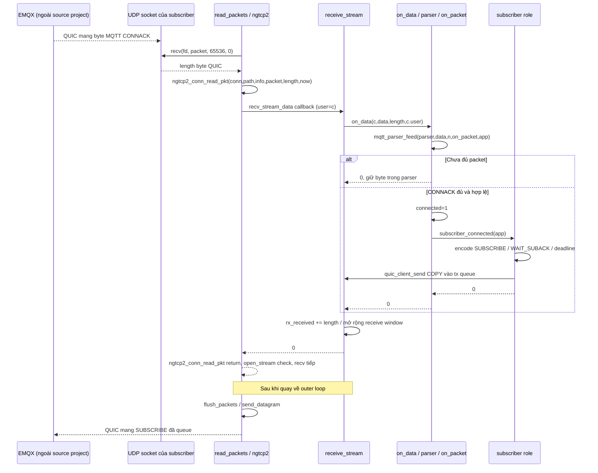

# 04 — Luồng nhận: UDP, ngtcp2, callback stream và MQTT parser

[Bản đồ](00-README.md) · [Luồng gửi](03-PACKET-SEND-FLOW.md) · [Trạng thái/ownership](07-STATE-AND-DATA-FLOW.md)

## 1. Ba loại dữ liệu không được gọi chung thành một packet

**[SOURCE]** Chương trình nhận UDP bằng `recv()` vào `packet[65536]`, đưa nguyên số byte nhận cho ngtcp2, rồi chỉ sau khi ngtcp2 xử lý stream mới đưa byte ứng dụng cho parser MQTT. Không có `recvfrom()`/server listener C của project ở đường nhận này. [quic_client.c:452–464](/home/nguyenluongduc/Github/QUIC/ZerotoHeroWithQUIC/src/PrgSocket/QUICSocket/mqtt-quic/clients/quic_client.c:452) [quic_client.c:145–162](/home/nguyenluongduc/Github/QUIC/ZerotoHeroWithQUIC/src/PrgSocket/QUICSocket/mqtt-quic/clients/quic_client.c:145) [app.c:66–73](/home/nguyenluongduc/Github/QUIC/ZerotoHeroWithQUIC/src/PrgSocket/QUICSocket/mqtt-quic/clients/app.c:66)

| Tầng | Địa chỉ/vùng nhớ trong source | Có thể chứa gì? | Bộ phận xử lý tiếp |
|---|---|---|---|
| UDP datagram | `packet` local read_packets | Serialized QUIC, gồm phần được bảo vệ/mã hóa | ngtcp2_conn_read_pkt |
| QUIC stream bytes | `data,length` của receive_stream | Đoạn byte MQTT đã qua xử lý transport, đúng thứ tự stream | on_data / parser |
| MQTT packet | `mqtt_packet` view trong parser | type, flags, body đầy đủ của một MQTT control packet | on_packet / role.packet |

Nguồn từng ranh giới: [quic_client.c:453–464](/home/nguyenluongduc/Github/QUIC/ZerotoHeroWithQUIC/src/PrgSocket/QUICSocket/mqtt-quic/clients/quic_client.c:453) [quic_client.c:145–156](/home/nguyenluongduc/Github/QUIC/ZerotoHeroWithQUIC/src/PrgSocket/QUICSocket/mqtt-quic/clients/quic_client.c:145) [mqtt_codec.c:83–85](/home/nguyenluongduc/Github/QUIC/ZerotoHeroWithQUIC/src/PrgSocket/QUICSocket/mqtt-quic/clients/mqtt_codec.c:83). Một UDP datagram không bắt buộc bằng một MQTT packet, và một callback stream có thể tạo 0/1/nhiều MQTT packet. [mqtt_codec.h:24–25](/home/nguyenluongduc/Github/QUIC/ZerotoHeroWithQUIC/src/PrgSocket/QUICSocket/mqtt-quic/clients/mqtt_codec.h:24) [mqtt_codec.c:78–97](/home/nguyenluongduc/Github/QUIC/ZerotoHeroWithQUIC/src/PrgSocket/QUICSocket/mqtt-quic/clients/mqtt_codec.c:78)

**[SOURCE — THƯ VIỆN]** `ngtcp2_conn_read_pkt` thực hiện decrypt/process và handshake theo API installed 1.25.0; callback stream được thư viện gọi theo offset không giảm, không overlap. Dự án còn kiểm offset bằng đúng rx_received. [version.h:39](/home/nguyenluongduc/Github/QUIC/ZerotoHeroWithQUIC/src/PrgSocket/QUICSocket/demo/src/.deps/include/ngtcp2/version.h:39) [ngtcp2.h:4250–4258](/home/nguyenluongduc/Github/QUIC/ZerotoHeroWithQUIC/src/PrgSocket/QUICSocket/demo/src/.deps/include/ngtcp2/ngtcp2.h:4250) [ngtcp2.h:2919–2935](/home/nguyenluongduc/Github/QUIC/ZerotoHeroWithQUIC/src/PrgSocket/QUICSocket/demo/src/.deps/include/ngtcp2/ngtcp2.h:2919) [quic_client.c:150–152](/home/nguyenluongduc/Github/QUIC/ZerotoHeroWithQUIC/src/PrgSocket/QUICSocket/mqtt-quic/clients/quic_client.c:150)

**[UNVERIFIED]** Tài liệu chưa capture packet hay chạy debugger mới. Các ví dụ chia/gộp là mô phỏng quyết định của parser từ source và test vector, không phải tuyên bố một lần kernel recv thực tế đã chia đúng những đoạn đó. [test_codec.c:37–62](/home/nguyenluongduc/Github/QUIC/ZerotoHeroWithQUIC/src/PrgSocket/QUICSocket/mqtt-quic/tests/test_codec.c:37)

## 2. Sequence đầy đủ: nhận CONNACK và tạo SUBSCRIBE đáp lại



Diagram phân biệt đường gọi đồng bộ lồng nhau với đường gửi sau khi quay về event loop. Callback không tự tạo thread/process khác. Source của các cạnh: [quic_client.c:455–476](/home/nguyenluongduc/Github/QUIC/ZerotoHeroWithQUIC/src/PrgSocket/QUICSocket/mqtt-quic/clients/quic_client.c:455) [quic_client.c:145–162](/home/nguyenluongduc/Github/QUIC/ZerotoHeroWithQUIC/src/PrgSocket/QUICSocket/mqtt-quic/clients/quic_client.c:145) [app.c:49–73](/home/nguyenluongduc/Github/QUIC/ZerotoHeroWithQUIC/src/PrgSocket/QUICSocket/mqtt-quic/clients/app.c:49) [subscriber.c:20–30](/home/nguyenluongduc/Github/QUIC/ZerotoHeroWithQUIC/src/PrgSocket/QUICSocket/mqtt-quic/clients/subscriber.c:20) [quic_client.c:507–510](/home/nguyenluongduc/Github/QUIC/ZerotoHeroWithQUIC/src/PrgSocket/QUICSocket/mqtt-quic/clients/quic_client.c:507). QUIC không bảo đảm một CONNACK ứng với đúng một callback; nhánh incomplete là bình thường. [mqtt_codec.c:78–97](/home/nguyenluongduc/Github/QUIC/ZerotoHeroWithQUIC/src/PrgSocket/QUICSocket/mqtt-quic/clients/mqtt_codec.c:78)

## 3. Socket nào nhận và vì sao không có map connection của ứng dụng?

Socket fd được tạo trong socket_open bằng AF_INET/SOCK_DGRAM, đặt O_NONBLOCK và UDP connect tới numeric IPv4/cổng remote. getsockname ghi local concrete IP/port sau route selection. Không có explicit bind/listen/accept trong client này. [quic_client.c:212–236](/home/nguyenluongduc/Github/QUIC/ZerotoHeroWithQUIC/src/PrgSocket/QUICSocket/mqtt-quic/clients/quic_client.c:212)

Mỗi executable tạo một heap quic_client và một ngtcp2_conn; event_loop luôn truyền cùng c cho read_packets, rồi ngtcp2_conn_read_pkt nhận c.conn. Ứng dụng không tìm connection trong hash map CID theo packet. Đó là mô hình một connection cho một process, không phải server nhiều connection. [quic_client.c:548–570](/home/nguyenluongduc/Github/QUIC/ZerotoHeroWithQUIC/src/PrgSocket/QUICSocket/mqtt-quic/clients/quic_client.c:548) [quic_client.c:534–535](/home/nguyenluongduc/Github/QUIC/ZerotoHeroWithQUIC/src/PrgSocket/QUICSocket/mqtt-quic/clients/quic_client.c:534) [quic_client.c:463](/home/nguyenluongduc/Github/QUIC/ZerotoHeroWithQUIC/src/PrgSocket/QUICSocket/mqtt-quic/clients/quic_client.c:463)

**[THEORY — LINUX]** Kernel dùng namespace, UDP socket/peer tuple và cơ chế nhận mạng để phân phối datagram tới socket; CID/packet protection là công việc QUIC bên trong ngtcp2, không thay thế fd của kernel. Chỉ từ source không suy ra số ephemeral port hay rule Docker đang có ở runtime; xem [network path](05-NETWORK-PACKET-PATH.md). Điểm kết nối với source là UDP connect/getname và recv. [quic_client.c:232–233](/home/nguyenluongduc/Github/QUIC/ZerotoHeroWithQUIC/src/PrgSocket/QUICSocket/mqtt-quic/clients/quic_client.c:232) [quic_client.c:455](/home/nguyenluongduc/Github/QUIC/ZerotoHeroWithQUIC/src/PrgSocket/QUICSocket/mqtt-quic/clients/quic_client.c:455)

## 4. `read_packets` và syscall `recv`

### A. Hàm và nơi gọi

```c
static int read_packets(quic_client *c)
```

Định nghĩa duy nhất trong quic_client.c. Caller event_loop chỉ gọi khi poll trả POLLIN; không gọi blocking read vô điều kiện ở mỗi vòng. [quic_client.c:452–479](/home/nguyenluongduc/Github/QUIC/ZerotoHeroWithQUIC/src/PrgSocket/QUICSocket/mqtt-quic/clients/quic_client.c:452) [quic_client.c:523–537](/home/nguyenluongduc/Github/QUIC/ZerotoHeroWithQUIC/src/PrgSocket/QUICSocket/mqtt-quic/clients/quic_client.c:523)

### B. Toàn bộ tham số và local buffer

| Tham số/giá trị | Nguồn | Tác dụng, mutation và lifetime |
|---|---|---|
| `c` | Heap object đang được event_loop xử lý | Borrowed; lấy fd/conn/path; trạng thái conn có thể đổi qua library/callback |
| `packet[65536]` | Stack mỗi lần gọi read_packets | Writable receive buffer, được dùng lại mỗi recv; không giữ pointer sau call stack |
| `length` | Return `ssize_t` của recv | Số byte thực có hoặc giá trị âm lỗi; kiểm âm trước cast size_t |
| `i` | Local burst counter 0..63 | Giới hạn tối đa 64 lần recv trong một lần gọi để trả quyền về event_loop |

Nguồn locals và loop: [quic_client.c:452–464](/home/nguyenluongduc/Github/QUIC/ZerotoHeroWithQUIC/src/PrgSocket/QUICSocket/mqtt-quic/clients/quic_client.c:452).

Syscall thực tế:

```c
ssize_t length = recv(c->fd, packet, sizeof(packet), 0);
```

| Đối số recv | Nguồn runtime | Ý nghĩa trong project |
|---|---|---|
| `c->fd` | socket_open lưu return socket() | Socket UDP của process hiện tại, connected peer là broker |
| `packet` | Địa chỉ phần tử đầu array stack | Kernel ghi dữ liệu vào đây |
| `sizeof(packet)` | 65536 | Capacity, không phải số byte chắc chắn nhận |
| `0` | Literal flags | Không yêu cầu MSG_PEEK/MSG_WAITALL/MSG_TRUNC |

Source tạo fd và call site: [quic_client.c:224–234](/home/nguyenluongduc/Github/QUIC/ZerotoHeroWithQUIC/src/PrgSocket/QUICSocket/mqtt-quic/clients/quic_client.c:224) [quic_client.c:453–455](/home/nguyenluongduc/Github/QUIC/ZerotoHeroWithQUIC/src/PrgSocket/QUICSocket/mqtt-quic/clients/quic_client.c:453).

### C. Các nhánh sau recv

- `length<0` và errno EAGAIN/EWOULDBLOCK: socket nonblocking tạm hết dữ liệu, return0 để outer loop tiếp tục. [quic_client.c:456–457](/home/nguyenluongduc/Github/QUIC/ZerotoHeroWithQUIC/src/PrgSocket/QUICSocket/mqtt-quic/clients/quic_client.c:456)
- EINTR cũng return0, không coi connection hỏng; vòng outer sẽ xử lý signal. [quic_client.c:457](/home/nguyenluongduc/Github/QUIC/ZerotoHeroWithQUIC/src/PrgSocket/QUICSocket/mqtt-quic/clients/quic_client.c:457) [quic_client.c:484–490](/home/nguyenluongduc/Github/QUIC/ZerotoHeroWithQUIC/src/PrgSocket/QUICSocket/mqtt-quic/clients/quic_client.c:484)
- Lỗi âm khác: perror và -1; event_loop chuyển lỗi ra run. [quic_client.c:458](/home/nguyenluongduc/Github/QUIC/ZerotoHeroWithQUIC/src/PrgSocket/QUICSocket/mqtt-quic/clients/quic_client.c:458) [quic_client.c:535–537](/home/nguyenluongduc/Github/QUIC/ZerotoHeroWithQUIC/src/PrgSocket/QUICSocket/mqtt-quic/clients/quic_client.c:535)
- `length==0`: continue burst; zero-length UDP datagram không phải FIN của QUIC stream. FIN được xử lý ở receive_stream flags. [quic_client.c:460](/home/nguyenluongduc/Github/QUIC/ZerotoHeroWithQUIC/src/PrgSocket/QUICSocket/mqtt-quic/clients/quic_client.c:460) [quic_client.c:164–169](/home/nguyenluongduc/Github/QUIC/ZerotoHeroWithQUIC/src/PrgSocket/QUICSocket/mqtt-quic/clients/quic_client.c:164)
- Dương: tạo path/metadata rồi gọi ngtcp2, không parse MQTT trực tiếp. [quic_client.c:461–464](/home/nguyenluongduc/Github/QUIC/ZerotoHeroWithQUIC/src/PrgSocket/QUICSocket/mqtt-quic/clients/quic_client.c:461)

### D. Return và bước tiếp

Return0 khi burst hoàn tất/hết dữ liệu; return1 là sentinel riêng của project cho peer-close success; số âm/nonzero còn lại là failure. event_loop hiểu return1 thành run success. Chi tiết predicate peer close nằm tại finishing && tx_fin && pending0 && peer error_code0; không cần fin_acked ở nhánh này. [quic_client.c:465–479](/home/nguyenluongduc/Github/QUIC/ZerotoHeroWithQUIC/src/PrgSocket/QUICSocket/mqtt-quic/clients/quic_client.c:465) [quic_client.c:535–537](/home/nguyenluongduc/Github/QUIC/ZerotoHeroWithQUIC/src/PrgSocket/QUICSocket/mqtt-quic/clients/quic_client.c:535)

Sau mỗi ngtcp2_conn_read_pkt thành công, `open_stream(c)` được gọi trước recv packet kế tiếp. Điều này cho phép stream/app ready được thiết lập sau handshake packet trước khi một packet sau chứa application data được xử lý. [quic_client.c:474–477](/home/nguyenluongduc/Github/QUIC/ZerotoHeroWithQUIC/src/PrgSocket/QUICSocket/mqtt-quic/clients/quic_client.c:474)

## 5. `path_for` và `ngtcp2_conn_read_pkt`

### `path_for`: địa chỉ đưa vào library

```c
static ngtcp2_path path_for(quic_client *c)
```

c borrowed; tạo local descriptor path với local/remote sockaddr pointer trỏ vào hai field của c, độ dài sizeof(sockaddr_in), user_data=NULL. Return descriptor bằng giá trị, nhưng địa chỉ sockaddrs vẫn thuộc c và sống lâu hơn lời gọi ngtcp2_conn_read_pkt. Các caller là connection_init và read_packets. Không tạo namespace/interface ở đây. [quic_client.c:90–96](/home/nguyenluongduc/Github/QUIC/ZerotoHeroWithQUIC/src/PrgSocket/QUICSocket/mqtt-quic/clients/quic_client.c:90) [quic_client.c:277](/home/nguyenluongduc/Github/QUIC/ZerotoHeroWithQUIC/src/PrgSocket/QUICSocket/mqtt-quic/clients/quic_client.c:277) [quic_client.c:461](/home/nguyenluongduc/Github/QUIC/ZerotoHeroWithQUIC/src/PrgSocket/QUICSocket/mqtt-quic/clients/quic_client.c:461)

### A. API và nguồn version

```c
/* Dạng gọi macro ở project: */
ngtcp2_conn_read_pkt(conn, path, pi, pkt, pktlen, ts);

/* Prototype implementation mà macro gọi tới: */
int ngtcp2_conn_read_pkt_versioned(
    ngtcp2_conn *conn, const ngtcp2_path *path,
    int pkt_info_version, const ngtcp2_pkt_info *pi,
    const uint8_t *pkt, size_t pktlen, ngtcp2_tstamp ts);
```

Installed header mở rộng macro sang `ngtcp2_conn_read_pkt_versioned` và tự thêm NGTCP2_PKT_INFO_VERSION. Đối số version không do read_packets tự tính, không phải version QUIC trên wire; nó chỉ chọn layout API metadata. Prototype và contract thuộc header 1.25.0. [version.h:39](/home/nguyenluongduc/Github/QUIC/ZerotoHeroWithQUIC/src/PrgSocket/QUICSocket/demo/src/.deps/include/ngtcp2/version.h:39) [ngtcp2.h:4287–4291](/home/nguyenluongduc/Github/QUIC/ZerotoHeroWithQUIC/src/PrgSocket/QUICSocket/demo/src/.deps/include/ngtcp2/ngtcp2.h:4287) [ngtcp2.h:7297–7305](/home/nguyenluongduc/Github/QUIC/ZerotoHeroWithQUIC/src/PrgSocket/QUICSocket/demo/src/.deps/include/ngtcp2/ngtcp2.h:7297)

### B. Từng đối số tại call site

| Đối số | Giá trị thực | Vai trò / ownership / mutation |
|---|---|---|
| `conn` | `c->conn` đã tạo trong connection_init | Library cập nhật connection; không phải lookup connection mới từ MQTT |
| `path` | `&path` local từ path_for | Input local/remote; descriptor stack, địa chỉ bên trong thuộc c |
| `pi` | `&info`, info zero | Input packet metadata; project không đọc ancillary ECN từ recvmsg |
| `pkt` | `packet` stack vừa recv | Input QUIC bytes, không giữ làm MQTT buffer |
| `pktlen` | `(size_t)length` sau kiểm length>=0 | Số byte nhận thực tế, không phải capacity65536 |
| `ts` | `now_ns()` | Timestamp monotonic ns cho ngtcp2 |

Chuẩn bị và call site: [quic_client.c:461–464](/home/nguyenluongduc/Github/QUIC/ZerotoHeroWithQUIC/src/PrgSocket/QUICSocket/mqtt-quic/clients/quic_client.c:461); nguồn c.conn: [quic_client.c:278–279](/home/nguyenluongduc/Github/QUIC/ZerotoHeroWithQUIC/src/PrgSocket/QUICSocket/mqtt-quic/clients/quic_client.c:278); timestamp: [quic_client.c:43–52](/home/nguyenluongduc/Github/QUIC/ZerotoHeroWithQUIC/src/PrgSocket/QUICSocket/mqtt-quic/clients/quic_client.c:43).

### C. Hành vi library được xác minh

API docs mô tả decrypt/process packet và thực hiện handshake, không được gọi lại ngtcp2_conn_read_pkt từ bên trong callback. Local library source cập nhật timestamp, bỏ qua packet zero length, kiểm path client rồi dispatch theo connection state, bao gồm CLIENT_INITIAL/CLIENT_WAIT_HANDSHAKE. Đây là code **ngtcp2**, không phải code tự viết của lab. [ngtcp2.h:4250–4260](/home/nguyenluongduc/Github/QUIC/ZerotoHeroWithQUIC/src/PrgSocket/QUICSocket/demo/src/.deps/include/ngtcp2/ngtcp2.h:4250) [ngtcp2_conn.c:10335–10386](/home/nguyenluongduc/Github/QUIC/ZerotoHeroWithQUIC/src/PrgSocket/QUICSocket/third_party/ngtcp2/lib/ngtcp2_conn.c:10335)

Local library gọi callback qua `conn->callbacks.recv_stream_data(...)`, đưa `conn->user_data` và `strm->stream_user_data`. Callback table được project đăng ký `.recv_stream_data=receive_stream`, user_data cuối ngtcp2_conn_client_new là c. Đây là bằng chứng callback không phải do tên `on_*` tự động được hệ điều hành nhận diện. [ngtcp2_conn.c:133–149](/home/nguyenluongduc/Github/QUIC/ZerotoHeroWithQUIC/src/PrgSocket/QUICSocket/third_party/ngtcp2/lib/ngtcp2_conn.c:133) [quic_client.c:247](/home/nguyenluongduc/Github/QUIC/ZerotoHeroWithQUIC/src/PrgSocket/QUICSocket/mqtt-quic/clients/quic_client.c:247) [quic_client.c:278–279](/home/nguyenluongduc/Github/QUIC/ZerotoHeroWithQUIC/src/PrgSocket/QUICSocket/mqtt-quic/clients/quic_client.c:278)

### C2. Đi sâu vào library: từ QUIC header tới callback stream

Đây là implementation **ngtcp2**, không phải mqtt_codec.header. Hai parser ở hai tầng khác nhau: ngtcp2 đọc packet/frame transport, mqtt_codec.header chỉ đọc fixed header MQTT sau khi đã có stream bytes. Library có nhánh handshake và nhánh protected/application packet, nên không mô tả tất cả gói đi qua một đường duy nhất. [ngtcp2_conn.c:10335–10386](/home/nguyenluongduc/Github/QUIC/ZerotoHeroWithQUIC/src/PrgSocket/QUICSocket/third_party/ngtcp2/lib/ngtcp2_conn.c:10335) [ngtcp2_conn.c:9248–9256](/home/nguyenluongduc/Github/QUIC/ZerotoHeroWithQUIC/src/PrgSocket/QUICSocket/third_party/ngtcp2/lib/ngtcp2_conn.c:9248) [mqtt_codec.c:59–76](/home/nguyenluongduc/Github/QUIC/ZerotoHeroWithQUIC/src/PrgSocket/QUICSocket/mqtt-quic/clients/mqtt_codec.c:59)

Trong đường `conn_recv_pkt` cho 1-RTT short-header, source cho thấy chuỗi sau:

| Thứ tự | Việc library làm | Giá trị/buffer chính | Cạnh đi tiếp hoặc lỗi |
|---|---|---|---|
| 1 | Decode short header, chọn application packet-number space và crypto context | hd, conn.pktns, ckm, hp_ctx, callbacks hp_mask/decrypt | Header sai/fixed bit sai thì discard |
| 2 | Bỏ header protection | decrypt_hp_buf, hp mask callback, input pkt | Không bỏ được protection thì discard hoặc fatal |
| 3 | Khôi phục full packet number | max_pkt_num đã nhận, số PN cắt ngắn và độ dài PN từ header | PN vượt giới hạn thì discard |
| 4 | Cấp receive decrypt buffer và chọn key phase | decrypt_buf, current/old/new ckm theo state | Key không phù hợp dẫn tới decrypt failure |
| 5 | Decrypt/xác thực payload | output decrypt_buf, AAD header đã bỏ protection, hd.pkt_num, ckm, decrypt callback | Auth/decrypt lỗi thì discard; đạt ngưỡng AEAD thì connection error |
| 6 | Kiểm reserved bits, packet number duplicate và DCID | header/state ACK/CID của conn | Protocol error hoặc discard trước frame delivery |
| 7 | Decode từng QUIC frame | frd/fr trong payload plaintext | STREAM gọi conn_recv_stream; ACK gọi conn_recv_ack |

Nguồn từng hàng theo thứ tự: [ngtcp2_conn.c:9357–9375](/home/nguyenluongduc/Github/QUIC/ZerotoHeroWithQUIC/src/PrgSocket/QUICSocket/third_party/ngtcp2/lib/ngtcp2_conn.c:9357) [ngtcp2_conn.c:9378–9392](/home/nguyenluongduc/Github/QUIC/ZerotoHeroWithQUIC/src/PrgSocket/QUICSocket/third_party/ngtcp2/lib/ngtcp2_conn.c:9378) [ngtcp2_conn.c:9398–9404](/home/nguyenluongduc/Github/QUIC/ZerotoHeroWithQUIC/src/PrgSocket/QUICSocket/third_party/ngtcp2/lib/ngtcp2_conn.c:9398) [ngtcp2_conn.c:9423–9459](/home/nguyenluongduc/Github/QUIC/ZerotoHeroWithQUIC/src/PrgSocket/QUICSocket/third_party/ngtcp2/lib/ngtcp2_conn.c:9423) [ngtcp2_conn.c:9465–9500](/home/nguyenluongduc/Github/QUIC/ZerotoHeroWithQUIC/src/PrgSocket/QUICSocket/third_party/ngtcp2/lib/ngtcp2_conn.c:9465) [ngtcp2_conn.c:9548–9565](/home/nguyenluongduc/Github/QUIC/ZerotoHeroWithQUIC/src/PrgSocket/QUICSocket/third_party/ngtcp2/lib/ngtcp2_conn.c:9548) [ngtcp2_conn.c:9631–9656](/home/nguyenluongduc/Github/QUIC/ZerotoHeroWithQUIC/src/PrgSocket/QUICSocket/third_party/ngtcp2/lib/ngtcp2_conn.c:9631). Các callback hp_mask/decrypt ở đây chính là crypto adapter mà project gắn lúc connection_init, không phải hàm MQTT xử lý topic. [quic_client.c:244–246](/home/nguyenluongduc/Github/QUIC/ZerotoHeroWithQUIC/src/PrgSocket/QUICSocket/mqtt-quic/clients/quic_client.c:244)

Một STREAM frame không tự được chuyển nguyên trạng thành một MQTT packet. `conn_recv_stream(conn,fr,ts)` kiểm và tổ chức dữ liệu của stream; khi dữ liệu tới đúng receive offset, nó cắt phần đã có rồi gọi conn_call_recv_stream_data. Nếu còn gap, nó đưa vào reordering buffer. Khi gap được lấp, conn_emit_pending_stream_data duyệt phần ordered còn lại và gọi callback tiếp. [ngtcp2_conn.c:7449–7452](/home/nguyenluongduc/Github/QUIC/ZerotoHeroWithQUIC/src/PrgSocket/QUICSocket/third_party/ngtcp2/lib/ngtcp2_conn.c:7449) [ngtcp2_conn.c:7608–7655](/home/nguyenluongduc/Github/QUIC/ZerotoHeroWithQUIC/src/PrgSocket/QUICSocket/third_party/ngtcp2/lib/ngtcp2_conn.c:7608) [ngtcp2_conn.c:7213–7262](/home/nguyenluongduc/Github/QUIC/ZerotoHeroWithQUIC/src/PrgSocket/QUICSocket/third_party/ngtcp2/lib/ngtcp2_conn.c:7213)

| Internal helper | Tham số có nguồn gì? | Trạng thái/ownership và kết quả |
|---|---|---|
| conn_recv_stream(conn, fr, ts) | conn đang read; fr.stream do QUIC frame decoder tạo; ts timestamp API read | Library giữ state stream/reorder; callback khi có ordered data; lỗi quay về packet reader |
| conn_emit_pending_stream_data(conn, strm, rx_offset) | conn/stream đã xác định; receive offset sau đoạn vừa giao | Lấy data từ reordering buffer, set FIN/0RTT flags; pop phần đã giao sau callback success |
| conn_call_recv_stream_data(conn,strm,flags,offset,data,datalen) | Các values từ nhánh contiguous hoặc buffer ordered | Gọi conn.callbacks.recv_stream_data với conn.user_data và strm.stream_user_data; callback nonzero đổi thành CALLBACK_FAILURE |

Signature/call/return thật: [ngtcp2_conn.c:133–149](/home/nguyenluongduc/Github/QUIC/ZerotoHeroWithQUIC/src/PrgSocket/QUICSocket/third_party/ngtcp2/lib/ngtcp2_conn.c:133) [ngtcp2_conn.c:7213–7262](/home/nguyenluongduc/Github/QUIC/ZerotoHeroWithQUIC/src/PrgSocket/QUICSocket/third_party/ngtcp2/lib/ngtcp2_conn.c:7213) [ngtcp2_conn.c:7449–7452](/home/nguyenluongduc/Github/QUIC/ZerotoHeroWithQUIC/src/PrgSocket/QUICSocket/third_party/ngtcp2/lib/ngtcp2_conn.c:7449) [ngtcp2_conn.c:7640–7655](/home/nguyenluongduc/Github/QUIC/ZerotoHeroWithQUIC/src/PrgSocket/QUICSocket/third_party/ngtcp2/lib/ngtcp2_conn.c:7640). Input data có thể trỏ vào decrypt buffer hoặc reorder buffer của library; app không dựa vào địa chỉ nguồn sống qua callback mà copy cần thiết vào parser. [ngtcp2_conn.c:7614–7622](/home/nguyenluongduc/Github/QUIC/ZerotoHeroWithQUIC/src/PrgSocket/QUICSocket/third_party/ngtcp2/lib/ngtcp2_conn.c:7614) [ngtcp2_conn.c:7238–7262](/home/nguyenluongduc/Github/QUIC/ZerotoHeroWithQUIC/src/PrgSocket/QUICSocket/third_party/ngtcp2/lib/ngtcp2_conn.c:7238) [mqtt_codec.c:92–95](/home/nguyenluongduc/Github/QUIC/ZerotoHeroWithQUIC/src/PrgSocket/QUICSocket/mqtt-quic/clients/mqtt_codec.c:92)

Ở đường handshake, source cũng có PN reconstruction/duplicate/auth/CID checks, và client cập nhật destination CID thành SCID của server khi xử lý Initial đầu tiên. Điều này không phải project tự memcpy CID ở receive_stream; nó nằm trong ngtcp2. [ngtcp2_conn.c:6815–6855](/home/nguyenluongduc/Github/QUIC/ZerotoHeroWithQUIC/src/PrgSocket/QUICSocket/third_party/ngtcp2/lib/ngtcp2_conn.c:6815) [ngtcp2_conn.c:6874–6898](/home/nguyenluongduc/Github/QUIC/ZerotoHeroWithQUIC/src/PrgSocket/QUICSocket/third_party/ngtcp2/lib/ngtcp2_conn.c:6874) [ngtcp2_conn.c:6913–6918](/home/nguyenluongduc/Github/QUIC/ZerotoHeroWithQUIC/src/PrgSocket/QUICSocket/third_party/ngtcp2/lib/ngtcp2_conn.c:6913)

### D. Kết quả

0 là processed/ignored thành công theo ngtcp2, không luôn có MQTT bytes. Error draining/closing/crypto và các lỗi khác được wrapper kiểm; callback failure cũng làm library trả lỗi. Sau call thành công, stack callback đã return và wrapper tiếp tục open_stream/recv. [ngtcp2.h:4261–4284](/home/nguyenluongduc/Github/QUIC/ZerotoHeroWithQUIC/src/PrgSocket/QUICSocket/demo/src/.deps/include/ngtcp2/ngtcp2.h:4261) [quic_client.c:465–477](/home/nguyenluongduc/Github/QUIC/ZerotoHeroWithQUIC/src/PrgSocket/QUICSocket/mqtt-quic/clients/quic_client.c:465)

## 6. `receive_stream`: callback của ngtcp2

### A. Signature và registration

```c
static int receive_stream(ngtcp2_conn *conn, uint32_t flags, int64_t id,
                          uint64_t offset, const uint8_t *data, size_t length,
                          void *user, void *stream_user)
```

Definition: quic_client.c145; registration callbacks.recv_stream_data tại247; caller thực tế thuộc ngtcp2 conn_call_recv_stream_data. Contract type trong installed header có cùng thứ tự đối số, dù gọi tên stream_id/datalen/user_data. [quic_client.c:145–147](/home/nguyenluongduc/Github/QUIC/ZerotoHeroWithQUIC/src/PrgSocket/QUICSocket/mqtt-quic/clients/quic_client.c:145) [quic_client.c:247](/home/nguyenluongduc/Github/QUIC/ZerotoHeroWithQUIC/src/PrgSocket/QUICSocket/mqtt-quic/clients/quic_client.c:247) [ngtcp2_conn.c:133–149](/home/nguyenluongduc/Github/QUIC/ZerotoHeroWithQUIC/src/PrgSocket/QUICSocket/third_party/ngtcp2/lib/ngtcp2_conn.c:133) [ngtcp2.h:2938–2942](/home/nguyenluongduc/Github/QUIC/ZerotoHeroWithQUIC/src/PrgSocket/QUICSocket/demo/src/.deps/include/ngtcp2/ngtcp2.h:2938)

### B. TẤT CẢ tám tham số

| Tham số | Nguồn cụ thể | Vì sao cần / thay đổi | Lifetime/ownership |
|---|---|---|---|
| `ngtcp2_conn *conn` | Library chuyển chính conn đang ngtcp2_conn_read_pkt | Dùng mở rộng flow-control window | Library-owned; app không del trong callback |
| `uint32_t flags` | Library tạo từ STREAM delivery/FIN/0RTT | Reject0RTT, kiểm FIN; không sửa caller | Value bitmask, khác MQTT flags |
| `int64_t id` | stream của data trong library | Phải bằng c.stream_id | Value; không phải MQTT packet ID |
| `uint64_t offset` | Absolute receive stream byte offset | Phải đúng c.rx_received | Value; không phải index buffer UDP |
| `const uint8_t *data` | Byte stream library cung cấp | Chuyển cho app nếu length>0 | Borrowed read-only; project copy vào parser nếu cần giữ |
| `size_t length` | Độ dài đoạn stream bytes | Cập nhật rx_received/window sau callback thành công | Value; có thể0 chỉ ở delivery FIN theo contract |
| `void *user` | conn.user_data = c từ ngtcp2_conn_client_new | Cast quic_client*c để lấy trạng thái | Borrowed c heap, không phải &app |
| `void *stream_user` | stream user_data lúc ngtcp2_conn_open_bidi_stream(NULL) | Cố ý bỏ qua ở lab | Không dereference/free |

Nguồn đối số: [quic_client.c:278–279](/home/nguyenluongduc/Github/QUIC/ZerotoHeroWithQUIC/src/PrgSocket/QUICSocket/mqtt-quic/clients/quic_client.c:278) [quic_client.c:340](/home/nguyenluongduc/Github/QUIC/ZerotoHeroWithQUIC/src/PrgSocket/QUICSocket/mqtt-quic/clients/quic_client.c:340) [ngtcp2_conn.c:142–144](/home/nguyenluongduc/Github/QUIC/ZerotoHeroWithQUIC/src/PrgSocket/QUICSocket/third_party/ngtcp2/lib/ngtcp2_conn.c:142); điều kiện/range contract: [ngtcp2.h:2919–2942](/home/nguyenluongduc/Github/QUIC/ZerotoHeroWithQUIC/src/PrgSocket/QUICSocket/demo/src/.deps/include/ngtcp2/ngtcp2.h:2919); sử dụng thực: [quic_client.c:148–169](/home/nguyenluongduc/Github/QUIC/ZerotoHeroWithQUIC/src/PrgSocket/QUICSocket/mqtt-quic/clients/quic_client.c:148).

### C. Trình tự kiểm tra và gọi app

1. Cast user thành c; không dùng stream_user. [quic_client.c:148–149](/home/nguyenluongduc/Github/QUIC/ZerotoHeroWithQUIC/src/PrgSocket/QUICSocket/mqtt-quic/clients/quic_client.c:148)
2. Reject chưa ready, sai stream, đã thấy rx_fin, offset không liên tục, overflow offset+length hoặc 0RTT. Offset contract của library không overlap được project siết thành đúng kế tiếp rx_received. [quic_client.c:150–154](/home/nguyenluongduc/Github/QUIC/ZerotoHeroWithQUIC/src/PrgSocket/QUICSocket/mqtt-quic/clients/quic_client.c:150) [ngtcp2.h:2923–2931](/home/nguyenluongduc/Github/QUIC/ZerotoHeroWithQUIC/src/PrgSocket/QUICSocket/demo/src/.deps/include/ngtcp2/ngtcp2.h:2923)
3. Nếu length>0 và callback data tồn tại, gọi `c->callbacks->data(c,data,length,c->user)`. Với bảng app hiện tại, đó là on_data(c,data,length,&app). FIN-only length0 không gọi on_data. [quic_client.c:156–157](/home/nguyenluongduc/Github/QUIC/ZerotoHeroWithQUIC/src/PrgSocket/QUICSocket/mqtt-quic/clients/quic_client.c:156) [app.c:158–161](/home/nguyenluongduc/Github/QUIC/ZerotoHeroWithQUIC/src/PrgSocket/QUICSocket/mqtt-quic/clients/app.c:158)
4. Chỉ sau callback app thành công mới tăng rx_received; nếu app lỗi, không tăng window/counter ở các dòng sau. Không rollback các thay đổi mà app đã làm trước lỗi. [quic_client.c:156–162](/home/nguyenluongduc/Github/QUIC/ZerotoHeroWithQUIC/src/PrgSocket/QUICSocket/mqtt-quic/clients/quic_client.c:156)
5. Tăng receive allowance của stream và connection bằng đúng length, không phải packet capacity hoặc MQTT body length. Đây là cho phép peer gửi tiếp, không phải ACK ứng dụng. [quic_client.c:159–162](/home/nguyenluongduc/Github/QUIC/ZerotoHeroWithQUIC/src/PrgSocket/QUICSocket/mqtt-quic/clients/quic_client.c:159) [ngtcp2.h:5553–5581](/home/nguyenluongduc/Github/QUIC/ZerotoHeroWithQUIC/src/PrgSocket/QUICSocket/demo/src/.deps/include/ngtcp2/ngtcp2.h:5553)
6. Nếu FIN: đánh dấu rx_fin; nếu chưa finishing thì coi broker kết thúc stream bất ngờ và fail. [quic_client.c:164–169](/home/nguyenluongduc/Github/QUIC/ZerotoHeroWithQUIC/src/PrgSocket/QUICSocket/mqtt-quic/clients/quic_client.c:164)

### D. Return và flow-control API arguments

0 trả về ngtcp2 tiếp tục packet processing; NGTCP2_ERR_CALLBACK_FAILURE làm library call dừng với lỗi. [quic_client.c:153–171](/home/nguyenluongduc/Github/QUIC/ZerotoHeroWithQUIC/src/PrgSocket/QUICSocket/mqtt-quic/clients/quic_client.c:153) [ngtcp2.h:2932–2935](/home/nguyenluongduc/Github/QUIC/ZerotoHeroWithQUIC/src/PrgSocket/QUICSocket/demo/src/.deps/include/ngtcp2/ngtcp2.h:2932)

`ngtcp2_conn_extend_max_stream_offset(conn,id,length)` nhận connection hiện tại, stream ID được kiểm và số byte đã giao app. Hàm trả error thì callback failure; `ngtcp2_conn_extend_max_offset(conn,length)` mở connection window, API void nên không có check return. [quic_client.c:160–162](/home/nguyenluongduc/Github/QUIC/ZerotoHeroWithQUIC/src/PrgSocket/QUICSocket/mqtt-quic/clients/quic_client.c:160) [ngtcp2.h:5553–5581](/home/nguyenluongduc/Github/QUIC/ZerotoHeroWithQUIC/src/PrgSocket/QUICSocket/demo/src/.deps/include/ngtcp2/ngtcp2.h:5553)

## 7. `on_data`: callback transport của ứng dụng

### A. Signature, registration, caller

```c
static int on_data(quic_client *client, const uint8_t *data,
                   size_t length, void *user)
```

App gắn quic_callbacks.data=on_data; receive_stream gọi trường này. Đây là callback do wrapper project gọi, khác ngtcp2_callbacks.recv_stream_data. [app.c:66–73](/home/nguyenluongduc/Github/QUIC/ZerotoHeroWithQUIC/src/PrgSocket/QUICSocket/mqtt-quic/clients/app.c:66) [app.c:158–161](/home/nguyenluongduc/Github/QUIC/ZerotoHeroWithQUIC/src/PrgSocket/QUICSocket/mqtt-quic/clients/app.c:158) [quic_client.c:156](/home/nguyenluongduc/Github/QUIC/ZerotoHeroWithQUIC/src/PrgSocket/QUICSocket/mqtt-quic/clients/quic_client.c:156)

### B. Tham số

| Tham số | Nguồn | Tác dụng và lifetime |
|---|---|---|
| `client` | c của receive_stream | Trỏ transport local; không dùng trong thân on_data, `(void)client` suppress warning |
| `data` | Đoạn stream byte ở callback ngtcp2 | Read-only borrowed, không phải raw UDP; parser copy phần cần giữ |
| `length` | length stream callback | Số byte mới, không phải strlen hay độ dài toàn packet |
| `user` | c.user=&app từ quic_client_run | Cast mqtt_app*; không copy app, không cấp app mới |

Nguồn context: [quic_client.c:550–552](/home/nguyenluongduc/Github/QUIC/ZerotoHeroWithQUIC/src/PrgSocket/QUICSocket/mqtt-quic/clients/quic_client.c:550) [quic_client.c:156](/home/nguyenluongduc/Github/QUIC/ZerotoHeroWithQUIC/src/PrgSocket/QUICSocket/mqtt-quic/clients/quic_client.c:156) [app.c:66–69](/home/nguyenluongduc/Github/QUIC/ZerotoHeroWithQUIC/src/PrgSocket/QUICSocket/mqtt-quic/clients/app.c:66).

### C. Các lời gọi

`mqtt_parser_feed(&app->parser,data,length,on_packet,app)` truyền địa chỉ parser embedded, input bytes, callback function pointer và cùng app pointer làm arg. `app` đã là con trỏ nên không truyền `&app`; cách sau thành mqtt_app** trỏ vào local pointer, không phải context cần thiết. [app.c:67–69](/home/nguyenluongduc/Github/QUIC/ZerotoHeroWithQUIC/src/PrgSocket/QUICSocket/mqtt-quic/clients/app.c:67) [app.h:20–28](/home/nguyenluongduc/Github/QUIC/ZerotoHeroWithQUIC/src/PrgSocket/QUICSocket/mqtt-quic/clients/app.h:20)

### D. Return

Feed nonzero: fprintf stderr rồi -1 lên receive_stream. Feed0: return0 dù packet còn dở. Không free data vì không sở hữu data. Một callback on_data có thể đồng bộ gọi on_packet nhiều lần trước khi on_data return. [app.c:69–73](/home/nguyenluongduc/Github/QUIC/ZerotoHeroWithQUIC/src/PrgSocket/QUICSocket/mqtt-quic/clients/app.c:69) [mqtt_codec.c:78–97](/home/nguyenluongduc/Github/QUIC/ZerotoHeroWithQUIC/src/PrgSocket/QUICSocket/mqtt-quic/clients/mqtt_codec.c:78)

## 8. `mqtt_parser_feed`: tất cả nhánh và bộ nhớ

### A. API và call sites

```c
int mqtt_parser_feed(mqtt_parser *p, const uint8_t *data, size_t n,
                     mqtt_packet_cb cb, void *arg)
```

Declaration codec.h25; definition codec.c78; production caller on_data; unit callers trong test tách/coalesce. Đây là lời gọi trực tiếp đồng bộ. [mqtt_codec.h:24–25](/home/nguyenluongduc/Github/QUIC/ZerotoHeroWithQUIC/src/PrgSocket/QUICSocket/mqtt-quic/clients/mqtt_codec.h:24) [mqtt_codec.c:78–97](/home/nguyenluongduc/Github/QUIC/ZerotoHeroWithQUIC/src/PrgSocket/QUICSocket/mqtt-quic/clients/mqtt_codec.c:78) [app.c:69](/home/nguyenluongduc/Github/QUIC/ZerotoHeroWithQUIC/src/PrgSocket/QUICSocket/mqtt-quic/clients/app.c:69) [test_codec.c:45–61](/home/nguyenluongduc/Github/QUIC/ZerotoHeroWithQUIC/src/PrgSocket/QUICSocket/mqtt-quic/tests/test_codec.c:45)

### B. Tham số

| Tham số | Giá trị trong production | Mutation/ownership/lifetime |
|---|---|---|
| `p` | &app.parser | Borrowed descriptor; thay data,len,cap; buffer heap do parser sở hữu đến free |
| `data` | stream bytes borrowed | Con trỏ local tăng khi consume; không sửa byte nguồn; không sửa con trỏ của caller |
| `n` | length của on_data | Local remaining count giảm dần; khác p.len |
| `cb` | địa chỉ on_packet | Callback function, không phải whole table; được gọi sync khi đủ packet |
| `arg` | app pointer | Opaque context gửi nguyên về callback; parser không dereference |

Nguồn và sử dụng: [app.c:69](/home/nguyenluongduc/Github/QUIC/ZerotoHeroWithQUIC/src/PrgSocket/QUICSocket/mqtt-quic/clients/app.c:69) [mqtt_codec.c:78–95](/home/nguyenluongduc/Github/QUIC/ZerotoHeroWithQUIC/src/PrgSocket/QUICSocket/mqtt-quic/clients/mqtt_codec.c:78). p không được NULL ở call production; function không tự kiểm mọi pointer tùy ý nên không được gọi như API chấp nhận p=NULL. [mqtt_codec.c:79–81](/home/nguyenluongduc/Github/QUIC/ZerotoHeroWithQUIC/src/PrgSocket/QUICSocket/mqtt-quic/clients/mqtt_codec.c:79)

### C1. Guard, while và trạng thái chưa đủ

`(!data && n)||!cb` reject NULL kèm n>0 hoặc callback NULL; n0 không tự là lỗi. `while(n||p->len)` còn chạy khi đầu vào còn hoặc có phần dở cần xét. Mỗi vòng nh/nb zero rồi header(p.data,p.len,&nh,&nb). Header<0 fail ngay. [mqtt_codec.c:79–82](/home/nguyenluongduc/Github/QUIC/ZerotoHeroWithQUIC/src/PrgSocket/QUICSocket/mqtt-quic/clients/mqtt_codec.c:79)

`if(!n) break` chỉ được xét sau thử xử lý packet đầy đủ; nhờ đó một packet đã có đủ trong p vẫn được callback ngay cả khi n0. Nếu p đang dở và n0, giữ dữ liệu rồi return0 thay vì busy loop. [mqtt_codec.c:83–88](/home/nguyenluongduc/Github/QUIC/ZerotoHeroWithQUIC/src/PrgSocket/QUICSocket/mqtt-quic/clients/mqtt_codec.c:83)

### C2. Chọn số byte cần copy

`need = hr ? nh+nb : p.len+1`: hr1 biết toàn size, hr0 chỉ xin thêm một byte header. Điều này tránh allocate theo Remaining Length chưa kiểm. Nếu need>cap, realloc data sang need; dùng q tạm để giữ nguyên old data nếu realloc fail. Có thể đổi địa chỉ buffer nên view cũ không được giữ qua feed. [mqtt_codec.c:89–92](/home/nguyenluongduc/Github/QUIC/ZerotoHeroWithQUIC/src/PrgSocket/QUICSocket/mqtt-quic/clients/mqtt_codec.c:89)

`take=min(need-p.len,n)`. memcpy(dst=p.data+p.len, src=data, count=take) append đúng số thiếu; sau đó len+=take, data+=take, n-=take. Chỉ biến data/n local thay đổi; buffer parser giữ bytes lâu hơn callback QUIC. [mqtt_codec.c:94–95](/home/nguyenluongduc/Github/QUIC/ZerotoHeroWithQUIC/src/PrgSocket/QUICSocket/mqtt-quic/clients/mqtt_codec.c:94)

### C3. Khi đủ một packet

`hr==1 && p.len>=nh+nb` tạo mqtt_packet local theo thứ tự fields type,flags,body,len. Body là p.data+nh, không copy riêng. cb(&packet,arg) gọi on_packet(&packet,app). Callback failure làm feed return-1 trước khi trừ len. Success trừ nh+nb rồi memmove phần dư về đầu, continue kiểm packet kế. [mqtt_codec.h:9–15](/home/nguyenluongduc/Github/QUIC/ZerotoHeroWithQUIC/src/PrgSocket/QUICSocket/mqtt-quic/clients/mqtt_codec.h:9) [mqtt_codec.c:83–86](/home/nguyenluongduc/Github/QUIC/ZerotoHeroWithQUIC/src/PrgSocket/QUICSocket/mqtt-quic/clients/mqtt_codec.c:83)

Bản hiện tại chỉ copy đủ packet đang xét nên phần dư p.len sau callback thường bằng0; phần coalesced kế tiếp vẫn ở data/n đầu vào. Không diễn giải thành “luôn copy toàn chunk rồi split”. memmove vẫn là lựa chọn an toàn nếu có phần dư overlap. [mqtt_codec.c:86–95](/home/nguyenluongduc/Github/QUIC/ZerotoHeroWithQUIC/src/PrgSocket/QUICSocket/mqtt-quic/clients/mqtt_codec.c:86)

### D. Return, lifetime và cleanup

Return0 = input được tiếp nhận/xử lý mà không lỗi, có thể chưa callback packet nào; return-1 = validation/alloc/handler failure. packet/body view hết hạn khi callback return; parser reuse/memmove/realloc có thể đổi nội dung/địa chỉ ngay sau đó. App kiểm parser.len sau transport success để phát hiện packet bị cắt, rồi parser_free ở cuối main session. [mqtt_codec.h:24–25](/home/nguyenluongduc/Github/QUIC/ZerotoHeroWithQUIC/src/PrgSocket/QUICSocket/mqtt-quic/clients/mqtt_codec.h:24) [mqtt_codec.c:85–97](/home/nguyenluongduc/Github/QUIC/ZerotoHeroWithQUIC/src/PrgSocket/QUICSocket/mqtt-quic/clients/mqtt_codec.c:85) [app.c:162–166](/home/nguyenluongduc/Github/QUIC/ZerotoHeroWithQUIC/src/PrgSocket/QUICSocket/mqtt-quic/clients/app.c:162)

## 9. `header`: fixed header, bitmask và Remaining Length

### A. Signature và caller

```c
static int header(const uint8_t *p, size_t n, size_t *nh, size_t *body_len)
```

Caller duy nhất là feed ở dòng81, mỗi iteration đọc lại header của buffer hiện tại. Đây không phải hàm put16/get16, không parse UDP/QUIC header và không đọc socket. [mqtt_codec.c:59–81](/home/nguyenluongduc/Github/QUIC/ZerotoHeroWithQUIC/src/PrgSocket/QUICSocket/mqtt-quic/clients/mqtt_codec.c:59)

### B. Tất cả tham số và output

| Tham số | Nguồn từ feed | Ý nghĩa/ghi gì |
|---|---|---|
| `p` | p.data của parser | Input byte pointer, borrowed const; p tên local khác p parser |
| `n` | p.len | Số byte hiện đã có, có thể gồm body; không phải Remaining Length |
| `nh` | &nh local feed | Output số byte fixed header, gồm byte đầu + RL bytes |
| `body_len` | &nb local feed | Output Remaining Length; tên tham số khác tên biến caller vẫn cùng địa chỉ |

Hàm ghi *nh/*body_len khi kết thúc RL; caller chỉ dùng các output khi hr1. [mqtt_codec.c:59–72](/home/nguyenluongduc/Github/QUIC/ZerotoHeroWithQUIC/src/PrgSocket/QUICSocket/mqtt-quic/clients/mqtt_codec.c:59) [mqtt_codec.c:81–83](/home/nguyenluongduc/Github/QUIC/ZerotoHeroWithQUIC/src/PrgSocket/QUICSocket/mqtt-quic/clients/mqtt_codec.c:81)

### C1. Byte đầu

Nếu n0 return0 trước dereference p[0]. `type=p[0]>>4`, `flags=p[0]&15`; mask15=00001111. type0/type15 fail. Type6/8/10 cần flags2, type khác trừ PUBLISH cần0. PUBLISH kiểm QoS bits `(flags>>1)&3` khác3 và không DUP khi QoS0. Phân biệt `&` AND bit với `&&` AND logic. [mqtt_codec.c:60–64](/home/nguyenluongduc/Github/QUIC/ZerotoHeroWithQUIC/src/PrgSocket/QUICSocket/mqtt-quic/clients/mqtt_codec.c:60)

```text
0x20 = 0010 0000 → type2, flags0 (CONNACK)
0x82 = 1000 0010 → type8, flags2 (SUBSCRIBE)
PUBLISH flags: bit3=DUP; bit2..1=QoS; bit0=RETAIN
```

Các diễn giải trên theo shift/mask/required đang viết trong source; byte0x82 ở vị trí RL lại được đọc theo base128, không mang nghĩa SUBSCRIBE. [mqtt_codec.c:61–69](/home/nguyenluongduc/Github/QUIC/ZerotoHeroWithQUIC/src/PrgSocket/QUICSocket/mqtt-quic/clients/mqtt_codec.c:61)

### C2. Remaining Length

Khởi value0/mult1. i từ1 tới4 vì p[0] đã dùng. Nếu i>=n, return0 vì chưa có byte cần đọc. Cộng `(p[i]&127)*mult`; mask127 giữ bảy bit thấp. Bit128/0x80 báo còn byte. Nếu còn, mult*=128. Nếu hết, ghi nh=i+1 và body_len=value. [mqtt_codec.c:65–74](/home/nguyenluongduc/Github/QUIC/ZerotoHeroWithQUIC/src/PrgSocket/QUICSocket/mqtt-quic/clients/mqtt_codec.c:65)

Ví dụ RL `82 01`: `(0x82&127)*1 + (0x01&127)*128 = 2+128=130`. Khi bit cao cuối là0, header hoàn chỉnh. i cuối2 làm nh3, body130, total133 byte. [mqtt_codec.c:68–72](/home/nguyenluongduc/Github/QUIC/ZerotoHeroWithQUIC/src/PrgSocket/QUICSocket/mqtt-quic/clients/mqtt_codec.c:68)

Check `i>1 && !(p[i]&127)` từ chối biểu diễn dư như RL `80 00` cho số0. Guard value>MAX_PACKET_SIZE-nh từ chối tổng packet vượt1MiB của lab. Nếu bốn RL bytes đều còn continuation thì return-1, không đọc byte thứ năm. [mqtt_codec.c:66–76](/home/nguyenluongduc/Github/QUIC/ZerotoHeroWithQUIC/src/PrgSocket/QUICSocket/mqtt-quic/clients/mqtt_codec.c:66) [mqtt_codec.h:6–7](/home/nguyenluongduc/Github/QUIC/ZerotoHeroWithQUIC/src/PrgSocket/QUICSocket/mqtt-quic/clients/mqtt_codec.h:6)

### D. Status không phải độ dài packet

| Return | Ý nghĩa | Feed làm gì? |
|---:|---|---|
| -1 | Header sai/size vượt bound | Return-1, fail connection qua callbacks |
| 0 | Header chưa đủ | Lấy thêm một byte nếu input còn; nếu hết giữ phần dở |
| 1 | Header đủ, đã biết nh/nb | Còn phải kiểm body có đủ nh+nb byte chưa |

Return values/consumer conditions: [mqtt_codec.c:60–76](/home/nguyenluongduc/Github/QUIC/ZerotoHeroWithQUIC/src/PrgSocket/QUICSocket/mqtt-quic/clients/mqtt_codec.c:60) [mqtt_codec.c:81–95](/home/nguyenluongduc/Github/QUIC/ZerotoHeroWithQUIC/src/PrgSocket/QUICSocket/mqtt-quic/clients/mqtt_codec.c:81).

### 9.1. Vì sao không dùng put16 để đọc RL?

`put16(p,n)` là encoder ghi đúng2byte big-endian; `get16(p)` là decoder đọc đúng2byte. RL là base128 variable-length, do allocate/header xử lý riêng. Ví dụ300 viết bằng put16 là `01 2c`, RL300 là `ac 02`; không được áp get16 cho RL. [mqtt_codec.c:5–6](/home/nguyenluongduc/Github/QUIC/ZerotoHeroWithQUIC/src/PrgSocket/QUICSocket/mqtt-quic/clients/mqtt_codec.c:5) [mqtt_codec.c:30–36](/home/nguyenluongduc/Github/QUIC/ZerotoHeroWithQUIC/src/PrgSocket/QUICSocket/mqtt-quic/clients/mqtt_codec.c:30) [mqtt_codec.c:65–74](/home/nguyenluongduc/Github/QUIC/ZerotoHeroWithQUIC/src/PrgSocket/QUICSocket/mqtt-quic/clients/mqtt_codec.c:65)

## 10. Trace parser qua ba chunk, không bỏ bước

CONNACK bytes là `20 02 00 00`; unit test cũng dùng vector này. [test_codec.c:37](/home/nguyenluongduc/Github/QUIC/ZerotoHeroWithQUIC/src/PrgSocket/QUICSocket/mqtt-quic/tests/test_codec.c:37)

| Lần feed | Đầu vào mới | Trạng thái đầu | Các quyết định | Kết quả cuối |
|---|---|---|---|---|
| 1 | `20` | len0/cap0 | header0; allocate1/copy1; header thấy thiếu p[1]; hết n | len1; feed0; chưa callback |
| 2 | `02 00` | len1 | header0; copy RL02; header1 nh2/nb2; reserve4; copy body byte00 còn có | len3; feed0; chưa callback |
| 3 | `00` | len3/cap4 | header1; copy1; len4 đủ; tạo packet; cb; trừ4 | len0/cap4; một callback |

Trace suy ra từ nhánh feed/header, không phải khẳng định recv sẽ chia đúng như vậy. [mqtt_codec.c:59–97](/home/nguyenluongduc/Github/QUIC/ZerotoHeroWithQUIC/src/PrgSocket/QUICSocket/mqtt-quic/clients/mqtt_codec.c:59)

Nếu chunk có `20 02 00 00` cộng packet kế, feed callback CONNACK trước rồi consume input tiếp; callback CONNACK có thể queue SUBSCRIBE ngay trong stack này. Trong thực nghiệm MQTT thật, server còn phải nhận SUBSCRIBE trước khi phát SUBACK; parser generic unit test có thể coalesce packet bất kỳ để kiểm tách stream. [mqtt_codec.c:83–95](/home/nguyenluongduc/Github/QUIC/ZerotoHeroWithQUIC/src/PrgSocket/QUICSocket/mqtt-quic/clients/mqtt_codec.c:83) [app.c:61](/home/nguyenluongduc/Github/QUIC/ZerotoHeroWithQUIC/src/PrgSocket/QUICSocket/mqtt-quic/clients/app.c:61) [subscriber.c:25–26](/home/nguyenluongduc/Github/QUIC/ZerotoHeroWithQUIC/src/PrgSocket/QUICSocket/mqtt-quic/clients/subscriber.c:25) [test_codec.c:55–61](/home/nguyenluongduc/Github/QUIC/ZerotoHeroWithQUIC/src/PrgSocket/QUICSocket/mqtt-quic/tests/test_codec.c:55)

## 11. `on_packet`: session dispatch sau khi packet đã đầy đủ

### A. Signature và registration

```c
static int on_packet(const mqtt_packet *packet, void *user)
```

on_data truyền địa chỉ hàm vào feed; feed gọi cb(&packet,arg). Đây là callback parser, không phải bảng ngtcp2 và cũng khác role.packet của subscriber. [app.c:49–69](/home/nguyenluongduc/Github/QUIC/ZerotoHeroWithQUIC/src/PrgSocket/QUICSocket/mqtt-quic/clients/app.c:49) [mqtt_codec.c:85](/home/nguyenluongduc/Github/QUIC/ZerotoHeroWithQUIC/src/PrgSocket/QUICSocket/mqtt-quic/clients/mqtt_codec.c:85)

### B. Tham số

| Tham số | Nguồn | Quyền và lifetime |
|---|---|---|
| `packet` | &packet local feed | View const; body nằm trong parser; chỉ dùng trong callback hiện tại |
| `user` | arg=app từ on_data | Borrowed app stack còn sống; cast mqtt_app* để cập nhật session/role |

Nguồn kiểu và call: [mqtt_codec.h:9–15](/home/nguyenluongduc/Github/QUIC/ZerotoHeroWithQUIC/src/PrgSocket/QUICSocket/mqtt-quic/clients/mqtt_codec.h:9) [mqtt_codec.c:84–85](/home/nguyenluongduc/Github/QUIC/ZerotoHeroWithQUIC/src/PrgSocket/QUICSocket/mqtt-quic/clients/mqtt_codec.c:84) [app.c:50](/home/nguyenluongduc/Github/QUIC/ZerotoHeroWithQUIC/src/PrgSocket/QUICSocket/mqtt-quic/clients/app.c:50)

### C. Điều kiện chuyển nhánh

Nếu `!app.connected`, bắt buộc connect_sent và CONNACK hợp lệ. C biểu thức `||` short-circuit nên nếu chưa connect_sent thì không đọc biến sp/rc chưa khởi tạo; nếu decoder lỗi thì không đọc output chưa ghi. Nếu valid nhưng session_present hoặc return_code khác0, reject. Chấp nhận mới đặt connected1, log và gọi role.connected. [app.c:51–61](/home/nguyenluongduc/Github/QUIC/ZerotoHeroWithQUIC/src/PrgSocket/QUICSocket/mqtt-quic/clients/app.c:51)

Nếu app đã connected, gọi role.packet(app,packet). CONNACK đầu tiên không được đưa thêm sang subscriber_packet vì nhánh trước return ngay kết quả role.connected. [app.c:59–63](/home/nguyenluongduc/Github/QUIC/ZerotoHeroWithQUIC/src/PrgSocket/QUICSocket/mqtt-quic/clients/app.c:59)

### D. Return

Return kết quả callback role; không nuốt lỗi. Khi subscriber_connected queue SUBSCRIBE, flow còn quay lại parser, on_data, receive_stream, ngtcp2 read, read_packets, event_loop; sau đó mới flush. Khi handler lỗi, feed chưa discard packet hiện tại và toàn connection fail thay vì thử parse tiếp. [app.c:61–73](/home/nguyenluongduc/Github/QUIC/ZerotoHeroWithQUIC/src/PrgSocket/QUICSocket/mqtt-quic/clients/app.c:61) [mqtt_codec.c:85–86](/home/nguyenluongduc/Github/QUIC/ZerotoHeroWithQUIC/src/PrgSocket/QUICSocket/mqtt-quic/clients/mqtt_codec.c:85) [quic_client.c:156–157](/home/nguyenluongduc/Github/QUIC/ZerotoHeroWithQUIC/src/PrgSocket/QUICSocket/mqtt-quic/clients/quic_client.c:156) [quic_client.c:510](/home/nguyenluongduc/Github/QUIC/ZerotoHeroWithQUIC/src/PrgSocket/QUICSocket/mqtt-quic/clients/quic_client.c:510)

## 12. Decoder CONNACK và callback connected

### `mqtt_decode_connack`

```c
int mqtt_decode_connack(const mqtt_packet *p, uint8_t *sp, uint8_t *rc)
```

Declaration codec.h31 dùng tên session_present/return_code; definition codec.c99; production caller on_packet. [mqtt_codec.h:31](/home/nguyenluongduc/Github/QUIC/ZerotoHeroWithQUIC/src/PrgSocket/QUICSocket/mqtt-quic/clients/mqtt_codec.h:31) [mqtt_codec.c:99–101](/home/nguyenluongduc/Github/QUIC/ZerotoHeroWithQUIC/src/PrgSocket/QUICSocket/mqtt-quic/clients/mqtt_codec.c:99) [app.c:54](/home/nguyenluongduc/Github/QUIC/ZerotoHeroWithQUIC/src/PrgSocket/QUICSocket/mqtt-quic/clients/app.c:54)

| Tham số | Nguồn/ý nghĩa | Ghi/ownership |
|---|---|---|
| `p` | Packet view parser | Read-only, type2/flags0/bodylen2 |
| `sp` | &session_present local on_packet | Output byte0 session-present; chỉ ghi success |
| `rc` | &return_code local on_packet | Output byte1 return code; chỉ ghi success |

Kiểm p.type2, flags0, len2 trước khi đọc body; byte0<=1, byte1<=5, và return-code khác0 không được kèm session-present1. Return0 chỉ là format hợp lệ; app còn yêu cầu sp0/rc0 vì CONNECT clean session. Decoder không tự đổi connected và không gửi mạng. [mqtt_codec.c:100–101](/home/nguyenluongduc/Github/QUIC/ZerotoHeroWithQUIC/src/PrgSocket/QUICSocket/mqtt-quic/clients/mqtt_codec.c:100) [app.c:53–61](/home/nguyenluongduc/Github/QUIC/ZerotoHeroWithQUIC/src/PrgSocket/QUICSocket/mqtt-quic/clients/app.c:53)

### `subscriber_connected`

```c
static int subscriber_connected(mqtt_app *app)
```

Role main gắn .connected; app gọi sau CONNACK. app borrowed lấy subscriber_context từ role_data; đây là địa chỉ subscriber local main, không phải app mới. Encode SUBSCRIBE(&buffer,1,app.topic), mqtt_app_send, state WAIT_SUBACK và deadline now+15000 chỉ sau queue success. Return0 về on_packet hoặc -1 lan lỗi. Chi tiết tất cả encoder parameters xem [send flow](03-PACKET-SEND-FLOW.md). [subscriber.c:20–31](/home/nguyenluongduc/Github/QUIC/ZerotoHeroWithQUIC/src/PrgSocket/QUICSocket/mqtt-quic/clients/subscriber.c:20) [subscriber.c:113–124](/home/nguyenluongduc/Github/QUIC/ZerotoHeroWithQUIC/src/PrgSocket/QUICSocket/mqtt-quic/clients/subscriber.c:113) [app.c:61](/home/nguyenluongduc/Github/QUIC/ZerotoHeroWithQUIC/src/PrgSocket/QUICSocket/mqtt-quic/clients/app.c:61)

Publisher dùng cùng CONNACK path nhưng role.connected trỏ publisher_connected; không có if phân loại publisher/subscriber trong on_packet ở đây. [publisher.c:44–48](/home/nguyenluongduc/Github/QUIC/ZerotoHeroWithQUIC/src/PrgSocket/QUICSocket/mqtt-quic/clients/publisher.c:44) [app.c:61](/home/nguyenluongduc/Github/QUIC/ZerotoHeroWithQUIC/src/PrgSocket/QUICSocket/mqtt-quic/clients/app.c:61)

## 13. `subscriber_packet`: SUBACK, PUBLISH và PINGRESP

### A. Hàm và caller

```c
static int subscriber_packet(mqtt_app *app, const mqtt_packet *packet)
```

Gắn role.packet tại main; on_packet gọi khi connected1. [subscriber.c:34–82](/home/nguyenluongduc/Github/QUIC/ZerotoHeroWithQUIC/src/PrgSocket/QUICSocket/mqtt-quic/clients/subscriber.c:34) [subscriber.c:120](/home/nguyenluongduc/Github/QUIC/ZerotoHeroWithQUIC/src/PrgSocket/QUICSocket/mqtt-quic/clients/subscriber.c:120) [app.c:63](/home/nguyenluongduc/Github/QUIC/ZerotoHeroWithQUIC/src/PrgSocket/QUICSocket/mqtt-quic/clients/app.c:63)

### B. Tham số

| Tham số | Nguồn | Công dụng và lifetime |
|---|---|---|
| `app` | Session context on_packet | Lấy context/topic/count; có thể request disconnect, không free app |
| `packet` | Cùng view parser | Đọc type/flags/body/len, không giữ pointer sau callback |

subscriber_context lấy qua app.role_data; các output decode local và fwrite đều chạy trước khi callback return, do đó còn trong lifetime view. [subscriber.c:35–76](/home/nguyenluongduc/Github/QUIC/ZerotoHeroWithQUIC/src/PrgSocket/QUICSocket/mqtt-quic/clients/subscriber.c:35)

### C1. Nhận SUBACK

Điều kiện type9 && state WAIT_SUBACK. `mqtt_decode_suback(packet,&packet_id,&granted_qos)` trả format; role còn yêu cầu packet_id1 khớp SUBSCRIBE đã phát và granted_qos0. Chỉ khi cả ba pass mới state SUBSCRIBED, log và return0. [subscriber.c:37–47](/home/nguyenluongduc/Github/QUIC/ZerotoHeroWithQUIC/src/PrgSocket/QUICSocket/mqtt-quic/clients/subscriber.c:37)

```c
int mqtt_decode_suback(const mqtt_packet *p, uint16_t *id, uint8_t *qos)
```

p là view borrowed; id=&packet_id và qos=&granted_qos là output stack; decoder không giữ địa chỉ. Nó kiểm type9/flags0/bodylen3, packet ID get16 khác0, granted byte thuộc0/1/2/0x80; chỉ sau success ghi output. QoS1/2 hoặc failure0x80 là format hợp lệ ở decoder nhưng bị role từ chối vì lab chỉ chấp nhận0. [mqtt_codec.h:32](/home/nguyenluongduc/Github/QUIC/ZerotoHeroWithQUIC/src/PrgSocket/QUICSocket/mqtt-quic/clients/mqtt_codec.h:32) [mqtt_codec.c:103–105](/home/nguyenluongduc/Github/QUIC/ZerotoHeroWithQUIC/src/PrgSocket/QUICSocket/mqtt-quic/clients/mqtt_codec.c:103) [subscriber.c:40–41](/home/nguyenluongduc/Github/QUIC/ZerotoHeroWithQUIC/src/PrgSocket/QUICSocket/mqtt-quic/clients/subscriber.c:40)

### C2. Nhận PUBLISH

Điều kiện type3 && state SUBSCRIBED. Decode vào mqtt_publish message local, so strlen(app.topic)==message.topic_len rồi memcmp đúng topic. Short-circuit tránh memcmp khi decode/length sai. [subscriber.c:51–57](/home/nguyenluongduc/Github/QUIC/ZerotoHeroWithQUIC/src/PrgSocket/QUICSocket/mqtt-quic/clients/subscriber.c:51)

In topic/payload bằng fwrite(ptr,1,len,stdout), không dùng %s với body không có NUL. `fputs` chỉ in nhãn; `putchar('\n')` hoàn tất dòng. Tăng received, rồi nếu count khác0 và received>=count thì mqtt_app_disconnect; count0 tiếp tục nhận. [subscriber.c:60–70](/home/nguyenluongduc/Github/QUIC/ZerotoHeroWithQUIC/src/PrgSocket/QUICSocket/mqtt-quic/clients/subscriber.c:60)

Một PUBLISH topic khác làm fail connection thay vì bỏ qua. Không có callback riêng cho nhiều topic hoặc wildcard dispatch. [subscriber.c:53–57](/home/nguyenluongduc/Github/QUIC/ZerotoHeroWithQUIC/src/PrgSocket/QUICSocket/mqtt-quic/clients/subscriber.c:53)

### C3. Nhận PINGRESP

Điều kiện type13, flags0, bodylen0 và ping_pending1; không kiểm state trực tiếp ở nhánh này. Khi pass, clear pending và return0. Nếu một PINGRESP không được chờ đợi tới, nó rơi xuống unexpected packet và fail. [subscriber.c:73–82](/home/nguyenluongduc/Github/QUIC/ZerotoHeroWithQUIC/src/PrgSocket/QUICSocket/mqtt-quic/clients/subscriber.c:73)

### D. Return

Các nhánh hợp lệ return0 hoặc kết quả app_disconnect. Mọi type/state không được hỗ trợ in type/state rồi -1 lên on_packet/feed/transport. Không có application ACK riêng cho PUBLISH QoS0 trong subscriber. [subscriber.c:67–82](/home/nguyenluongduc/Github/QUIC/ZerotoHeroWithQUIC/src/PrgSocket/QUICSocket/mqtt-quic/clients/subscriber.c:67) [app.c:63](/home/nguyenluongduc/Github/QUIC/ZerotoHeroWithQUIC/src/PrgSocket/QUICSocket/mqtt-quic/clients/app.c:63) [mqtt_codec.c:85](/home/nguyenluongduc/Github/QUIC/ZerotoHeroWithQUIC/src/PrgSocket/QUICSocket/mqtt-quic/clients/mqtt_codec.c:85)

## 14. `mqtt_decode_publish` và `get16`

### A. API

```c
int mqtt_decode_publish(const mqtt_packet *p, mqtt_publish *out)
```

Declaration codec.h33, definition codec.c107; production caller subscriber_packet. [mqtt_codec.h:33](/home/nguyenluongduc/Github/QUIC/ZerotoHeroWithQUIC/src/PrgSocket/QUICSocket/mqtt-quic/clients/mqtt_codec.h:33) [mqtt_codec.c:107–112](/home/nguyenluongduc/Github/QUIC/ZerotoHeroWithQUIC/src/PrgSocket/QUICSocket/mqtt-quic/clients/mqtt_codec.c:107) [subscriber.c:52–55](/home/nguyenluongduc/Github/QUIC/ZerotoHeroWithQUIC/src/PrgSocket/QUICSocket/mqtt-quic/clients/subscriber.c:52)

### B. Parameters

| Tham số | Nguồn | Sử dụng / thay đổi / ownership |
|---|---|---|
| `p` | Full MQTT packet view | Read-only input body/len, đã có body trong parser |
| `out` | &message local subscriber_packet | Ghi topic/payload pointer và lengths/retained; không malloc/copy data |

Output fields chỉ hợp lệ cùng lifetime parser packet. [mqtt_codec.h:16–20](/home/nguyenluongduc/Github/QUIC/ZerotoHeroWithQUIC/src/PrgSocket/QUICSocket/mqtt-quic/clients/mqtt_codec.h:16) [mqtt_codec.c:111–112](/home/nguyenluongduc/Github/QUIC/ZerotoHeroWithQUIC/src/PrgSocket/QUICSocket/mqtt-quic/clients/mqtt_codec.c:111)

### C. Bounds, flags và views

Reject type!=3, flags&14 khác0 (DUP hoặc QoS bits), len<2 trước get16. Retain bit0 có thể1; decoder ghi out.retained nhưng role không xử lý riêng retained message. [mqtt_codec.c:108–112](/home/nguyenluongduc/Github/QUIC/ZerotoHeroWithQUIC/src/PrgSocket/QUICSocket/mqtt-quic/clients/mqtt_codec.c:108) [subscriber.c:51–70](/home/nguyenluongduc/Github/QUIC/ZerotoHeroWithQUIC/src/PrgSocket/QUICSocket/mqtt-quic/clients/subscriber.c:51)

`nt=get16(p.body)`; reject nt>p.len-2 để topic không vượt body, rồi valid_topic(body+2,nt) kiểm topic. Hàm valid_topic/UTF8 đã phân tích trong send flow; cùng helper chạy trên length wire chứ không strlen body. [mqtt_codec.c:109–110](/home/nguyenluongduc/Github/QUIC/ZerotoHeroWithQUIC/src/PrgSocket/QUICSocket/mqtt-quic/clients/mqtt_codec.c:109)

Success ghi topic=body+2, topic_len=nt, payload=body+2+nt, payload_len=p.len-2-nt, retained=flags&1. Payload có thể rỗng hoặc chứa NUL vì chỉ dùng độ dài; source CLI publisher vẫn dùng strlen đầu vào. [mqtt_codec.c:111–112](/home/nguyenluongduc/Github/QUIC/ZerotoHeroWithQUIC/src/PrgSocket/QUICSocket/mqtt-quic/clients/mqtt_codec.c:111) [publisher.c:14–15](/home/nguyenluongduc/Github/QUIC/ZerotoHeroWithQUIC/src/PrgSocket/QUICSocket/mqtt-quic/clients/publisher.c:14)

### D. Return

0 nghĩa out đã có views hợp lệ; -1 means không dùng các fields chưa được ghi. subscriber_packet kiểm return trước truy cập nhờ short-circuit. [mqtt_codec.c:108–112](/home/nguyenluongduc/Github/QUIC/ZerotoHeroWithQUIC/src/PrgSocket/QUICSocket/mqtt-quic/clients/mqtt_codec.c:108) [subscriber.c:53–55](/home/nguyenluongduc/Github/QUIC/ZerotoHeroWithQUIC/src/PrgSocket/QUICSocket/mqtt-quic/clients/subscriber.c:53)

### `get16`

```c
static uint16_t get16(const uint8_t *p)
```

p borrowed pointer tối thiểu2byte readable, callers kiểm body length trước. Return `(p[0]<<8)|p[1]`, không sửa input/cấp phát. Dùng cho SUBACK packet ID và PUBLISH topic length; không dùng cho Remaining Length. [mqtt_codec.c:6](/home/nguyenluongduc/Github/QUIC/ZerotoHeroWithQUIC/src/PrgSocket/QUICSocket/mqtt-quic/clients/mqtt_codec.c:6) [mqtt_codec.c:104–110](/home/nguyenluongduc/Github/QUIC/ZerotoHeroWithQUIC/src/PrgSocket/QUICSocket/mqtt-quic/clients/mqtt_codec.c:104)

## 15. Sau nhận, phản hồi nào thật sự được tạo?

| Packet/sự kiện nhận | Điều kiện | Hành động app | Gửi thật khi nào? |
|---|---|---|---|
| CONNACK ở subscriber | Format và rc/sp hợp lệ | Queue SUBSCRIBE | Outer event_loop flush |
| CONNACK ở publisher | Tương tự | Queue PUBLISH | Outer event_loop flush |
| SUBACK | ID1, granted0, WAIT | Chuyển SUBSCRIBED | Không có MQTT response ngay |
| PUBLISH | SUBSCRIBED, topic/QoS đúng | In, tăng received; có thể queue DISCONNECT khi đủ count | DISCONNECT đi qua flush; không có PUBACK QoS0 |
| PINGRESP | Đang ping_pending | Clear pending | Không gửi thêm response MQTT |
| STREAM delivery nói chung | App callback success | Mở rộng stream/conn flow-control | ngtcp2 quyết định QUIC control frames lúc write |

Cạnh app được chứng minh tại [app.c:49–63](/home/nguyenluongduc/Github/QUIC/ZerotoHeroWithQUIC/src/PrgSocket/QUICSocket/mqtt-quic/clients/app.c:49) [publisher.c:11–19](/home/nguyenluongduc/Github/QUIC/ZerotoHeroWithQUIC/src/PrgSocket/QUICSocket/mqtt-quic/clients/publisher.c:11) [subscriber.c:20–77](/home/nguyenluongduc/Github/QUIC/ZerotoHeroWithQUIC/src/PrgSocket/QUICSocket/mqtt-quic/clients/subscriber.c:20); flow-control tại [quic_client.c:158–162](/home/nguyenluongduc/Github/QUIC/ZerotoHeroWithQUIC/src/PrgSocket/QUICSocket/mqtt-quic/clients/quic_client.c:158). QUIC ACK khác MQTT response; ngtcp2 quản lý ACK bên transport, ứng dụng không encode một MQTT ACK cho mọi packet nhận.

`publisher_packet(app,packet)` cũng là role callback, nhưng chỉ in unexpected type rồi -1 vì sau CONNACK publisher QoS0 không mong packet MQTT nữa. app được cố ý bỏ qua; packet borrowed chỉ đọc type; return-1 truyền lên cùng chain như subscriber failure. [publisher.c:22–26](/home/nguyenluongduc/Github/QUIC/ZerotoHeroWithQUIC/src/PrgSocket/QUICSocket/mqtt-quic/clients/publisher.c:22) [app.c:63](/home/nguyenluongduc/Github/QUIC/ZerotoHeroWithQUIC/src/PrgSocket/QUICSocket/mqtt-quic/clients/app.c:63)

## 16. Broker là ranh giới source, không được bịa call stack

Từ publisher đến EMQX là network boundary; từ EMQX đến subscriber là connection QUIC khác. Project không chứa source handler MQTT/QUIC nội bộ EMQX nên tài liệu không đặt tên giả như `emqx_receive_packet()` hoặc khẳng định EMQX gọi ngtcp2 client callback của lab. Source client chỉ chứng minh encode/gửi, CONNACK/SUBACK/PUBLISH nhận, và test kiểm topic/payload. [publisher.c:14–18](/home/nguyenluongduc/Github/QUIC/ZerotoHeroWithQUIC/src/PrgSocket/QUICSocket/mqtt-quic/clients/publisher.c:14) [subscriber.c:37–76](/home/nguyenluongduc/Github/QUIC/ZerotoHeroWithQUIC/src/PrgSocket/QUICSocket/mqtt-quic/clients/subscriber.c:37) [integration.py:111–136](/home/nguyenluongduc/Github/QUIC/ZerotoHeroWithQUIC/src/PrgSocket/QUICSocket/mqtt-quic/tests/integration.py:111)

**[THEORY — MQTT]** Broker phải hiểu subscription và phân phối PUBLISH theo topic để test end-to-end pass. Từng process/thread nội bộ, bộ QUIC backend broker và routing table MQTT nội bộ cần kiểm source/image EMQX tương ứng hoặc instrumentation; không suy ra từ tên Docker container. Xem [traceability/gaps](10-TRACEABILITY-AND-GAPS.md).

## 17. Kiểm thử source đã có và phạm vi nó chứng minh

Unit tests encode wire vector CONNECT/SUBSCRIBE, topic sai/UTF8 sai; thử PUBLISH qua nhiều độ dài, mọi boundary nhỏ và stride lớn; một-byte-at-a-time/coalesced; malformed RL/flags/QoS/CONNACK/SUBACK/truncated topic. Đây là code test có trên đĩa, không phải kết quả chạy mới trong lượt tài liệu. [test_codec.c:24–76](/home/nguyenluongduc/Github/QUIC/ZerotoHeroWithQUIC/src/PrgSocket/QUICSocket/mqtt-quic/tests/test_codec.c:24)

Integration host đợi CONNACK/SUBACK/PINGRESP thật rồi phát message và kiểm một dòng topic/payload đúng, publisher ACK, exits; có hostname/CA negative và SIGINT. Nó không tự chứng minh mạng Mininet vì scope host khác topology test. [integration.py:78](/home/nguyenluongduc/Github/QUIC/ZerotoHeroWithQUIC/src/PrgSocket/QUICSocket/mqtt-quic/tests/integration.py:78) [integration.py:111–184](/home/nguyenluongduc/Github/QUIC/ZerotoHeroWithQUIC/src/PrgSocket/QUICSocket/mqtt-quic/tests/integration.py:111)

## 18. Chuỗi trả về khi handler gặp lỗi

```text
subscriber_packet / decoder → -1
on_packet → -1
mqtt_parser_feed (cb failure) → -1
on_data → -1
receive_stream → NGTCP2_ERR_CALLBACK_FAILURE
ngtcp2_conn_read_pkt → error
read_packets → error
event_loop → error
quic_client_run → close_error + cleanup → -1
mqtt_app_main → parser_free → exit1
```

Mỗi cạnh có call/return thật ở [subscriber.c:53–57](/home/nguyenluongduc/Github/QUIC/ZerotoHeroWithQUIC/src/PrgSocket/QUICSocket/mqtt-quic/clients/subscriber.c:53) [app.c:63–73](/home/nguyenluongduc/Github/QUIC/ZerotoHeroWithQUIC/src/PrgSocket/QUICSocket/mqtt-quic/clients/app.c:63) [mqtt_codec.c:85](/home/nguyenluongduc/Github/QUIC/ZerotoHeroWithQUIC/src/PrgSocket/QUICSocket/mqtt-quic/clients/mqtt_codec.c:85) [quic_client.c:156–157](/home/nguyenluongduc/Github/QUIC/ZerotoHeroWithQUIC/src/PrgSocket/QUICSocket/mqtt-quic/clients/quic_client.c:156) [quic_client.c:463–477](/home/nguyenluongduc/Github/QUIC/ZerotoHeroWithQUIC/src/PrgSocket/QUICSocket/mqtt-quic/clients/quic_client.c:463) [quic_client.c:535–537](/home/nguyenluongduc/Github/QUIC/ZerotoHeroWithQUIC/src/PrgSocket/QUICSocket/mqtt-quic/clients/quic_client.c:535) [quic_client.c:570–582](/home/nguyenluongduc/Github/QUIC/ZerotoHeroWithQUIC/src/PrgSocket/QUICSocket/mqtt-quic/clients/quic_client.c:570) [app.c:161–167](/home/nguyenluongduc/Github/QUIC/ZerotoHeroWithQUIC/src/PrgSocket/QUICSocket/mqtt-quic/clients/app.c:161). Đây là propagation đồng bộ trên stack; không phải message lỗi truyền qua một process riêng.

## 19. Câu hỏi tự kiểm khi đặt breakpoint

1. Đang nhìn `packet` UDP hay `mqtt_packet` view? Tên local giống nhau không đồng nghĩa cùng representation. [quic_client.c:453](/home/nguyenluongduc/Github/QUIC/ZerotoHeroWithQUIC/src/PrgSocket/QUICSocket/mqtt-quic/clients/quic_client.c:453) [mqtt_codec.c:84](/home/nguyenluongduc/Github/QUIC/ZerotoHeroWithQUIC/src/PrgSocket/QUICSocket/mqtt-quic/clients/mqtt_codec.c:84)
2. `user` của receive_stream trỏ c, nhưng `user` của on_data trỏ app: ở cạnh nào wrapper đổi context? Chính tại c.callbacks.data(...,c.user). [quic_client.c:148–156](/home/nguyenluongduc/Github/QUIC/ZerotoHeroWithQUIC/src/PrgSocket/QUICSocket/mqtt-quic/clients/quic_client.c:148)
3. Header đủ mà packet thiếu thì hr1/len<nh+nb; tại sao return0 không phải thành công delivery? Vì parser giữ phần dở. [mqtt_codec.c:81–97](/home/nguyenluongduc/Github/QUIC/ZerotoHeroWithQUIC/src/PrgSocket/QUICSocket/mqtt-quic/clients/mqtt_codec.c:81)
4. Sau callback, liệu còn giữ message.payload không? Không dùng view qua callback vì parser có thể memmove/realloc. [mqtt_codec.h:24–25](/home/nguyenluongduc/Github/QUIC/ZerotoHeroWithQUIC/src/PrgSocket/QUICSocket/mqtt-quic/clients/mqtt_codec.h:24) [mqtt_codec.c:86–95](/home/nguyenluongduc/Github/QUIC/ZerotoHeroWithQUIC/src/PrgSocket/QUICSocket/mqtt-quic/clients/mqtt_codec.c:86)
5. SUBACK valid QoS1 có được lab chấp nhận không? Decoder có, role không. [mqtt_codec.c:104–105](/home/nguyenluongduc/Github/QUIC/ZerotoHeroWithQUIC/src/PrgSocket/QUICSocket/mqtt-quic/clients/mqtt_codec.c:104) [subscriber.c:40–41](/home/nguyenluongduc/Github/QUIC/ZerotoHeroWithQUIC/src/PrgSocket/QUICSocket/mqtt-quic/clients/subscriber.c:40)

[Tiếp: đường mạng](05-NETWORK-PACKET-PATH.md) · [Call graph](06-FUNCTION-CALL-GRAPH.md) · [State/data](07-STATE-AND-DATA-FLOW.md)
