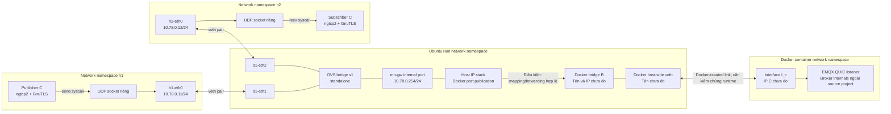
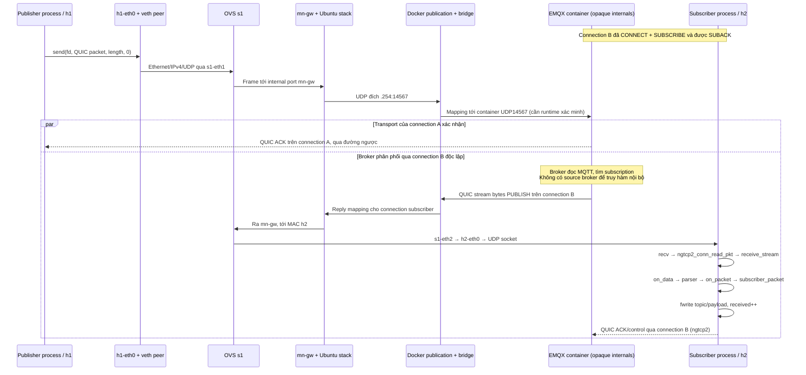

# 05 — Đường đi packet qua Mininet, Ubuntu và Docker

[Bản đồ](00-README.md) · [Startup](01-STARTUP-FLOW.md) · [Gửi](03-PACKET-SEND-FLOW.md) · [Nhận](04-PACKET-RECEIVE-FLOW.md) · [Walkthrough](09-END-TO-END-WALKTHROUGH.md)

## 1. Câu hỏi cần trả lời và giới hạn chứng minh

Tài liệu này nối `send()` của process C với `recv()` ở phía còn lại bằng **đường mạng**, không bằng một danh sách lời gọi C tưởng tượng. Khi frame đi từ h1-eth0 sang s1-eth1, không có lời gọi hàm `s1_eth1()` trong project. Packet được Linux/OVS/Docker xử lý sau khi ứng dụng giao nó cho socket. Các điểm giao userspace thật nằm ở `send()` và `recv()`. [clients/quic_client.c:322–335](/home/nguyenluongduc/Github/QUIC/ZerotoHeroWithQUIC/src/PrgSocket/QUICSocket/mqtt-quic/clients/quic_client.c:322) [clients/quic_client.c:452–465](/home/nguyenluongduc/Github/QUIC/ZerotoHeroWithQUIC/src/PrgSocket/QUICSocket/mqtt-quic/clients/quic_client.c:452)

Mức bằng chứng trong tài liệu:

| Nhãn | Có nghĩa gì? | Ví dụ |
|---|---|---|
| **SOURCE** | Đã đọc implementation của project | Tạo `mn-gw`, gán IP, client dùng UDP connect |
| **LIB** | Đã đọc source thư viện cài trên máy | Mininet tạo veth fast path, gán tên ethN |
| **CONFIG** | Có khai báo yêu cầu, chưa xác minh runtime mới | Docker publish UDP14567, driver bridge, EMQX bind |
| **HỆ ĐIỀU HÀNH** | Mô hình Linux/Docker/OVS giải thích bước ngoài code ứng dụng | Route lookup, ARP, NAT/conntrack |
| **CHƯA XÁC MINH** | Thiếu dữ liệu runtime hoặc source implementation | IP container hiện tại, rule DNAT cụ thể, hàm broker parse packet |

Lần khảo sát này không chạy topology, inspect container, capture packet hoặc sửa rule. Chỉ đọc source/config/thư viện và đối chiếu tài liệu chính thức. Do đó các sơ đồ mô tả đường đi được cấu hình/dự kiến, không phải bằng chứng tcpdump của phiên đang chạy.

Không lấy địa chỉ Docker bridge từ một lần kiểm thử cũ làm hằng số. Compose chỉ chọn bridge network tên logic `broker`, không khai báo subnet/IPAM, IP tĩnh, host-side veth name hoặc tên interface container. [docker/compose.yaml:27–34](/home/nguyenluongduc/Github/QUIC/ZerotoHeroWithQUIC/src/PrgSocket/QUICSocket/mqtt-quic/docker/compose.yaml:27)

## 2. Những thành phần thực sự được source tạo

Với lựa chọn `--subnet 10.78.0.0/24`, các giá trị suy ra từ phép cộng địa chỉ trong source là:

| Thành phần | Namespace | IP / tên interface | Ai tạo hoặc cấu hình? | Bằng chứng |
|---|---|---|---|---|
| Publisher | h1 network namespace | local `.11`, source UDP port do Linux chọn | h1.popen và socket_open | [mininet/topology.py:190–191](/home/nguyenluongduc/Github/QUIC/ZerotoHeroWithQUIC/src/PrgSocket/QUICSocket/mqtt-quic/mininet/topology.py:190) [clients/quic_client.c:224–235](/home/nguyenluongduc/Github/QUIC/ZerotoHeroWithQUIC/src/PrgSocket/QUICSocket/mqtt-quic/clients/quic_client.c:224) |
| h1 interface | h1 | h1-eth0, `10.78.0.11/24` | Mininet addHost/addLink/build | [mininet/topology.py:264–269](/home/nguyenluongduc/Github/QUIC/ZerotoHeroWithQUIC/src/PrgSocket/QUICSocket/mqtt-quic/mininet/topology.py:264) [LIB/link.py:439–446](/usr/lib/python3/dist-packages/mininet/link.py:439) |
| Peer h1 | Ubuntu/root | s1-eth1 | Link naming + Switch portBase | [LIB/node.py:899](/usr/lib/python3/dist-packages/mininet/node.py:899) [LIB/link.py:481–485](/usr/lib/python3/dist-packages/mininet/link.py:481) |
| Subscriber | h2 network namespace | local `.12`, source port do Linux chọn | h2.popen và socket_open | [mininet/topology.py:186–187](/home/nguyenluongduc/Github/QUIC/ZerotoHeroWithQUIC/src/PrgSocket/QUICSocket/mqtt-quic/mininet/topology.py:186) [clients/quic_client.c:224–235](/home/nguyenluongduc/Github/QUIC/ZerotoHeroWithQUIC/src/PrgSocket/QUICSocket/mqtt-quic/clients/quic_client.c:224) |
| h2 interface | h2 | h2-eth0, `10.78.0.12/24` | Mininet | [mininet/topology.py:265–269](/home/nguyenluongduc/Github/QUIC/ZerotoHeroWithQUIC/src/PrgSocket/QUICSocket/mqtt-quic/mininet/topology.py:265) |
| Peer h2 | Ubuntu/root | s1-eth2 | Link thứ hai vào s1 | [mininet/topology.py:267–268](/home/nguyenluongduc/Github/QUIC/ZerotoHeroWithQUIC/src/PrgSocket/QUICSocket/mqtt-quic/mininet/topology.py:267) [LIB/node.py:443–447](/usr/lib/python3/dist-packages/mininet/node.py:443) |
| s1 | Ubuntu/root datapath | OVS bridge, không có IP broker riêng trên port dữ liệu | OwnedBridge.start | [mininet/topology.py:97–107](/home/nguyenluongduc/Github/QUIC/ZerotoHeroWithQUIC/src/PrgSocket/QUICSocket/mqtt-quic/mininet/topology.py:97) |
| mn-gw | Ubuntu/root | `10.78.0.254/24`, type internal | main gọi ovs/ip | [mininet/topology.py:271–276](/home/nguyenluongduc/Github/QUIC/ZerotoHeroWithQUIC/src/PrgSocket/QUICSocket/mqtt-quic/mininet/topology.py:271) |
| Docker bridge | Ubuntu/root | Ký hiệu `B`, tên/subnet runtime chưa biết | Docker bridge driver theo Compose | [docker/compose.yaml:27–34](/home/nguyenluongduc/Github/QUIC/ZerotoHeroWithQUIC/src/PrgSocket/QUICSocket/mqtt-quic/docker/compose.yaml:27) |
| Container interface | Namespace container | Ký hiệu `I_c`, IP `C` chưa biết | Docker, không do topology.py đặt | [docker/compose.yaml:3–28](/home/nguyenluongduc/Github/QUIC/ZerotoHeroWithQUIC/src/PrgSocket/QUICSocket/mqtt-quic/docker/compose.yaml:3) |
| EMQX | Namespace container | listener CONFIG `0.0.0.0:14567/UDP` | Image ngoài project đọc emqx.conf | [docker/emqx.conf:17–26](/home/nguyenluongduc/Github/QUIC/ZerotoHeroWithQUIC/src/PrgSocket/QUICSocket/mqtt-quic/docker/emqx.conf:17) |

Ở h1/h2, **network namespace** có bảng địa chỉ, route và socket riêng. Chạy lệnh trong namespace đúng quyết định socket thuộc môi trường mạng nào; file executable giống nhau không khiến socket tự thuộc root namespace. Khái niệm isolation này được mô tả trong [network_namespaces(7)](https://man7.org/linux/man-pages/man7/network_namespaces.7.html). Cách Mininet chọn namespace thực tế được kiểm tra ở [LIB/node.py:141–168](/usr/lib/python3/dist-packages/mininet/node.py:141) và [LIB/node.py:397–423](/usr/lib/python3/dist-packages/mininet/node.py:397).

`mnexec -n` của bản đang cài tạo cả network và mount namespaces; `-a PID` đi vào hai namespace đó theo manpage [mnexec.1.gz](/usr/share/man/man1/mnexec.1.gz). Source không truyền cờ tạo PID namespace. Không suy ra “h1 là một máy ảo” hoặc “ps trong h2 chỉ nhìn thấy process h2”. Vòng đời các object/shell xem [LIB/node.py:83–124](/usr/lib/python3/dist-packages/mininet/node.py:83) và [LIB/node.py:275–281](/usr/lib/python3/dist-packages/mininet/node.py:275).

## 3. Sơ đồ topology và ranh giới tầng



Cơ sở topology s1/h1/h2/internal port: [mininet/topology.py:263–276](/home/nguyenluongduc/Github/QUIC/ZerotoHeroWithQUIC/src/PrgSocket/QUICSocket/mqtt-quic/mininet/topology.py:263); veth do Mininet tạo: [LIB/link.py:452–469](/usr/lib/python3/dist-packages/mininet/link.py:452) [LIB/util.py:237–271](/usr/lib/python3/dist-packages/mininet/util.py:237); Docker bridge yêu cầu bởi [docker/compose.yaml:27–34](/home/nguyenluongduc/Github/QUIC/ZerotoHeroWithQUIC/src/PrgSocket/QUICSocket/mqtt-quic/docker/compose.yaml:27). Phần tên/IP Docker để ký hiệu vì không nằm trong source. Sơ đồ không khẳng định đã quan sát host-side veth cụ thể.

Các đường h1/h2 tới broker dùng chung đoạn s1–mn-gw nhưng là **hai QUIC connection riêng**. Broker kết thúc connection A của publisher, xử lý MQTT, rồi phát packet MQTT mới trên connection B của subscriber. Không có việc OVS tự đọc topic hay nối stream A sang B. Việc tạo một transport object/connection riêng mỗi lần executable chạy được chứng minh tại [clients/quic_client.c:542–570](/home/nguyenluongduc/Github/QUIC/ZerotoHeroWithQUIC/src/PrgSocket/QUICSocket/mqtt-quic/clients/quic_client.c:542); role pub/sub được chọn ở [clients/publisher.c:42–48](/home/nguyenluongduc/Github/QUIC/ZerotoHeroWithQUIC/src/PrgSocket/QUICSocket/mqtt-quic/clients/publisher.c:42) và [clients/subscriber.c:113–124](/home/nguyenluongduc/Github/QUIC/ZerotoHeroWithQUIC/src/PrgSocket/QUICSocket/mqtt-quic/clients/subscriber.c:113).

## 4. Hop 0: người dùng gõ h1 nhưng process thực sự chạy ở đâu?

### 4.1. Hai đường tạo process

Trong test, `run_test` gọi `h1.popen(publisher_command, cwd=ROOT, stdout=publisher_log, stderr=STDOUT)`. Mininet Node.popen prepend `mnexec -da <h1.pid>` rồi subprocess.Popen. h1.pid là PID shell namespace được tạo trước đó. Như vậy publisher vào môi trường mạng h1 trước khi main C chạy. [mininet/topology.py:190–191](/home/nguyenluongduc/Github/QUIC/ZerotoHeroWithQUIC/src/PrgSocket/QUICSocket/mqtt-quic/mininet/topology.py:190) [LIB/node.py:397–423](/usr/lib/python3/dist-packages/mininet/node.py:397) [LIB/node.py:154–168](/usr/lib/python3/dist-packages/mininet/node.py:154)

Trong CLI, từ đầu `h1` được `CLI.default` nhận diện như tên Node; phần còn lại gửi vào shell Node bằng sendCmd rồi đợi. `h1` không phải argument của publisher và không phải một C function. `sh ...` lại chạy trên shell host qua `call(..., shell=True)`. [LIB/cli.py:416–439](/usr/lib/python3/dist-packages/mininet/cli.py:416) [LIB/cli.py:172–176](/usr/lib/python3/dist-packages/mininet/cli.py:172)

### 4.2. Trạng thái trước khi packet được gửi

Publisher main → app main → quic_client_run → socket_open, connection_init, tls_init → event_loop. Các bước này cùng process C, không có IPC gọi hàm subscriber. Chỉ sau handshake verified, open_stream mới gọi on_ready để queue CONNECT; publisher_connected chỉ queue PUBLISH sau CONNACK. [clients/publisher.c:42–48](/home/nguyenluongduc/Github/QUIC/ZerotoHeroWithQUIC/src/PrgSocket/QUICSocket/mqtt-quic/clients/publisher.c:42) [clients/app.c:37–63](/home/nguyenluongduc/Github/QUIC/ZerotoHeroWithQUIC/src/PrgSocket/QUICSocket/mqtt-quic/clients/app.c:37) [clients/quic_client.c:567–570](/home/nguyenluongduc/Github/QUIC/ZerotoHeroWithQUIC/src/PrgSocket/QUICSocket/mqtt-quic/clients/quic_client.c:567) [clients/quic_client.c:338–347](/home/nguyenluongduc/Github/QUIC/ZerotoHeroWithQUIC/src/PrgSocket/QUICSocket/mqtt-quic/clients/quic_client.c:338)

Chi tiết byte MQTT/QUIC trong [03](03-PACKET-SEND-FLOW.md). Ở đây ta bắt đầu tại thời điểm transport đã tạo một buffer QUIC packet và chuẩn bị send xuống UDP. Không đồng nhất một MQTT packet với một UDP datagram; flush có thể tạo nhiều datagram hoặc packet chỉ chứa control transport. [clients/quic_client.c:350–393](/home/nguyenluongduc/Github/QUIC/ZerotoHeroWithQUIC/src/PrgSocket/QUICSocket/mqtt-quic/clients/quic_client.c:350)

## 5. Hop 1: socket_open chọn endpoint và local address

Hàm project thực tế là:

```c
static int socket_open(quic_client *c);
```

Định nghĩa: [clients/quic_client.c:212–236](/home/nguyenluongduc/Github/QUIC/ZerotoHeroWithQUIC/src/PrgSocket/QUICSocket/mqtt-quic/clients/quic_client.c:212). Caller: chuỗi startup tại [clients/quic_client.c:567](/home/nguyenluongduc/Github/QUIC/ZerotoHeroWithQUIC/src/PrgSocket/QUICSocket/mqtt-quic/clients/quic_client.c:567). `c` là object heap của process hiện tại, do calloc tạo; hàm đổi các trường `remote`, `fd`, `local`, không tạo đối tượng broker. Object sống tới cleanup quic_client_run. [clients/quic_client.c:548–555](/home/nguyenluongduc/Github/QUIC/ZerotoHeroWithQUIC/src/PrgSocket/QUICSocket/mqtt-quic/clients/quic_client.c:548) [clients/quic_client.c:574–581](/home/nguyenluongduc/Github/QUIC/ZerotoHeroWithQUIC/src/PrgSocket/QUICSocket/mqtt-quic/clients/quic_client.c:574)

### 5.1. Giá trị remote đi từ đâu tới?

Python tạo command có `--host gateway`, gateway=subnet+254, port chuỗi `14567`. getopt_long ghi optarg vào options.host/options.port; c->options mượn địa chỉ options. socket_open parse chuỗi port, inet_pton numeric IPv4 và ghi sockaddr_in remote. [mininet/topology.py:127–132](/home/nguyenluongduc/Github/QUIC/ZerotoHeroWithQUIC/src/PrgSocket/QUICSocket/mqtt-quic/mininet/topology.py:127) [clients/app.c:134–144](/home/nguyenluongduc/Github/QUIC/ZerotoHeroWithQUIC/src/PrgSocket/QUICSocket/mqtt-quic/clients/app.c:134) [clients/quic_client.c:550](/home/nguyenluongduc/Github/QUIC/ZerotoHeroWithQUIC/src/PrgSocket/QUICSocket/mqtt-quic/clients/quic_client.c:550) [clients/quic_client.c:213–223](/home/nguyenluongduc/Github/QUIC/ZerotoHeroWithQUIC/src/PrgSocket/QUICSocket/mqtt-quic/clients/quic_client.c:213)

Trong tình huống `.78`:

```text
c->remote.sin_family = AF_INET
c->remote.sin_addr   = IPv4 10.78.0.254, network byte order
c->remote.sin_port   = htons(14567)
```

Các phép chuyển đổi nêu trên do code thực hiện; con số source UDP port và fd không được hardcode. [clients/quic_client.c:215–224](/home/nguyenluongduc/Github/QUIC/ZerotoHeroWithQUIC/src/PrgSocket/QUICSocket/mqtt-quic/clients/quic_client.c:215)

### 5.2. Socket API và mọi argument tại call site

| Lời gọi thực tế | Argument và nguồn | Tác động/return |
|---|---|---|
| `socket(AF_INET, SOCK_DGRAM, 0)` | IPv4, datagram, protocol mặc định cho loại socket | Trả fd local trong process hoặc -1; fd lưu vào c->fd |
| `fcntl(c->fd, F_GETFL, 0)` | fd vừa tạo, đọc flags | Trả flags cũ hoặc lỗi |
| `fcntl(c->fd, F_SETFL, flags \| O_NONBLOCK)` | flags vừa đọc cộng nonblocking | recv/send không chờ vô hạn khi chưa có dữ liệu/chỗ gửi |
| `connect(c->fd, (struct sockaddr *)&c->remote, sizeof(c->remote))` | fd riêng, sockaddr đã điền, size struct | Gắn peer UDP; không phải TCP handshake |
| `getsockname(c->fd, (struct sockaddr *)&c->local, &length)` | length khởi tạo sizeof(c->local), buffer nằm trong c | Ghi local address/port thực và cập nhật length |

Bằng chứng toàn bảng: [clients/quic_client.c:224–235](/home/nguyenluongduc/Github/QUIC/ZerotoHeroWithQUIC/src/PrgSocket/QUICSocket/mqtt-quic/clients/quic_client.c:224). Project không có bind/listen/accept ở client; không dùng recvfrom/sendto ở luồng này.

**HỆ ĐIỀU HÀNH:** UDP connect chọn peer mặc định để send không cần truyền địa chỉ; socket chưa bind được Linux gán local port thích hợp. Điều đó không tạo bảo đảm delivery của UDP hoặc QUIC handshake thành công. Nguồn giao diện hệ thống: [udp(7)](https://man7.org/linux/man-pages/man7/udp.7.html). Địa chỉ cụ thể trong c->local được quan sát bằng getsockname trong source, không được tài liệu này tự gán một port ví dụ làm port thật.

### 5.3. Vì sao local IP dự kiến là .11?

h1 được cấu hình `.11/24` trên interface duy nhất đi ra lab; destination `.254` nằm cùng prefix. Với bảng route bình thường do cấu hình này tạo, Linux chọn h1-eth0 và source `.11`. Đây là suy luận có điều kiện từ địa chỉ/interface và UDP connect, không phải dump route runtime. Nếu có policy routing hoặc cấu hình khác được thêm ngoài project, phải dùng `ip route get`/getsockname để kiểm tra lại. [mininet/topology.py:264–269](/home/nguyenluongduc/Github/QUIC/ZerotoHeroWithQUIC/src/PrgSocket/QUICSocket/mqtt-quic/mininet/topology.py:264) [LIB/link.py:76–88](/usr/lib/python3/dist-packages/mininet/link.py:76) [clients/quic_client.c:232–235](/home/nguyenluongduc/Github/QUIC/ZerotoHeroWithQUIC/src/PrgSocket/QUICSocket/mqtt-quic/clients/quic_client.c:232)

## 6. Hop 2: từ send_datagram vào Linux h1

Hàm project:

```c
static int send_datagram(quic_client *c, const uint8_t *data, size_t length);
```

Định nghĩa/call site: [clients/quic_client.c:322–335](/home/nguyenluongduc/Github/QUIC/ZerotoHeroWithQUIC/src/PrgSocket/QUICSocket/mqtt-quic/clients/quic_client.c:322) [clients/quic_client.c:389](/home/nguyenluongduc/Github/QUIC/ZerotoHeroWithQUIC/src/PrgSocket/QUICSocket/mqtt-quic/clients/quic_client.c:389). Đây là lời gọi đồng bộ trong flush_packets, không phải callback do Linux tự tìm theo tên.

| Tham số | Nguồn | Dữ liệu/vòng đời/ownership | Tác động |
|---|---|---|---|
| c | Transport của publisher | Heap object còn sống; helper mượn | Lấy đúng fd thuộc namespace h1 |
| data | `packet` buffer của flush_packets | Array stack chứa QUIC packet do ngtcp2 viết; helper không free/sửa | UDP payload gửi xuống kernel |
| length | Số byte ngtcp2_conn_writev_stream trả về dương | Không phải strlen và không gồm Ethernet/IP/UDP header do kernel tạo | Giới hạn byte send |

Helper tạo deadline monotonic một giây, gọi `send(c->fd, data, length, 0)`. Nếu số byte trả đúng length thì thành công; EINTR retry; EAGAIN/EWOULDBLOCK thì poll POLLOUT 10 ms trong giới hạn, còn lỗi khác/quá hạn thì perror và -1. Byte array còn hợp lệ trong mọi lần retry vì caller chưa return. [clients/quic_client.c:322–335](/home/nguyenluongduc/Github/QUIC/ZerotoHeroWithQUIC/src/PrgSocket/QUICSocket/mqtt-quic/clients/quic_client.c:322)

`send()` thành công chỉ xác nhận syscall nhận số byte cần gửi, chưa xác nhận broker nhận, chưa xác nhận stream ACK, càng chưa xác nhận subscriber nhận payload. Project dùng tx counters/ACK callback cho mốc transport riêng, test dùng log h2 cho mốc end-to-end. [clients/quic_client.c:174–187](/home/nguyenluongduc/Github/QUIC/ZerotoHeroWithQUIC/src/PrgSocket/QUICSocket/mqtt-quic/clients/quic_client.c:174) [clients/publisher.c:28–38](/home/nguyenluongduc/Github/QUIC/ZerotoHeroWithQUIC/src/PrgSocket/QUICSocket/mqtt-quic/clients/publisher.c:28) [mininet/topology.py:194–200](/home/nguyenluongduc/Github/QUIC/ZerotoHeroWithQUIC/src/PrgSocket/QUICSocket/mqtt-quic/mininet/topology.py:194)

Sau syscall, không có lời gọi C trực tiếp từ publisher tới switch. Linux tạo/điền các header IP/UDP, chọn route/interface, xử lý neighbor và chuyển frame qua thiết bị của namespace. Đây là phần **HỆ ĐIỀU HÀNH**; code ứng dụng chỉ đưa QUIC bytes vào socket. Cấu hình sockaddr network byte order và loại socket tương ứng giao diện [ip(7)](https://man7.org/linux/man-pages/man7/ip.7.html); code gọi socket/connect tại [clients/quic_client.c:216–235](/home/nguyenluongduc/Github/QUIC/ZerotoHeroWithQUIC/src/PrgSocket/QUICSocket/mqtt-quic/clients/quic_client.c:216).

## 7. Hop 3: route và ARP trong h1

### 7.1. Không cần đặt .254 làm default route của h1

Main truyền IP `/24` nhưng không truyền defaultRoute. Mininet Node.config có defaultRoute=None và setParam bỏ qua giá trị None. Đích `.254` cùng `/24`, nên đường đi dự kiến là connected route qua h1-eth0 chứ không cần `default via .254`. [mininet/topology.py:264–265](/home/nguyenluongduc/Github/QUIC/ZerotoHeroWithQUIC/src/PrgSocket/QUICSocket/mqtt-quic/mininet/topology.py:264) [LIB/node.py:589–624](/usr/lib/python3/dist-packages/mininet/node.py:589)

Đây là sự khác biệt giữa hai câu:

```text
Ứng dụng kết nối đến host 10.78.0.254, port 14567.
```

và:

```text
Hệ điều hành đặt default gateway là 10.78.0.254.
```

Project thực hiện câu đầu qua --host; không có lời gọi setDefaultRoute trong startup của h1/h2 với tham số khác None. Tên biến `gateway` không thay thế một lệnh cấu hình routing. [mininet/topology.py:128–132](/home/nguyenluongduc/Github/QUIC/ZerotoHeroWithQUIC/src/PrgSocket/QUICSocket/mqtt-quic/mininet/topology.py:128) [LIB/node.py:610–624](/usr/lib/python3/dist-packages/mininet/node.py:610)

### 7.2. Neighbor resolution trước khi đưa frame lên veth

**HỆ ĐIỀU HÀNH:** ARP ánh xạ địa chỉ IPv4 trực tiếp tới MAC và dùng neighbor cache; thiếu ánh xạ thì kernel thực hiện resolution. Nguồn mô tả giao thức kernel: [arp(7)](https://man7.org/linux/man-pages/man7/arp.7.html). Project không có hàm encode/parse ARP trong client; nó dùng socket UDP IPv4. [clients/quic_client.c:224](/home/nguyenluongduc/Github/QUIC/ZerotoHeroWithQUIC/src/PrgSocket/QUICSocket/mqtt-quic/clients/quic_client.c:224)

Với route on-link tới `.254`, địa chỉ cần tìm MAC là `.254`. Đó là MAC của internal interface mn-gw, không phải MAC container và không phải MAC s1-eth1. Đây là suy luận từ đích local Ubuntu và port internal đã gán IP. [mininet/topology.py:271–276](/home/nguyenluongduc/Github/QUIC/ZerotoHeroWithQUIC/src/PrgSocket/QUICSocket/mqtt-quic/mininet/topology.py:271)

Mininet default `autoStaticArp=False`, project không ghi đè thành True; build chỉ staticArp khi cờ bật. Vì thế không có bảng ARP tĩnh all-pairs được topology chuẩn bị. [LIB/net.py:122](/usr/lib/python3/dist-packages/mininet/net.py:122) [LIB/net.py:515–516](/usr/lib/python3/dist-packages/mininet/net.py:515)

Tuy nhiên check_ip chạy trước khi client spawn nên ping h1→.254 có thể đã làm neighbor cache nóng. Không được khẳng định “mỗi lần PUBLISH đều phát một ARP request mới”. Thời điểm ARP thật phụ thuộc cache runtime. [mininet/topology.py:209–222](/home/nguyenluongduc/Github/QUIC/ZerotoHeroWithQUIC/src/PrgSocket/QUICSocket/mqtt-quic/mininet/topology.py:209) [mininet/topology.py:281–283](/home/nguyenluongduc/Github/QUIC/ZerotoHeroWithQUIC/src/PrgSocket/QUICSocket/mqtt-quic/mininet/topology.py:281)

### 7.3. MAC host được suy ra từ library thế nào?

make_network bật autoSetMacs, nhưng net.nextIP khởi tạo từ ipBase mặc định của Mininet và bắt đầu 1. addHost tạo MAC từ nextIP trước khi merge IP explicit `.11`/`.12`. Do đó hai host MAC theo source/thứ tự hiện tại là `00:00:00:00:00:01`, `00:00:00:00:00:02`. Chúng được set khi build/configHosts. [mininet/topology.py:123](/home/nguyenluongduc/Github/QUIC/ZerotoHeroWithQUIC/src/PrgSocket/QUICSocket/mqtt-quic/mininet/topology.py:123) [LIB/net.py:149–153](/usr/lib/python3/dist-packages/mininet/net.py:149) [LIB/net.py:219–232](/usr/lib/python3/dist-packages/mininet/net.py:219) [LIB/net.py:434–443](/usr/lib/python3/dist-packages/mininet/net.py:434) [LIB/node.py:622–623](/usr/lib/python3/dist-packages/mininet/node.py:622)

Port phía switch nhận MAC random khi addLink tạo addr2, còn mn-gw được OVS tạo không có `mac=` cố định trong command. Không thể từ source điền một MAC cụ thể cho mn-gw hay host-side Docker veth. [LIB/net.py:402–406](/usr/lib/python3/dist-packages/mininet/net.py:402) [mininet/topology.py:271–272](/home/nguyenluongduc/Github/QUIC/ZerotoHeroWithQUIC/src/PrgSocket/QUICSocket/mqtt-quic/mininet/topology.py:271)

## 8. Hop 4: veth h1-eth0 ↔ s1-eth1

Mininet addLink mặc định chọn Link, port host bắt đầu 0 và port switch bắt đầu 1. Tên interface là node-ethN; h1 được thêm link trước h2. Vì vậy peer của h1-eth0 là s1-eth1, không phải h2-eth0. [mininet/topology.py:267–268](/home/nguyenluongduc/Github/QUIC/ZerotoHeroWithQUIC/src/PrgSocket/QUICSocket/mqtt-quic/mininet/topology.py:267) [LIB/node.py:81](/usr/lib/python3/dist-packages/mininet/node.py:81) [LIB/node.py:899](/usr/lib/python3/dist-packages/mininet/node.py:899) [LIB/link.py:439–446](/usr/lib/python3/dist-packages/mininet/link.py:439) [LIB/link.py:481–485](/usr/lib/python3/dist-packages/mininet/link.py:481)

**LIB:** fast path của Link tạo veth bằng lệnh chạy trong node1 và đặt peer sang namespace node2 lúc tạo. Với `(h1,s1)`, đầu h1 nằm trong h1, peer s1 nằm ở namespace root do switch được tạo với inNamespace=False. [LIB/link.py:452–469](/usr/lib/python3/dist-packages/mininet/link.py:452) [LIB/util.py:249–268](/usr/lib/python3/dist-packages/mininet/util.py:249) [LIB/net.py:255–266](/usr/lib/python3/dist-packages/mininet/net.py:255)

**HỆ ĐIỀU HÀNH:** veth là cặp thiết bị; frame phát một đầu xuất hiện ở đầu kia, hai đầu có thể ở hai namespace. Nguồn cơ chế: [veth(4)](https://man7.org/linux/man-pages/man4/veth.4.html). Cặp veth không giải mã QUIC, không hiểu MQTT và không phải một relay userspace của project.

Lúc này, trong ví dụ route on-link bình thường, frame đi vào s1-eth1 mang thông tin logic:

```text
Ethernet source: MAC h1-eth0
Ethernet dest:   MAC mn-gw (nếu neighbor resolution đã hoàn tất)
IPv4 source:    10.78.0.11
IPv4 dest:      10.78.0.254
UDP source:     p_pub do Linux chọn
UDP dest:       14567
UDP payload:    QUIC packet bytes
```

Đây là mẫu **suy ra từ cấu hình**, không phải capture. `p_pub` và MAC mn-gw để ký hiệu vì source không ấn định. UDP destination/IP có nguồn trong client_commands và socket_open. [mininet/topology.py:128–132](/home/nguyenluongduc/Github/QUIC/ZerotoHeroWithQUIC/src/PrgSocket/QUICSocket/mqtt-quic/mininet/topology.py:128) [clients/quic_client.c:215–235](/home/nguyenluongduc/Github/QUIC/ZerotoHeroWithQUIC/src/PrgSocket/QUICSocket/mqtt-quic/clients/quic_client.c:215)

## 9. Hop 5: OVS s1 chuyển frame tới internal port mn-gw

### 9.1. Tại sao OVS biết các port?

OwnedBridge.start duyệt interface của s1 và add-port cho port khác 0, chưa có IP. s1-eth1 và s1-eth2 đáp ứng điều kiện. Sau net.start, main add-port mn-gw type internal riêng. Không có lệnh gắn Docker container interface trực tiếp vào s1. [mininet/topology.py:97–107](/home/nguyenluongduc/Github/QUIC/ZerotoHeroWithQUIC/src/PrgSocket/QUICSocket/mqtt-quic/mininet/topology.py:97) [mininet/topology.py:271–272](/home/nguyenluongduc/Github/QUIC/ZerotoHeroWithQUIC/src/PrgSocket/QUICSocket/mqtt-quic/mininet/topology.py:271)

Cấu hình OVS là `fail_mode=standalone`, `controller=None`. Project không cài OpenFlow rule riêng, không có controller process nhận packet-in để quyết định topic/routing. [mininet/topology.py:99–101](/home/nguyenluongduc/Github/QUIC/ZerotoHeroWithQUIC/src/PrgSocket/QUICSocket/mqtt-quic/mininet/topology.py:99) [mininet/topology.py:123](/home/nguyenluongduc/Github/QUIC/ZerotoHeroWithQUIC/src/PrgSocket/QUICSocket/mqtt-quic/mininet/topology.py:123)

**HÀNH VI OVS DỰ KIẾN:** standalone cho phép OVS hoạt động như MAC-learning switch; internal port nối bridge với network stack host và có thể được đặt IP. ovs-vsctl là công cụ cấu hình OVSDB; một transaction có thể gồm nhiều lệnh. Nguồn chính thức: [ovs-vsctl manual](https://www.openvswitch.org/support/dist-docs/ovs-vsctl.8.html). Phiên bản/rule datapath đang chạy chưa được đọc ở lần khảo sát này; source chỉ kiểm tra fail_mode string sau startup. [mininet/topology.py:277–278](/home/nguyenluongduc/Github/QUIC/ZerotoHeroWithQUIC/src/PrgSocket/QUICSocket/mqtt-quic/mininet/topology.py:277)

### 9.2. L2 khác L3 và MQTT

Từ cấu hình trên, đường dự kiến của unicast tới MAC mn-gw là s1-eth1 → datapath s1 → mn-gw. Nếu forwarding database chưa biết đích, cách học/flood của switch quyết định các bản frame trung gian; không được đồng nhất mỗi bản frame quan sát trên h2 với việc subscriber đã nhận MQTT. Subscriber socket chỉ đọc UDP cho peer/port của connection nó. Source receive branch đi qua fd riêng và ngtcp2. [clients/quic_client.c:224–235](/home/nguyenluongduc/Github/QUIC/ZerotoHeroWithQUIC/src/PrgSocket/QUICSocket/mqtt-quic/clients/quic_client.c:224) [clients/quic_client.c:452–465](/home/nguyenluongduc/Github/QUIC/ZerotoHeroWithQUIC/src/PrgSocket/QUICSocket/mqtt-quic/clients/quic_client.c:452)

Port s1-eth1 không phải IP next-hop `.254`; MAC đích không bắt buộc là MAC của port ingress. S1 chuyển frame ở tầng 2; `.254` thuộc internal port Ubuntu. Chỉ khi frame tới IP stack host/Docker mapping mới có xử lý IP/NAT tiếp. Cơ sở phân tách là không gán IP lên s1 data port trong source và gán `.254` vào mn-gw. [mininet/topology.py:102–104](/home/nguyenluongduc/Github/QUIC/ZerotoHeroWithQUIC/src/PrgSocket/QUICSocket/mqtt-quic/mininet/topology.py:102) [mininet/topology.py:275](/home/nguyenluongduc/Github/QUIC/ZerotoHeroWithQUIC/src/PrgSocket/QUICSocket/mqtt-quic/mininet/topology.py:275)

## 10. Hop 6: Ubuntu nhận qua mn-gw và áp dụng Docker publication

### 10.1. Điều được cấu hình chính xác

Compose yêu cầu:

```yaml
ports:
  - "0.0.0.0:14567:14567/udp"
```

Nguồn: [docker/compose.yaml:11–13](/home/nguyenluongduc/Github/QUIC/ZerotoHeroWithQUIC/src/PrgSocket/QUICSocket/mqtt-quic/docker/compose.yaml:11). Đây là endpoint host IPv4 wildcard UDP14567 chuyển tới UDP14567 container, không phải cấu hình publish TCP1883.

Main tạo `10.78.0.254/24` trên một interface host; client kết nối endpoint đó. Từ hai cấu hình này, ta kỳ vọng Docker publication nhận traffic gửi tới `.254:14567` khi container/listener/rules đã hoạt động. Địa chỉ host mới được thêm không yêu cầu client biết IP nội bộ container. [mininet/topology.py:271–280](/home/nguyenluongduc/Github/QUIC/ZerotoHeroWithQUIC/src/PrgSocket/QUICSocket/mqtt-quic/mininet/topology.py:271) [docker/compose.yaml:12](/home/nguyenluongduc/Github/QUIC/ZerotoHeroWithQUIC/src/PrgSocket/QUICSocket/mqtt-quic/docker/compose.yaml:12)

**HÀNH VI DOCKER:** port publication ánh xạ port container lên địa chỉ host; với bridge NAT thông thường Docker triển khai mapping bằng các quy tắc mạng. Các chế độ gateway khác tồn tại nên không thể chỉ từ Compose không có override mà khẳng định rule runtime cụ thể. Nguồn: [Docker port publishing](https://docs.docker.com/engine/network/port-publishing/). Đường minh họa dưới dùng trường hợp NAT thông thường, được ghi rõ là điều kiện.

### 10.2. Nhánh NAT thông thường: đích IP thay đổi trước khi giao broker

**MÔ HÌNH CÓ ĐIỀU KIỆN**, ký hiệu `C` là IP container chưa biết:

```text
Trước Docker mapping:
10.78.0.11:p_pub → 10.78.0.254:14567

Sau destination translation thông thường:
10.78.0.11:p_pub → C:14567
```

Đây là phép suy diễn từ mapping CONFIG, không phải rule đã đọc. Nếu có thêm source NAT hoặc proxy, source nhìn từ container có thể khác `.11:p_pub`; không điền giá trị đó khi chưa quan sát.

**HÀNH VI FIREWALL:** Docker trên Linux tạo rule phục vụ isolation/port publication; có backend iptables hoặc nftables. Với traffic được chuyển đích tới container, không nên giả định nó luôn đi qua host INPUT như một UDP server thông thường. Nguồn: [Docker packet filtering](https://docs.docker.com/engine/network/packet-filtering-firewalls/). Project không chọn backend và không tự cài một rule NAT riêng. [docker/compose.yaml:1–34](/home/nguyenluongduc/Github/QUIC/ZerotoHeroWithQUIC/src/PrgSocket/QUICSocket/mqtt-quic/docker/compose.yaml:1) [mininet/topology.py:263–292](/home/nguyenluongduc/Github/QUIC/ZerotoHeroWithQUIC/src/PrgSocket/QUICSocket/mqtt-quic/mininet/topology.py:263)

Với backend iptables, tài liệu Docker mô tả DNAT đã diễn ra khi packet tới DOCKER-USER và dùng conntrack khi cần đối chiếu tuple đích ban đầu. Tên chain/rule của máy hiện tại vẫn cần inspect. Nguồn: [Docker with iptables](https://docs.docker.com/engine/network/firewall-iptables/). Không dùng mô tả này làm bằng chứng rằng máy đang có chính xác một chain/filter rule cụ thể.

### 10.3. Tại sao “host có IP .254” không đồng nghĩa broker bind socket ở host?

Project C chỉ tạo socket **client**. EMQX được yêu cầu bind trong container qua file mount. Packet tới IP host có thể được Docker chuyển đích/forward trước khi giao một local UDP socket host. Vì vậy việc `ss` root không hiển thị socket C server trên `.254:14567` không đủ kết luận mapping hỏng; cũng không nên khẳng định luôn có docker-proxy process trong đường đi. [clients/quic_client.c:224–235](/home/nguyenluongduc/Github/QUIC/ZerotoHeroWithQUIC/src/PrgSocket/QUICSocket/mqtt-quic/clients/quic_client.c:224) [docker/compose.yaml:12–18](/home/nguyenluongduc/Github/QUIC/ZerotoHeroWithQUIC/src/PrgSocket/QUICSocket/mqtt-quic/docker/compose.yaml:12) [docker/emqx.conf:17–26](/home/nguyenluongduc/Github/QUIC/ZerotoHeroWithQUIC/src/PrgSocket/QUICSocket/mqtt-quic/docker/emqx.conf:17)

Nếu môi trường dùng userland proxy cho trường hợp nào đó, xuất hiện thêm một lần nhận/gửi userspace và tuple phía container thay đổi. Source project không cấu hình hoặc kiểm tra lựa chọn đó. Tài liệu giữ nó là khả năng cần xác minh, không vẽ một lời gọi proxy giả là chắc chắn có.

### 10.4. Có IP forwarding/NAT không?

Câu trả lời phải chia phạm vi:

| Câu hỏi | Trả lời có bằng chứng |
|---|---|
| Topology có tự thêm NAT rule không? | Không có lời gọi iptables/nft trong đường main; nó thêm OVS port/IP/interface. [mininet/topology.py:263–292](/home/nguyenluongduc/Github/QUIC/ZerotoHeroWithQUIC/src/PrgSocket/QUICSocket/mqtt-quic/mininet/topology.py:263) |
| Docker có yêu cầu publish port không? | Có, Compose UDP wildcard mapping. [docker/compose.yaml:12](/home/nguyenluongduc/Github/QUIC/ZerotoHeroWithQUIC/src/PrgSocket/QUICSocket/mqtt-quic/docker/compose.yaml:12) |
| Có thể cần host L3 forwarding để tới bridge container? | Có trong mô hình Docker bridge forwarding; phụ thuộc rules/backend/runtime, chưa đo |
| h1 có dùng .254 như default route không? | Source không truyền defaultRoute; đích .254 on-link. [mininet/topology.py:264–265](/home/nguyenluongduc/Github/QUIC/ZerotoHeroWithQUIC/src/PrgSocket/QUICSocket/mqtt-quic/mininet/topology.py:264) [LIB/node.py:610–624](/usr/lib/python3/dist-packages/mininet/node.py:610) |
| Có thể kết luận hoàn toàn không có NAT vì project không gọi iptables? | Không; Docker daemon quản lý phần này bên ngoài source topology |
| Có bằng chứng một rule DROP đang chặn không? | Không trong lần khảo sát; cần capture/counters |

## 11. Hop 7: Docker bridge và interface container

Compose gắn service emqx vào logical network `broker` với `driver: bridge`. Không dùng `network_mode: host`, không attach container vào OVS s1 bằng topology. [docker/compose.yaml:27–34](/home/nguyenluongduc/Github/QUIC/ZerotoHeroWithQUIC/src/PrgSocket/QUICSocket/mqtt-quic/docker/compose.yaml:27) [mininet/topology.py:263–292](/home/nguyenluongduc/Github/QUIC/ZerotoHeroWithQUIC/src/PrgSocket/QUICSocket/mqtt-quic/mininet/topology.py:263)

**HÀNH VI DOCKER BRIDGE:** container được cấp interface/địa chỉ trong subnet của bridge, bridge cô lập mạng và hỗ trợ publication từ host. Nguồn: [Docker bridge driver](https://docs.docker.com/engine/network/drivers/bridge/). Tên interface trong container thường có prefix eth theo driver nhưng project không ấn định; tài liệu dùng `I_c` để tránh giả định runtime.

Đường dự kiến sau mapping là host routing → bridge B → Docker link → I_c trong container → stack UDP container. Source project không có lệnh tạo Docker veth; đó là implementation Docker daemon/kernel, cần inspect interface/peer để chứng minh trên máy. Cơ sở project duy nhất cho việc tham gia bridge là cấu hình driver/service network nêu trên.

Đến segment Docker, Ethernet header được lựa chọn cho segment đó; không yêu cầu MAC mn-gw là MAC container. Hai miền L2 được nối qua host L3/publication trong mô hình này, không phải một bridge L2 duy nhất s1↔container.

Đường cuối vào broker là listener được cấu hình `0.0.0.0:14567` bên trong container. `0.0.0.0` ở đây là wildcard **của namespace container**, khác wildcard host trong Compose. [docker/emqx.conf:17–19](/home/nguyenluongduc/Github/QUIC/ZerotoHeroWithQUIC/src/PrgSocket/QUICSocket/mqtt-quic/docker/emqx.conf:17) [docker/compose.yaml:12](/home/nguyenluongduc/Github/QUIC/ZerotoHeroWithQUIC/src/PrgSocket/QUICSocket/mqtt-quic/docker/compose.yaml:12)

## 12. Hop 8: broker kết thúc QUIC, rồi chọn subscriber theo MQTT

Không có source implementation EMQX trong project này. Có image declaration, mount config/certificate và các lệnh emqx ctl. Vì vậy không thể chỉ ra một hàm C/Erlang cụ thể bên broker nhận UDP, chọn CID, giải mã và route subscription. Giới hạn source phải dừng ở boundary broker process. [docker/compose.yaml:4–18](/home/nguyenluongduc/Github/QUIC/ZerotoHeroWithQUIC/src/PrgSocket/QUICSocket/mqtt-quic/docker/compose.yaml:4) [scripts/broker.sh:27–29](/home/nguyenluongduc/Github/QUIC/ZerotoHeroWithQUIC/src/PrgSocket/QUICSocket/mqtt-quic/scripts/broker.sh:27)

Điều client/test yêu cầu broker thực hiện là:

1. Nhận QUIC/TLS phù hợp ALPN mqtt và certificate broker.test.
2. Trả CONNACK cho từng MQTT CONNECT.
3. Nhận SUBSCRIBE topic từ connection subscriber và trả SUBACK.
4. Nhận PUBLISH QoS 0 từ publisher và tạo PUBLISH gửi tới subscriber phù hợp.

Các bước này là **hành vi giao thức dự kiến được client chờ đợi**, không phải chuỗi hàm broker tự suy đoán. Client-side điều kiện chứng minh ở [clients/quic_client.c:122–142](/home/nguyenluongduc/Github/QUIC/ZerotoHeroWithQUIC/src/PrgSocket/QUICSocket/mqtt-quic/clients/quic_client.c:122) [clients/app.c:49–63](/home/nguyenluongduc/Github/QUIC/ZerotoHeroWithQUIC/src/PrgSocket/QUICSocket/mqtt-quic/clients/app.c:49) [clients/subscriber.c:20–78](/home/nguyenluongduc/Github/QUIC/ZerotoHeroWithQUIC/src/PrgSocket/QUICSocket/mqtt-quic/clients/subscriber.c:20); test đối chiếu ở [mininet/topology.py:188–200](/home/nguyenluongduc/Github/QUIC/ZerotoHeroWithQUIC/src/PrgSocket/QUICSocket/mqtt-quic/mininet/topology.py:188).

Packet UDP/QUIC nhận từ publisher không được broker chuyển nguyên trạng sang subscriber. Hai connection có CID, packet number, keys và stream state riêng. Byte MQTT đầu ra cũng do phía broker tạo/phân phối. Trên client, mỗi invocation quic_client_run tạo c/conn/TLS riêng; không có shared c giữa executable publisher và subscriber. [clients/quic_client.c:548–570](/home/nguyenluongduc/Github/QUIC/ZerotoHeroWithQUIC/src/PrgSocket/QUICSocket/mqtt-quic/clients/quic_client.c:548) [clients/quic_client.c:239–320](/home/nguyenluongduc/Github/QUIC/ZerotoHeroWithQUIC/src/PrgSocket/QUICSocket/mqtt-quic/clients/quic_client.c:239)

## 13. Chiều phản hồi từ broker về publisher

Trong mô hình NAT thông thường, trả lời của connection A đi theo đường logic:

```text
EMQX
  → UDP stack container I_c
  → Docker link/bridge B
  → host translation/conntrack cho flow A
  → mn-gw
  → s1
  → s1-eth1
  → h1-eth0
  → UDP socket publisher
```

Đây là chiều ngược của mô hình publication đã giải thích, không phải callback C nối qua từng interface. Từ phía client socket đã connected, peer logic vẫn là `10.78.0.254:14567`; vì vậy phản hồi cần được mapping về tuple phù hợp. Cơ sở peer cố định: [clients/quic_client.c:232–235](/home/nguyenluongduc/Github/QUIC/ZerotoHeroWithQUIC/src/PrgSocket/QUICSocket/mqtt-quic/clients/quic_client.c:232); cấu hình publication: [docker/compose.yaml:12](/home/nguyenluongduc/Github/QUIC/ZerotoHeroWithQUIC/src/PrgSocket/QUICSocket/mqtt-quic/docker/compose.yaml:12). Rule/counters/tuple container thực tế chưa được kiểm chứng.

Payload ngược có thể là QUIC handshake, ACK, stream bytes CONNACK hoặc control transport. Một UDP datagram tới socket không nhất thiết tạo on_data. read_packets luôn đưa bytes vào ngtcp2_conn_read_pkt; chỉ stream-data callback hợp lệ mới gọi app data callback. [clients/quic_client.c:452–479](/home/nguyenluongduc/Github/QUIC/ZerotoHeroWithQUIC/src/PrgSocket/QUICSocket/mqtt-quic/clients/quic_client.c:452) [clients/quic_client.c:145–171](/home/nguyenluongduc/Github/QUIC/ZerotoHeroWithQUIC/src/PrgSocket/QUICSocket/mqtt-quic/clients/quic_client.c:145)

QUIC ACK của broker trên connection A xác nhận transport publisher; nó không phải ACK của subscriber và không chứng minh h2 đã in payload. Publisher code QoS 0 chờ pending=0 rồi disconnect, còn test yêu cầu dòng payload từ h2 riêng. [clients/publisher.c:28–38](/home/nguyenluongduc/Github/QUIC/ZerotoHeroWithQUIC/src/PrgSocket/QUICSocket/mqtt-quic/clients/publisher.c:28) [mininet/topology.py:194–200](/home/nguyenluongduc/Github/QUIC/ZerotoHeroWithQUIC/src/PrgSocket/QUICSocket/mqtt-quic/mininet/topology.py:194)

## 14. Chiều broker tới subscriber là connection B

Subscriber h2 đã chủ động tạo UDP/QUIC connection trước, giữ source port `p_sub` riêng. Broker gửi PUBLISH xuống connection B; không phải tự mở một connection QUIC mới tới một listener subscriber. Client transport không cho broker mở application streams mới; dữ liệu đi trên stream của connection client mở. [mininet/topology.py:186–190](/home/nguyenluongduc/Github/QUIC/ZerotoHeroWithQUIC/src/PrgSocket/QUICSocket/mqtt-quic/mininet/topology.py:186) [clients/quic_client.c:269–272](/home/nguyenluongduc/Github/QUIC/ZerotoHeroWithQUIC/src/PrgSocket/QUICSocket/mqtt-quic/clients/quic_client.c:269) [clients/quic_client.c:338–347](/home/nguyenluongduc/Github/QUIC/ZerotoHeroWithQUIC/src/PrgSocket/QUICSocket/mqtt-quic/clients/quic_client.c:338)

Đường logic phía h2:

```text
EMQX trên connection B
  → container interface I_c
  → Docker bridge B
  → host mapping cho flow B
  → mn-gw
  → s1
  → s1-eth2
  → h2-eth0
  → socket UDP subscriber
  → recv()
  → ngtcp2_conn_read_pkt()
  → receive_stream()
  → on_data()
  → mqtt_parser_feed()
  → on_packet()
  → subscriber_packet()
  → mqtt_decode_publish()
  → fwrite(topic/payload)
```

Đoạn từ EMQX tới socket là đường mạng có điều kiện. Đoạn từ recv trở đi là call chain xác minh trong source. Các chuyển tiếp: [clients/quic_client.c:452–465](/home/nguyenluongduc/Github/QUIC/ZerotoHeroWithQUIC/src/PrgSocket/QUICSocket/mqtt-quic/clients/quic_client.c:452) [clients/quic_client.c:145–156](/home/nguyenluongduc/Github/QUIC/ZerotoHeroWithQUIC/src/PrgSocket/QUICSocket/mqtt-quic/clients/quic_client.c:145) [clients/app.c:49–73](/home/nguyenluongduc/Github/QUIC/ZerotoHeroWithQUIC/src/PrgSocket/QUICSocket/mqtt-quic/clients/app.c:49) [clients/mqtt_codec.c:78–97](/home/nguyenluongduc/Github/QUIC/ZerotoHeroWithQUIC/src/PrgSocket/QUICSocket/mqtt-quic/clients/mqtt_codec.c:78) [clients/subscriber.c:50–70](/home/nguyenluongduc/Github/QUIC/ZerotoHeroWithQUIC/src/PrgSocket/QUICSocket/mqtt-quic/clients/subscriber.c:50).

### 14.1. Mọi argument của recv thực tế

```c
uint8_t packet[65536];
ssize_t length = recv(c->fd, packet, sizeof(packet), 0);
```

| Argument | Nguồn và ý nghĩa | Ownership/mutation |
|---|---|---|
| c->fd | Socket subscriber do socket_open tạo trong h2 | Chỉ đọc descriptor; kernel đọc hàng đợi socket |
| packet | Array stack của read_packets hiện tại | Kernel ghi datagram vào buffer, caller giữ tới hết hàm |
| sizeof(packet) | 65536 byte theo khai báo | Sức chứa tối đa, không phải số byte nhận thực |
| flags=0 | Hằng source | Không yêu cầu MSG_PEEK/DONTWAIT; fd đã nonblocking |

Nguồn: [clients/quic_client.c:452–459](/home/nguyenluongduc/Github/QUIC/ZerotoHeroWithQUIC/src/PrgSocket/QUICSocket/mqtt-quic/clients/quic_client.c:452) [clients/quic_client.c:224–228](/home/nguyenluongduc/Github/QUIC/ZerotoHeroWithQUIC/src/PrgSocket/QUICSocket/mqtt-quic/clients/quic_client.c:224). Return length dương là số byte UDP payload đã đọc; EAGAIN/EWOULDBLOCK/EINTR khiến helper trả 0 để event loop tiếp tục, lỗi khác trả -1. Zero datagram bị bỏ và vòng lặp đọc tiếp. [clients/quic_client.c:455–460](/home/nguyenluongduc/Github/QUIC/ZerotoHeroWithQUIC/src/PrgSocket/QUICSocket/mqtt-quic/clients/quic_client.c:455)

### 14.2. Connection nào nhận packet và ai giải mã?

Project tạo một c và một ngtcp2_conn trên mỗi process/client, không có bảng server demultiplex nhiều connection trên cùng fd. read_packets đưa buffer vào c->conn đang có và path_for(c) lấy local/remote đã xác định. ngtcp2 kiểm tra/diễn giải QUIC packet của connection và gọi crypto callbacks/backend đã đăng ký; implementation/API được đối chiếu ở tài liệu 02/04. [clients/quic_client.c:239–281](/home/nguyenluongduc/Github/QUIC/ZerotoHeroWithQUIC/src/PrgSocket/QUICSocket/mqtt-quic/clients/quic_client.c:239) [clients/quic_client.c:461–465](/home/nguyenluongduc/Github/QUIC/ZerotoHeroWithQUIC/src/PrgSocket/QUICSocket/mqtt-quic/clients/quic_client.c:461)

Mạng không mang con trỏ c/app. CID là byte định danh của giao thức, không phải địa chỉ bộ nhớ; user_data là liên kết trong process giúp callback trở lại object đúng. CIDs được sinh và đưa vào conn constructor ở [clients/quic_client.c:274–279](/home/nguyenluongduc/Github/QUIC/ZerotoHeroWithQUIC/src/PrgSocket/QUICSocket/mqtt-quic/clients/quic_client.c:274); c->user trỏ app được lưu ở [clients/quic_client.c:550–552](/home/nguyenluongduc/Github/QUIC/ZerotoHeroWithQUIC/src/PrgSocket/QUICSocket/mqtt-quic/clients/quic_client.c:550).

### 14.3. Điều kiện từ stream tới dữ liệu MQTT

receive_stream kiểm tra ready, đúng stream_id, không có FIN trước, offset liên tục và không 0-RTT; chỉ khi length>0 và callback data đã gắn mới gọi on_data. on_data dùng app.parser ghép stream thành packet; on_packet chuyển packet sau CONNACK sang role.packet. Subscriber chỉ in PUBLISH khi đã SUBSCRIBED và decode/topic hợp lệ. [clients/quic_client.c:145–171](/home/nguyenluongduc/Github/QUIC/ZerotoHeroWithQUIC/src/PrgSocket/QUICSocket/mqtt-quic/clients/quic_client.c:145) [clients/app.c:49–73](/home/nguyenluongduc/Github/QUIC/ZerotoHeroWithQUIC/src/PrgSocket/QUICSocket/mqtt-quic/clients/app.c:49) [clients/subscriber.c:50–70](/home/nguyenluongduc/Github/QUIC/ZerotoHeroWithQUIC/src/PrgSocket/QUICSocket/mqtt-quic/clients/subscriber.c:50)

Sau fwrite, received tăng. Nếu count hữu hạn đã đạt, subscriber queue DISCONNECT và yêu cầu finish; nếu count 0, tiếp tục chờ/ping. Đây là xử lý ứng dụng trên cùng event-loop thread, không phải network tạo một process mới cho mỗi message. [clients/subscriber.c:67–70](/home/nguyenluongduc/Github/QUIC/ZerotoHeroWithQUIC/src/PrgSocket/QUICSocket/mqtt-quic/clients/subscriber.c:67) [clients/app.c:24–34](/home/nguyenluongduc/Github/QUIC/ZerotoHeroWithQUIC/src/PrgSocket/QUICSocket/mqtt-quic/clients/app.c:24) [clients/quic_client.h:20–25](/home/nguyenluongduc/Github/QUIC/ZerotoHeroWithQUIC/src/PrgSocket/QUICSocket/mqtt-quic/clients/quic_client.h:20)

## 15. Sequence end-to-end: hai connection, nhiều tầng



Thứ tự tuyệt đối giữa QUIC ACK publisher và broker chuyển PUBLISH không được source client quy định; sơ đồ biểu diễn hai công việc tách biệt, không khẳng định một packet capture cụ thể. Broker có thể xử lý/gửi theo scheduling của implementation ngoài project. Bằng chứng cho việc test cần cả hai dấu hiệu riêng: [mininet/topology.py:194–200](/home/nguyenluongduc/Github/QUIC/ZerotoHeroWithQUIC/src/PrgSocket/QUICSocket/mqtt-quic/mininet/topology.py:194).

## 16. Bảng tuple qua các boundary

Bảng dưới là mô hình cho subnet `.78` và Docker publication NAT thông thường. `p_pub`, `p_sub`, `C`, các MAC và tuple sau source translation phải đo nếu cần giá trị thật.

| Điểm quan sát | Connection A publisher | Connection B subscriber | Mức chắc chắn |
|---|---|---|---|
| Client remote option | `.254:14567` | `.254:14567` | SOURCE từ command list |
| Client local IP dự kiến | `.11` | `.12` | Suy ra route/config; getsockname là điểm xác nhận |
| Client source port | p_pub | p_sub | Không ấn định trong source |
| Trước host publication | `.11:p_pub → .254:14567` | `.12:p_sub → .254:14567` | Mô hình từ source endpoint |
| Tới broker sau DNAT thông thường | `source thực tế → C:14567` | `source thực tế → C:14567` | Có điều kiện, cần inspect/capture |
| Client thấy phản hồi | `.254:14567 → .11:p_pub` | `.254:14567 → .12:p_sub` | Dự kiến theo peer UDP/publication |
| Application bytes | CONNECT/PUBLISH/DISCONNECT | CONNECT/SUBSCRIBE, nhận PUBLISH, ping | SOURCE codec/session/role |

Cơ sở endpoint và local selection: [mininet/topology.py:128–132](/home/nguyenluongduc/Github/QUIC/ZerotoHeroWithQUIC/src/PrgSocket/QUICSocket/mqtt-quic/mininet/topology.py:128) [clients/quic_client.c:215–235](/home/nguyenluongduc/Github/QUIC/ZerotoHeroWithQUIC/src/PrgSocket/QUICSocket/mqtt-quic/clients/quic_client.c:215). Cơ sở application bytes: [clients/app.c:24–45](/home/nguyenluongduc/Github/QUIC/ZerotoHeroWithQUIC/src/PrgSocket/QUICSocket/mqtt-quic/clients/app.c:24) [clients/publisher.c:12–21](/home/nguyenluongduc/Github/QUIC/ZerotoHeroWithQUIC/src/PrgSocket/QUICSocket/mqtt-quic/clients/publisher.c:12) [clients/subscriber.c:20–78](/home/nguyenluongduc/Github/QUIC/ZerotoHeroWithQUIC/src/PrgSocket/QUICSocket/mqtt-quic/clients/subscriber.c:20).

Port 14567 là UDP port, packet ID 1 là identifier MQTT SUBSCRIBE, stream ID là identifier QUIC, CID là identifier QUIC connection, PID là identifier process. Không dùng chúng thay thế cho nhau. Nguồn tạo/kiểm tra từng loại: [mininet/topology.py:129](/home/nguyenluongduc/Github/QUIC/ZerotoHeroWithQUIC/src/PrgSocket/QUICSocket/mqtt-quic/mininet/topology.py:129) [clients/subscriber.c:25–41](/home/nguyenluongduc/Github/QUIC/ZerotoHeroWithQUIC/src/PrgSocket/QUICSocket/mqtt-quic/clients/subscriber.c:25) [clients/quic_client.c:274–279](/home/nguyenluongduc/Github/QUIC/ZerotoHeroWithQUIC/src/PrgSocket/QUICSocket/mqtt-quic/clients/quic_client.c:274) [clients/quic_client.c:338–344](/home/nguyenluongduc/Github/QUIC/ZerotoHeroWithQUIC/src/PrgSocket/QUICSocket/mqtt-quic/clients/quic_client.c:338) [clients/app.c:120–121](/home/nguyenluongduc/Github/QUIC/ZerotoHeroWithQUIC/src/PrgSocket/QUICSocket/mqtt-quic/clients/app.c:120).

## 17. Những gì topology không triển khai

| Thành phần/tính năng dễ hiểu nhầm | Trạng thái theo source |
|---|---|
| Router C hoặc forwarding loop của project | Không có; source topology gọi OVS/ip, C client chỉ UDP/QUIC. [mininet/topology.py:263–292](/home/nguyenluongduc/Github/QUIC/ZerotoHeroWithQUIC/src/PrgSocket/QUICSocket/mqtt-quic/mininet/topology.py:263) [clients/quic_client.c:212–236](/home/nguyenluongduc/Github/QUIC/ZerotoHeroWithQUIC/src/PrgSocket/QUICSocket/mqtt-quic/clients/quic_client.c:212) |
| Mininet controller | Không tạo, controller=None. [mininet/topology.py:123](/home/nguyenluongduc/Github/QUIC/ZerotoHeroWithQUIC/src/PrgSocket/QUICSocket/mqtt-quic/mininet/topology.py:123) |
| Veth nối trực tiếp s1 vào container | Không có lời gọi Docker attach/OVS add-port container trong topology. [mininet/topology.py:263–292](/home/nguyenluongduc/Github/QUIC/ZerotoHeroWithQUIC/src/PrgSocket/QUICSocket/mqtt-quic/mininet/topology.py:263) |
| Container nằm trong h1 hoặc h2 namespace | Không cấu hình; h1/h2 do Mininet, broker network do Docker. [mininet/topology.py:264–268](/home/nguyenluongduc/Github/QUIC/ZerotoHeroWithQUIC/src/PrgSocket/QUICSocket/mqtt-quic/mininet/topology.py:264) [docker/compose.yaml:27–34](/home/nguyenluongduc/Github/QUIC/ZerotoHeroWithQUIC/src/PrgSocket/QUICSocket/mqtt-quic/docker/compose.yaml:27) |
| Default gateway `.254` được set cho h1/h2 | Không truyền defaultRoute, chỉ IP `/24`. [mininet/topology.py:264–265](/home/nguyenluongduc/Github/QUIC/ZerotoHeroWithQUIC/src/PrgSocket/QUICSocket/mqtt-quic/mininet/topology.py:264) |
| Traffic shaping tự bật | Không dùng TCLink/TCIntf trong constructor project; Link mặc định. [mininet/topology.py:123](/home/nguyenluongduc/Github/QUIC/ZerotoHeroWithQUIC/src/PrgSocket/QUICSocket/mqtt-quic/mininet/topology.py:123) [LIB/net.py:118–123](/usr/lib/python3/dist-packages/mininet/net.py:118) |
| HTTP/3 hoặc proxy chuyển MQTT/TCP sang QUIC | Client dùng ALPN mqtt và QUIC trực tiếp; TCP listener broker tắt. [clients/quic_client.c:285](/home/nguyenluongduc/Github/QUIC/ZerotoHeroWithQUIC/src/PrgSocket/QUICSocket/mqtt-quic/clients/quic_client.c:285) [docker/emqx.conf:13–19](/home/nguyenluongduc/Github/QUIC/ZerotoHeroWithQUIC/src/PrgSocket/QUICSocket/mqtt-quic/docker/emqx.conf:13) |
| Subscriber là UDP server lắng nghe port14567 | Không; nó dùng cùng client socket_open và chủ động connect. [clients/subscriber.c:124](/home/nguyenluongduc/Github/QUIC/ZerotoHeroWithQUIC/src/PrgSocket/QUICSocket/mqtt-quic/clients/subscriber.c:124) [clients/app.c:161](/home/nguyenluongduc/Github/QUIC/ZerotoHeroWithQUIC/src/PrgSocket/QUICSocket/mqtt-quic/clients/app.c:161) [clients/quic_client.c:224–235](/home/nguyenluongduc/Github/QUIC/ZerotoHeroWithQUIC/src/PrgSocket/QUICSocket/mqtt-quic/clients/quic_client.c:224) |
| Source code EMQX packet routing | Không có trong project; image binary/config là boundary. [docker/compose.yaml:4](/home/nguyenluongduc/Github/QUIC/ZerotoHeroWithQUIC/src/PrgSocket/QUICSocket/mqtt-quic/docker/compose.yaml:4) |

## 18. Quan sát để nâng CONFIG/dự kiến thành bằng chứng runtime

Các lệnh dưới chỉ là **đề xuất quan sát**, không được thực thi trong đợt viết tài liệu. Cần có phiên topology đang chạy để interface tồn tại. Không ghi sẵn output giả.

### 18.1. Trong Mininet CLI

```text
h1 ip -4 address show dev h1-eth0
h1 ip -4 route show
h1 ip -4 route get 10.78.0.254
h1 ip neigh show dev h1-eth0
h1 ss -uapn
h2 ip -4 route show
h2 ss -uapn
py h1.pid
py h2.pid
```

Các lệnh route/neighbor/socket giúp kiểm tra giả định source `.11/.12`, connected route, MAC neighbor và port động. `py h1.pid` trả PID shell do Mininet giữ, không phải tự động PID publisher. Cơ sở shell PID: [LIB/node.py:162–168](/usr/lib/python3/dist-packages/mininet/node.py:162); popen tạo process mới từ PID đó: [LIB/node.py:397–423](/usr/lib/python3/dist-packages/mininet/node.py:397).

### 18.2. Tại terminal Ubuntu

```bash
sudo ovs-vsctl show
sudo ovs-vsctl list-ports s1
sudo ovs-vsctl get Bridge s1 fail_mode
sudo ovs-vsctl get Interface mn-gw type
ip -4 address show dev mn-gw
ip -4 route show table all
docker inspect emqx-quic
docker network inspect mqtt-quic-testbed_broker
docker port emqx-quic 14567/udp
docker exec emqx-quic emqx ctl listeners
```

Tên network runtime được kỳ vọng từ Compose project/service network nhưng có thể đối chiếu chính xác bằng `docker inspect emqx-quic` trước; không lấy `_broker` làm tên bridge Linux. Logical network/project names có nguồn [docker/compose.yaml:1](/home/nguyenluongduc/Github/QUIC/ZerotoHeroWithQUIC/src/PrgSocket/QUICSocket/mqtt-quic/docker/compose.yaml:1) [docker/compose.yaml:27–34](/home/nguyenluongduc/Github/QUIC/ZerotoHeroWithQUIC/src/PrgSocket/QUICSocket/mqtt-quic/docker/compose.yaml:27) và [scripts/broker.sh:4–6](/home/nguyenluongduc/Github/QUIC/ZerotoHeroWithQUIC/src/PrgSocket/QUICSocket/mqtt-quic/scripts/broker.sh:4).

Đọc `NetworkSettings.Networks` để biết IP/network ID, sau đó tìm bridge/link theo inspect/ip link thay vì hardcode `docker0` hay `br-...`. Compose dùng user-defined bridge chứ không yêu cầu default network bridge. [docker/compose.yaml:27–34](/home/nguyenluongduc/Github/QUIC/ZerotoHeroWithQUIC/src/PrgSocket/QUICSocket/mqtt-quic/docker/compose.yaml:27)

### 18.3. Capture đúng boundary

```bash
sudo tcpdump -ni mn-gw udp port 14567
```

Sau khi đã xác định đúng Docker bridge/interface, có thể capture cùng bộ lọc tại đó để đối chiếu tuple trước/sau mapping. Không dùng tên placeholder `B` như một interface thật trong lệnh.

Packet capture cho thấy datagram/tuple/thời gian, không tự đọc được message MQTT đã mã hóa. Log `MQTT PUBLISH received` của subscriber bổ sung bằng chứng payload ở tầng ứng dụng. Cơ sở mã hóa/QUIC packet flow: [clients/quic_client.c:239–320](/home/nguyenluongduc/Github/QUIC/ZerotoHeroWithQUIC/src/PrgSocket/QUICSocket/mqtt-quic/clients/quic_client.c:239); điểm in payload: [clients/subscriber.c:60–65](/home/nguyenluongduc/Github/QUIC/ZerotoHeroWithQUIC/src/PrgSocket/QUICSocket/mqtt-quic/clients/subscriber.c:60).

### 18.4. Khi cần kiểm tra firewall, chỉ đọc

```bash
sudo iptables-save
sudo nft list ruleset
```

Chọn công cụ phù hợp backend thực tế. Không flush ruleset để làm phép thử. Cần ghi tuple trước/sau translation, interface ingress/egress và counter liên quan; chỉ một dòng ping PASS không loại trừ lỗi UDP publication.

## 19. Điểm gãy theo từng tầng và bằng chứng cần có

| Dừng ở đâu? | Code/thiết lập liên quan | Bằng chứng cần bổ sung |
|---|---|---|
| Chưa tạo topology | require_clear/lock/reserved names | stderr, địa chỉ/route/owner/lock đang có |
| Có h1 nhưng không tới `.254` | veth, OVS, mn-gw IP/up | route, neighbor, ip link, OVS ports, ping |
| Tới mn-gw nhưng broker không trả QUIC | Docker mapping, listener, firewall | capture mn-gw và bridge, listeners, counters |
| Broker trả nhưng TLS bị từ chối | CA/SNI/ALPN/time | client certificate status/log; không tắt verify |
| QUIC ready nhưng chưa CONNACK | MQTT CONNECT/parser/protocol | log/decoder/packet byte trace ở callback |
| Có CONNACK nhưng chưa SUBACK | subscriber_connected và role handler | SUBSCRIBE queued, decode_suback ID/QoS |
| Publisher ACK nhưng h2 chưa có payload | Subscription/topic/broker routing | SUBACK trước publish, đúng topic, log h2 |
| Payload đúng nhưng shutdown lỗi | DISCONNECT queue, FIN ACK, drain | tx counters, close flags, event-loop return |

Source guards/startup: [mininet/topology.py:251–281](/home/nguyenluongduc/Github/QUIC/ZerotoHeroWithQUIC/src/PrgSocket/QUICSocket/mqtt-quic/mininet/topology.py:251); protocol checkpoints: [clients/app.c:37–88](/home/nguyenluongduc/Github/QUIC/ZerotoHeroWithQUIC/src/PrgSocket/QUICSocket/mqtt-quic/clients/app.c:37) [clients/subscriber.c:20–78](/home/nguyenluongduc/Github/QUIC/ZerotoHeroWithQUIC/src/PrgSocket/QUICSocket/mqtt-quic/clients/subscriber.c:20); shutdown: [clients/quic_client.c:482–540](/home/nguyenluongduc/Github/QUIC/ZerotoHeroWithQUIC/src/PrgSocket/QUICSocket/mqtt-quic/clients/quic_client.c:482). Chẩn đoán không được bỏ qua tầng dưới, nhưng cũng không dùng tầng dưới để kết luận tầng trên đã chạy đúng.

## 20. Kết thúc phiên và ý nghĩa “dọn mạng”

Main finally kiểm tra owner của mn-gw trước del-port, gọi net.stop rồi đóng lock. OwnedBridge.stop kiểm tra owner trước del-br. Mininet dọn link và terminate shell. Đây là tài nguyên lab đã tạo, không phải lệnh Docker down; broker có thể tiếp tục chạy sau khi Mininet thoát. [mininet/topology.py:109–120](/home/nguyenluongduc/Github/QUIC/ZerotoHeroWithQUIC/src/PrgSocket/QUICSocket/mqtt-quic/mininet/topology.py:109) [mininet/topology.py:300–312](/home/nguyenluongduc/Github/QUIC/ZerotoHeroWithQUIC/src/PrgSocket/QUICSocket/mqtt-quic/mininet/topology.py:300) [LIB/net.py:578–602](/usr/lib/python3/dist-packages/mininet/net.py:578)

Project không có lời gọi sửa default route Ubuntu hoặc flush firewall trong main. Tuy nhiên Docker daemon quản lý firewall của nó, và Mininet.init có thể chỉnh resource limits/sysctl. Phải phân biệt source project với tác động thư viện/hệ thống thay vì phát biểu tuyệt đối “không thay đổi hệ thống”. [LIB/net.py:174](/usr/lib/python3/dist-packages/mininet/net.py:174) [LIB/net.py:931–937](/usr/lib/python3/dist-packages/mininet/net.py:931) [LIB/util.py:512–537](/usr/lib/python3/dist-packages/mininet/util.py:512)

File lock/log còn trên đĩa không chứng minh namespace/socket còn sống. Ngược lại, SIGKILL một topology có thể bỏ qua Python finally nên tài nguyên có thể còn; source chỉ có cơ hội cleanup khi control flow tới finally. SIGTERM được map thành KeyboardInterrupt để có đường đó. [mininet/topology.py:242–245](/home/nguyenluongduc/Github/QUIC/ZerotoHeroWithQUIC/src/PrgSocket/QUICSocket/mqtt-quic/mininet/topology.py:242) [mininet/topology.py:294–312](/home/nguyenluongduc/Github/QUIC/ZerotoHeroWithQUIC/src/PrgSocket/QUICSocket/mqtt-quic/mininet/topology.py:294)

Đối chiếu [09 — Walkthrough](09-END-TO-END-WALKTHROUGH.md) để theo một message qua cả userspace và network; xem [10 — Gaps](10-TRACEABILITY-AND-GAPS.md) để biết những dữ liệu runtime chưa có và vị trí đặt breakpoint.
