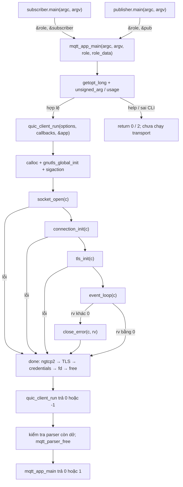
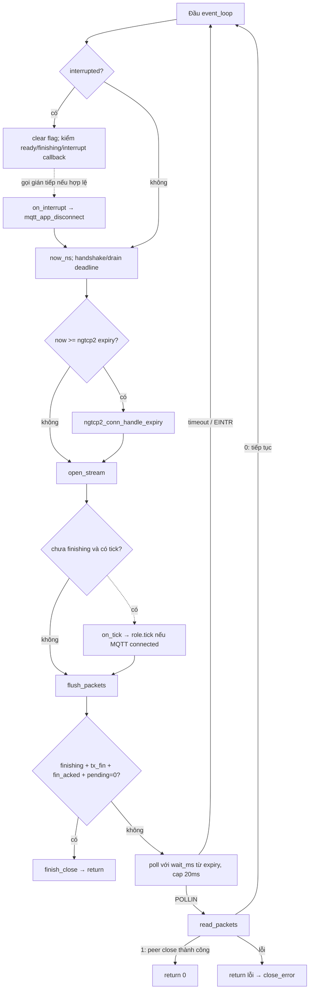
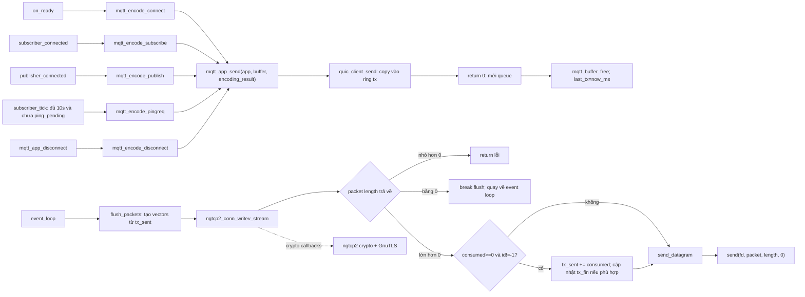
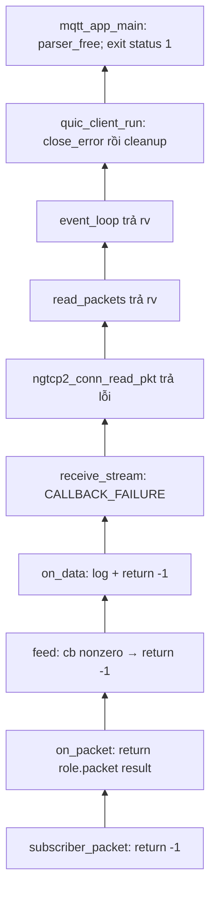
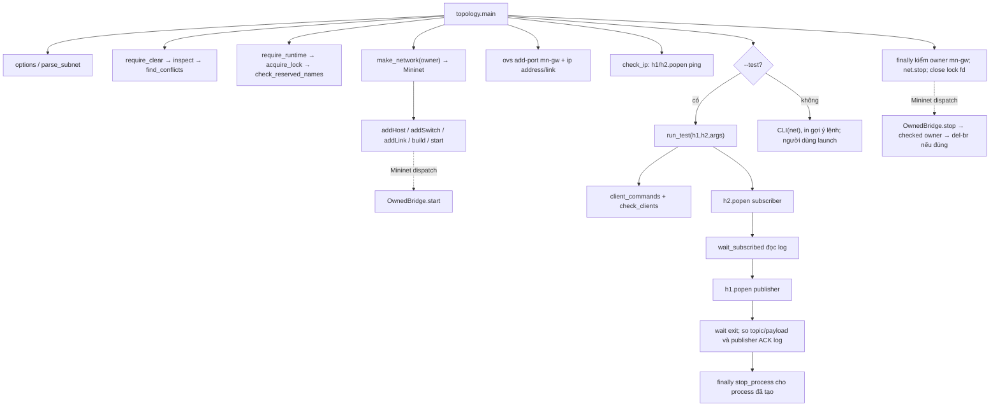

# Quan hệ gọi hàm, callback và quay về call stack

Đọc cùng [03 — gửi](03-PACKET-SEND-FLOW.md), [04 — nhận](04-PACKET-RECEIVE-FLOW.md), [07 — state/data](07-STATE-AND-DATA-FLOW.md), [08 — lỗi/đóng](08-ERROR-TIMER-AND-CLOSE-FLOW.md). Mọi cạnh dưới đây là [SOURCE] trừ cạnh mạng hoặc thư viện được chú thích riêng.

## 1. Quy ước: bốn quan hệ không được gộp

| Quan hệ | Ví dụ | Ý nghĩa |
|---|---|---|
| Gọi trực tiếp | `mqtt_app_main → quic_client_run` | Cùng process/thread; caller chờ return |
| Gọi qua con trỏ hàm | `c->callbacks->data(...) → on_data` | Vẫn là lời gọi C đồng bộ, chỉ chọn hàm qua địa chỉ |
| Thư viện gọi callback | `ngtcp2_conn_read_pkt → receive_stream` | Project gọi vào ngtcp2; trong call stack đó ngtcp2 có thể gọi lại project |
| Truyền mạng | publisher → EMQX → subscriber | Process độc lập; không phải call stack liên process |

Ba loại đầu thể hiện rõ tại [clients/app.c:158-161](/home/nguyenluongduc/Github/QUIC/ZerotoHeroWithQUIC/src/PrgSocket/QUICSocket/mqtt-quic/clients/app.c:158), [clients/quic_client.c:145-172](/home/nguyenluongduc/Github/QUIC/ZerotoHeroWithQUIC/src/PrgSocket/QUICSocket/mqtt-quic/clients/quic_client.c:145) và [clients/mqtt_codec.c:78-98](/home/nguyenluongduc/Github/QUIC/ZerotoHeroWithQUIC/src/PrgSocket/QUICSocket/mqtt-quic/clients/mqtt_codec.c:78). Loại cuối được tạo bởi hai process riêng ở [mininet/topology.py:183-192](/home/nguyenluongduc/Github/QUIC/ZerotoHeroWithQUIC/src/PrgSocket/QUICSocket/mqtt-quic/mininet/topology.py:183); broker implementation không nằm trong các file C của project.

## 2. Từ startup tới vòng lặp



`main()` không thực thi role callbacks lúc gán bảng; nó truyền địa chỉ role/context vào session. `quic_client_run()` lưu pointer options/callback/user và chạy đồng bộ nên stack objects còn sống. Init short-circuit theo socket → connection → TLS; lỗi init đi thẳng `done`, còn lỗi sau event loop mới đi qua `close_error`. Nguồn: [clients/subscriber.c:113-125](/home/nguyenluongduc/Github/QUIC/ZerotoHeroWithQUIC/src/PrgSocket/QUICSocket/mqtt-quic/clients/subscriber.c:113), [clients/publisher.c:42-49](/home/nguyenluongduc/Github/QUIC/ZerotoHeroWithQUIC/src/PrgSocket/QUICSocket/mqtt-quic/clients/publisher.c:42), [clients/app.c:115-170](/home/nguyenluongduc/Github/QUIC/ZerotoHeroWithQUIC/src/PrgSocket/QUICSocket/mqtt-quic/clients/app.c:115), [clients/quic_client.c:542-583](/home/nguyenluongduc/Github/QUIC/ZerotoHeroWithQUIC/src/PrgSocket/QUICSocket/mqtt-quic/clients/quic_client.c:542).

## 3. Bản đồ vòng lặp với điều kiện chuyển tiếp



Sơ đồ không có một thread riêng cho tick/data: tất cả chạy trên event-loop thread. Tick không cần packet mới; `poll` chờ tối đa 20 ms theo phép tính code nhưng không bảo đảm deadline scheduling thực tế của OS. Nếu bất kỳ kiểm tra/API trong loop trả lỗi, các cạnh success còn lại không được thực hiện. [clients/quic_client.c:482-539](/home/nguyenluongduc/Github/QUIC/ZerotoHeroWithQUIC/src/PrgSocket/QUICSocket/mqtt-quic/clients/quic_client.c:482), [clients/quic_client.h:20-26](/home/nguyenluongduc/Github/QUIC/ZerotoHeroWithQUIC/src/PrgSocket/QUICSocket/mqtt-quic/clients/quic_client.h:20).

## 4. Call graph nhánh nhận xuyên module

```mermaid
flowchart LR
  RECV["recv(c.fd, packet, 65536, 0)"] --> NR["ngtcp2_conn_read_pkt(conn, path, info, packet, length, ts)"]
  NR -. "callback stream khi có byte/FIN" .-> RS["receive_stream(conn, flags, id, offset, data, length, user=c, stream_user)"]
  RS -. "length > 0 và có data callback" .-> OD["on_data(client=c, data, length, user=app)"]
  OD --> FEED["mqtt_parser_feed(parser, bytes, n, cb=on_packet, arg=app)"]
  FEED --> HEAD["header(buffer, len, &nh, &nb)"]
  HEAD --> HR{"hr nhỏ hơn 0?"}
  HR -->|"có"| HF["feed return -1"]
  HR -->|"không"| CHECK{"feed kiểm hr==1 và len>=nh+nb?"}
  CHECK -->|"có"| PK["mqtt_packet view"]
  CHECK -->|"chưa đủ"| N{"còn byte mới n>0?"}
  N -->|"có"| MORE["feed copy số byte còn cần"]
  MORE --> FEED
  N -->|"không"| F0["break; feed return 0, giữ phần đang dở"]
  PK -. "cb(&packet, arg)" .-> OP["on_packet(packet, user=app)"]
  OP -->|"chưa connected"| CA["mqtt_decode_connack"]
  CA -->|"CONNACK chấp nhận"| RC["app.connected=1; role.connected(app)"]
  RC -. "subscriber role" .-> SC["subscriber_connected → queue SUBSCRIBE"]
  RC -. "publisher role" .-> PC["publisher_connected → queue PUBLISH"]
  OP -. "đã connected, role.packet=subscriber_packet" .-> SP["subscriber_packet"]
  SP --> DS["decode SUBACK / PUBLISH; PINGRESP checks"]
  OP -. "đã connected, role.packet=publisher_packet" .-> PP["publisher_packet"]
  PP --> PE["unexpected packet → return -1"]
```



Bằng chứng từng cạnh: UDP→ngtcp2 tại [clients/quic_client.c:452-479](/home/nguyenluongduc/Github/QUIC/ZerotoHeroWithQUIC/src/PrgSocket/QUICSocket/mqtt-quic/clients/quic_client.c:452); đăng ký `recv_stream_data` tại [clients/quic_client.c:240-258](/home/nguyenluongduc/Github/QUIC/ZerotoHeroWithQUIC/src/PrgSocket/QUICSocket/mqtt-quic/clients/quic_client.c:240); thư viện contract stream tại [../demo/src/.deps/include/ngtcp2/ngtcp2.h:2919-2943](/home/nguyenluongduc/Github/QUIC/ZerotoHeroWithQUIC/src/PrgSocket/QUICSocket/demo/src/.deps/include/ngtcp2/ngtcp2.h:2919); dispatch vào app tại [clients/quic_client.c:145-172](/home/nguyenluongduc/Github/QUIC/ZerotoHeroWithQUIC/src/PrgSocket/QUICSocket/mqtt-quic/clients/quic_client.c:145); app→parser tại [clients/app.c:66-74](/home/nguyenluongduc/Github/QUIC/ZerotoHeroWithQUIC/src/PrgSocket/QUICSocket/mqtt-quic/clients/app.c:66); parser→header/callback tại [clients/mqtt_codec.c:78-98](/home/nguyenluongduc/Github/QUIC/ZerotoHeroWithQUIC/src/PrgSocket/QUICSocket/mqtt-quic/clients/mqtt_codec.c:78); session→role tại [clients/app.c:49-64](/home/nguyenluongduc/Github/QUIC/ZerotoHeroWithQUIC/src/PrgSocket/QUICSocket/mqtt-quic/clients/app.c:49); role xử lý tại [clients/subscriber.c:20-82](/home/nguyenluongduc/Github/QUIC/ZerotoHeroWithQUIC/src/PrgSocket/QUICSocket/mqtt-quic/clients/subscriber.c:20) và [clients/publisher.c:11-26](/home/nguyenluongduc/Github/QUIC/ZerotoHeroWithQUIC/src/PrgSocket/QUICSocket/mqtt-quic/clients/publisher.c:11).

Khi packet handler return 0, call stack đi ngược `subscriber_packet → on_packet → feed`; feed có thể xử lý packet kế tiếp ngay trước khi `on_data` return. Sau khi app callback thành công, `receive_stream` mới tăng `rx_received`, trả lại flow-control credit và xử lý FIN. Cuối cùng quay về ngtcp2 rồi `read_packets`, không nhảy thẳng từ subscriber handler tới `poll`. [clients/mqtt_codec.c:83-96](/home/nguyenluongduc/Github/QUIC/ZerotoHeroWithQUIC/src/PrgSocket/QUICSocket/mqtt-quic/clients/mqtt_codec.c:83), [clients/quic_client.c:156-171](/home/nguyenluongduc/Github/QUIC/ZerotoHeroWithQUIC/src/PrgSocket/QUICSocket/mqtt-quic/clients/quic_client.c:156).

## 5. Call graph nhánh gửi và ranh giới queue



Không có cạnh gọi trực tiếp `quic_client_send → flush_packets`: queue được dùng khi event loop tiếp tục. Một packet response nhận được có thể làm callback queue dữ liệu, nhưng callback không trực tiếp gọi `ngtcp2_conn_writev_stream`; nhờ đó tách xử lý app khỏi transport writer. [clients/app.c:13-21](/home/nguyenluongduc/Github/QUIC/ZerotoHeroWithQUIC/src/PrgSocket/QUICSocket/mqtt-quic/clients/app.c:13), [clients/quic_client.c:63-76](/home/nguyenluongduc/Github/QUIC/ZerotoHeroWithQUIC/src/PrgSocket/QUICSocket/mqtt-quic/clients/quic_client.c:63), [clients/quic_client.c:350-393](/home/nguyenluongduc/Github/QUIC/ZerotoHeroWithQUIC/src/PrgSocket/QUICSocket/mqtt-quic/clients/quic_client.c:350), [clients/quic_client.c:505-510](/home/nguyenluongduc/Github/QUIC/ZerotoHeroWithQUIC/src/PrgSocket/QUICSocket/mqtt-quic/clients/quic_client.c:505).

`tx_sent` tăng theo số **stream bytes consumed**, còn `length` trả về của writer là số **QUIC packet bytes** để gửi. Hai số không bằng nhau nói chung; packet có thể chỉ chứa handshake/ACK nên consumed vẫn -1. Contract đúng version: [../demo/src/.deps/include/ngtcp2/ngtcp2.h:5201-5357](/home/nguyenluongduc/Github/QUIC/ZerotoHeroWithQUIC/src/PrgSocket/QUICSocket/demo/src/.deps/include/ngtcp2/ngtcp2.h:5201).

## 6. Bảng đăng ký callback của ứng dụng và role

| Callback field | Gán ở đâu? | Nơi thực sự gọi | Điều kiện/đầu vào | Return đi đâu? |
|---|---|---|---|---|
| quic `.ready = on_ready` | [clients/app.c:158-160](/home/nguyenluongduc/Github/QUIC/ZerotoHeroWithQUIC/src/PrgSocket/QUICSocket/mqtt-quic/clients/app.c:158) | [clients/quic_client.c:338-347](/home/nguyenluongduc/Github/QUIC/ZerotoHeroWithQUIC/src/PrgSocket/QUICSocket/mqtt-quic/clients/quic_client.c:338) | Handshake đã verified; mở stream thành công; c.ready trước đó false | Nonzero → callback failure từ open_stream |
| quic `.data = on_data` | [clients/app.c:158-160](/home/nguyenluongduc/Github/QUIC/ZerotoHeroWithQUIC/src/PrgSocket/QUICSocket/mqtt-quic/clients/app.c:158) | [clients/quic_client.c:145-157](/home/nguyenluongduc/Github/QUIC/ZerotoHeroWithQUIC/src/PrgSocket/QUICSocket/mqtt-quic/clients/quic_client.c:145) | Stream/offset hợp lệ, length>0; byte ứng dụng, user=app | Nonzero → receive_stream trả callback failure |
| quic `.tick = on_tick` | [clients/app.c:158-160](/home/nguyenluongduc/Github/QUIC/ZerotoHeroWithQUIC/src/PrgSocket/QUICSocket/mqtt-quic/clients/app.c:158) | [clients/quic_client.c:505-509](/home/nguyenluongduc/Github/QUIC/ZerotoHeroWithQUIC/src/PrgSocket/QUICSocket/mqtt-quic/clients/quic_client.c:505) | Mỗi vòng phù hợp, chưa finishing; now_ms monotonic | Nonzero → event_loop trả callback failure |
| quic `.interrupt = on_interrupt` | [clients/app.c:158-160](/home/nguyenluongduc/Github/QUIC/ZerotoHeroWithQUIC/src/PrgSocket/QUICSocket/mqtt-quic/clients/app.c:158) | [clients/quic_client.c:483-490](/home/nguyenluongduc/Github/QUIC/ZerotoHeroWithQUIC/src/PrgSocket/QUICSocket/mqtt-quic/clients/quic_client.c:483) | Có signal flag, ready, chưa finishing, callback tồn tại | Nonzero hoặc không hợp lệ → abort loop |
| parser `cb = on_packet` | [clients/app.c:69](/home/nguyenluongduc/Github/QUIC/ZerotoHeroWithQUIC/src/PrgSocket/QUICSocket/mqtt-quic/clients/app.c:69) | [clients/mqtt_codec.c:83-86](/home/nguyenluongduc/Github/QUIC/ZerotoHeroWithQUIC/src/PrgSocket/QUICSocket/mqtt-quic/clients/mqtt_codec.c:83) | Đủ fixed header và body; packet view; arg=app | Nonzero → feed trả -1 |
| subscriber `.connected` | [clients/subscriber.c:115-122](/home/nguyenluongduc/Github/QUIC/ZerotoHeroWithQUIC/src/PrgSocket/QUICSocket/mqtt-quic/clients/subscriber.c:115) | [clients/app.c:51-61](/home/nguyenluongduc/Github/QUIC/ZerotoHeroWithQUIC/src/PrgSocket/QUICSocket/mqtt-quic/clients/app.c:51) | CONNACK đầu tiên hợp lệ, session_present=0, return_code=0 | Kết quả qua on_packet→feed |
| subscriber `.packet` | [clients/subscriber.c:115-122](/home/nguyenluongduc/Github/QUIC/ZerotoHeroWithQUIC/src/PrgSocket/QUICSocket/mqtt-quic/clients/subscriber.c:115) | [clients/app.c:63](/home/nguyenluongduc/Github/QUIC/ZerotoHeroWithQUIC/src/PrgSocket/QUICSocket/mqtt-quic/clients/app.c:63) | MQTT đã connected; packet hoàn chỉnh | Kết quả qua on_packet→feed |
| subscriber `.tick` | [clients/subscriber.c:115-122](/home/nguyenluongduc/Github/QUIC/ZerotoHeroWithQUIC/src/PrgSocket/QUICSocket/mqtt-quic/clients/subscriber.c:115) | [clients/app.c:76-88](/home/nguyenluongduc/Github/QUIC/ZerotoHeroWithQUIC/src/PrgSocket/QUICSocket/mqtt-quic/clients/app.c:76) | Chưa stopping, chưa timeout tổng; app.connected true | Kết quả qua on_tick→event_loop |
| publisher `.connected` | [clients/publisher.c:44-46](/home/nguyenluongduc/Github/QUIC/ZerotoHeroWithQUIC/src/PrgSocket/QUICSocket/mqtt-quic/clients/publisher.c:44) | [clients/app.c:61](/home/nguyenluongduc/Github/QUIC/ZerotoHeroWithQUIC/src/PrgSocket/QUICSocket/mqtt-quic/clients/app.c:61) | Tương tự CONNACK, nhưng queue PUBLISH | Kết quả qua parser |
| publisher `.packet` | [clients/publisher.c:44-46](/home/nguyenluongduc/Github/QUIC/ZerotoHeroWithQUIC/src/PrgSocket/QUICSocket/mqtt-quic/clients/publisher.c:44) | [clients/app.c:63](/home/nguyenluongduc/Github/QUIC/ZerotoHeroWithQUIC/src/PrgSocket/QUICSocket/mqtt-quic/clients/app.c:63) | Packet sau CONNACK; role này không mong MQTT packet nữa | Luôn -1, log unexpected |
| publisher `.tick` | [clients/publisher.c:44-46](/home/nguyenluongduc/Github/QUIC/ZerotoHeroWithQUIC/src/PrgSocket/QUICSocket/mqtt-quic/clients/publisher.c:44) | [clients/app.c:88](/home/nguyenluongduc/Github/QUIC/ZerotoHeroWithQUIC/src/PrgSocket/QUICSocket/mqtt-quic/clients/app.c:88) | Đã connected; kiểm deadline trước kiểm pending | Pending=0→disconnect, quá deadline→-1 |

`.connected` của role nghĩa là MQTT CONNECT được broker chấp nhận, không phải socket connected hay QUIC handshake xong. Khi xử lý CONNACK, `on_packet` return kết quả role.connected ngay; chính CONNACK ấy không được gọi thêm vào role.packet. [clients/app.c:49-64](/home/nguyenluongduc/Github/QUIC/ZerotoHeroWithQUIC/src/PrgSocket/QUICSocket/mqtt-quic/clients/app.c:49).

## 7. Bảng `ngtcp2_callbacks`: project hay dependency thực thi?

Toàn bộ bảng được tạo cục bộ trong `connection_init`; constructor nhận bản copy theo contract dependency. Đăng ký tại [clients/quic_client.c:240-258](/home/nguyenluongduc/Github/QUIC/ZerotoHeroWithQUIC/src/PrgSocket/QUICSocket/mqtt-quic/clients/quic_client.c:240); constructor/copy contract tại [../demo/src/.deps/include/ngtcp2/ngtcp2.h:4173-4201](/home/nguyenluongduc/Github/QUIC/ZerotoHeroWithQUIC/src/PrgSocket/QUICSocket/demo/src/.deps/include/ngtcp2/ngtcp2.h:4173). Không nhầm bảng này với `quic_callbacks` được giữ trong `c->callbacks`.

| Field | Hàm được gắn | Sự kiện/đầu vào do ngtcp2 cung cấp | Phần thực thi |
|---|---|---|---|
| `client_initial` | `ngtcp2_crypto_client_initial_cb` | Cần khởi tạo crypto/TLS client và Initial | Crypto adapter của dependency |
| `recv_crypto_data` | `ngtcp2_crypto_recv_crypto_data_cb` | CRYPTO data ở encryption level/offset tương ứng | Adapter chuyển handshake data tới TLS |
| `handshake_completed` | `handshake_completed` | ngtcp2 báo handshake complete, user=c | Project kiểm TLS1.3/ALPN/cert, set handshake |
| `encrypt` | `ngtcp2_crypto_encrypt_cb` | Key/nonce/AAD/plaintext cần AEAD | Crypto adapter/backend |
| `decrypt` | `ngtcp2_crypto_decrypt_cb` | Ciphertext/key/nonce/AAD cần xác thực/giải mã | Crypto adapter/backend |
| `hp_mask` | `ngtcp2_crypto_hp_mask_cb` | Header protection sample/key | Crypto adapter/backend |
| `recv_stream_data` | `receive_stream` | Stream id/offset/flags/bytes; user=c | Project validate, gọi own data callback |
| `acked_stream_data_offset` | `acked_stream` | Stream byte range được ACK, hoặc empty FIN ACK | Project tiến tx_acked và đánh dấu fin_acked |
| `recv_retry` | `ngtcp2_crypto_recv_retry_cb` | Retry hợp lệ cần reset Initial keys | Crypto adapter, chỉ nếu peer gửi Retry |
| `rand` | `random_bytes` | Buffer/số byte và rand context | Project gọi gnutls_rnd, lỗi abort |
| `get_new_connection_id2` | `new_cid` | Cần CID/token mới, độ dài do library cung cấp | Project gọi random_cid và gnutls_rnd |
| `update_key` | `ngtcp2_crypto_update_key_cb` | Cần next traffic secret/keys | Crypto adapter/backend |
| `delete_crypto_aead_ctx` | `ngtcp2_crypto_delete_crypto_aead_ctx_cb` | Library giải phóng crypto context | Adapter giải phóng backend object |
| `delete_crypto_cipher_ctx` | `ngtcp2_crypto_delete_crypto_cipher_ctx_cb` | Library giải phóng cipher context | Adapter/backend |
| `get_path_challenge_data2` | `ngtcp2_crypto_get_path_challenge_data2_cb` | Cần dữ liệu PATH_CHALLENGE | Adapter; không chứng minh project hỗ trợ migration đầy đủ |
| `version_negotiation` | `ngtcp2_crypto_version_negotiation_cb` | Crypto setup cho xử lý version negotiation | Adapter; client init chọn QUIC v1 |
| `stream_close2` | `stream_closed` | Stream đóng, flags và lỗi hai chiều | Project kiểm trạng thái và set stream_closed |

Source project định nghĩa các callback riêng ở [clients/quic_client.c:99-210](/home/nguyenluongduc/Github/QUIC/ZerotoHeroWithQUIC/src/PrgSocket/QUICSocket/mqtt-quic/clients/quic_client.c:99). Signature/contract dependency và đường vào GnuTLS được phân tích theo từng nhóm ở [02](02-CONNECTION-AND-HANDSHAKE.md); riêng ACK/loss/close ở [08](08-ERROR-TIMER-AND-CLOSE-FLOW.md). Các sự kiện Retry, new CID hoặc key update là callback đã đăng ký, không được coi đã xảy ra trong log demo nếu không có trace tương ứng.

Ngoài bảng trên còn có function pointer:

```c
c->conn_ref.get_conn = get_conn;
c->conn_ref.user_data = c;
gnutls_session_set_ptr(c->tls, &c->conn_ref);
```

Đây là cầu TLS adapter→ngtcp2 connection, không phải callback dữ liệu MQTT. `get_conn(ref)` trả `((quic_client *)ref->user_data)->conn`. GnuTLS session giữ pointer tới conn_ref nằm bên trong c nên sống tới cleanup c. [clients/quic_client.c:86-88](/home/nguyenluongduc/Github/QUIC/ZerotoHeroWithQUIC/src/PrgSocket/QUICSocket/mqtt-quic/clients/quic_client.c:86), [clients/quic_client.c:312-316](/home/nguyenluongduc/Github/QUIC/ZerotoHeroWithQUIC/src/PrgSocket/QUICSocket/mqtt-quic/clients/quic_client.c:312).

## 8. Registry toàn bộ hàm C production và caller chính

Bảng này để tra chỗ chuyển tiếp; chi tiết tất cả tham số/nhánh/ownership nằm trong chương 01–04, 07–08. Các helper nhỏ cũng xuất hiện để không bỏ qua bước encoding/validation.

| Hàm/nhóm | Định nghĩa | Caller hoặc nơi đăng ký; điều kiện |
|---|---|---|
| subscriber `main` | [clients/subscriber.c:113-125](/home/nguyenluongduc/Github/QUIC/ZerotoHeroWithQUIC/src/PrgSocket/QUICSocket/mqtt-quic/clients/subscriber.c:113) | OS process startup; topology h2.popen ở [mininet/topology.py:184-185](/home/nguyenluongduc/Github/QUIC/ZerotoHeroWithQUIC/src/PrgSocket/QUICSocket/mqtt-quic/mininet/topology.py:184) |
| publisher `main` | [clients/publisher.c:42-49](/home/nguyenluongduc/Github/QUIC/ZerotoHeroWithQUIC/src/PrgSocket/QUICSocket/mqtt-quic/clients/publisher.c:42) | OS process startup; topology h1.popen ở [mininet/topology.py:188-189](/home/nguyenluongduc/Github/QUIC/ZerotoHeroWithQUIC/src/PrgSocket/QUICSocket/mqtt-quic/mininet/topology.py:188) |
| `mqtt_app_main` | [clients/app.c:115-170](/home/nguyenluongduc/Github/QUIC/ZerotoHeroWithQUIC/src/PrgSocket/QUICSocket/mqtt-quic/clients/app.c:115) | Hai main truyền argc/argv/role/context |
| `unsigned_arg` | [clients/app.c:98-106](/home/nguyenluongduc/Github/QUIC/ZerotoHeroWithQUIC/src/PrgSocket/QUICSocket/mqtt-quic/clients/app.c:98) | CLI port/count/timeout tại [clients/app.c:137-149](/home/nguyenluongduc/Github/QUIC/ZerotoHeroWithQUIC/src/PrgSocket/QUICSocket/mqtt-quic/clients/app.c:137) |
| `usage` | [clients/app.c:108-113](/home/nguyenluongduc/Github/QUIC/ZerotoHeroWithQUIC/src/PrgSocket/QUICSocket/mqtt-quic/clients/app.c:108) | --help hoặc invalid CLI tại [clients/app.c:151-170](/home/nguyenluongduc/Github/QUIC/ZerotoHeroWithQUIC/src/PrgSocket/QUICSocket/mqtt-quic/clients/app.c:151) |
| `on_ready` | [clients/app.c:37-47](/home/nguyenluongduc/Github/QUIC/ZerotoHeroWithQUIC/src/PrgSocket/QUICSocket/mqtt-quic/clients/app.c:37) | quic_callbacks.ready từ open_stream |
| `on_data` | [clients/app.c:66-74](/home/nguyenluongduc/Github/QUIC/ZerotoHeroWithQUIC/src/PrgSocket/QUICSocket/mqtt-quic/clients/app.c:66) | quic_callbacks.data từ receive_stream |
| `on_packet` | [clients/app.c:49-64](/home/nguyenluongduc/Github/QUIC/ZerotoHeroWithQUIC/src/PrgSocket/QUICSocket/mqtt-quic/clients/app.c:49) | parser callback đủ packet |
| `on_tick` | [clients/app.c:76-89](/home/nguyenluongduc/Github/QUIC/ZerotoHeroWithQUIC/src/PrgSocket/QUICSocket/mqtt-quic/clients/app.c:76) | quic_callbacks.tick từ event_loop |
| `on_interrupt` | [clients/app.c:91-96](/home/nguyenluongduc/Github/QUIC/ZerotoHeroWithQUIC/src/PrgSocket/QUICSocket/mqtt-quic/clients/app.c:91) | quic_callbacks.interrupt khi signal flag |
| `mqtt_app_send` | [clients/app.c:13-22](/home/nguyenluongduc/Github/QUIC/ZerotoHeroWithQUIC/src/PrgSocket/QUICSocket/mqtt-quic/clients/app.c:13) | on_ready, các role connected, subscriber tick, app disconnect |
| `mqtt_app_disconnect` | [clients/app.c:24-35](/home/nguyenluongduc/Github/QUIC/ZerotoHeroWithQUIC/src/PrgSocket/QUICSocket/mqtt-quic/clients/app.c:24) | publisher_tick pending=0; subscriber đủ count; on_interrupt |
| `subscriber_connected` | [clients/subscriber.c:20-32](/home/nguyenluongduc/Github/QUIC/ZerotoHeroWithQUIC/src/PrgSocket/QUICSocket/mqtt-quic/clients/subscriber.c:20) | role.connected sau CONNACK |
| `subscriber_packet` | [clients/subscriber.c:34-83](/home/nguyenluongduc/Github/QUIC/ZerotoHeroWithQUIC/src/PrgSocket/QUICSocket/mqtt-quic/clients/subscriber.c:34) | role.packet sau connected |
| `subscriber_tick` | [clients/subscriber.c:85-111](/home/nguyenluongduc/Github/QUIC/ZerotoHeroWithQUIC/src/PrgSocket/QUICSocket/mqtt-quic/clients/subscriber.c:85) | role.tick sau connected |
| `publisher_connected` | [clients/publisher.c:11-20](/home/nguyenluongduc/Github/QUIC/ZerotoHeroWithQUIC/src/PrgSocket/QUICSocket/mqtt-quic/clients/publisher.c:11) | role.connected sau CONNACK |
| `publisher_packet` | [clients/publisher.c:22-27](/home/nguyenluongduc/Github/QUIC/ZerotoHeroWithQUIC/src/PrgSocket/QUICSocket/mqtt-quic/clients/publisher.c:22) | role.packet, nhánh unexpected |
| `publisher_tick` | [clients/publisher.c:29-40](/home/nguyenluongduc/Github/QUIC/ZerotoHeroWithQUIC/src/PrgSocket/QUICSocket/mqtt-quic/clients/publisher.c:29) | role.tick sau connected |
| `put16` | [clients/mqtt_codec.c:5](/home/nguyenluongduc/Github/QUIC/ZerotoHeroWithQUIC/src/PrgSocket/QUICSocket/mqtt-quic/clients/mqtt_codec.c:5) | Encode CONNECT/SUBSCRIBE/PUBLISH: [clients/mqtt_codec.c:38-54](/home/nguyenluongduc/Github/QUIC/ZerotoHeroWithQUIC/src/PrgSocket/QUICSocket/mqtt-quic/clients/mqtt_codec.c:38) |
| `get16` | [clients/mqtt_codec.c:6](/home/nguyenluongduc/Github/QUIC/ZerotoHeroWithQUIC/src/PrgSocket/QUICSocket/mqtt-quic/clients/mqtt_codec.c:6) | Decode SUBACK/PUBLISH: [clients/mqtt_codec.c:103-113](/home/nguyenluongduc/Github/QUIC/ZerotoHeroWithQUIC/src/PrgSocket/QUICSocket/mqtt-quic/clients/mqtt_codec.c:103) |
| `valid_utf8` | [clients/mqtt_codec.c:8-24](/home/nguyenluongduc/Github/QUIC/ZerotoHeroWithQUIC/src/PrgSocket/QUICSocket/mqtt-quic/clients/mqtt_codec.c:8) | valid_topic hoặc encode CONNECT |
| `valid_topic` | [clients/mqtt_codec.c:25-27](/home/nguyenluongduc/Github/QUIC/ZerotoHeroWithQUIC/src/PrgSocket/QUICSocket/mqtt-quic/clients/mqtt_codec.c:25) | Encode SUBSCRIBE/PUBLISH; decode PUBLISH |
| `allocate` | [clients/mqtt_codec.c:30-37](/home/nguyenluongduc/Github/QUIC/ZerotoHeroWithQUIC/src/PrgSocket/QUICSocket/mqtt-quic/clients/mqtt_codec.c:30) | Các encoder, tạo fixed header + buffer |
| `mqtt_buffer_free` | [clients/mqtt_codec.c:28](/home/nguyenluongduc/Github/QUIC/ZerotoHeroWithQUIC/src/PrgSocket/QUICSocket/mqtt-quic/clients/mqtt_codec.c:28) | mqtt_app_send cả success/error |
| `mqtt_parser_free` | [clients/mqtt_codec.c:29](/home/nguyenluongduc/Github/QUIC/ZerotoHeroWithQUIC/src/PrgSocket/QUICSocket/mqtt-quic/clients/mqtt_codec.c:29) | mqtt_app_main sau run; unit tests |
| `mqtt_encode_connect` | [clients/mqtt_codec.c:38-43](/home/nguyenluongduc/Github/QUIC/ZerotoHeroWithQUIC/src/PrgSocket/QUICSocket/mqtt-quic/clients/mqtt_codec.c:38) | on_ready(app.client_id, keepalive=20) |
| `mqtt_encode_subscribe` | [clients/mqtt_codec.c:44-48](/home/nguyenluongduc/Github/QUIC/ZerotoHeroWithQUIC/src/PrgSocket/QUICSocket/mqtt-quic/clients/mqtt_codec.c:44) | subscriber_connected(id=1, app.topic) |
| `mqtt_encode_publish` | [clients/mqtt_codec.c:49-54](/home/nguyenluongduc/Github/QUIC/ZerotoHeroWithQUIC/src/PrgSocket/QUICSocket/mqtt-quic/clients/mqtt_codec.c:49) | publisher_connected(topic, message, strlen) |
| `mqtt_encode_pingreq` | [clients/mqtt_codec.c:55](/home/nguyenluongduc/Github/QUIC/ZerotoHeroWithQUIC/src/PrgSocket/QUICSocket/mqtt-quic/clients/mqtt_codec.c:55) | subscriber_tick sau 10s không gửi MQTT |
| `mqtt_encode_disconnect` | [clients/mqtt_codec.c:56](/home/nguyenluongduc/Github/QUIC/ZerotoHeroWithQUIC/src/PrgSocket/QUICSocket/mqtt-quic/clients/mqtt_codec.c:56) | mqtt_app_disconnect nếu app.connected |
| `header` | [clients/mqtt_codec.c:59-77](/home/nguyenluongduc/Github/QUIC/ZerotoHeroWithQUIC/src/PrgSocket/QUICSocket/mqtt-quic/clients/mqtt_codec.c:59) | feed mỗi vòng kiểm parser buffer |
| `mqtt_parser_feed` | [clients/mqtt_codec.c:78-98](/home/nguyenluongduc/Github/QUIC/ZerotoHeroWithQUIC/src/PrgSocket/QUICSocket/mqtt-quic/clients/mqtt_codec.c:78) | on_data; codec unit tests |
| `mqtt_decode_connack` | [clients/mqtt_codec.c:99-102](/home/nguyenluongduc/Github/QUIC/ZerotoHeroWithQUIC/src/PrgSocket/QUICSocket/mqtt-quic/clients/mqtt_codec.c:99) | on_packet khi chưa app.connected |
| `mqtt_decode_suback` | [clients/mqtt_codec.c:103-106](/home/nguyenluongduc/Github/QUIC/ZerotoHeroWithQUIC/src/PrgSocket/QUICSocket/mqtt-quic/clients/mqtt_codec.c:103) | subscriber_packet type9 + WAIT_SUBACK |
| `mqtt_decode_publish` | [clients/mqtt_codec.c:107-113](/home/nguyenluongduc/Github/QUIC/ZerotoHeroWithQUIC/src/PrgSocket/QUICSocket/mqtt-quic/clients/mqtt_codec.c:107) | subscriber_packet type3 + SUBSCRIBED |
| `now_ns` | [clients/quic_client.c:43-50](/home/nguyenluongduc/Github/QUIC/ZerotoHeroWithQUIC/src/PrgSocket/QUICSocket/mqtt-quic/clients/quic_client.c:43) | Timestamp init/loop/I/O/close; abort nếu clock lỗi |
| `quic_client_now_ms` | [clients/quic_client.c:52](/home/nguyenluongduc/Github/QUIC/ZerotoHeroWithQUIC/src/PrgSocket/QUICSocket/mqtt-quic/clients/quic_client.c:52) | app/role deadlines và callback tick |
| `signal_received` | [clients/quic_client.c:54-57](/home/nguyenluongduc/Github/QUIC/ZerotoHeroWithQUIC/src/PrgSocket/QUICSocket/mqtt-quic/clients/quic_client.c:54) | SIGINT/SIGTERM handler đăng ký ở [clients/quic_client.c:558-566](/home/nguyenluongduc/Github/QUIC/ZerotoHeroWithQUIC/src/PrgSocket/QUICSocket/mqtt-quic/clients/quic_client.c:558) |
| `quic_client_pending` | [clients/quic_client.c:59-61](/home/nguyenluongduc/Github/QUIC/ZerotoHeroWithQUIC/src/PrgSocket/QUICSocket/mqtt-quic/clients/quic_client.c:59) | queue guard, publisher tick, FIN/drain/peer close |
| `quic_client_send` | [clients/quic_client.c:63-76](/home/nguyenluongduc/Github/QUIC/ZerotoHeroWithQUIC/src/PrgSocket/QUICSocket/mqtt-quic/clients/quic_client.c:63) | mqtt_app_send; copy vào ring |
| `quic_client_finish` | [clients/quic_client.c:78-84](/home/nguyenluongduc/Github/QUIC/ZerotoHeroWithQUIC/src/PrgSocket/QUICSocket/mqtt-quic/clients/quic_client.c:78) | mqtt_app_disconnect; chỉ yêu cầu drain |
| `get_conn` | [clients/quic_client.c:86-88](/home/nguyenluongduc/Github/QUIC/ZerotoHeroWithQUIC/src/PrgSocket/QUICSocket/mqtt-quic/clients/quic_client.c:86) | Crypto conn_ref callback |
| `path_for` | [clients/quic_client.c:90-97](/home/nguyenluongduc/Github/QUIC/ZerotoHeroWithQUIC/src/PrgSocket/QUICSocket/mqtt-quic/clients/quic_client.c:90) | connection_init và read_packets |
| `random_cid` | [clients/quic_client.c:99-105](/home/nguyenluongduc/Github/QUIC/ZerotoHeroWithQUIC/src/PrgSocket/QUICSocket/mqtt-quic/clients/quic_client.c:99) | connection_init tạo dcid/scid; new_cid callback |
| `random_bytes` | [clients/quic_client.c:107-110](/home/nguyenluongduc/Github/QUIC/ZerotoHeroWithQUIC/src/PrgSocket/QUICSocket/mqtt-quic/clients/quic_client.c:107) | ngtcp2_callbacks.rand |
| `new_cid` | [clients/quic_client.c:112-120](/home/nguyenluongduc/Github/QUIC/ZerotoHeroWithQUIC/src/PrgSocket/QUICSocket/mqtt-quic/clients/quic_client.c:112) | ngtcp2_callbacks.get_new_connection_id2 |
| `handshake_completed` | [clients/quic_client.c:122-143](/home/nguyenluongduc/Github/QUIC/ZerotoHeroWithQUIC/src/PrgSocket/QUICSocket/mqtt-quic/clients/quic_client.c:122) | ngtcp2 handshake event |
| `receive_stream` | [clients/quic_client.c:145-172](/home/nguyenluongduc/Github/QUIC/ZerotoHeroWithQUIC/src/PrgSocket/QUICSocket/mqtt-quic/clients/quic_client.c:145) | ngtcp2 recv_stream_data |
| `acked_stream` | [clients/quic_client.c:174-188](/home/nguyenluongduc/Github/QUIC/ZerotoHeroWithQUIC/src/PrgSocket/QUICSocket/mqtt-quic/clients/quic_client.c:174) | ngtcp2 acked_stream_data_offset |
| `stream_closed` | [clients/quic_client.c:190-203](/home/nguyenluongduc/Github/QUIC/ZerotoHeroWithQUIC/src/PrgSocket/QUICSocket/mqtt-quic/clients/quic_client.c:190) | ngtcp2 stream_close2 |
| `quic_log` | [clients/quic_client.c:205-210](/home/nguyenluongduc/Github/QUIC/ZerotoHeroWithQUIC/src/PrgSocket/QUICSocket/mqtt-quic/clients/quic_client.c:205) | settings.log_write khi --verbose |
| `socket_open` | [clients/quic_client.c:212-237](/home/nguyenluongduc/Github/QUIC/ZerotoHeroWithQUIC/src/PrgSocket/QUICSocket/mqtt-quic/clients/quic_client.c:212) | quic_client_run init đầu tiên |
| `connection_init` | [clients/quic_client.c:239-282](/home/nguyenluongduc/Github/QUIC/ZerotoHeroWithQUIC/src/PrgSocket/QUICSocket/mqtt-quic/clients/quic_client.c:239) | quic_client_run sau socket |
| `tls_init` | [clients/quic_client.c:284-320](/home/nguyenluongduc/Github/QUIC/ZerotoHeroWithQUIC/src/PrgSocket/QUICSocket/mqtt-quic/clients/quic_client.c:284) | quic_client_run sau connection |
| `send_datagram` | [clients/quic_client.c:322-336](/home/nguyenluongduc/Github/QUIC/ZerotoHeroWithQUIC/src/PrgSocket/QUICSocket/mqtt-quic/clients/quic_client.c:322) | flush_packets, close_error, finish_close |
| `open_stream` | [clients/quic_client.c:338-348](/home/nguyenluongduc/Github/QUIC/ZerotoHeroWithQUIC/src/PrgSocket/QUICSocket/mqtt-quic/clients/quic_client.c:338) | event_loop và sau mỗi ngtcp2_conn_read_pkt thành công |
| `flush_packets` | [clients/quic_client.c:350-394](/home/nguyenluongduc/Github/QUIC/ZerotoHeroWithQUIC/src/PrgSocket/QUICSocket/mqtt-quic/clients/quic_client.c:350) | event_loop sau tick |
| `make_close` | [clients/quic_client.c:396-408](/home/nguyenluongduc/Github/QUIC/ZerotoHeroWithQUIC/src/PrgSocket/QUICSocket/mqtt-quic/clients/quic_client.c:396) | close_error hoặc finish_close |
| `close_error` | [clients/quic_client.c:410-424](/home/nguyenluongduc/Github/QUIC/ZerotoHeroWithQUIC/src/PrgSocket/QUICSocket/mqtt-quic/clients/quic_client.c:410) | quic_client_run khi event_loop trả lỗi |
| `finish_close` | [clients/quic_client.c:426-450](/home/nguyenluongduc/Github/QUIC/ZerotoHeroWithQUIC/src/PrgSocket/QUICSocket/mqtt-quic/clients/quic_client.c:426) | event_loop khi bytes+FIN ACK |
| `read_packets` | [clients/quic_client.c:452-480](/home/nguyenluongduc/Github/QUIC/ZerotoHeroWithQUIC/src/PrgSocket/QUICSocket/mqtt-quic/clients/quic_client.c:452) | event_loop nếu poll báo POLLIN |
| `event_loop` | [clients/quic_client.c:482-540](/home/nguyenluongduc/Github/QUIC/ZerotoHeroWithQUIC/src/PrgSocket/QUICSocket/mqtt-quic/clients/quic_client.c:482) | quic_client_run sau init thành công |
| `quic_client_run` | [clients/quic_client.c:542-583](/home/nguyenluongduc/Github/QUIC/ZerotoHeroWithQUIC/src/PrgSocket/QUICSocket/mqtt-quic/clients/quic_client.c:542) | mqtt_app_main, một lần trong mỗi process |

## 9. Thành công và lỗi đi ngược qua các return như thế nào?

Ví dụ packet SUBACK sai ID: [clients/subscriber.c:37-44](/home/nguyenluongduc/Github/QUIC/ZerotoHeroWithQUIC/src/PrgSocket/QUICSocket/mqtt-quic/clients/subscriber.c:37).



Bằng chứng return chain: [clients/app.c:49-74](/home/nguyenluongduc/Github/QUIC/ZerotoHeroWithQUIC/src/PrgSocket/QUICSocket/mqtt-quic/clients/app.c:49), [clients/mqtt_codec.c:83-85](/home/nguyenluongduc/Github/QUIC/ZerotoHeroWithQUIC/src/PrgSocket/QUICSocket/mqtt-quic/clients/mqtt_codec.c:83), [clients/quic_client.c:156-157](/home/nguyenluongduc/Github/QUIC/ZerotoHeroWithQUIC/src/PrgSocket/QUICSocket/mqtt-quic/clients/quic_client.c:156), [clients/quic_client.c:463-478](/home/nguyenluongduc/Github/QUIC/ZerotoHeroWithQUIC/src/PrgSocket/QUICSocket/mqtt-quic/clients/quic_client.c:463), [clients/quic_client.c:531-538](/home/nguyenluongduc/Github/QUIC/ZerotoHeroWithQUIC/src/PrgSocket/QUICSocket/mqtt-quic/clients/quic_client.c:531), [clients/quic_client.c:567-583](/home/nguyenluongduc/Github/QUIC/ZerotoHeroWithQUIC/src/PrgSocket/QUICSocket/mqtt-quic/clients/quic_client.c:567), [clients/app.c:161-167](/home/nguyenluongduc/Github/QUIC/ZerotoHeroWithQUIC/src/PrgSocket/QUICSocket/mqtt-quic/clients/app.c:161). Không có cơ chế bỏ qua packet SUBACK sai rồi tiếp tục chờ trong source hiện tại.

Ngược lại, thiếu body không phải lỗi: `header` có thể trả 1, feed thấy `len < nh+nb`, lấy thêm byte hoặc break nếu hết input, rồi return0. Callback packet chưa chạy nhưng callback data vẫn thành công. [clients/mqtt_codec.c:78-98](/home/nguyenluongduc/Github/QUIC/ZerotoHeroWithQUIC/src/PrgSocket/QUICSocket/mqtt-quic/clients/mqtt_codec.c:78).

## 10. Quan hệ gọi của orchestration và test



Các cạnh startup/test từ [mininet/topology.py:127-206](/home/nguyenluongduc/Github/QUIC/ZerotoHeroWithQUIC/src/PrgSocket/QUICSocket/mqtt-quic/mininet/topology.py:127) và [mininet/topology.py:240-312](/home/nguyenluongduc/Github/QUIC/ZerotoHeroWithQUIC/src/PrgSocket/QUICSocket/mqtt-quic/mininet/topology.py:240). Cạnh callback bridge nằm tại [mininet/topology.py:75-124](/home/nguyenluongduc/Github/QUIC/ZerotoHeroWithQUIC/src/PrgSocket/QUICSocket/mqtt-quic/mininet/topology.py:75) và được kiểm tra bằng lifecycle test dùng Mininet dispatch thật nhưng mock side effect: [tests/test_topology_lifecycle.py:23-81](/home/nguyenluongduc/Github/QUIC/ZerotoHeroWithQUIC/src/PrgSocket/QUICSocket/mqtt-quic/tests/test_topology_lifecycle.py:23). Đường `--test` và interactive là hai nhánh loại trừ; không được khẳng định interactive tự chạy publisher/subscriber chỉ vì nó in lệnh.

Các helper Python: `checked(command)` thực thi danh sách argv, timeout10 và kiểm returncode; `ovs(*arguments)` thêm ovs-vsctl timeout5 rồi gọi checked; `stop_process(process)` SIGINT/wait rồi kill nếu quá hạn; `wait_subscribed(process, log_path, timeout)` kiểm marker/poll với deadline monotonic. Full signature/argument source và return của chúng được phân tích ở chương01. [mininet/topology.py:28-36](/home/nguyenluongduc/Github/QUIC/ZerotoHeroWithQUIC/src/PrgSocket/QUICSocket/mqtt-quic/mininet/topology.py:28), [mininet/topology.py:145-165](/home/nguyenluongduc/Github/QUIC/ZerotoHeroWithQUIC/src/PrgSocket/QUICSocket/mqtt-quic/mininet/topology.py:145).

## 11. Cách dùng graph để đọc source

Đặt breakpoint ở một node, xác định process và pointer hiện tại trước khi đi theo cạnh. Nếu cạnh là direct/callback thì dùng step/finish trong cùng process; nếu cạnh là UDP/network phải chuyển công cụ sang capture hoặc debugger process khác. Khi thấy `user`/`arg`, đối chiếu bảng ở chương07, không suy từ tên biến. Sau mỗi return hỏi caller kiểm `0`, `1`, số byte hay mã lỗi nào: `read_packets` dùng return1 cho peer-close thành công trong khi app callback dùng nonzero cho lỗi. [clients/quic_client.c:465-468](/home/nguyenluongduc/Github/QUIC/ZerotoHeroWithQUIC/src/PrgSocket/QUICSocket/mqtt-quic/clients/quic_client.c:465), [clients/quic_client.c:532-536](/home/nguyenluongduc/Github/QUIC/ZerotoHeroWithQUIC/src/PrgSocket/QUICSocket/mqtt-quic/clients/quic_client.c:532), [clients/quic_client.h:20-25](/home/nguyenluongduc/Github/QUIC/ZerotoHeroWithQUIC/src/PrgSocket/QUICSocket/mqtt-quic/clients/quic_client.h:20).

[Quay về bản đồ](00-README.md) · [Tiếp: state và dữ liệu](07-STATE-AND-DATA-FLOW.md)
