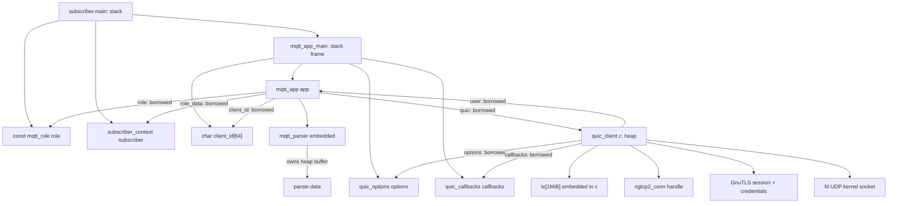
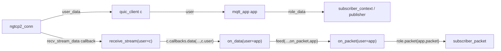
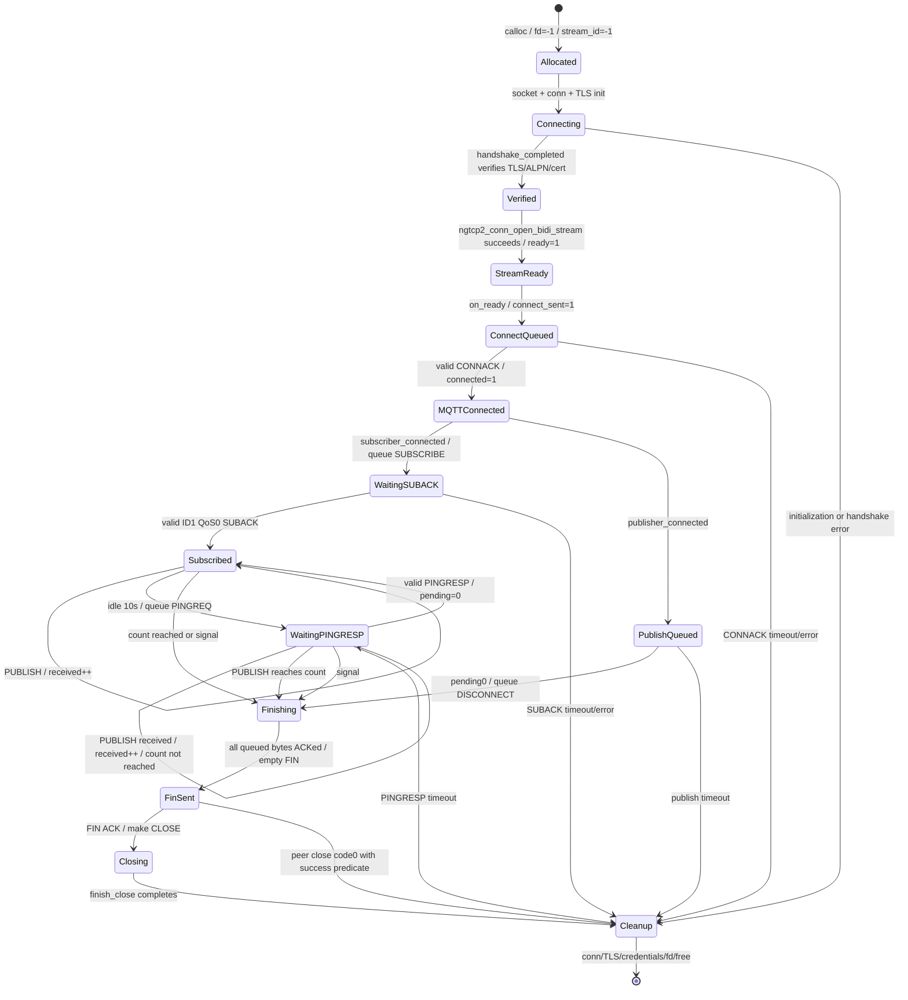

# 07 — Trạng thái, con trỏ, dữ liệu và vòng đời tài nguyên

[Bản đồ](00-README.md) · [Call graph](06-FUNCTION-CALL-GRAPH.md) · [Lỗi/timer/close](08-ERROR-TIMER-AND-CLOSE-FLOW.md)

## 1. Phạm vi: dữ liệu của process nào?

**[SOURCE]** Hai executable có hai main riêng và mỗi main tạo context/role cục bộ riêng, rồi gọi cùng mqtt_app_main. COMMON object được link vào cả hai executable không biến app/context thành shared memory. Mỗi lần run cấp một quic_client, một UDP socket và một ngtcp2 connection. [publisher.c:42–48](/home/nguyenluongduc/Github/QUIC/ZerotoHeroWithQUIC/src/PrgSocket/QUICSocket/mqtt-quic/clients/publisher.c:42) [subscriber.c:113–124](/home/nguyenluongduc/Github/QUIC/ZerotoHeroWithQUIC/src/PrgSocket/QUICSocket/mqtt-quic/clients/subscriber.c:113) [Makefile:13–27](/home/nguyenluongduc/Github/QUIC/ZerotoHeroWithQUIC/src/PrgSocket/QUICSocket/mqtt-quic/clients/Makefile:13) [quic_client.c:548–570](/home/nguyenluongduc/Github/QUIC/ZerotoHeroWithQUIC/src/PrgSocket/QUICSocket/mqtt-quic/clients/quic_client.c:548) [quic_client.c:224](/home/nguyenluongduc/Github/QUIC/ZerotoHeroWithQUIC/src/PrgSocket/QUICSocket/mqtt-quic/clients/quic_client.c:224) [quic_client.c:278–279](/home/nguyenluongduc/Github/QUIC/ZerotoHeroWithQUIC/src/PrgSocket/QUICSocket/mqtt-quic/clients/quic_client.c:278)

**[SOURCE]** Các callback chạy trên event-loop thread; code không tạo thread riêng cho on_data/on_packet/subscriber_tick. Signal handler chỉ ghi flag, outer loop xử lý. Khai báo callback và call sites thực tế là bằng chứng, không phải suy luận chỉ từ tiền tố tên hàm. [quic_client.h:20–26](/home/nguyenluongduc/Github/QUIC/ZerotoHeroWithQUIC/src/PrgSocket/QUICSocket/mqtt-quic/clients/quic_client.h:20) [quic_client.c:54–56](/home/nguyenluongduc/Github/QUIC/ZerotoHeroWithQUIC/src/PrgSocket/QUICSocket/mqtt-quic/clients/quic_client.c:54) [quic_client.c:484–509](/home/nguyenluongduc/Github/QUIC/ZerotoHeroWithQUIC/src/PrgSocket/QUICSocket/mqtt-quic/clients/quic_client.c:484) [mqtt_codec.c:85](/home/nguyenluongduc/Github/QUIC/ZerotoHeroWithQUIC/src/PrgSocket/QUICSocket/mqtt-quic/clients/mqtt_codec.c:85)

**[UNVERIFIED]** Không có PID/fd/socket source port/CID bytes cố định nào được đo mới. Bảng dưới mô tả nguồn sinh, quyền sở hữu và phép cập nhật từ code. Các số wire-size được ghi là suy ra encoder, không phải packet capture.

## 2. Sơ đồ object thực tế trong một process subscriber



Mũi tên biểu thị trường/quan hệ lưu địa chỉ, không phải mọi mũi tên đều có quyền free đích. Owner c là quic_client_run; app.quic chỉ tham chiếu. Parser descriptor embedded trong app nhưng parser.data là allocation riêng. Role/context/options/callbacks stack còn sống vì run chưa return. [app.h:20–28](/home/nguyenluongduc/Github/QUIC/ZerotoHeroWithQUIC/src/PrgSocket/QUICSocket/mqtt-quic/clients/app.h:20) [app.c:115–125](/home/nguyenluongduc/Github/QUIC/ZerotoHeroWithQUIC/src/PrgSocket/QUICSocket/mqtt-quic/clients/app.c:115) [app.c:158–166](/home/nguyenluongduc/Github/QUIC/ZerotoHeroWithQUIC/src/PrgSocket/QUICSocket/mqtt-quic/clients/app.c:158) [subscriber.c:113–124](/home/nguyenluongduc/Github/QUIC/ZerotoHeroWithQUIC/src/PrgSocket/QUICSocket/mqtt-quic/clients/subscriber.c:113) [quic_client.c:24–38](/home/nguyenluongduc/Github/QUIC/ZerotoHeroWithQUIC/src/PrgSocket/QUICSocket/mqtt-quic/clients/quic_client.c:24) [quic_client.c:548–552](/home/nguyenluongduc/Github/QUIC/ZerotoHeroWithQUIC/src/PrgSocket/QUICSocket/mqtt-quic/clients/quic_client.c:548) [quic_client.c:574–581](/home/nguyenluongduc/Github/QUIC/ZerotoHeroWithQUIC/src/PrgSocket/QUICSocket/mqtt-quic/clients/quic_client.c:574)

Bản publisher thay subscriber_context bằng publisher pub; kiểu mqtt_app và quic_client không đổi. Không có con trỏ giữa context publisher và context subscriber ở hai process. [publisher.c:6–8](/home/nguyenluongduc/Github/QUIC/ZerotoHeroWithQUIC/src/PrgSocket/QUICSocket/mqtt-quic/clients/publisher.c:6) [publisher.c:42–48](/home/nguyenluongduc/Github/QUIC/ZerotoHeroWithQUIC/src/PrgSocket/QUICSocket/mqtt-quic/clients/publisher.c:42) [subscriber.c:12–18](/home/nguyenluongduc/Github/QUIC/ZerotoHeroWithQUIC/src/PrgSocket/QUICSocket/mqtt-quic/clients/subscriber.c:12)

## 3. `mqtt_app`: tất cả các trường và thời điểm thay đổi

Declaration là kiểu forward typedef ở app.h7, definition app.h20–29; instance tạo app.c122. Các trường không chỉ định trong aggregate initializer được zero-init. [app.h:7–29](/home/nguyenluongduc/Github/QUIC/ZerotoHeroWithQUIC/src/PrgSocket/QUICSocket/mqtt-quic/clients/app.h:7) [app.c:122–125](/home/nguyenluongduc/Github/QUIC/ZerotoHeroWithQUIC/src/PrgSocket/QUICSocket/mqtt-quic/clients/app.c:122)

| Trường | Kiểu | Nguồn/giá trị ban đầu | Đọc/ghi thực tế và lifetime |
|---|---|---|---|
| `quic` | quic_client* | NULL do zero-init | on_ready/on_tick/on_interrupt gán client; mqtt_app_send/pending/finish dùng; borrowed đến run cleanup |
| `parser` | mqtt_parser | dataNULL,len0,cap0 | on_data/feed cập nhật; parser_free ở cuối session |
| `topic` | const char* | literal lab/temperature | CLI --topic thay pointer bằng optarg; role encode/compare đọc; không free |
| `message` | const char* | literal Temperature = 28.5 C | --message chỉ publisher; encoder đọc strlen/copy; không tự phát khi gán |
| `client_id` | const char* | trỏ client_id[64] stack | --client-id chuyển sang argv string; on_ready encode CONNECT |
| `count` | unsigned | 0 | --count chỉ subscriber; nhận đủ count khác0 thì disconnect |
| `timeout` | unsigned | role.default_timeout | --timeout override; on_tick kiểm runtime tổng |
| `started` | uint64_t | zero rồi now_ms trước run | mốc monotonic ms để on_tick tính runtime |
| `deadline` | uint64_t | 0 | on_ready đặt now_ms+15000 cho CONNACK |
| `last_tx` | uint64_t | 0 | mqtt_app_send thành công đặt now_ms, subscriber_tick dùng để ping |
| `connect_sent` | int | 0 | on_ready đặt1 sau queue CONNECT; on_packet yêu cầu trước CONNACK |
| `connected` | int | 0 | on_packet đặt1 sau valid accepted CONNACK; không đại diện chỉ UDP/QUIC ready |
| `stopping` | int | 0 | app_disconnect đặt1 sau queue DISCONNECT; on_tick bỏ qua và tránh disconnect lặp |
| `role` | const mqtt_role* | &role từ main | app đọc callback/CLI/default; borrowed stack main |
| `role_data` | void* | &subscriber hoặc &pub | role cast về đúng context; borrowed, không phải địa chỉ mqtt_app_main function |

Nguồn/cập nhật của bảng: [app.h:20–28](/home/nguyenluongduc/Github/QUIC/ZerotoHeroWithQUIC/src/PrgSocket/QUICSocket/mqtt-quic/clients/app.h:20) [app.c:13–95](/home/nguyenluongduc/Github/QUIC/ZerotoHeroWithQUIC/src/PrgSocket/QUICSocket/mqtt-quic/clients/app.c:13) [app.c:120–161](/home/nguyenluongduc/Github/QUIC/ZerotoHeroWithQUIC/src/PrgSocket/QUICSocket/mqtt-quic/clients/app.c:120) [subscriber.c:67–69](/home/nguyenluongduc/Github/QUIC/ZerotoHeroWithQUIC/src/PrgSocket/QUICSocket/mqtt-quic/clients/subscriber.c:67) [subscriber.c:101–107](/home/nguyenluongduc/Github/QUIC/ZerotoHeroWithQUIC/src/PrgSocket/QUICSocket/mqtt-quic/clients/subscriber.c:101) [publisher.c:12–17](/home/nguyenluongduc/Github/QUIC/ZerotoHeroWithQUIC/src/PrgSocket/QUICSocket/mqtt-quic/clients/publisher.c:12).

`const char *` bảo vệ truy cập byte qua pointer đó; bản thân field pointer vẫn có thể đổi sang optarg. Không có malloc/strdup/free cho topic/message/client_id ở app; literal/argv/stack array thuộc lifetime bao ngoài. [app.c:120–147](/home/nguyenluongduc/Github/QUIC/ZerotoHeroWithQUIC/src/PrgSocket/QUICSocket/mqtt-quic/clients/app.c:120)

## 4. `mqtt_role`: bảng hàm và dữ liệu mô tả

```c
typedef struct {
    const char *name;
    int subscriber;
    unsigned default_timeout;
    int (*connected)(mqtt_app *);
    int (*packet)(mqtt_app *, const mqtt_packet *);
    int (*tick)(mqtt_app *, uint64_t now);
} mqtt_role;
```

Định nghĩa và semantics CLI: [app.h:10–17](/home/nguyenluongduc/Github/QUIC/ZerotoHeroWithQUIC/src/PrgSocket/QUICSocket/mqtt-quic/clients/app.h:10). Hai instance role nằm trong hai main, không phải biến global dùng chung. [publisher.c:44–47](/home/nguyenluongduc/Github/QUIC/ZerotoHeroWithQUIC/src/PrgSocket/QUICSocket/mqtt-quic/clients/publisher.c:44) [subscriber.c:115–122](/home/nguyenluongduc/Github/QUIC/ZerotoHeroWithQUIC/src/PrgSocket/QUICSocket/mqtt-quic/clients/subscriber.c:115)

| Field | Publisher | Subscriber | Ai sử dụng? |
|---|---|---|---|
| name | publisher | subscriber | snprintf tạo ID default |
| subscriber | 0 | 1 | Chọn --message/--count và help, không tự hiện thực logic subscribe |
| default_timeout | 30s | 0 | Giá trị app.timeout ban đầu |
| connected | publisher_connected | subscriber_connected | on_packet sau CONNACK |
| packet | publisher_packet | subscriber_packet | on_packet khi đã connected |
| tick | publisher_tick | subscriber_tick | on_tick nếu connected và chưa stopping |

Nguồn giá trị/call sites: [publisher.c:44–47](/home/nguyenluongduc/Github/QUIC/ZerotoHeroWithQUIC/src/PrgSocket/QUICSocket/mqtt-quic/clients/publisher.c:44) [subscriber.c:115–122](/home/nguyenluongduc/Github/QUIC/ZerotoHeroWithQUIC/src/PrgSocket/QUICSocket/mqtt-quic/clients/subscriber.c:115) [app.c:61–63](/home/nguyenluongduc/Github/QUIC/ZerotoHeroWithQUIC/src/PrgSocket/QUICSocket/mqtt-quic/clients/app.c:61) [app.c:88](/home/nguyenluongduc/Github/QUIC/ZerotoHeroWithQUIC/src/PrgSocket/QUICSocket/mqtt-quic/clients/app.c:88) [app.c:108–124](/home/nguyenluongduc/Github/QUIC/ZerotoHeroWithQUIC/src/PrgSocket/QUICSocket/mqtt-quic/clients/app.c:108) [app.c:147–148](/home/nguyenluongduc/Github/QUIC/ZerotoHeroWithQUIC/src/PrgSocket/QUICSocket/mqtt-quic/clients/app.c:147).

Gán `.connected=subscriber_connected` không gọi hàm; `app->role->connected(app)` mới là lời gọi. Static function trong file vẫn gọi được qua pointer này. Các hàm callback không sở hữu role; main chỉ return sau mqtt_app_main kết thúc. [subscriber.c:20](/home/nguyenluongduc/Github/QUIC/ZerotoHeroWithQUIC/src/PrgSocket/QUICSocket/mqtt-quic/clients/subscriber.c:20) [subscriber.c:119–124](/home/nguyenluongduc/Github/QUIC/ZerotoHeroWithQUIC/src/PrgSocket/QUICSocket/mqtt-quic/clients/subscriber.c:119) [app.c:61](/home/nguyenluongduc/Github/QUIC/ZerotoHeroWithQUIC/src/PrgSocket/QUICSocket/mqtt-quic/clients/app.c:61)

## 5. `quic_options` và `quic_callbacks`: cấu hình, identity, thời gian

Kiểu public khai báo quic_client.h9–26; app tạo options và callbacks trên stack, c chỉ lưu pointer. [quic_client.h:9–26](/home/nguyenluongduc/Github/QUIC/ZerotoHeroWithQUIC/src/PrgSocket/QUICSocket/mqtt-quic/clients/quic_client.h:9) [app.c:116–119](/home/nguyenluongduc/Github/QUIC/ZerotoHeroWithQUIC/src/PrgSocket/QUICSocket/mqtt-quic/clients/app.c:116) [app.c:158–161](/home/nguyenluongduc/Github/QUIC/ZerotoHeroWithQUIC/src/PrgSocket/QUICSocket/mqtt-quic/clients/app.c:158) [quic_client.c:550–552](/home/nguyenluongduc/Github/QUIC/ZerotoHeroWithQUIC/src/PrgSocket/QUICSocket/mqtt-quic/clients/quic_client.c:550)

| Option | Default app | Sử dụng thực tế |
|---|---|---|
| host | 10.77.0.254 | inet_pton numeric IPv4, không lookup DNS cho routing |
| port | chuỗi14567 | CLI/strtoul validate rồi htons vào sockaddr remote |
| ca_file | docker/certs/ca.pem | GnuTLS load CA PEM; relative với cwd nếu không truyền absolute |
| server_name | broker.test | SNI và verify DNS identity; độc lập host numeric IP |
| handshake_timeout_s | 15 | ns setting và outer guard; đồng thời duration cho finish_deadline |
| idle_timeout_s | 60 | QUIC transport max_idle_timeout được quảng bá, không phải runtime app |
| verbose | 0 | CLI bật1 để settings.log_write=quic_log |

Nguồn defaults/overrides: [app.c:116–150](/home/nguyenluongduc/Github/QUIC/ZerotoHeroWithQUIC/src/PrgSocket/QUICSocket/mqtt-quic/clients/app.c:116). Nơi dùng cụ thể: [quic_client.c:215–233](/home/nguyenluongduc/Github/QUIC/ZerotoHeroWithQUIC/src/PrgSocket/QUICSocket/mqtt-quic/clients/quic_client.c:215) [quic_client.c:262–272](/home/nguyenluongduc/Github/QUIC/ZerotoHeroWithQUIC/src/PrgSocket/QUICSocket/mqtt-quic/clients/quic_client.c:262) [quic_client.c:288–310](/home/nguyenluongduc/Github/QUIC/ZerotoHeroWithQUIC/src/PrgSocket/QUICSocket/mqtt-quic/clients/quic_client.c:288) [quic_client.c:78–82](/home/nguyenluongduc/Github/QUIC/ZerotoHeroWithQUIC/src/PrgSocket/QUICSocket/mqtt-quic/clients/quic_client.c:78).

| Callback field | Địa chỉ app gắn | Khi wrapper gọi | Context cuối |
|---|---|---|---|
| ready | on_ready | Sau verified handshake và open stream thành công | &app |
| data | on_data | receive_stream có length>0, validation pass | &app |
| tick | on_tick | event loop chưa finishing và callback tồn tại | &app |
| interrupt | on_interrupt | loop thấy signal flag khi ready/chưa finishing | &app |

Registration/call sites: [app.c:158–161](/home/nguyenluongduc/Github/QUIC/ZerotoHeroWithQUIC/src/PrgSocket/QUICSocket/mqtt-quic/clients/app.c:158) [quic_client.c:345–346](/home/nguyenluongduc/Github/QUIC/ZerotoHeroWithQUIC/src/PrgSocket/QUICSocket/mqtt-quic/clients/quic_client.c:345) [quic_client.c:156–157](/home/nguyenluongduc/Github/QUIC/ZerotoHeroWithQUIC/src/PrgSocket/QUICSocket/mqtt-quic/clients/quic_client.c:156) [quic_client.c:484–509](/home/nguyenluongduc/Github/QUIC/ZerotoHeroWithQUIC/src/PrgSocket/QUICSocket/mqtt-quic/clients/quic_client.c:484).

Comment h:24 ghi “At least every 20ms”, nhưng code chỉ chọn poll wait tối đa20ms trong loop thông thường; send retry/burst work/OS scheduling có thể kéo dài. Không diễn giải comment thành hard realtime guarantee hay một thread timer 50Hz riêng. [quic_client.h:24](/home/nguyenluongduc/Github/QUIC/ZerotoHeroWithQUIC/src/PrgSocket/QUICSocket/mqtt-quic/clients/quic_client.h:24) [quic_client.c:322–335](/home/nguyenluongduc/Github/QUIC/ZerotoHeroWithQUIC/src/PrgSocket/QUICSocket/mqtt-quic/clients/quic_client.c:322) [quic_client.c:519–524](/home/nguyenluongduc/Github/QUIC/ZerotoHeroWithQUIC/src/PrgSocket/QUICSocket/mqtt-quic/clients/quic_client.c:519)

## 6. `quic_client`: mọi trường của transport object

Đây là opaque type ở public header, definition chỉ nằm trong implementation; app chỉ có pointer và gọi API. c được calloc một lần nên các counter/flag zero; fd và stream_id được đổi thành -1 để phân biệt chưa tạo. [quic_client.h:7](/home/nguyenluongduc/Github/QUIC/ZerotoHeroWithQUIC/src/PrgSocket/QUICSocket/mqtt-quic/clients/quic_client.h:7) [quic_client.c:24–39](/home/nguyenluongduc/Github/QUIC/ZerotoHeroWithQUIC/src/PrgSocket/QUICSocket/mqtt-quic/clients/quic_client.c:24) [quic_client.c:548–555](/home/nguyenluongduc/Github/QUIC/ZerotoHeroWithQUIC/src/PrgSocket/QUICSocket/mqtt-quic/clients/quic_client.c:548)

| Field | Kiểu/owner | Nguồn tạo, ai cập nhật, khi hết hạn |
|---|---|---|
| options | const quic_options*, borrowed | &options stack mqtt_app_main; còn sống suốt run |
| callbacks | const quic_callbacks*, borrowed | &callbacks stack mqtt_app_main; wrapper dispatch các field |
| user | void*, borrowed | &app từ run; wrapper gửi lại app callbacks |
| fd | int, run quản lý handle | socket() trả; connect peer; close cuối run nếu !=-1 |
| local | sockaddr_in embedded | getsockname ghi IP/port nguồn kernel đã chọn |
| remote | sockaddr_in embedded | inet_pton, htons ghi từ options |
| conn | ngtcp2_conn*, run quản lý lifetime | ngtcp2_conn_client_new output; library quản state nội bộ; ngtcp2_conn_del trước TLS cleanup |
| conn_ref | ngtcp2_crypto_conn_ref embedded | get_conn pointer + user_data=c, GnuTLS session ptr trỏ tới nó |
| tls | gnutls_session_t handle | gnutls_init output; native handle gắn với ngtcp2; deinit sau ngtcp2_conn_del |
| credentials | GnuTLS credential handle | allocate_credentials/load trust; free sau session |
| stream_id | int64_t | -1 ban đầu; ngtcp2_conn_open_bidi_stream output; kiểm mọi receive/ACK/close callback |
| tx | uint8_t[1MiB], embedded | queue COPY input; không realloc/memmove khi library còn giữ bytes |
| tx_queued | uint64_t offset | Tổng byte app đã queue; send() API wrapper tăng |
| tx_sent | uint64_t offset | Tổng byte app ngtcp2 đã consume; flush tăng theo consumed, không theo UDP length |
| tx_acked | uint64_t offset | ACK stream contiguous prefix; acked_stream tăng length |
| rx_received | uint64_t offset | Byte stream đã app callback nhận thành công; receive_stream tăng |
| started | ngtcp2_tstamp | now_ns khi tạo c; initial_ts/settings/outer handshake guard |
| finish_deadline | ngtcp2_tstamp | Lần finish đầu đặt now+handshake_timeout_s |
| handshake | int | callback handshake_completed set1 sau TLS/ALPN/cert verify |
| ready | int | open_stream set1 sau ngtcp2 mở stream |
| finishing | int | finish set1, ngăn queue mới/tick, bật drain |
| tx_fin | int | flush set1 khi FIN đã được ngtcp2 serialize/consume |
| fin_acked | int | ACK callback empty FIN length0 set1 khi tx_acked==queued |
| rx_fin | int | receive_stream thấy FIN set1; reject delivery tiếp hoặc FIN bất ngờ |
| stream_closed | int | stream_closed callback set1 sau validation; không phải điều kiện bắt buộc chính để return success |

Nguồn/cập nhật: [quic_client.c:24–38](/home/nguyenluongduc/Github/QUIC/ZerotoHeroWithQUIC/src/PrgSocket/QUICSocket/mqtt-quic/clients/quic_client.c:24) [quic_client.c:63–87](/home/nguyenluongduc/Github/QUIC/ZerotoHeroWithQUIC/src/PrgSocket/QUICSocket/mqtt-quic/clients/quic_client.c:63) [quic_client.c:122–202](/home/nguyenluongduc/Github/QUIC/ZerotoHeroWithQUIC/src/PrgSocket/QUICSocket/mqtt-quic/clients/quic_client.c:122) [quic_client.c:212–236](/home/nguyenluongduc/Github/QUIC/ZerotoHeroWithQUIC/src/PrgSocket/QUICSocket/mqtt-quic/clients/quic_client.c:212) [quic_client.c:284–315](/home/nguyenluongduc/Github/QUIC/ZerotoHeroWithQUIC/src/PrgSocket/QUICSocket/mqtt-quic/clients/quic_client.c:284) [quic_client.c:350–393](/home/nguyenluongduc/Github/QUIC/ZerotoHeroWithQUIC/src/PrgSocket/QUICSocket/mqtt-quic/clients/quic_client.c:350) [quic_client.c:548–582](/home/nguyenluongduc/Github/QUIC/ZerotoHeroWithQUIC/src/PrgSocket/QUICSocket/mqtt-quic/clients/quic_client.c:548).

`tx_fin` không có nghĩa peer đã ACK FIN; `fin_acked` riêng để phân biệt. `stream_closed` có thể được ghi nhưng outer successful drain gate kiểm finishing/tx_fin/fin_acked/pending0, không kiểm stream_closed/rx_fin. Nhánh peer-close success lại kiểm error_code0/finishing/tx_fin/pending0, không đòi fin_acked. [quic_client.c:183–201](/home/nguyenluongduc/Github/QUIC/ZerotoHeroWithQUIC/src/PrgSocket/QUICSocket/mqtt-quic/clients/quic_client.c:183) [quic_client.c:465–468](/home/nguyenluongduc/Github/QUIC/ZerotoHeroWithQUIC/src/PrgSocket/QUICSocket/mqtt-quic/clients/quic_client.c:465) [quic_client.c:512–514](/home/nguyenluongduc/Github/QUIC/ZerotoHeroWithQUIC/src/PrgSocket/QUICSocket/mqtt-quic/clients/quic_client.c:512)

## 7. Hai bảng callback khác nhau có lifetime khác nhau

Bảng `quic_callbacks` của project nằm ở mqtt_app_main stack, c lưu pointer. Bảng `ngtcp2_callbacks` lại local trong connection_init, truyền sang ngtcp2_conn_client_new. Library source sao chép callbacks vào conn (`(*pconn)->callbacks=*callbacks`), nên bảng local connection_init hết scope không làm callback table của library dangling. Settings cũng được library copy. [app.c:158–161](/home/nguyenluongduc/Github/QUIC/ZerotoHeroWithQUIC/src/PrgSocket/QUICSocket/mqtt-quic/clients/app.c:158) [quic_client.c:240–279](/home/nguyenluongduc/Github/QUIC/ZerotoHeroWithQUIC/src/PrgSocket/QUICSocket/mqtt-quic/clients/quic_client.c:240) [quic_client.c:550–552](/home/nguyenluongduc/Github/QUIC/ZerotoHeroWithQUIC/src/PrgSocket/QUICSocket/mqtt-quic/clients/quic_client.c:550) [ngtcp2_conn.c:1391](/home/nguyenluongduc/Github/QUIC/ZerotoHeroWithQUIC/src/PrgSocket/QUICSocket/third_party/ngtcp2/lib/ngtcp2_conn.c:1391) [ngtcp2_conn.c:1460](/home/nguyenluongduc/Github/QUIC/ZerotoHeroWithQUIC/src/PrgSocket/QUICSocket/third_party/ngtcp2/lib/ngtcp2_conn.c:1460)

Điểm khác biệt quan trọng: không được từ việc “library copy ngtcp2_callbacks” suy ra c cũng copy bảng quic_callbacks. Code c chỉ gán pointer. [quic_client.c:551](/home/nguyenluongduc/Github/QUIC/ZerotoHeroWithQUIC/src/PrgSocket/QUICSocket/mqtt-quic/clients/quic_client.c:551) [ngtcp2_conn.c:1460](/home/nguyenluongduc/Github/QUIC/ZerotoHeroWithQUIC/src/PrgSocket/QUICSocket/third_party/ngtcp2/lib/ngtcp2_conn.c:1460)



Mỗi `void *user` cần cast đúng theo caller đã truyền. Các mũi tên context trên được thiết lập ở ngtcp2_conn_client_new cuối đối số c, run c.user=user, main role_data, và feed arg. Đây là các địa chỉ khác nhau, không phải một “user” toàn cục. [quic_client.c:278–279](/home/nguyenluongduc/Github/QUIC/ZerotoHeroWithQUIC/src/PrgSocket/QUICSocket/mqtt-quic/clients/quic_client.c:278) [quic_client.c:552](/home/nguyenluongduc/Github/QUIC/ZerotoHeroWithQUIC/src/PrgSocket/QUICSocket/mqtt-quic/clients/quic_client.c:552) [app.c:124](/home/nguyenluongduc/Github/QUIC/ZerotoHeroWithQUIC/src/PrgSocket/QUICSocket/mqtt-quic/clients/app.c:124) [app.c:69](/home/nguyenluongduc/Github/QUIC/ZerotoHeroWithQUIC/src/PrgSocket/QUICSocket/mqtt-quic/clients/app.c:69) [mqtt_codec.c:85](/home/nguyenluongduc/Github/QUIC/ZerotoHeroWithQUIC/src/PrgSocket/QUICSocket/mqtt-quic/clients/mqtt_codec.c:85)

## 8. `subscriber_context`: ý nghĩa từng field

```c
enum subscriber_state { WAIT_SUBACK = 2, SUBSCRIBED = 3 };
```

Đây là hai trạng thái role sau MQTT CONNECT trong logic thiết kế; main vẫn khởi tạo state WAIT_SUBACK trước khi thật sự gửi SUBSCRIBE. app.connected gate ngăn role tick/packet chạy quá sớm; subscriber_connected đặt lại WAIT_SUBACK/deadline khi queue thật thành công. Không có enum INIT trong source hiện tại. [subscriber.c:6–18](/home/nguyenluongduc/Github/QUIC/ZerotoHeroWithQUIC/src/PrgSocket/QUICSocket/mqtt-quic/clients/subscriber.c:6) [subscriber.c:28–29](/home/nguyenluongduc/Github/QUIC/ZerotoHeroWithQUIC/src/PrgSocket/QUICSocket/mqtt-quic/clients/subscriber.c:28) [subscriber.c:114](/home/nguyenluongduc/Github/QUIC/ZerotoHeroWithQUIC/src/PrgSocket/QUICSocket/mqtt-quic/clients/subscriber.c:114) [app.c:51–63](/home/nguyenluongduc/Github/QUIC/ZerotoHeroWithQUIC/src/PrgSocket/QUICSocket/mqtt-quic/clients/app.c:51) [app.c:88](/home/nguyenluongduc/Github/QUIC/ZerotoHeroWithQUIC/src/PrgSocket/QUICSocket/mqtt-quic/clients/app.c:88)

| Field | Khởi tạo | Ghi/đọc và ảnh hưởng |
|---|---|---|
| state | WAIT_SUBACK=2 | connected đặt WAIT; valid SUBACK đổi SUBSCRIBED; packet/tick chọn nhánh |
| received | 0 | PUBLISH hợp lệ ++; count khác0 đủ thì disconnect |
| ping_pending | 0 | Sau queue PINGREQ set1; matching PINGRESP clear0 |
| ping_at | 0 | Set now lúc queue ping, dùng timeout10s |
| subscribe_deadline | 0 | Đặt now_ms+15000 sau SUBSCRIBE; chỉ kiểm khi WAIT và role tick đã được gọi |

Nguồn zero/init và mọi updates: [subscriber.c:12–18](/home/nguyenluongduc/Github/QUIC/ZerotoHeroWithQUIC/src/PrgSocket/QUICSocket/mqtt-quic/clients/subscriber.c:12) [subscriber.c:28–29](/home/nguyenluongduc/Github/QUIC/ZerotoHeroWithQUIC/src/PrgSocket/QUICSocket/mqtt-quic/clients/subscriber.c:28) [subscriber.c:45](/home/nguyenluongduc/Github/QUIC/ZerotoHeroWithQUIC/src/PrgSocket/QUICSocket/mqtt-quic/clients/subscriber.c:45) [subscriber.c:67–76](/home/nguyenluongduc/Github/QUIC/ZerotoHeroWithQUIC/src/PrgSocket/QUICSocket/mqtt-quic/clients/subscriber.c:67) [subscriber.c:85–108](/home/nguyenluongduc/Github/QUIC/ZerotoHeroWithQUIC/src/PrgSocket/QUICSocket/mqtt-quic/clients/subscriber.c:85) [subscriber.c:114](/home/nguyenluongduc/Github/QUIC/ZerotoHeroWithQUIC/src/PrgSocket/QUICSocket/mqtt-quic/clients/subscriber.c:114).

Gán ping_pending1 riêng nó không gửi gì. Trong code thật, encoder/mqtt_app_send chạy trước rồi mới set flag, nên flag phản ánh “đã queue PINGREQ thành công, đang chờ PINGRESP”. Tương tự state WAIT không tự đăng ký topic. [subscriber.c:25–29](/home/nguyenluongduc/Github/QUIC/ZerotoHeroWithQUIC/src/PrgSocket/QUICSocket/mqtt-quic/clients/subscriber.c:25) [subscriber.c:101–108](/home/nguyenluongduc/Github/QUIC/ZerotoHeroWithQUIC/src/PrgSocket/QUICSocket/mqtt-quic/clients/subscriber.c:101)

## 9. `publisher` context và completion

```c
typedef struct { uint64_t publish_deadline; } publisher;
```

Context pub zero trong publisher.main; role_data trỏ tới pub. Sau valid CONNACK, publisher_connected queue PUBLISH rồi đặt deadline now_ms+15000. publisher_tick so deadline trước, sau đó nếu pending0 request disconnect. Không có received/subscribed/ping_pending trong publisher context. [publisher.c:6–8](/home/nguyenluongduc/Github/QUIC/ZerotoHeroWithQUIC/src/PrgSocket/QUICSocket/mqtt-quic/clients/publisher.c:6) [publisher.c:11–17](/home/nguyenluongduc/Github/QUIC/ZerotoHeroWithQUIC/src/PrgSocket/QUICSocket/mqtt-quic/clients/publisher.c:11) [publisher.c:29–48](/home/nguyenluongduc/Github/QUIC/ZerotoHeroWithQUIC/src/PrgSocket/QUICSocket/mqtt-quic/clients/publisher.c:29)

App default timeout30s và publish deadline15s là hai ràng buộc riêng; còn handshake15/CONNACK15 dùng các mốc khác. Runtime có thể hết trước publish deadline nếu nhiều thời gian đã dùng ở startup; on_tick kiểm app timeout trước role.tick. [publisher.c:45](/home/nguyenluongduc/Github/QUIC/ZerotoHeroWithQUIC/src/PrgSocket/QUICSocket/mqtt-quic/clients/publisher.c:45) [app.c:76–88](/home/nguyenluongduc/Github/QUIC/ZerotoHeroWithQUIC/src/PrgSocket/QUICSocket/mqtt-quic/clients/app.c:76)

## 10. State diagram: transport và MQTT không gộp thành một enum



Tên Allocated/Verified/ConnectQueued là **nhãn giải thích** cho tổ hợp flag/điểm thực thi, không phải enum mới được thêm vào code. Diagram có nhánh subscriber và publisher thay thế nhau theo role, không phải một process lần lượt vừa publish vừa subscribe. [quic_client.c:548–570](/home/nguyenluongduc/Github/QUIC/ZerotoHeroWithQUIC/src/PrgSocket/QUICSocket/mqtt-quic/clients/quic_client.c:548) [quic_client.c:122–142](/home/nguyenluongduc/Github/QUIC/ZerotoHeroWithQUIC/src/PrgSocket/QUICSocket/mqtt-quic/clients/quic_client.c:122) [quic_client.c:338–347](/home/nguyenluongduc/Github/QUIC/ZerotoHeroWithQUIC/src/PrgSocket/QUICSocket/mqtt-quic/clients/quic_client.c:338) [app.c:37–63](/home/nguyenluongduc/Github/QUIC/ZerotoHeroWithQUIC/src/PrgSocket/QUICSocket/mqtt-quic/clients/app.c:37) [subscriber.c:20–108](/home/nguyenluongduc/Github/QUIC/ZerotoHeroWithQUIC/src/PrgSocket/QUICSocket/mqtt-quic/clients/subscriber.c:20) [publisher.c:11–39](/home/nguyenluongduc/Github/QUIC/ZerotoHeroWithQUIC/src/PrgSocket/QUICSocket/mqtt-quic/clients/publisher.c:11)

Nhánh lỗi từ mọi state không vẽ hết để giữ sơ đồ đọc được; các return failure đi qua run cleanup như file08. FIN/CLOSE transitions theo predicates thực, không đòi nhận MQTT PUBACK hoặc rx_fin trước successful drain. [quic_client.c:359–388](/home/nguyenluongduc/Github/QUIC/ZerotoHeroWithQUIC/src/PrgSocket/QUICSocket/mqtt-quic/clients/quic_client.c:359) [quic_client.c:465–468](/home/nguyenluongduc/Github/QUIC/ZerotoHeroWithQUIC/src/PrgSocket/QUICSocket/mqtt-quic/clients/quic_client.c:465) [quic_client.c:512–514](/home/nguyenluongduc/Github/QUIC/ZerotoHeroWithQUIC/src/PrgSocket/QUICSocket/mqtt-quic/clients/quic_client.c:512) [quic_client.c:570–582](/home/nguyenluongduc/Github/QUIC/ZerotoHeroWithQUIC/src/PrgSocket/QUICSocket/mqtt-quic/clients/quic_client.c:570)

## 11. Ba mốc tx và một ring: invariant cần giữ

```text
absolute stream byte offsets:
0 ........ tx_acked ........ tx_sent ........ tx_queued
  đã ACK        đã submit nhưng       chưa submit
                 chưa ACK              cho ngtcp2
```

Theo kiểm tra và updates trong code, invariant dự kiến là `tx_acked <= tx_sent <= tx_queued`; pending=`queued-acked`. tx array không dài vô hạn, physical index của offset là offset%QUEUE_CAPACITY. Những byte chưa ACK phải giữ ổn định vì ngtcp2 có thể tham chiếu để retransmit. [quic_client.c:59–75](/home/nguyenluongduc/Github/QUIC/ZerotoHeroWithQUIC/src/PrgSocket/QUICSocket/mqtt-quic/clients/quic_client.c:59) [quic_client.c:174–186](/home/nguyenluongduc/Github/QUIC/ZerotoHeroWithQUIC/src/PrgSocket/QUICSocket/mqtt-quic/clients/quic_client.c:174) [quic_client.c:363–388](/home/nguyenluongduc/Github/QUIC/ZerotoHeroWithQUIC/src/PrgSocket/QUICSocket/mqtt-quic/clients/quic_client.c:363) [ngtcp2.h:5243–5250](/home/nguyenluongduc/Github/QUIC/ZerotoHeroWithQUIC/src/PrgSocket/QUICSocket/demo/src/.deps/include/ngtcp2/ngtcp2.h:5243)

| Thao tác | Counter thay đổi | Counter không thể tự suy ra đã đổi |
|---|---|---|
| quic_client_send copy length | queued += length | sent, acked |
| writev consumed>=0 | sent += consumed | acked |
| syscall send thành công | Không tăng counter stream tại send_datagram | Không có ACK tự động |
| ngtcp2 acked_stream callback | acked += length | queued |
| recv application stream success | rx_received += length | tx counters |

Nguồn từng update: [quic_client.c:74](/home/nguyenluongduc/Github/QUIC/ZerotoHeroWithQUIC/src/PrgSocket/QUICSocket/mqtt-quic/clients/quic_client.c:74) [quic_client.c:386–388](/home/nguyenluongduc/Github/QUIC/ZerotoHeroWithQUIC/src/PrgSocket/QUICSocket/mqtt-quic/clients/quic_client.c:386) [quic_client.c:325–326](/home/nguyenluongduc/Github/QUIC/ZerotoHeroWithQUIC/src/PrgSocket/QUICSocket/mqtt-quic/clients/quic_client.c:325) [quic_client.c:180–186](/home/nguyenluongduc/Github/QUIC/ZerotoHeroWithQUIC/src/PrgSocket/QUICSocket/mqtt-quic/clients/quic_client.c:180) [quic_client.c:158](/home/nguyenluongduc/Github/QUIC/ZerotoHeroWithQUIC/src/PrgSocket/QUICSocket/mqtt-quic/clients/quic_client.c:158)

Nếu queued ở gần cuối array, một MQTT packet có thể được chép thành hai đoạn vật lý; flush tạo tối đa hai ngtcp2_vec để giữ logical byte stream liên tục. Việc wrap bộ nhớ không tạo packet MQTT mới hoặc stream mới. [quic_client.c:70–73](/home/nguyenluongduc/Github/QUIC/ZerotoHeroWithQUIC/src/PrgSocket/QUICSocket/mqtt-quic/clients/quic_client.c:70) [quic_client.c:363–370](/home/nguyenluongduc/Github/QUIC/ZerotoHeroWithQUIC/src/PrgSocket/QUICSocket/mqtt-quic/clients/quic_client.c:363)

### 11.1. Ví dụ ring nhỏ để học, không phải capacity thật

Giả sử chỉ để tính tay capacity8, queued6, acked4, sent6, muốn queue4byte ABCD. pending2 nên room6 đủ. pos6, first2: A/B vào index6/7, C/D vào0/1, queued thành10. Absolute offsets6..9 vẫn liên tục. Đây là phép thay số minh họa công thức của code; capacity thực luôn1MiB trong source. [quic_client.c:21](/home/nguyenluongduc/Github/QUIC/ZerotoHeroWithQUIC/src/PrgSocket/QUICSocket/mqtt-quic/clients/quic_client.c:21) [quic_client.c:65–74](/home/nguyenluongduc/Github/QUIC/ZerotoHeroWithQUIC/src/PrgSocket/QUICSocket/mqtt-quic/clients/quic_client.c:65)

App không được sửa tx bytes từ offset acked trở đi trước ACK. Khi acked tăng, room tăng và những vị trí modulo cũ có thể được tái sử dụng cho offset mới. Guard room dựa pending, không dựa queued-sent, vì byte đã submit nhưng chưa ACK vẫn còn cần. [quic_client.c:65](/home/nguyenluongduc/Github/QUIC/ZerotoHeroWithQUIC/src/PrgSocket/QUICSocket/mqtt-quic/clients/quic_client.c:65) [ngtcp2.h:5243–5250](/home/nguyenluongduc/Github/QUIC/ZerotoHeroWithQUIC/src/PrgSocket/QUICSocket/demo/src/.deps/include/ngtcp2/ngtcp2.h:5243)

### 11.2. FIN có zero data nhưng vẫn có trạng thái ACK

quic_client_pending chỉ đếm bytes, không đếm FIN. Vì vậy transport tách tx_fin/fin_acked: send_fin chỉ khi finishing && pending0; ACK callback length0 sau empty FIN mới đánh dấu fin_acked. Contract library xác nhận empty STREAM FIN có thể tạo ACK callback datalen0. [quic_client.c:359–388](/home/nguyenluongduc/Github/QUIC/ZerotoHeroWithQUIC/src/PrgSocket/QUICSocket/mqtt-quic/clients/quic_client.c:359) [quic_client.c:183–186](/home/nguyenluongduc/Github/QUIC/ZerotoHeroWithQUIC/src/PrgSocket/QUICSocket/mqtt-quic/clients/quic_client.c:183) [ngtcp2.h:3028–3040](/home/nguyenluongduc/Github/QUIC/ZerotoHeroWithQUIC/src/PrgSocket/QUICSocket/demo/src/.deps/include/ngtcp2/ngtcp2.h:3028)

Không thể dùng pending0 một mình để kết luận shutdown hoàn tất; event_loop còn kiểm FIN state hoặc peer-close success predicate. [quic_client.c:465–468](/home/nguyenluongduc/Github/QUIC/ZerotoHeroWithQUIC/src/PrgSocket/QUICSocket/mqtt-quic/clients/quic_client.c:465) [quic_client.c:512–514](/home/nguyenluongduc/Github/QUIC/ZerotoHeroWithQUIC/src/PrgSocket/QUICSocket/mqtt-quic/clients/quic_client.c:512)

## 12. Buffer nhận: descriptor, owner và view

| Object/vùng nhớ | Ai tạo | Ai sở hữu/free | Nội dung có thể thay khi nào? |
|---|---|---|---|
| read_packets.packet[65536] | stack read_packets | Stack tự hết; không free() | recv kế tiếp ghi lại |
| receive_stream.data | ngtcp2 cung cấp | Borrowed; project không free | Không dựa vào lifetime sau callback; copy phần cần giữ |
| app.parser descriptor | embedded app stack | mqtt_app_main | feed đổi data/len/cap |
| parser.data heap | realloc trong feed | parser_free cuối mqtt_app_main | realloc/memcpy/memmove trong feed |
| mqtt_packet local | stack feed | Stack tự hết | Sau callback không được giữ &packet |
| packet.body | pointer vào parser.data | Không có allocation độc lập | Có thể đổi ngay sau callback bởi memmove/realloc |
| mqtt_publish message | stack subscriber_packet | Stack tự hết | Callback return hết lifetime descriptor |
| message.topic/payload | views vào packet.body | Không free riêng | Chỉ dùng khi callback packet còn hiệu lực |

Nguồn owners/views: [quic_client.c:453–455](/home/nguyenluongduc/Github/QUIC/ZerotoHeroWithQUIC/src/PrgSocket/QUICSocket/mqtt-quic/clients/quic_client.c:453) [quic_client.c:145–156](/home/nguyenluongduc/Github/QUIC/ZerotoHeroWithQUIC/src/PrgSocket/QUICSocket/mqtt-quic/clients/quic_client.c:145) [mqtt_codec.h:8–25](/home/nguyenluongduc/Github/QUIC/ZerotoHeroWithQUIC/src/PrgSocket/QUICSocket/mqtt-quic/clients/mqtt_codec.h:8) [mqtt_codec.c:84–95](/home/nguyenluongduc/Github/QUIC/ZerotoHeroWithQUIC/src/PrgSocket/QUICSocket/mqtt-quic/clients/mqtt_codec.c:84) [mqtt_codec.c:111–112](/home/nguyenluongduc/Github/QUIC/ZerotoHeroWithQUIC/src/PrgSocket/QUICSocket/mqtt-quic/clients/mqtt_codec.c:111) [subscriber.c:52–65](/home/nguyenluongduc/Github/QUIC/ZerotoHeroWithQUIC/src/PrgSocket/QUICSocket/mqtt-quic/clients/subscriber.c:52) [app.c:166](/home/nguyenluongduc/Github/QUIC/ZerotoHeroWithQUIC/src/PrgSocket/QUICSocket/mqtt-quic/clients/app.c:166)

`const` không bảo đảm vùng nhớ sống mãi hoặc thuộc read-only storage; nó chỉ giới hạn sửa qua pointer đó. Quyền sở hữu/lifetime phải theo allocation và caller/callee. Trong project, parser copy vào buffer riêng chính là cách vượt qua lifetime ngắn của input stream callback. [mqtt_codec.c:92–95](/home/nguyenluongduc/Github/QUIC/ZerotoHeroWithQUIC/src/PrgSocket/QUICSocket/mqtt-quic/clients/mqtt_codec.c:92) [mqtt_codec.h:24–25](/home/nguyenluongduc/Github/QUIC/ZerotoHeroWithQUIC/src/PrgSocket/QUICSocket/mqtt-quic/clients/mqtt_codec.h:24)

## 13. Parser state và ví dụ partial packet

`mqtt_parser` có data/len/cap. cap là capacity tổng; room=cap-len. len không phải Remaining Length của MQTT, cap không phải “chỗ trống”. Cấu trúc khởi tạo zero cùng app. [mqtt_codec.h:15](/home/nguyenluongduc/Github/QUIC/ZerotoHeroWithQUIC/src/PrgSocket/QUICSocket/mqtt-quic/clients/mqtt_codec.h:15) [app.c:122–125](/home/nguyenluongduc/Github/QUIC/ZerotoHeroWithQUIC/src/PrgSocket/QUICSocket/mqtt-quic/clients/app.c:122)

| Mốc | p.len | p.cap có thể | Điều đã biết |
|---|---:|---:|---|
| Trước byte đầu | 0 | 0 | header chưa có |
| Feed20 | 1 | 1 | type/flags có; thiếu RL |
| Feed02 00 | 3 | 4 | nh2/nb2; body còn thiếu1 |
| Feed00 | 0 sau callback | 4 | packet đủ, đã xử lý; giữ allocation dùng tiếp |

Ví dụ CONNACK20 02 00 00 và trace được suy từ header/feed, không phải cam kết cách QUIC chia callback. [mqtt_codec.c:59–97](/home/nguyenluongduc/Github/QUIC/ZerotoHeroWithQUIC/src/PrgSocket/QUICSocket/mqtt-quic/clients/mqtt_codec.c:59) [test_codec.c:37](/home/nguyenluongduc/Github/QUIC/ZerotoHeroWithQUIC/src/PrgSocket/QUICSocket/mqtt-quic/tests/test_codec.c:37)

Nh/nb là locals mỗi iteration, không nằm trong parser struct. header ghi hai output qua pointer chỉ khi kết thúc RL; hr1 chỉ xác nhận fixed header đủ, feed còn kiểm len>=nh+nb. Phần body ở MQTT terminology gồm variable header+payload, không chỉ payload. [mqtt_codec.c:59–72](/home/nguyenluongduc/Github/QUIC/ZerotoHeroWithQUIC/src/PrgSocket/QUICSocket/mqtt-quic/clients/mqtt_codec.c:59) [mqtt_codec.c:81–84](/home/nguyenluongduc/Github/QUIC/ZerotoHeroWithQUIC/src/PrgSocket/QUICSocket/mqtt-quic/clients/mqtt_codec.c:81)

`mqtt_parser_free(mqtt_parser *p)` free heap rồi memset descriptor0; app gọi sau run dù success/failure. Nó không giải phóng mqtt_app stack. `mqtt_buffer_free` chỉ free encode buffer data rồi reset pointer/len, không free descriptor stack. [mqtt_codec.c:28–29](/home/nguyenluongduc/Github/QUIC/ZerotoHeroWithQUIC/src/PrgSocket/QUICSocket/mqtt-quic/clients/mqtt_codec.c:28) [app.c:166](/home/nguyenluongduc/Github/QUIC/ZerotoHeroWithQUIC/src/PrgSocket/QUICSocket/mqtt-quic/clients/app.c:166)

## 14. Wire data và số byte ACK phụ thuộc Client ID

Với topic15/message20, PUBLISH tổng39B; SUBSCRIBE id1/topic15 tổng22B; PINGREQ/DISCONNECT mỗi packet2B. CONNECT body12+L với L là số byte ID; với default ID nằm trong64B array thì body<128, fixed header2 nên CONNECT tổng14+L. [mqtt_codec.c:30–56](/home/nguyenluongduc/Github/QUIC/ZerotoHeroWithQUIC/src/PrgSocket/QUICSocket/mqtt-quic/clients/mqtt_codec.c:30) [app.c:120–123](/home/nguyenluongduc/Github/QUIC/ZerotoHeroWithQUIC/src/PrgSocket/QUICSocket/mqtt-quic/clients/app.c:120)

Một timeline **minh họa PID1234**, không phải PID đo thật:

| Process | Client ID | L | CONNECT | SUBSCRIBE/PUBLISH | DISCONNECT | Tổng tx nếu chưa ping |
|---|---|---:|---:|---:|---:|---:|
| Publisher | mqtt-publisher-1234 | 19 | 33 | PUBLISH39 | 2 | 74 |
| Subscriber | mqtt-subscriber-1234 | 20 | 34 | SUBSCRIBE22 | 2 | 58 |

Các số là kết quả công thức snprintf/strlen/encoder, không phải transport packet number. Mỗi ping thêm2byte ứng dụng gửi của subscriber; QUIC ACK/control/retransmission bytes không cộng vào tx_queued. [app.c:121](/home/nguyenluongduc/Github/QUIC/ZerotoHeroWithQUIC/src/PrgSocket/QUICSocket/mqtt-quic/clients/app.c:121) [publisher.c:14–15](/home/nguyenluongduc/Github/QUIC/ZerotoHeroWithQUIC/src/PrgSocket/QUICSocket/mqtt-quic/clients/publisher.c:14) [mqtt_codec.c:38–56](/home/nguyenluongduc/Github/QUIC/ZerotoHeroWithQUIC/src/PrgSocket/QUICSocket/mqtt-quic/clients/mqtt_codec.c:38) [quic_client.c:74](/home/nguyenluongduc/Github/QUIC/ZerotoHeroWithQUIC/src/PrgSocket/QUICSocket/mqtt-quic/clients/quic_client.c:74) [quic_client.c:386–388](/home/nguyenluongduc/Github/QUIC/ZerotoHeroWithQUIC/src/PrgSocket/QUICSocket/mqtt-quic/clients/quic_client.c:386)

Vì PID/CLI ID/keepalive khác nhau, log `acked=76` hoặc `acked=60` từ lần test trước không phải constant phải luôn xuất hiện. `acked` đếm tổng stream bytes của connection theo callback, không đếm UDP/IP overhead hay số message. [quic_client.c:180–186](/home/nguyenluongduc/Github/QUIC/ZerotoHeroWithQUIC/src/PrgSocket/QUICSocket/mqtt-quic/clients/quic_client.c:180) [quic_client.c:513](/home/nguyenluongduc/Github/QUIC/ZerotoHeroWithQUIC/src/PrgSocket/QUICSocket/mqtt-quic/clients/quic_client.c:513)

## 15. Những định danh khác nhau trong cùng một lần chạy

| Tên | Nguồn | Phạm vi/ý nghĩa | Không được nhầm với |
|---|---|---|---|
| PID | kernel getpid / process launch | Process hiện tại; dùng làm suffix client ID default | fd, stream ID, MQTT packet ID |
| fd | return socket | Handle trong process tới UDP socket | Cổng UDP hoặc socket của process khác |
| local IP/port | getsockname sau UDP connect | Tuple nguồn runtime | server_name/certificate identity |
| remote IP/port | options host/port | Endpoint numeric IP14567/UDP | MQTT topic |
| MQTT client_id | snprintf hoặc CLI | Định danh MQTT gửi trong CONNECT | QUIC CID |
| MQTT packet ID1 | literal encoder SUBSCRIBE | Ghép SUBSCRIBE/SUBACK của connection MQTT | QUIC packet number |
| QUIC stream_id | ngtcp2_conn_open_bidi_stream output | Stream của một connection; client đầu tiên thường0 | stream0 trong connection của process khác |
| DCID/SCID | gnutls_rnd + ngtcp2_cid_init | CID QUIC ban đầu16byte, library quản tiếp | TLS SNI hoặc MQTT client ID |
| QUIC packet number | Library ngtcp2 | Trạng thái transport nội bộ | Không phải tx_queued hoặc received |
| stream offset | queue/rx counters + library | Byte position liên tục trong stream | Index vật lý modulo ring |

Nguồn các ID nhìn thấy trong project: [app.c:121](/home/nguyenluongduc/Github/QUIC/ZerotoHeroWithQUIC/src/PrgSocket/QUICSocket/mqtt-quic/clients/app.c:121) [quic_client.c:99–104](/home/nguyenluongduc/Github/QUIC/ZerotoHeroWithQUIC/src/PrgSocket/QUICSocket/mqtt-quic/clients/quic_client.c:99) [quic_client.c:212–236](/home/nguyenluongduc/Github/QUIC/ZerotoHeroWithQUIC/src/PrgSocket/QUICSocket/mqtt-quic/clients/quic_client.c:212) [quic_client.c:275–279](/home/nguyenluongduc/Github/QUIC/ZerotoHeroWithQUIC/src/PrgSocket/QUICSocket/mqtt-quic/clients/quic_client.c:275) [quic_client.c:338–345](/home/nguyenluongduc/Github/QUIC/ZerotoHeroWithQUIC/src/PrgSocket/QUICSocket/mqtt-quic/clients/quic_client.c:338) [subscriber.c:25](/home/nguyenluongduc/Github/QUIC/ZerotoHeroWithQUIC/src/PrgSocket/QUICSocket/mqtt-quic/clients/subscriber.c:25) [subscriber.c:40–41](/home/nguyenluongduc/Github/QUIC/ZerotoHeroWithQUIC/src/PrgSocket/QUICSocket/mqtt-quic/clients/subscriber.c:40) [quic_client.c:36](/home/nguyenluongduc/Github/QUIC/ZerotoHeroWithQUIC/src/PrgSocket/QUICSocket/mqtt-quic/clients/quic_client.c:36). Không có field packet_number tự viết trong quic_client; chi tiết packet number bên library được phân tích ở [connection](02-CONNECTION-AND-HANDSHAKE.md).

## 16. Clock, timestamp, timeout và deadline

### 16.1. Hai hàm clock

```c
static ngtcp2_tstamp now_ns(void);
uint64_t quic_client_now_ms(void);
```

now_ns không có tham số; clock_gettime(CLOCK_MONOTONIC,&ts) ghi timespec stack. Thành công trả sec*NGTCP2_SECONDS+nsec; lỗi perror rồi abort, không return lỗi có thể recover. quic_client_now_ms cũng không tham số, chia now_ns cho NGTCP2_MILLISECONDS. [quic_client.c:43–52](/home/nguyenluongduc/Github/QUIC/ZerotoHeroWithQUIC/src/PrgSocket/QUICSocket/mqtt-quic/clients/quic_client.c:43)

Installed header đặt tick NANOSECONDS=1, MICROSECONDS=1000, MILLISECONDS=1000000, SECONDS=1000000000; project dùng ns cho API ngtcp2 và ms cho app callbacks. Không đưa wall-clock date/time vào so sánh timeout. [ngtcp2.h:217–244](/home/nguyenluongduc/Github/QUIC/ZerotoHeroWithQUIC/src/PrgSocket/QUICSocket/demo/src/.deps/include/ngtcp2/ngtcp2.h:217) [quic_client.c:43–52](/home/nguyenluongduc/Github/QUIC/ZerotoHeroWithQUIC/src/PrgSocket/QUICSocket/mqtt-quic/clients/quic_client.c:43) [quic_client.c:507–508](/home/nguyenluongduc/Github/QUIC/ZerotoHeroWithQUIC/src/PrgSocket/QUICSocket/mqtt-quic/clients/quic_client.c:507)

### 16.2. Bảng mọi giới hạn thời gian

| Mốc/giới hạn | Đơn vị | Đặt từ đâu | Đọc/điều kiện |
|---|---|---|---|
| c.started | ns | now_ns khi c tạo | settings.initial_ts, outer handshake guard |
| settings.handshake_timeout | ns | options.handshake_timeout_s*SECONDS | ngtcp2 handshake timer |
| options.handshake_timeout_s | giây | default15 | outer handshake guard và drain duration |
| params.max_idle_timeout | ns | idle_timeout_s60*SECONDS | QUIC peer negotiation/library idle behavior |
| app.started | ms | trước run | on_tick timeout tổng |
| app.timeout | giây | role default0/30 hoặc --timeout | now-started >= timeout*1000 |
| app.deadline | ms absolute | now_ms+15000 sau CONNECT queue | connect_sent && !connected && now>=deadline |
| subscriber.subscribe_deadline | ms absolute | now_ms+15000 sau SUBSCRIBE queue | WAIT_SUBACK và now>=deadline |
| subscriber.ping_at | ms | now tick lúc queue PINGREQ | pending && now-ping_at>=10000 |
| app.last_tx | ms | queue MQTT success | !pending && now-last_tx>=10000 |
| publisher.publish_deadline | ms absolute | now_ms+15000 sau PUBLISH queue | publisher_tick kiểm trước pending |
| c.finish_deadline | ns absolute | now_ns+handshake_timeout_s*SECONDS | event_loop drain guard / finish_close cap |
| send_datagram.deadline | ns absolute | now_ns+1s | Chỉ gate retry EAGAIN/EWOULDBLOCK |
| poll wait_ms | ms duration | min20, expiry rounded up/capped | poll chờ readiness, không tự tạo timer callback thread |

Call sites: [app.c:20](/home/nguyenluongduc/Github/QUIC/ZerotoHeroWithQUIC/src/PrgSocket/QUICSocket/mqtt-quic/clients/app.c:20) [app.c:44](/home/nguyenluongduc/Github/QUIC/ZerotoHeroWithQUIC/src/PrgSocket/QUICSocket/mqtt-quic/clients/app.c:44) [app.c:76–88](/home/nguyenluongduc/Github/QUIC/ZerotoHeroWithQUIC/src/PrgSocket/QUICSocket/mqtt-quic/clients/app.c:76) [app.c:157](/home/nguyenluongduc/Github/QUIC/ZerotoHeroWithQUIC/src/PrgSocket/QUICSocket/mqtt-quic/clients/app.c:157) [subscriber.c:29](/home/nguyenluongduc/Github/QUIC/ZerotoHeroWithQUIC/src/PrgSocket/QUICSocket/mqtt-quic/clients/subscriber.c:29) [subscriber.c:85–108](/home/nguyenluongduc/Github/QUIC/ZerotoHeroWithQUIC/src/PrgSocket/QUICSocket/mqtt-quic/clients/subscriber.c:85) [publisher.c:17](/home/nguyenluongduc/Github/QUIC/ZerotoHeroWithQUIC/src/PrgSocket/QUICSocket/mqtt-quic/clients/publisher.c:17) [publisher.c:31–37](/home/nguyenluongduc/Github/QUIC/ZerotoHeroWithQUIC/src/PrgSocket/QUICSocket/mqtt-quic/clients/publisher.c:31) [quic_client.c:78–82](/home/nguyenluongduc/Github/QUIC/ZerotoHeroWithQUIC/src/PrgSocket/QUICSocket/mqtt-quic/clients/quic_client.c:78) [quic_client.c:261–272](/home/nguyenluongduc/Github/QUIC/ZerotoHeroWithQUIC/src/PrgSocket/QUICSocket/mqtt-quic/clients/quic_client.c:261) [quic_client.c:323–331](/home/nguyenluongduc/Github/QUIC/ZerotoHeroWithQUIC/src/PrgSocket/QUICSocket/mqtt-quic/clients/quic_client.c:323) [quic_client.c:492–524](/home/nguyenluongduc/Github/QUIC/ZerotoHeroWithQUIC/src/PrgSocket/QUICSocket/mqtt-quic/clients/quic_client.c:492).

Timeout duration15s khác deadline=now+15000ms. Subscriber default_timeout0 chỉ bỏ giới hạn runtime tổng; không bỏ handshake/CONNACK/SUBACK/PINGRESP/QUIC idle/drain timeout. Ngay khi app.stopping1, on_tick bỏ kiểm app/role, nhưng transport còn drain deadline. [app.c:79–88](/home/nguyenluongduc/Github/QUIC/ZerotoHeroWithQUIC/src/PrgSocket/QUICSocket/mqtt-quic/clients/app.c:79) [subscriber.c:118](/home/nguyenluongduc/Github/QUIC/ZerotoHeroWithQUIC/src/PrgSocket/QUICSocket/mqtt-quic/clients/subscriber.c:118) [quic_client.c:497–499](/home/nguyenluongduc/Github/QUIC/ZerotoHeroWithQUIC/src/PrgSocket/QUICSocket/mqtt-quic/clients/quic_client.c:497)

## 17. Quyền sở hữu và thứ tự giải phóng

| Tài nguyên | Điểm tạo | Người giải phóng | Vì sao thứ tự quan trọng |
|---|---|---|---|
| c heap+tx embedded | calloc run | free(c) cuối run | Phải sống tới mọi callback/library object hết dùng |
| ngtcp2_conn | ngtcp2_conn_client_new | ngtcp2_conn_del đầu cleanup | Crypto objects còn tham chiếu GnuTLS, xóa QUIC trước TLS |
| GnuTLS session | gnutls_init | gnutls_deinit sau ngtcp2_conn_del | Giữ native handle hợp lệ khi QUIC dọn crypto |
| credentials | allocate_credentials | certificate_free_credentials sau TLS | Credentials còn dùng bởi session |
| fd | socket | close nếu fd!=-1 | Không để caller app dùng sau run |
| signal actions | sigaction save old | restore nếu have_int/have_term | Hoàn trả process handler cũ |
| GnuTLS global state | global_init | global_deinit | Kết thúc sau handles local |
| parser.data | feed realloc | mqtt_app_main parser_free sau run | Parser thuộc app, không thuộc c cleanup |
| encoder buffer.data | allocate malloc | mqtt_app_send buffer_free | Transport đã copy nên free trước ACK được |
| stack role/context/options/app | C automatic storage | Các hàm bao return | Không free bằng free() |

Tất cả create/free owners có trong [quic_client.c:548–582](/home/nguyenluongduc/Github/QUIC/ZerotoHeroWithQUIC/src/PrgSocket/QUICSocket/mqtt-quic/clients/quic_client.c:548) [quic_client.c:278–315](/home/nguyenluongduc/Github/QUIC/ZerotoHeroWithQUIC/src/PrgSocket/QUICSocket/mqtt-quic/clients/quic_client.c:278) [mqtt_codec.c:28–35](/home/nguyenluongduc/Github/QUIC/ZerotoHeroWithQUIC/src/PrgSocket/QUICSocket/mqtt-quic/clients/mqtt_codec.c:28) [mqtt_codec.c:92](/home/nguyenluongduc/Github/QUIC/ZerotoHeroWithQUIC/src/PrgSocket/QUICSocket/mqtt-quic/clients/mqtt_codec.c:92) [app.c:13–21](/home/nguyenluongduc/Github/QUIC/ZerotoHeroWithQUIC/src/PrgSocket/QUICSocket/mqtt-quic/clients/app.c:13) [app.c:161–167](/home/nguyenluongduc/Github/QUIC/ZerotoHeroWithQUIC/src/PrgSocket/QUICSocket/mqtt-quic/clients/app.c:161).

`app.quic` còn giữ địa chỉ đã free sau run return, nhưng mqtt_app_main không dùng nó nữa; chỉ xét parser.len/free và return. Đây là lifetime hợp lệ theo cách dùng hiện tại, không phải pointer được resetNULL. [quic_client.c:581–582](/home/nguyenluongduc/Github/QUIC/ZerotoHeroWithQUIC/src/PrgSocket/QUICSocket/mqtt-quic/clients/quic_client.c:581) [app.c:161–167](/home/nguyenluongduc/Github/QUIC/ZerotoHeroWithQUIC/src/PrgSocket/QUICSocket/mqtt-quic/clients/app.c:161)

## 18. Tín hiệu và biến global `interrupted`

`static volatile sig_atomic_t interrupted` thuộc từng process executable. signal_received(signo) cố ý bỏ signo và ghi1. Handler không malloc, không encode MQTT, không gọi ngtcp2/send. Outer loop đọc flag, reset0 rồi mới dispatch interrupt callback nếu ready/chưafinishing/callback có. [quic_client.c:41–56](/home/nguyenluongduc/Github/QUIC/ZerotoHeroWithQUIC/src/PrgSocket/QUICSocket/mqtt-quic/clients/quic_client.c:41) [quic_client.c:484–490](/home/nguyenluongduc/Github/QUIC/ZerotoHeroWithQUIC/src/PrgSocket/QUICSocket/mqtt-quic/clients/quic_client.c:484)

Vì không lưu signo, app log không phân biệt SIGINT với SIGTERM; cả hai handler cùng function. Đây không phải biến shared giữa publisher/subscriber và không được coi như một thiết kế giao tiếp đa luồng tổng quát. [quic_client.c:559–566](/home/nguyenluongduc/Github/QUIC/ZerotoHeroWithQUIC/src/PrgSocket/QUICSocket/mqtt-quic/clients/quic_client.c:559) [app.c:91–95](/home/nguyenluongduc/Github/QUIC/ZerotoHeroWithQUIC/src/PrgSocket/QUICSocket/mqtt-quic/clients/app.c:91)

## 19. Trạng thái được xác minh bằng source và điểm cần đo runtime

| Đã xác minh source | Cần runtime để biết |
|---|---|
| Endpoint default/CLI selection | Local ephemeral port, actual route và ARP/MAC |
| Bảng callback và user pointer chain | Thứ tự datagram cụ thể, number of callback chunks |
| Capacity ring1MiB và parser bound1MiB | Queue occupancy/congestion/loss trong một lần demo |
| CID request16B + callback sinh CID mới | CID bytes/sequence được peer thực sự sử dụng |
| Kiểu stream một bidirectional | Stream ID log thực, broker stream-limit behavior |
| State gates và timeout comparisons | Timestamp từng event/ACK và RTT/PTO cụ thể |
| Client CA/SNI/ALPN verification code | Certificate đang mount còn hạn và listener đang healthy |

Source cho cột trái: [app.c:116–161](/home/nguyenluongduc/Github/QUIC/ZerotoHeroWithQUIC/src/PrgSocket/QUICSocket/mqtt-quic/clients/app.c:116) [quic_client.c:21–38](/home/nguyenluongduc/Github/QUIC/ZerotoHeroWithQUIC/src/PrgSocket/QUICSocket/mqtt-quic/clients/quic_client.c:21) [quic_client.c:99–119](/home/nguyenluongduc/Github/QUIC/ZerotoHeroWithQUIC/src/PrgSocket/QUICSocket/mqtt-quic/clients/quic_client.c:99) [quic_client.c:122–171](/home/nguyenluongduc/Github/QUIC/ZerotoHeroWithQUIC/src/PrgSocket/QUICSocket/mqtt-quic/clients/quic_client.c:122) [quic_client.c:259–315](/home/nguyenluongduc/Github/QUIC/ZerotoHeroWithQUIC/src/PrgSocket/QUICSocket/mqtt-quic/clients/quic_client.c:259) [quic_client.c:338–347](/home/nguyenluongduc/Github/QUIC/ZerotoHeroWithQUIC/src/PrgSocket/QUICSocket/mqtt-quic/clients/quic_client.c:338) [quic_client.c:492–524](/home/nguyenluongduc/Github/QUIC/ZerotoHeroWithQUIC/src/PrgSocket/QUICSocket/mqtt-quic/clients/quic_client.c:492). Cột phải không được điền bằng giả định từ lần kiểm thử trước.

## 20. Các nhầm lẫn cần tránh khi giải thích hệ thống

- `connected` của MQTT khác `handshake`/`ready` QUIC; callback connected của role chỉ sau CONNACK. [app.c:49–61](/home/nguyenluongduc/Github/QUIC/ZerotoHeroWithQUIC/src/PrgSocket/QUICSocket/mqtt-quic/clients/app.c:49) [quic_client.c:139](/home/nguyenluongduc/Github/QUIC/ZerotoHeroWithQUIC/src/PrgSocket/QUICSocket/mqtt-quic/clients/quic_client.c:139) [quic_client.c:343](/home/nguyenluongduc/Github/QUIC/ZerotoHeroWithQUIC/src/PrgSocket/QUICSocket/mqtt-quic/clients/quic_client.c:343)
- `state=WAIT_SUBACK` không tự gửi SUBSCRIBE; function encode/queue mới tạo byte và trạng thái được đặt lại sau đó. [subscriber.c:25–29](/home/nguyenluongduc/Github/QUIC/ZerotoHeroWithQUIC/src/PrgSocket/QUICSocket/mqtt-quic/clients/subscriber.c:25) [subscriber.c:114](/home/nguyenluongduc/Github/QUIC/ZerotoHeroWithQUIC/src/PrgSocket/QUICSocket/mqtt-quic/clients/subscriber.c:114)
- `cap` là capacity tổng, không phải free room; `nh/nb` là locals output header, không phải fields parser. [mqtt_codec.h:15](/home/nguyenluongduc/Github/QUIC/ZerotoHeroWithQUIC/src/PrgSocket/QUICSocket/mqtt-quic/clients/mqtt_codec.h:15) [mqtt_codec.c:81–95](/home/nguyenluongduc/Github/QUIC/ZerotoHeroWithQUIC/src/PrgSocket/QUICSocket/mqtt-quic/clients/mqtt_codec.c:81)
- `pending0` không có nghĩa subscriber nhận message hoặc FIN ACK; cần hai chứng cứ riêng. [publisher.c:35–37](/home/nguyenluongduc/Github/QUIC/ZerotoHeroWithQUIC/src/PrgSocket/QUICSocket/mqtt-quic/clients/publisher.c:35) [quic_client.c:183–186](/home/nguyenluongduc/Github/QUIC/ZerotoHeroWithQUIC/src/PrgSocket/QUICSocket/mqtt-quic/clients/quic_client.c:183) [integration.py:124–136](/home/nguyenluongduc/Github/QUIC/ZerotoHeroWithQUIC/src/PrgSocket/QUICSocket/mqtt-quic/tests/integration.py:124)
- `user`, `arg`, `role_data` không phải địa chỉ một hàm; callback function pointer là field khác. [app.h:14–16](/home/nguyenluongduc/Github/QUIC/ZerotoHeroWithQUIC/src/PrgSocket/QUICSocket/mqtt-quic/clients/app.h:14) [app.h:28](/home/nguyenluongduc/Github/QUIC/ZerotoHeroWithQUIC/src/PrgSocket/QUICSocket/mqtt-quic/clients/app.h:28) [quic_client.c:552](/home/nguyenluongduc/Github/QUIC/ZerotoHeroWithQUIC/src/PrgSocket/QUICSocket/mqtt-quic/clients/quic_client.c:552) [mqtt_codec.c:85](/home/nguyenluongduc/Github/QUIC/ZerotoHeroWithQUIC/src/PrgSocket/QUICSocket/mqtt-quic/clients/mqtt_codec.c:85)
- Log file và PID file không phải IPC truyền payload MQTT; source test process handles dùng log để đợi marker, dữ liệu vẫn đi qua two QUIC connections và broker. [integration.py:90–97](/home/nguyenluongduc/Github/QUIC/ZerotoHeroWithQUIC/src/PrgSocket/QUICSocket/mqtt-quic/tests/integration.py:90) [integration.py:111–136](/home/nguyenluongduc/Github/QUIC/ZerotoHeroWithQUIC/src/PrgSocket/QUICSocket/mqtt-quic/tests/integration.py:111)
- TCP terms listen/accept không được gán cho socket client UDP đã connect. [quic_client.c:224–234](/home/nguyenluongduc/Github/QUIC/ZerotoHeroWithQUIC/src/PrgSocket/QUICSocket/mqtt-quic/clients/quic_client.c:224)

[Đọc timer/close với trạng thái trên](08-ERROR-TIMER-AND-CLOSE-FLOW.md) · [Theo dõi một lần chạy](09-END-TO-END-WALKTHROUGH.md) · [Bằng chứng và khoảng trống](10-TRACEABILITY-AND-GAPS.md)
