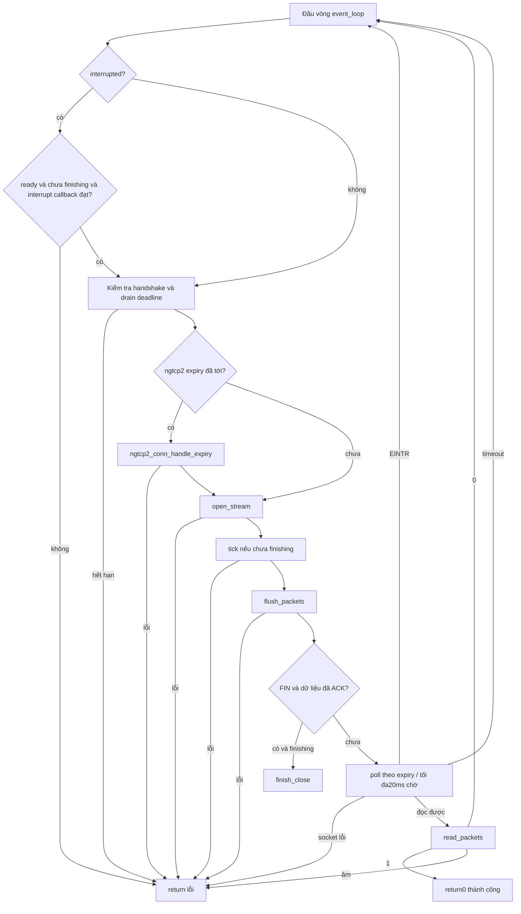
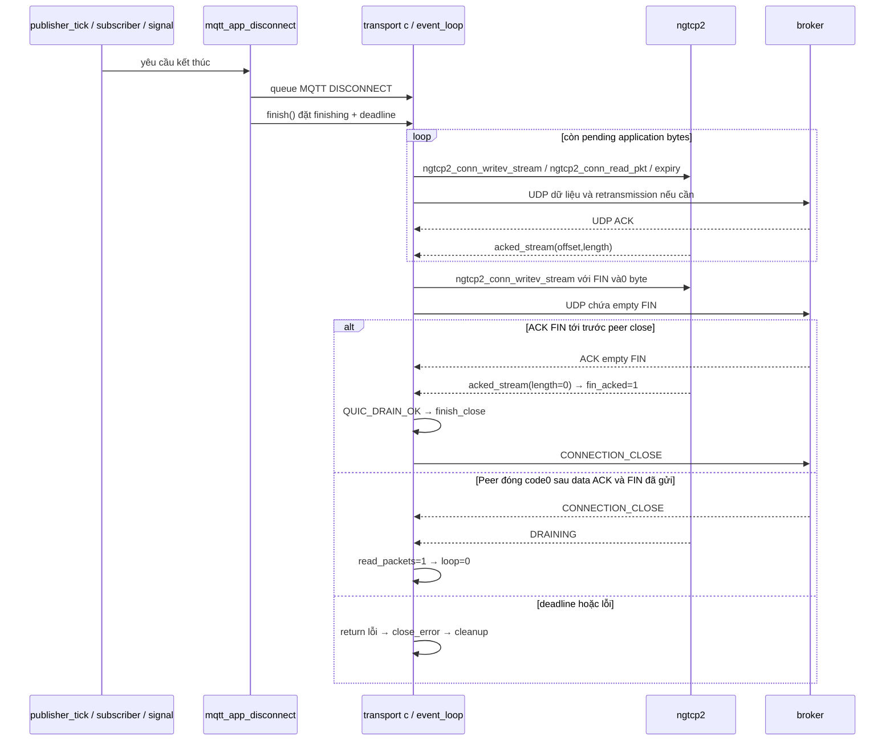

# 08 — Event loop, ACK, timer, lỗi và đóng connection

[Trở về bản đồ](00-README.md) · [Kết nối/handshake](02-CONNECTION-AND-HANDSHAKE.md) · [Nhận packet](04-PACKET-RECEIVE-FLOW.md) · [Trạng thái/buffer](07-STATE-AND-DATA-FLOW.md) · [Đối chiếu/gaps](10-TRACEABILITY-AND-GAPS.md)

## 1. Ranh giới chứng cứ

**SOURCE** chỉ những nhánh có trong project. **THƯ VIỆN** chỉ hợp đồng/header hoặc implementation ngtcp2 1.25.0 đã đọc. **DỰ KIẾN** chỉ giải thích hành vi mạng/HĐH, không phải capture mới. Trong lần lập tài liệu không tạo packet loss, không chạy Mininet/Docker/sudo và không sửa code. Bằng chứng runtime cũ phải được đọc như lịch sử, không phải trạng thái hiện tại.

Tài liệu này theo một object `quic_client *c` của một executable. Publisher và subscriber có object, socket, event loop và QUIC connection riêng; các callback trong một loop chạy đồng bộ trên cùng luồng điều khiển. Không có event loop ngầm do một thread mới của project tạo. Public contract và caller run thể hiện điều đó. [quic_client.h:20–30](/home/nguyenluongduc/Github/QUIC/ZerotoHeroWithQUIC/src/PrgSocket/QUICSocket/mqtt-quic/clients/quic_client.h:20) [quic_client.c:542–582](/home/nguyenluongduc/Github/QUIC/ZerotoHeroWithQUIC/src/PrgSocket/QUICSocket/mqtt-quic/clients/quic_client.c:542)

## 2. Bản đồ return code: mỗi lớp nói một ngôn ngữ

| Lớp | Return có ý nghĩa gì? | Nơi tiếp nhận |
|---|---|---|
| Role/app callback | 0 thành công, khác0 lỗi | on_packet/on_tick rồi wrapper callback |
| mqtt_parser_feed | 0 xử lý/giữ partial hợp lệ; −1 decode/handler lỗi | on_data |
| Callback wrapper → ngtcp2 | 0 hoặc NGTCP2_ERR_CALLBACK_FAILURE | ngtcp2 API đang gọi callback |
| send_datagram | 0 datagram được socket chấp nhận; −1 lỗi | flush hoặc close helpers |
| read_packets | 0 batch hết/tiếp tục; 1 peer-close được chấp nhận; âm là lỗi | event_loop |
| event_loop | 0 hoặc mã lỗi âm | quic_client_run |
| quic_client_run | Chuẩn hóa 0 hoặc −1 | mqtt_app_main |
| main/app | 0 thành công, 1 lỗi chạy, 2 CLI invalid | Process exit status cho shell/test |

Không đọc return1 của read_packets như lỗi: đó là sentinel thành công riêng, được event_loop chuyển thành0. Ngược lại return0 của feed không chứng minh đã có packet hoàn chỉnh. [quic_client.c:452–479](/home/nguyenluongduc/Github/QUIC/ZerotoHeroWithQUIC/src/PrgSocket/QUICSocket/mqtt-quic/clients/quic_client.c:452) [quic_client.c:534–537](/home/nguyenluongduc/Github/QUIC/ZerotoHeroWithQUIC/src/PrgSocket/QUICSocket/mqtt-quic/clients/quic_client.c:534) [quic_client.c:570–582](/home/nguyenluongduc/Github/QUIC/ZerotoHeroWithQUIC/src/PrgSocket/QUICSocket/mqtt-quic/clients/quic_client.c:570) [app.c:66–73](/home/nguyenluongduc/Github/QUIC/ZerotoHeroWithQUIC/src/PrgSocket/QUICSocket/mqtt-quic/clients/app.c:66) [app.c:161–170](/home/nguyenluongduc/Github/QUIC/ZerotoHeroWithQUIC/src/PrgSocket/QUICSocket/mqtt-quic/clients/app.c:161)

## 3. `event_loop()` — thứ tự chính xác trong một vòng

### A. Signature, caller, điều kiện

```c
static int event_loop(quic_client *c);
```

Định nghĩa tại482; chỉ caller trực tiếp là quic_client_run tại570, sau socket/connection/TLS init thành công. Không tham số timeout riêng: helper đọc options và state từ c. Đây là lời gọi chặn về mặt control flow tới khi hoàn tất/lỗi, nhưng fd là nonblocking và loop dùng poll. [quic_client.c:482–539](/home/nguyenluongduc/Github/QUIC/ZerotoHeroWithQUIC/src/PrgSocket/QUICSocket/mqtt-quic/clients/quic_client.c:482) [quic_client.c:567–570](/home/nguyenluongduc/Github/QUIC/ZerotoHeroWithQUIC/src/PrgSocket/QUICSocket/mqtt-quic/clients/quic_client.c:567) [quic_client.c:226–228](/home/nguyenluongduc/Github/QUIC/ZerotoHeroWithQUIC/src/PrgSocket/QUICSocket/mqtt-quic/clients/quic_client.c:226)

### B. Toàn bộ tham số

| Tham số | Nguồn | Dữ liệu được đọc/ghi | Sở hữu |
|---|---|---|---|
| `quic_client *c` | Object heap cấp ở run | options, callbacks,user, fd,conn, queue counters, boolean handshake/ready/finishing/FIN, deadline | Loop mượn object; run mới free sau loop |

Không có tham số địa chỉ broker riêng ở loop: socket đã connected và c->remote đã thiết lập. Không có danh sách nhiều connection để tra cứu; mỗi loop xử lý c->conn cố định. [quic_client.c:24–38](/home/nguyenluongduc/Github/QUIC/ZerotoHeroWithQUIC/src/PrgSocket/QUICSocket/mqtt-quic/clients/quic_client.c:24) [quic_client.c:232–234](/home/nguyenluongduc/Github/QUIC/ZerotoHeroWithQUIC/src/PrgSocket/QUICSocket/mqtt-quic/clients/quic_client.c:232) [quic_client.c:548–555](/home/nguyenluongduc/Github/QUIC/ZerotoHeroWithQUIC/src/PrgSocket/QUICSocket/mqtt-quic/clients/quic_client.c:548)

### C. Một lượt lặp, không đảo thứ tự

| Thứ tự | Câu lệnh/điều kiện | Hành động và lối thoát |
|---:|---|---|
| 1 | interrupted khác0 | Xóa flag, yêu cầu callback interrupt nếu ready và chưa finishing; nếu không đáp ứng hoặc callback lỗi thì return−1 |
| 2 | now_ns | Chụp monotonic ns cho guard/timer |
| 3 | !handshake và elapsed>=handshake_timeout | In handshake timeout, return−1 |
| 4 | finishing và now>=finish_deadline | In drain timeout/pending, return−1 |
| 5 | now>=ngtcp2_conn_get_expiry | ngtcp2_conn_handle_expiry(conn,now), nonzero trả lên |
| 6 | open_stream(c) | Khi đủ handshake thì thử mở; error trả lên |
| 7 | !finishing và có callback tick | Gọi tick(c,now_ms,c->user), nonzero → callback failure |
| 8 | flush_packets(c) | Sinh/gửi packet handshake, ACK, stream, retransmission hoặc FIN; error trả lên |
| 9 | finishing && tx_fin && fin_acked && pending==0 | In QUIC_DRAIN_OK, chuyển finish_close |
| 10 | đọc now và expiry mới | Tính thời gian poll, có thể chặn bởi finish_deadline |
| 11 | poll fd/POLLIN | EINTR lặp lại; lỗi khác return−1 |
| 12 | revents có ERR/NVAL/HUP | Thử lấy SO_ERROR, in lỗi rồi return−1 |
| 13 | revents có POLLIN | read_packets; sentinel1→return0, lỗi→return mã lỗi |
| 14 | Không thoát ở các bước trên | Lặp từ bước1 |

Từng hàng theo đúng source. Các callback không tự “chạy nền”; chính loop hoặc API thư viện được loop gọi thực hiện lời gọi hàm. Nếu callback encode/queue phản hồi trong lúc read_packets đang chạy, lời gọi quay về ngtcp2→read_packets→event_loop; lần flush sau mới dùng queue. [quic_client.c:482–539](/home/nguyenluongduc/Github/QUIC/ZerotoHeroWithQUIC/src/PrgSocket/QUICSocket/mqtt-quic/clients/quic_client.c:482) [quic_client.c:156–157](/home/nguyenluongduc/Github/QUIC/ZerotoHeroWithQUIC/src/PrgSocket/QUICSocket/mqtt-quic/clients/quic_client.c:156) [app.c:13–20](/home/nguyenluongduc/Github/QUIC/ZerotoHeroWithQUIC/src/PrgSocket/QUICSocket/mqtt-quic/clients/app.c:13)



Sơ đồ là control flow source, không mô tả mỗi hop mạng thành lời gọi C. Nhánh thành công do peer close độc lập với nhánh FIN-ACK→finish_close. [quic_client.c:501–537](/home/nguyenluongduc/Github/QUIC/ZerotoHeroWithQUIC/src/PrgSocket/QUICSocket/mqtt-quic/clients/quic_client.c:501)

### D. poll nhận những tham số gì?

```c
struct pollfd pfd = {.fd = c->fd, .events = POLLIN};
rv = poll(&pfd, 1, wait_ms);
```

| Tham số | Nguồn/ý nghĩa | Output/lifetime |
|---|---|---|
| `&pfd` | Một struct trên stack với fd UDP đã tạo | poll ghi revents; struct chỉ sống trong lượt loop |
| `1` | Có đúng một descriptor | Không poll nhiều connection/process cùng lúc |
| `wait_ms` | Bắt đầu20, giảm nếu expiry gần/đã tới | Đơn vị ms; không cùng đơn vị ns của expiry |

Nếu next<=now, chờ0. Nếu expiry còn dưới20ms, code chia ns→ms và làm tròn lên để tránh thức sớm chỉ vì bỏ phần lẻ. Nếu finishing thì next bị chặn trên bởi finish_deadline. Sau flush phải đọc expiry lại vì write đã thay đổi timer. [quic_client.c:516–525](/home/nguyenluongduc/Github/QUIC/ZerotoHeroWithQUIC/src/PrgSocket/QUICSocket/mqtt-quic/clients/quic_client.c:516) [ngtcp2.h:4707–4724](/home/nguyenluongduc/Github/QUIC/ZerotoHeroWithQUIC/src/PrgSocket/QUICSocket/demo/src/.deps/include/ngtcp2/ngtcp2.h:4707)

Header wrapper ghi “At least every20ms” cho tick, nhưng implementation chỉ giới hạn **thời gian chờ poll** thường ở20ms. Callback, batch32 sends, batch64 receives, scheduler và send_datagram có chờ riêng có thể làm khoảng cách thực tế lớn hơn20ms. Không có hard realtime guarantee. [quic_client.h:24](/home/nguyenluongduc/Github/QUIC/ZerotoHeroWithQUIC/src/PrgSocket/QUICSocket/mqtt-quic/clients/quic_client.h:24) [quic_client.c:323–335](/home/nguyenluongduc/Github/QUIC/ZerotoHeroWithQUIC/src/PrgSocket/QUICSocket/mqtt-quic/clients/quic_client.c:323) [quic_client.c:353](/home/nguyenluongduc/Github/QUIC/ZerotoHeroWithQUIC/src/PrgSocket/QUICSocket/mqtt-quic/clients/quic_client.c:353) [quic_client.c:454](/home/nguyenluongduc/Github/QUIC/ZerotoHeroWithQUIC/src/PrgSocket/QUICSocket/mqtt-quic/clients/quic_client.c:454) [quic_client.c:519–524](/home/nguyenluongduc/Github/QUIC/ZerotoHeroWithQUIC/src/PrgSocket/QUICSocket/mqtt-quic/clients/quic_client.c:519)

## 4. Các timer thuộc các tầng khác nhau

| Timer/state | Nguồn khởi tạo | Điều kiện hết hạn và kết quả |
|---|---|---|
| Handshake wrapper | c->started tại run; option15s | !c->handshake && now-started>=15s → lỗi |
| Handshake ngtcp2 | settings.initial_ts/handshake_timeout | ngtcp2_conn_handle_expiry có thể trả HANDSHAKE_TIMEOUT |
| QUIC idle | local params max_idle_timeout=60s; remote params cũng tham gia | Thư viện tính idle expiry và trả IDLE_CLOSE; không phải runtime tuyệt đối60s |
| Tổng runtime app | app.started, app.timeout từ role/CLI | timeout khác0 và elapsed>=timeout*1000 → app callback lỗi |
| CONNACK | on_ready queue CONNECT, deadline=now_ms+15000 | connect_sent nhưng chưa connected và now>=deadline → lỗi |
| SUBACK | subscriber_connected queue SUBSCRIBE, subscribe_deadline=now_ms+15000 | WAIT_SUBACK quá hạn → role tick lỗi |
| PINGREQ trigger | last_tx cập nhật khi app queue thành công | SUBSCRIBED, chưa ping_pending, 10s không gửi MQTT → queue ping |
| PINGRESP wait | subscriber.ping_at lúc queue ping | ping_pending>=10s → lỗi |
| Publisher ACK wait | publish_deadline sau queue PUBLISH | now>=deadline → lỗi, kể cả pending có thể vừa về0 trong cùng thời điểm kiểm tra |
| Drain | lần đầu quic_client_finish | finish_deadline=now_ns+handshake_timeout_s; tới hạn thì lỗi |
| Local closing hold | sau gửi CONNECTION_CLOSE thành công | min(now+3*PTO,finish_deadline); thêm signal/error có thể thoát sớm |

Các giá trị lấy từ source app/roles/transport; default subscriber timeout0 chỉ tắt tổng runtime, không tắt các deadline khác. Deadline là thời điểm tuyệt đối của monotonic clock; timeout là khoảng thời gian cho phép. [app.c:37–45](/home/nguyenluongduc/Github/QUIC/ZerotoHeroWithQUIC/src/PrgSocket/QUICSocket/mqtt-quic/clients/app.c:37) [app.c:76–88](/home/nguyenluongduc/Github/QUIC/ZerotoHeroWithQUIC/src/PrgSocket/QUICSocket/mqtt-quic/clients/app.c:76) [app.c:115–125](/home/nguyenluongduc/Github/QUIC/ZerotoHeroWithQUIC/src/PrgSocket/QUICSocket/mqtt-quic/clients/app.c:115) [subscriber.c:25–29](/home/nguyenluongduc/Github/QUIC/ZerotoHeroWithQUIC/src/PrgSocket/QUICSocket/mqtt-quic/clients/subscriber.c:25) [subscriber.c:85–108](/home/nguyenluongduc/Github/QUIC/ZerotoHeroWithQUIC/src/PrgSocket/QUICSocket/mqtt-quic/clients/subscriber.c:85) [publisher.c:17](/home/nguyenluongduc/Github/QUIC/ZerotoHeroWithQUIC/src/PrgSocket/QUICSocket/mqtt-quic/clients/publisher.c:17) [publisher.c:29–38](/home/nguyenluongduc/Github/QUIC/ZerotoHeroWithQUIC/src/PrgSocket/QUICSocket/mqtt-quic/clients/publisher.c:29) [quic_client.c:78–83](/home/nguyenluongduc/Github/QUIC/ZerotoHeroWithQUIC/src/PrgSocket/QUICSocket/mqtt-quic/clients/quic_client.c:78) [quic_client.c:261–272](/home/nguyenluongduc/Github/QUIC/ZerotoHeroWithQUIC/src/PrgSocket/QUICSocket/mqtt-quic/clients/quic_client.c:261) [quic_client.c:430–448](/home/nguyenluongduc/Github/QUIC/ZerotoHeroWithQUIC/src/PrgSocket/QUICSocket/mqtt-quic/clients/quic_client.c:430)

**THƯ VIỆN:** idle timeout không được suy ra là luôn đúng60s. Implementation 1.25 chọn local/remote max_idle_timeout theo quy tắc của nó, và bảo đảm không ngắn hơn3PTO trước khi cộng idle_ts. Timer loss detection, ACK delay, pacing và handshake được gom vào expiry. [ngtcp2_conn.c:11380–11387](/home/nguyenluongduc/Github/QUIC/ZerotoHeroWithQUIC/src/PrgSocket/QUICSocket/third_party/ngtcp2/lib/ngtcp2_conn.c:11380) [ngtcp2_conn.c:14051–14082](/home/nguyenluongduc/Github/QUIC/ZerotoHeroWithQUIC/src/PrgSocket/QUICSocket/third_party/ngtcp2/lib/ngtcp2_conn.c:14051)

## 5. ACK khác queue và khác MQTT PUBACK

### 5.1. Ba bộ đếm stream bytes

| Field | Ai cập nhật? | Ý nghĩa |
|---|---|---|
| tx_queued | quic_client_send | Tổng byte app đã copy vào tx ring |
| tx_sent | flush_packets khi consumed>=0 | Tổng byte mới đã được ngtcp2 nhận để serialize stream; không phải số byte UDP |
| tx_acked | acked_stream callback | Prefix byte stream đã được ACK theo callback thư viện |

Invariant mong muốn là `tx_acked <= tx_sent <= tx_queued`, và `pending=queued-acked` không vượt capacity. Counter là offset tích lũy, chỉ vị trí trong ring mới lấy modulo. Quá trình serialize đã tăng tx_sent trước send_datagram; nếu send UDP thất bại thì flow đi lỗi, không rollback counter để tự gửi lại ở tầng app. [quic_client.c:59–75](/home/nguyenluongduc/Github/QUIC/ZerotoHeroWithQUIC/src/PrgSocket/QUICSocket/mqtt-quic/clients/quic_client.c:59) [quic_client.c:363–390](/home/nguyenluongduc/Github/QUIC/ZerotoHeroWithQUIC/src/PrgSocket/QUICSocket/mqtt-quic/clients/quic_client.c:363) [quic_client.c:174–186](/home/nguyenluongduc/Github/QUIC/ZerotoHeroWithQUIC/src/PrgSocket/QUICSocket/mqtt-quic/clients/quic_client.c:174)

```c
uint64_t quic_client_pending(const quic_client *c);
```

Khai báo header35, định nghĩa59; caller queue kiểm tra capacity, publisher_tick kiểm tra hoàn tất, flush/close kiểm tra drain. `c` phải hợp lệ, mượn read-only qua const; helper không thay đổi state và trả `tx_queued-tx_acked`. Pending gồm byte CONNECT/PUBLISH/DISCONNECT và MQTT khác đã queue, không chỉ payload. [quic_client.h:35](/home/nguyenluongduc/Github/QUIC/ZerotoHeroWithQUIC/src/PrgSocket/QUICSocket/mqtt-quic/clients/quic_client.h:35) [quic_client.c:59–66](/home/nguyenluongduc/Github/QUIC/ZerotoHeroWithQUIC/src/PrgSocket/QUICSocket/mqtt-quic/clients/quic_client.c:59) [publisher.c:35–37](/home/nguyenluongduc/Github/QUIC/ZerotoHeroWithQUIC/src/PrgSocket/QUICSocket/mqtt-quic/clients/publisher.c:35) [quic_client.c:359](/home/nguyenluongduc/Github/QUIC/ZerotoHeroWithQUIC/src/PrgSocket/QUICSocket/mqtt-quic/clients/quic_client.c:359) [quic_client.c:467](/home/nguyenluongduc/Github/QUIC/ZerotoHeroWithQUIC/src/PrgSocket/QUICSocket/mqtt-quic/clients/quic_client.c:467)

### 5.2. `acked_stream()` nhận đầy đủ tham số nào?

```c
static int acked_stream(ngtcp2_conn *conn, int64_t id,
                        uint64_t offset, uint64_t length,
                        void *user, void *stream_user);
```

Đăng ký `.acked_stream_data_offset=acked_stream`; ngtcp2 gọi sau xử lý ACK cho stream range. Chữ ký không nhận UDP packet buffer hay packet number. [quic_client.c:174–187](/home/nguyenluongduc/Github/QUIC/ZerotoHeroWithQUIC/src/PrgSocket/QUICSocket/mqtt-quic/clients/quic_client.c:174) [quic_client.c:248](/home/nguyenluongduc/Github/QUIC/ZerotoHeroWithQUIC/src/PrgSocket/QUICSocket/mqtt-quic/clients/quic_client.c:248) [ngtcp2.h:3028–3050](/home/nguyenluongduc/Github/QUIC/ZerotoHeroWithQUIC/src/PrgSocket/QUICSocket/demo/src/.deps/include/ngtcp2/ngtcp2.h:3028)

| Tham số | Nguồn | Cách dùng và vòng đời |
|---|---|---|
| conn | c->conn đang xử lý ACK | Callback không dùng trực tiếp, không free |
| id | Stream ID mà ngtcp2 xác định | Phải bằng c->stream_id |
| offset | Offset bắt đầu phần stream được ACK mới báo | Phải bằng tx_acked hiện tại |
| length | Số stream byte được ACK; có thể0 với empty FIN | Phải <=tx_sent-tx_acked; cộng vào tx_acked |
| user | c từ constructor | Chuyển thành quic_client*, thay đổi counters/fin_acked |
| stream_user | NULL từ ngtcp2_conn_open_bidi_stream | Không dùng; khác user=&app của callbacks tầng app |

ngtcp2 contract báo increasing nonoverlapping ranges; implementation RTB lấy chênh lệch contiguous acknowledged stream offset rồi gọi callback. Vì thế code có thể sử dụng tx_acked như prefix. Việc ACK packet đến không nhất thiết ngay lập tức tăng mọi byte ngoài prefix nếu còn lỗ; thư viện quản lý chi tiết đó. [ngtcp2.h:3028–3048](/home/nguyenluongduc/Github/QUIC/ZerotoHeroWithQUIC/src/PrgSocket/QUICSocket/demo/src/.deps/include/ngtcp2/ngtcp2.h:3028) [ngtcp2_rtb.c:628–649](/home/nguyenluongduc/Github/QUIC/ZerotoHeroWithQUIC/src/PrgSocket/QUICSocket/third_party/ngtcp2/lib/ngtcp2_rtb.c:628) [quic_client.c:174–186](/home/nguyenluongduc/Github/QUIC/ZerotoHeroWithQUIC/src/PrgSocket/QUICSocket/mqtt-quic/clients/quic_client.c:174)

Logic callback:

```c
if (id != c->stream_id || offset != c->tx_acked ||
    length > c->tx_sent - c->tx_acked)
    return NGTCP2_ERR_CALLBACK_FAILURE;
c->tx_acked += length;
if (c->tx_fin && !length && c->tx_acked == c->tx_queued)
    c->fin_acked = 1;
```

Return0 cho ngtcp2 tiếp tục read; callback failure làm API hiện tại dừng. Callback không free toàn tx vì ring là bộ nhớ cố định trong c; tăng acked giải phóng **quyền tái sử dụng vùng ring**. Khi connection bị hủy, c mới được free sau ngtcp2_conn_del. [quic_client.c:179–187](/home/nguyenluongduc/Github/QUIC/ZerotoHeroWithQUIC/src/PrgSocket/QUICSocket/mqtt-quic/clients/quic_client.c:179) [quic_client.c:574–581](/home/nguyenluongduc/Github/QUIC/ZerotoHeroWithQUIC/src/PrgSocket/QUICSocket/mqtt-quic/clients/quic_client.c:574)

### 5.3. Tại sao chờ ACK trước empty FIN?

Code chỉ gửi FIN khi `finishing && pending==0`. Toàn bộ app bytes, kể cả DISCONNECT đã queue, phải ACK trước. Khi đó dữ liệu mới còn để submit là0; FIN được gửi trong một STREAM frame rỗng. API xác nhận empty FIN ACK có callback length0, nên c->fin_acked chỉ đặt ở sự kiện riêng này. Không nhầm ACK cuối dữ liệu với ACK FIN đang bay. [quic_client.c:359–372](/home/nguyenluongduc/Github/QUIC/ZerotoHeroWithQUIC/src/PrgSocket/QUICSocket/mqtt-quic/clients/quic_client.c:359) [quic_client.c:183–186](/home/nguyenluongduc/Github/QUIC/ZerotoHeroWithQUIC/src/PrgSocket/QUICSocket/mqtt-quic/clients/quic_client.c:183) [ngtcp2.h:3033–3038](/home/nguyenluongduc/Github/QUIC/ZerotoHeroWithQUIC/src/PrgSocket/QUICSocket/demo/src/.deps/include/ngtcp2/ngtcp2.h:3033)

ACK ở đây là transport QUIC của peer trực tiếp (broker), không phải MQTT PUBACK và không chứng minh h2 đã in payload. PUBLISH QoS0 của publisher không đợi MQTT PUBACK; nó đợi pending0 rồi yêu cầu disconnect. Bằng chứng giao hàng end-to-end nằm ở log subscriber/kiểm tra test, không phải chỉ callback ACK publisher. [publisher.c:22–38](/home/nguyenluongduc/Github/QUIC/ZerotoHeroWithQUIC/src/PrgSocket/QUICSocket/mqtt-quic/clients/publisher.c:22)

## 6. Retransmission, packet number và congestion control do ai làm?

**SOURCE APP:** app giữ byte đã gửi ổn định tới ACK, cấp timestamp, gọi read/write/ngtcp2_conn_handle_expiry, gửi packet mà thư viện tạo. App không có vòng “sleep rồi gửi lại MQTT PUBLISH” và không có biến packet_number riêng. [quic_client.c:35–36](/home/nguyenluongduc/Github/QUIC/ZerotoHeroWithQUIC/src/PrgSocket/QUICSocket/mqtt-quic/clients/quic_client.c:35) [quic_client.c:63–75](/home/nguyenluongduc/Github/QUIC/ZerotoHeroWithQUIC/src/PrgSocket/QUICSocket/mqtt-quic/clients/quic_client.c:63) [quic_client.c:350–393](/home/nguyenluongduc/Github/QUIC/ZerotoHeroWithQUIC/src/PrgSocket/QUICSocket/mqtt-quic/clients/quic_client.c:350) [quic_client.c:501–510](/home/nguyenluongduc/Github/QUIC/ZerotoHeroWithQUIC/src/PrgSocket/QUICSocket/mqtt-quic/clients/quic_client.c:501)

**THƯ VIỆN 1.25:** ngtcp2 có packet-number spaces và RTB riêng. Constructor tạo Initial/Handshake packet spaces; code ghi packet tăng last_pkt_num, còn ACK xử lý qua conn_recv_ack. Đây là packet number nội bộ, khác stream offset và packet ID MQTT. [ngtcp2_conn.c:1462–1474](/home/nguyenluongduc/Github/QUIC/ZerotoHeroWithQUIC/src/PrgSocket/QUICSocket/third_party/ngtcp2/lib/ngtcp2_conn.c:1462) [ngtcp2_conn.c:2865](/home/nguyenluongduc/Github/QUIC/ZerotoHeroWithQUIC/src/PrgSocket/QUICSocket/third_party/ngtcp2/lib/ngtcp2_conn.c:2865) [ngtcp2_conn.c:5616–5655](/home/nguyenluongduc/Github/QUIC/ZerotoHeroWithQUIC/src/PrgSocket/QUICSocket/third_party/ngtcp2/lib/ngtcp2_conn.c:5616)

Khi ACK hoặc loss timer cho biết dữ liệu cần truyền lại, thư viện reclaim/queue các frame cần thiết, rồi ngtcp2_conn_writev_stream ở lần tiếp theo đóng thành packet. Không mô tả như gửi lại nguyên UDP ciphertext với cùng packet number. Cụ thể source RTB mô tả `rtb_reclaim_frame` copy/queue frame; loss detection timer đặt số probe packet và tăng PTO count. [ngtcp2_rtb.c:204–221](/home/nguyenluongduc/Github/QUIC/ZerotoHeroWithQUIC/src/PrgSocket/QUICSocket/third_party/ngtcp2/lib/ngtcp2_rtb.c:204) [ngtcp2_rtb.c:446–506](/home/nguyenluongduc/Github/QUIC/ZerotoHeroWithQUIC/src/PrgSocket/QUICSocket/third_party/ngtcp2/lib/ngtcp2_rtb.c:446) [ngtcp2_conn.c:13468–13529](/home/nguyenluongduc/Github/QUIC/ZerotoHeroWithQUIC/src/PrgSocket/QUICSocket/third_party/ngtcp2/lib/ngtcp2_conn.c:13468)

`ngtcp2_conn_get_expiry()` gộp loss detection, ACK delay, internal timer, lost packet expiry, keepalive, handshake, idle và pacing. Tới hạn, ngtcp2_conn_handle_expiry xử lý loss detection rồi wrapper tiếp tục flush. Nếu app không cấp timer/flush thì ngtcp2 không có thread riêng tự send qua fd của project. [ngtcp2_conn.c:11380–11454](/home/nguyenluongduc/Github/QUIC/ZerotoHeroWithQUIC/src/PrgSocket/QUICSocket/third_party/ngtcp2/lib/ngtcp2_conn.c:11380) [quic_client.c:501–510](/home/nguyenluongduc/Github/QUIC/ZerotoHeroWithQUIC/src/PrgSocket/QUICSocket/mqtt-quic/clients/quic_client.c:501)

Congestion control mặc định là CUBIC vì ngtcp2_settings_default đặt nó và project không override. ngtcp2 ngtcp2_conn_writev_stream có thể trả0 vì congestion limited; wrapper break vòng flush, vẫn quay lại đọc/poll/timer để chờ tiến triển. Zero không có nghĩa mọi queued byte đã gửi hoặc đã ACK. Project cập nhật pkt_tx_time sau batch để pacing timer của thư viện có cơ sở. [ngtcp2_settings.c:32–50](/home/nguyenluongduc/Github/QUIC/ZerotoHeroWithQUIC/src/PrgSocket/QUICSocket/third_party/ngtcp2/lib/ngtcp2_settings.c:32) [quic_client.c:259–265](/home/nguyenluongduc/Github/QUIC/ZerotoHeroWithQUIC/src/PrgSocket/QUICSocket/mqtt-quic/clients/quic_client.c:259) [ngtcp2.h:5300–5325](/home/nguyenluongduc/Github/QUIC/ZerotoHeroWithQUIC/src/PrgSocket/QUICSocket/demo/src/.deps/include/ngtcp2/ngtcp2.h:5300) [quic_client.c:384–393](/home/nguyenluongduc/Github/QUIC/ZerotoHeroWithQUIC/src/PrgSocket/QUICSocket/mqtt-quic/clients/quic_client.c:384) [programmers-guide.rst:380–387](/home/nguyenluongduc/Github/QUIC/ZerotoHeroWithQUIC/src/PrgSocket/QUICSocket/third_party/ngtcp2/doc/source/programmers-guide.rst:380)

**CHƯA XÁC MINH THỰC NGHIỆM MỚI:** không có packet capture loss/reorder trong lần lập tài liệu, không báo một cwnd/RTT/PTO/packet number cụ thể. Các giá trị này phụ thuộc từng connection và thời điểm chạy.

## 7. `send_datagram()` — retry socket và giới hạn thời gian thật

```c
static int send_datagram(quic_client *c,
                         const uint8_t *data, size_t length);
```

Caller flush_packets tại390, close_error tại423, finish_close tại429/444. Là helper đồng bộ gửi **UDP datagram đã chứa QUIC packet**, không phải MQTT buffer thô. [quic_client.c:322–335](/home/nguyenluongduc/Github/QUIC/ZerotoHeroWithQUIC/src/PrgSocket/QUICSocket/mqtt-quic/clients/quic_client.c:322) [quic_client.c:390](/home/nguyenluongduc/Github/QUIC/ZerotoHeroWithQUIC/src/PrgSocket/QUICSocket/mqtt-quic/clients/quic_client.c:390) [quic_client.c:422–444](/home/nguyenluongduc/Github/QUIC/ZerotoHeroWithQUIC/src/PrgSocket/QUICSocket/mqtt-quic/clients/quic_client.c:422)

| Tham số | Nguồn | Sở hữu/lifetime/thay đổi |
|---|---|---|
| c | Wrapper có fd connected | Chỉ đọc fd; không đóng fd |
| data | `packet` stack1500 của flush hoặc close helper | Mượn tới khi hàm return; send sao chép vào kernel theo hành vi syscall dự kiến |
| length | Số byte dương ngtcp2 đã ghi | Đơn vị byte UDP payload, không phải consumed stream length |

Lời gọi thật `send(c->fd,data,length,0)`: fd là UDP đã connect nên không cần sockaddr; flags0 không bật MSG_MORE/GSO. Chỉ khi return đúng length mới thành công. `EINTR` thử lại; `EAGAIN/EWOULDBLOCK` và còn trước deadline thì poll POLLOUT tối đa10ms mỗi lần rồi thử lại. Lỗi khác hoặc hết nhánh would-block thì perror và return−1. [quic_client.c:323–335](/home/nguyenluongduc/Github/QUIC/ZerotoHeroWithQUIC/src/PrgSocket/QUICSocket/mqtt-quic/clients/quic_client.c:323)

Deadline `now+1s` chặn nhánh would-block, nhưng **không phải hard timeout tổng tuyệt đối**: nhánh EINTR tiếp tục mà không xét deadline; thời gian thực còn phụ thuộc scheduling. Đừng dùng mô tả “hàm chắc chắn return trong1s” để suy ra tick realtime20ms. [quic_client.c:323–331](/home/nguyenluongduc/Github/QUIC/ZerotoHeroWithQUIC/src/PrgSocket/QUICSocket/mqtt-quic/clients/quic_client.c:323)

Nếu ngtcp2 đã tăng state serialize nhưng syscall gửi lỗi, wrapper không rollback/khôi phục session; flush chuyển thành callback failure, run đi nhánh đóng lỗi. Với return ngắn không đúng length, code cũng báo lỗi; thông báo perror dựa errno hiện có nên không nên chỉ từ chuỗi lỗi mà suy ra nguyên nhân duy nhất. [quic_client.c:325–334](/home/nguyenluongduc/Github/QUIC/ZerotoHeroWithQUIC/src/PrgSocket/QUICSocket/mqtt-quic/clients/quic_client.c:325) [quic_client.c:386–390](/home/nguyenluongduc/Github/QUIC/ZerotoHeroWithQUIC/src/PrgSocket/QUICSocket/mqtt-quic/clients/quic_client.c:386) [quic_client.c:570–571](/home/nguyenluongduc/Github/QUIC/ZerotoHeroWithQUIC/src/PrgSocket/QUICSocket/mqtt-quic/clients/quic_client.c:570)

## 8. Các lỗi nhận và sentinel peer-close

Chi tiết nhận và mọi tham số recv/ngtcp2_conn_read_pkt ở tài liệu04; ở đây tập trung lối thoát của `read_packets()`. Hàm nhận c, dùng stack packet65536, xử lý tối đa64 datagram mỗi lần gọi. [quic_client.c:452–479](/home/nguyenluongduc/Github/QUIC/ZerotoHeroWithQUIC/src/PrgSocket/QUICSocket/mqtt-quic/clients/quic_client.c:452)

| Kết quả recv/API | Nhánh source | Bước sau |
|---|---|---|
| recv<0 với EAGAIN/EWOULDBLOCK/EINTR | return0 | Quay về event_loop; không đóng connection |
| recv<0 lỗi khác | perror, return−1 | run close_error rồi cleanup |
| recv==0 | continue | Bỏ datagram rỗng, đọc tiếp batch |
| ngtcp2 read trả0 | open_stream ngay sau packet | Tiếp tục datagram kế tiếp |
| ngtcp2 read trả lỗi khác DRAINING | return rv | Event loop trả lỗi |
| ngtcp2 read trả DRAINING | đọc ccerr, xét điều kiện bên dưới | Sentinel1 hoặc lỗi−1 |

[quic_client.c:455–477](/home/nguyenluongduc/Github/QUIC/ZerotoHeroWithQUIC/src/PrgSocket/QUICSocket/mqtt-quic/clients/quic_client.c:455)

Điều kiện chấp nhận peer đóng là:

```c
c->finishing && c->tx_fin &&
!quic_client_pending(c) && !error->error_code
```

Nếu đúng, read_packets return1, event_loop return0. Điều kiện **không có `c->fin_acked`** và không yêu cầu c->stream_closed. Nó kiểm tra code lỗi bằng0, không phân nhánh riêng type application/transport tại đây. Vì thế có một đường thành công không in QUIC_DRAIN_OK và không đi finish_close: peer đã gửi close thành công trong lúc wrapper đang kết thúc, application bytes đã ACK, FIN đã gửi. [quic_client.c:465–472](/home/nguyenluongduc/Github/QUIC/ZerotoHeroWithQUIC/src/PrgSocket/QUICSocket/mqtt-quic/clients/quic_client.c:465) [quic_client.c:534–537](/home/nguyenluongduc/Github/QUIC/ZerotoHeroWithQUIC/src/PrgSocket/QUICSocket/mqtt-quic/clients/quic_client.c:534)

Không bổ sung điều kiện hoặc log không có trong code để làm câu chuyện “mọi lần thành công đều chờ FIN ACK” đơn giản hơn. Khi nghiên cứu protocol strictness của shutdown, cần phân biệt rõ hai nhánh này.

## 9. `receive_stream()` xử lý FIN và `stream_closed()`

### 9.1. FIN có thể không có dữ liệu

Sau khi gọi data callback thành công, receive_stream tăng rx_received, mở thêm flow-control credit; nếu flags có FIN thì đặt rx_fin1. Nếu chưa finishing mà broker kết thúc MQTT stream, callback báo unexpected và trả failure. Nếu c đã finishing, FIN nhận được chấp nhận. Không tự coi mọi FIN là lỗi hoặc mọi FIN là thành công. [quic_client.c:145–171](/home/nguyenluongduc/Github/QUIC/ZerotoHeroWithQUIC/src/PrgSocket/QUICSocket/mqtt-quic/clients/quic_client.c:145)

Callback data chỉ được gọi khi length khác0. FIN-only length0 vẫn đi nhánh FIN trong receive_stream nhưng không gọi on_data. Ngược lại nếu FIN đi cùng đoạn dữ liệu cuối, app có cơ hội xử lý đoạn đó trước khi kiểm tra finishing. [quic_client.c:156–168](/home/nguyenluongduc/Github/QUIC/ZerotoHeroWithQUIC/src/PrgSocket/QUICSocket/mqtt-quic/clients/quic_client.c:156) [ngtcp2.h:2919–2938](/home/nguyenluongduc/Github/QUIC/ZerotoHeroWithQUIC/src/PrgSocket/QUICSocket/demo/src/.deps/include/ngtcp2/ngtcp2.h:2919)

### 9.2. `stream_closed()` có đủ mọi tham số

```c
static int stream_closed(ngtcp2_conn *conn, uint32_t flags,
                          int64_t id, uint64_t rx_error,
                          uint64_t tx_error,
                          void *user, void *stream_user);
```

Đăng ký stream_close2 trong connection_init; ngtcp2 gọi khi stream đóng, không phải callback chắc chắn chạy nếu connection bị cắt trước khi stream đóng. Hai hướng có error riêng theo API1.25. [quic_client.c:190–202](/home/nguyenluongduc/Github/QUIC/ZerotoHeroWithQUIC/src/PrgSocket/QUICSocket/mqtt-quic/clients/quic_client.c:190) [quic_client.c:257](/home/nguyenluongduc/Github/QUIC/ZerotoHeroWithQUIC/src/PrgSocket/QUICSocket/mqtt-quic/clients/quic_client.c:257) [ngtcp2.h:3685–3719](/home/nguyenluongduc/Github/QUIC/ZerotoHeroWithQUIC/src/PrgSocket/QUICSocket/demo/src/.deps/include/ngtcp2/ngtcp2.h:3685)

| Tham số | Nguồn và cách dùng |
|---|---|
| conn | c->conn; project chủ ý không dùng trực tiếp |
| flags | Bit mask trạng thái error hai hướng do ngtcp2 cung cấp; project yêu cầu bằng0 |
| id | ID stream được đóng; phải bằng c->stream_id |
| rx_error | Mã lỗi hướng nhận nếu flag tương ứng có; dùng để log nhánh lỗi |
| tx_error | Mã lỗi hướng gửi nếu flag tương ứng có; dùng để log nhánh lỗi |
| user | c từ constructor, dùng đọc finishing/tx_fin và ghi stream_closed |
| stream_user | NULL từ open_stream, không dùng |

Guard yêu cầu đúng stream, flags0, đang finishing và đã gửi FIN. Thành công chỉ đặt `c->stream_closed=1` rồi return0. Field này không phải điều kiện success trong event_loop hay nhánh peer-close; không có việc chỉ cần callback stream_close2 là chương trình kết thúc ngay. [quic_client.c:196–202](/home/nguyenluongduc/Github/QUIC/ZerotoHeroWithQUIC/src/PrgSocket/QUICSocket/mqtt-quic/clients/quic_client.c:196) [quic_client.c:467–468](/home/nguyenluongduc/Github/QUIC/ZerotoHeroWithQUIC/src/PrgSocket/QUICSocket/mqtt-quic/clients/quic_client.c:467) [quic_client.c:512–514](/home/nguyenluongduc/Github/QUIC/ZerotoHeroWithQUIC/src/PrgSocket/QUICSocket/mqtt-quic/clients/quic_client.c:512)

## 10. Signal handler và `on_interrupt()`

```c
static volatile sig_atomic_t interrupted;
static void signal_received(int signo);
```

Signal handler có một tham số signo do kernel/signal delivery cung cấp; project không phân biệt SIGINT và SIGTERM trong handler. Nó chỉ đặt interrupted1 rồi return, không encode MQTT, malloc, printf hay send từ signal context. `volatile sig_atomic_t` là cờ chia sẻ handler↔loop. [quic_client.c:41](/home/nguyenluongduc/Github/QUIC/ZerotoHeroWithQUIC/src/PrgSocket/QUICSocket/mqtt-quic/clients/quic_client.c:41) [quic_client.c:54–57](/home/nguyenluongduc/Github/QUIC/ZerotoHeroWithQUIC/src/PrgSocket/QUICSocket/mqtt-quic/clients/quic_client.c:54)

run tạo struct sigaction zero, gắn handler, xóa signal mask, lưu old_int/old_term, dùng have_int/have_term để biết khôi phục handler nào đã cài. Nếu cài SIGTERM thất bại sau SIGINT, cleanup vẫn khôi phục SIGINT. Các đối số sigaction là tín hiệu cụ thể, địa chỉ action mới, địa chỉ action cũ. [quic_client.c:558–566](/home/nguyenluongduc/Github/QUIC/ZerotoHeroWithQUIC/src/PrgSocket/QUICSocket/mqtt-quic/clients/quic_client.c:558) [quic_client.c:578–579](/home/nguyenluongduc/Github/QUIC/ZerotoHeroWithQUIC/src/PrgSocket/QUICSocket/mqtt-quic/clients/quic_client.c:578)

Loop gặp flag sẽ xóa nó trước. Nếu chưa ready, đã finishing, không có callback interrupt hoặc callback lỗi, nó return−1. Vì vậy Ctrl+C thứ hai trong drain không phải một lần queue DISCONNECT mới; nó có thể làm quá trình kết thúc chuyển thành lỗi. [quic_client.c:484–490](/home/nguyenluongduc/Github/QUIC/ZerotoHeroWithQUIC/src/PrgSocket/QUICSocket/mqtt-quic/clients/quic_client.c:484)

```c
static int on_interrupt(quic_client *client, void *user);
```

Callback app nhận client=c và user=&app; đổi user thành mqtt_app*, cập nhật app->quic, in Stopping on signal, gọi mqtt_app_disconnect(app). Return truyền nguyên về loop. Các object được mượn, không free ở callback. [app.c:91–96](/home/nguyenluongduc/Github/QUIC/ZerotoHeroWithQUIC/src/PrgSocket/QUICSocket/mqtt-quic/clients/app.c:91) [quic_client.c:486–487](/home/nguyenluongduc/Github/QUIC/ZerotoHeroWithQUIC/src/PrgSocket/QUICSocket/mqtt-quic/clients/quic_client.c:486)

## 11. `mqtt_app_disconnect()` và `quic_client_finish()`

### 11.1. Session queue DISCONNECT trước

```c
int mqtt_app_disconnect(mqtt_app *app);
```

Caller thực tế gồm on_interrupt, publisher_tick khi pending0 và subscriber_packet khi đạt count. app là context của executable; có quic pointer c sau on_ready. [app.c:24–34](/home/nguyenluongduc/Github/QUIC/ZerotoHeroWithQUIC/src/PrgSocket/QUICSocket/mqtt-quic/clients/app.c:24) [app.c:95](/home/nguyenluongduc/Github/QUIC/ZerotoHeroWithQUIC/src/PrgSocket/QUICSocket/mqtt-quic/clients/app.c:95) [publisher.c:35–37](/home/nguyenluongduc/Github/QUIC/ZerotoHeroWithQUIC/src/PrgSocket/QUICSocket/mqtt-quic/clients/publisher.c:35) [subscriber.c:67–69](/home/nguyenluongduc/Github/QUIC/ZerotoHeroWithQUIC/src/PrgSocket/QUICSocket/mqtt-quic/clients/subscriber.c:67)

- Nếu app->stopping đã1 thì return0, không queue thêm.
- Nếu MQTT connected: tạo mqtt_buffer zero, encode_disconnect, gọi mqtt_app_send; lỗi return−1 trước khi đặt stopping.
- Sau queue thành công hoặc chưa connected: đặt stopping1 và gọi quic_client_finish(app->quic), return0.

mqtt_app_send copy vào transport rồi free encode buffer và cập nhật last_tx; DISCONNECT lúc này có thể chưa ra socket. [app.c:13–34](/home/nguyenluongduc/Github/QUIC/ZerotoHeroWithQUIC/src/PrgSocket/QUICSocket/mqtt-quic/clients/app.c:13)

### 11.2. Transport đánh dấu drain

```c
void quic_client_finish(quic_client *c);
```

Khai báo header40; caller app disconnect tại33. c là object transport còn sống; chỉ lần đầu mới đặt finishing1 và finish_deadline=now_ns+handshake_timeout_s*seconds. Không đóng fd, không free queue, không gửi FIN trực tiếp, không return trạng thái vì hàm void. Lần gọi tiếp không kéo dài deadline. [quic_client.h:40](/home/nguyenluongduc/Github/QUIC/ZerotoHeroWithQUIC/src/PrgSocket/QUICSocket/mqtt-quic/clients/quic_client.h:40) [quic_client.c:78–84](/home/nguyenluongduc/Github/QUIC/ZerotoHeroWithQUIC/src/PrgSocket/QUICSocket/mqtt-quic/clients/quic_client.c:78) [app.c:32–34](/home/nguyenluongduc/Github/QUIC/ZerotoHeroWithQUIC/src/PrgSocket/QUICSocket/mqtt-quic/clients/app.c:32)

Từ thời điểm finishing, quic_client_send từ chối byte mới; event_loop bỏ callback tick nhưng vẫn handle timer/flush/read để nhận ACK và gửi FIN. Đó là khác biệt giữa “ngừng nhận thêm dữ liệu app” và “ngừng xử lý mạng”. [quic_client.c:63–68](/home/nguyenluongduc/Github/QUIC/ZerotoHeroWithQUIC/src/PrgSocket/QUICSocket/mqtt-quic/clients/quic_client.c:63) [quic_client.c:497–510](/home/nguyenluongduc/Github/QUIC/ZerotoHeroWithQUIC/src/PrgSocket/QUICSocket/mqtt-quic/clients/quic_client.c:497)



Sơ đồ có cả hai đường success thật. Chưa mô tả broker gọi hàm nội bộ nào vì source broker không có ở project. [quic_client.c:359–390](/home/nguyenluongduc/Github/QUIC/ZerotoHeroWithQUIC/src/PrgSocket/QUICSocket/mqtt-quic/clients/quic_client.c:359) [quic_client.c:465–472](/home/nguyenluongduc/Github/QUIC/ZerotoHeroWithQUIC/src/PrgSocket/QUICSocket/mqtt-quic/clients/quic_client.c:465) [quic_client.c:497–514](/home/nguyenluongduc/Github/QUIC/ZerotoHeroWithQUIC/src/PrgSocket/QUICSocket/mqtt-quic/clients/quic_client.c:497)

## 12. Empty FIN được flush như thế nào?

Trong flush_packets, send_fin được tính là `finishing && pending==0`. Chỉ khi ready, chưa tx_fin và có byte chưa submit hoặc cần FIN, code mới chọn stream ID. Vì pending0 nghĩa queued==acked và invariant yêu cầu sent<=queued, lúc gửi FIN không còn dữ liệu mới. Nó vẫn chuẩn bị vector dài0, count1, đặt NGTCP2_WRITE_STREAM_FLAG_FIN. [quic_client.c:350–378](/home/nguyenluongduc/Github/QUIC/ZerotoHeroWithQUIC/src/PrgSocket/QUICSocket/mqtt-quic/clients/quic_client.c:350)

ngtcp2_conn_writev_stream trả số byte UDP packet; consumed là output stream byte count độc lập. Nếu packet dương, consumed>=0 và id!=-1 thì tx_sent tăng consumed; khi send_fin và sent==queued, đặt tx_fin1. Nếu packet chỉ chứa frame control khác, consumed có thể−1 nên không được đánh dấu đã gửi FIN. Nếu stream bị flow-control block, fallback ghi với stream_id−1 và không FIN, để thư viện vẫn gửi control packet. [quic_client.c:377–390](/home/nguyenluongduc/Github/QUIC/ZerotoHeroWithQUIC/src/PrgSocket/QUICSocket/mqtt-quic/clients/quic_client.c:377) [ngtcp2.h:5220–5255](/home/nguyenluongduc/Github/QUIC/ZerotoHeroWithQUIC/src/PrgSocket/QUICSocket/demo/src/.deps/include/ngtcp2/ngtcp2.h:5220)

API cấm gọi ngtcp2_conn_writev_stream từ trong callback; project tuân thủ bằng cách callback chỉ queue/đặt state, còn flush ở event_loop ngoài callback. Đó là lý do không thay mqtt_app_send bằng ngtcp2 write trực tiếp trong on_packet. [ngtcp2.h:5310–5325](/home/nguyenluongduc/Github/QUIC/ZerotoHeroWithQUIC/src/PrgSocket/QUICSocket/demo/src/.deps/include/ngtcp2/ngtcp2.h:5310) [app.c:13–20](/home/nguyenluongduc/Github/QUIC/ZerotoHeroWithQUIC/src/PrgSocket/QUICSocket/mqtt-quic/clients/app.c:13) [quic_client.c:507–510](/home/nguyenluongduc/Github/QUIC/ZerotoHeroWithQUIC/src/PrgSocket/QUICSocket/mqtt-quic/clients/quic_client.c:507)

## 13. `make_close()` — tạo terminal packet, chưa chắc đã gửi

```c
static size_t make_close(quic_client *c, uint8_t *packet,
                         size_t capacity, int liberr);
```

Callers close_error và finish_close. Đây là helper đồng bộ chuyển trạng thái lỗi thành ngtcp2_ccerr rồi serialize terminal packet. [quic_client.c:396–407](/home/nguyenluongduc/Github/QUIC/ZerotoHeroWithQUIC/src/PrgSocket/QUICSocket/mqtt-quic/clients/quic_client.c:396) [quic_client.c:422](/home/nguyenluongduc/Github/QUIC/ZerotoHeroWithQUIC/src/PrgSocket/QUICSocket/mqtt-quic/clients/quic_client.c:422) [quic_client.c:428](/home/nguyenluongduc/Github/QUIC/ZerotoHeroWithQUIC/src/PrgSocket/QUICSocket/mqtt-quic/clients/quic_client.c:428)

| Tham số | Nguồn | Đọc/ghi, ownership |
|---|---|---|
| c | Connection hiện tại từ caller | Đọc conn, API có thể đổi state ngtcp2 |
| packet | Buffer stack1500 của close_error hoặc finish_close | Output packet; không cấp phát/không giữ sau caller |
| capacity | sizeof(packet) tại caller | Trần ghi, không phải số byte cần gửi |
| liberr | rv event_loop, hoặc0 cho đóng thành công | Chọn loại lỗi; không phải MQTT reason code |

Các bước:

1. `ngtcp2_ccerr_default(&error)` chuẩn bị struct lỗi stack.
2. liberr==CRYPTO: lấy TLS alert từ conn, dùng ccerr_set_tls_alert(error,alert,NULL,0).
3. liberr khác0: ccerr_set_liberr(error,liberr,NULL,0).
4. liberr==0: ccerr_set_application_error(error,0,NULL,0).
5. `ngtcp2_conn_write_connection_close(c->conn,NULL,NULL,packet,capacity,&error,now_ns())`.
6. Chỉ return độ dài dương; kết quả0 hoặc âm đều quy về0. [quic_client.c:396–407](/home/nguyenluongduc/Github/QUIC/ZerotoHeroWithQUIC/src/PrgSocket/QUICSocket/mqtt-quic/clients/quic_client.c:396)

Mọi đối số của write_connection_close: conn chọn connection; path=NULL và packet-info=NULL vì wrapper không cần output đó; packet/capacity là buffer đích; &error mô tả loại/mã/reason; timestamp từ clock chung. Reason=NULL và reasonlen0 ở các helper vì project không gửi chuỗi lý do chi tiết lên wire. Không có lời gọi send trong make_close. [quic_client.c:399–407](/home/nguyenluongduc/Github/QUIC/ZerotoHeroWithQUIC/src/PrgSocket/QUICSocket/mqtt-quic/clients/quic_client.c:399)

### Trường hợp IDLE_CLOSE/DROP_CONN: không kết luận nhầm là gửi CLOSE trái API

Guide khuyên drop connection mà không phát close khi IDLE_CLOSE hoặc DROP_CONN. Project không có if riêng cho hai mã này trong close_error, nhưng gọi ccerr_set_liberr: implementation1.25 đổi chúng thành special ccerr types; write_connection_close chỉ serialize TRANSPORT/APPLICATION, các type khác trả0. Vì vậy code hiện tại **không tạo packet CLOSE cho hai trường hợp này** qua đường helper đó. [programmers-guide.rst:595–603](/home/nguyenluongduc/Github/QUIC/ZerotoHeroWithQUIC/src/PrgSocket/QUICSocket/third_party/ngtcp2/doc/source/programmers-guide.rst:595) [ngtcp2_conn.c:12859–12875](/home/nguyenluongduc/Github/QUIC/ZerotoHeroWithQUIC/src/PrgSocket/QUICSocket/third_party/ngtcp2/lib/ngtcp2_conn.c:12859) [ngtcp2_conn.c:12903–12922](/home/nguyenluongduc/Github/QUIC/ZerotoHeroWithQUIC/src/PrgSocket/QUICSocket/third_party/ngtcp2/lib/ngtcp2_conn.c:12903) [quic_client.c:401–407](/home/nguyenluongduc/Github/QUIC/ZerotoHeroWithQUIC/src/PrgSocket/QUICSocket/mqtt-quic/clients/quic_client.c:401)

Đây là hành vi phụ thuộc hợp đồng/implementation thư viện đã đối chiếu, không phải một lỗi được chứng minh chỉ vì app không viết nhánh if. Có thể đề xuất làm rõ ý định bằng comment/refactor sau, nhưng yêu cầu hiện tại chỉ tạo tài liệu.

## 14. `close_error()` — đường lỗi và điều gì bị bỏ qua?

```c
static void close_error(quic_client *c, int liberr);
```

Caller run chỉ sau event_loop trả nonzero. `c` object còn sống; `liberr` là lỗi âm của loop hoặc−1 local. Hàm void, không thể thay đổi return rv của run. Init thất bại tại dòng567 goto done nên không qua close_error. [quic_client.c:410–424](/home/nguyenluongduc/Github/QUIC/ZerotoHeroWithQUIC/src/PrgSocket/QUICSocket/mqtt-quic/clients/quic_client.c:410) [quic_client.c:567–574](/home/nguyenluongduc/Github/QUIC/ZerotoHeroWithQUIC/src/PrgSocket/QUICSocket/mqtt-quic/clients/quic_client.c:567)

- Nếu chưa conn thì return ngay.
- Nếu liberr<−1, in ngtcp2_strerror; nếu CRYPTO và đã có TLS, đọc verify status và TLS alert để log; status khác0 thêm TLS_CERTIFICATE_REJECTED.
- Tạo stack packet1500, gọi make_close.
- Nếu length dương, gọi send_datagram nhưng bỏ qua kết quả `(void)`; không đợi ACK/3PTO ở nhánh lỗi này.

[quic_client.c:410–424](/home/nguyenluongduc/Github/QUIC/ZerotoHeroWithQUIC/src/PrgSocket/QUICSocket/mqtt-quic/clients/quic_client.c:410)

Khi đang DRAINING/closing, ngtcp2 không cho tiếp tục tạo packet bình thường; write_connection_close có thể trả0. Không diễn giải “close_error đã được gọi” thành “chắc chắn peer đã nhận CONNECTION_CLOSE”. Kể cả length dương, send syscall thành công cũng mới là kernel nhận datagram. [programmers-guide.rst:566–603](/home/nguyenluongduc/Github/QUIC/ZerotoHeroWithQUIC/src/PrgSocket/QUICSocket/third_party/ngtcp2/doc/source/programmers-guide.rst:566) [quic_client.c:422–423](/home/nguyenluongduc/Github/QUIC/ZerotoHeroWithQUIC/src/PrgSocket/QUICSocket/mqtt-quic/clients/quic_client.c:422)

## 15. `finish_close()` — nhánh local success và thời gian giữ closing

```c
static int finish_close(quic_client *c);
```

Caller duy nhất trong event_loop sau finishing+tx_fin+fin_acked+pending0. c là object còn conn/tls/fd; hàm không free, chỉ serialize/send/giữ khoảng closing. Return0 hoặc−1 về loop→run. [quic_client.c:426–449](/home/nguyenluongduc/Github/QUIC/ZerotoHeroWithQUIC/src/PrgSocket/QUICSocket/mqtt-quic/clients/quic_client.c:426) [quic_client.c:512–514](/home/nguyenluongduc/Github/QUIC/ZerotoHeroWithQUIC/src/PrgSocket/QUICSocket/mqtt-quic/clients/quic_client.c:512)

### A. Buffer và đối số

| Biến/tham số | Nguồn và ý nghĩa | Lifetime |
|---|---|---|
| c | Tham số duy nhất | Mượn object run |
| packet[1500] | Output make_close(c,packet,sizeof(packet),0) | Giữ nguyên để resend terminal ciphertext |
| incoming[65536] | Buffer nhận datagram peer trong closing | Stack; không parse thành MQTT |
| pto | ngtcp2_conn_get_pto(c->conn) | Duration ns hiện tại, không phải timeout app15s |
| last_sent | now_ns sau lần gửi đầu | Dùng hạn chế resend không quá một lần mỗi PTO |
| deadline | min(last_sent+3*pto,c->finish_deadline) | Mốc monotonic kết thúc closing hold |

[quic_client.c:427–445](/home/nguyenluongduc/Github/QUIC/ZerotoHeroWithQUIC/src/PrgSocket/QUICSocket/mqtt-quic/clients/quic_client.c:427)

### B. Thứ tự thật

1. make_close code0; nếu không tạo packet hoặc send_datagram lỗi, return−1.
2. Tính PTO và deadline3PTO, cắt bởi finish_deadline.
3. Trong khi chưa deadline: nếu interrupted thì break.
4. poll fd/POLLIN với20ms; EINTR tiếp tục, lỗi khác−1; ERR/HUP/NVAL thì break.
5. Nếu POLLIN: recv vào incoming. Nếu n>0 và đã qua ít nhất PTO từ last_sent, gửi lại **cùng packet CLOSE đã lưu**, cập nhật last_sent.
6. Hết vòng/break thông thường return0. [quic_client.c:428–449](/home/nguyenluongduc/Github/QUIC/ZerotoHeroWithQUIC/src/PrgSocket/QUICSocket/mqtt-quic/clients/quic_client.c:428)

Không gọi ngtcp2_conn_read_pkt trong hàm này: không parse ACK, không gọi MQTT parser, không gọi tick. Incoming chỉ là tín hiệu peer còn gửi để cân nhắc resend terminal packet. CONNECTION_CLOSE không có cơ chế app “chờ PUBACK” hay “chờ ACK CLOSE” ở đây. Guide thư viện cũng nói trong closing, resend packet CLOSE đầu tiên vì lần gọi write_connection_close sau có thể trả0. [quic_client.c:435–446](/home/nguyenluongduc/Github/QUIC/ZerotoHeroWithQUIC/src/PrgSocket/QUICSocket/mqtt-quic/clients/quic_client.c:435) [programmers-guide.rst:566–582](/home/nguyenluongduc/Github/QUIC/ZerotoHeroWithQUIC/src/PrgSocket/QUICSocket/third_party/ngtcp2/doc/source/programmers-guide.rst:566)

**Giới hạn quan trọng:** comment source nói closing state lasts three PTOs, nhưng implementation dùng min với finish_deadline và có thể break bởi signal/socket event. Vì vậy không đảm bảo luôn giữ ít nhất3PTO như guide khuyến nghị. Ngoài ra nhánh peer-close success không gọi helper này, nên không có closing-hold tương đương tại wrapper trên đường đó. Đây là điểm cần kiểm tra/đề xuất, không tự sửa trong tài liệu. [quic_client.c:430–440](/home/nguyenluongduc/Github/QUIC/ZerotoHeroWithQUIC/src/PrgSocket/QUICSocket/mqtt-quic/clients/quic_client.c:430) [quic_client.c:465–468](/home/nguyenluongduc/Github/QUIC/ZerotoHeroWithQUIC/src/PrgSocket/QUICSocket/mqtt-quic/clients/quic_client.c:465) [programmers-guide.rst:579–582](/home/nguyenluongduc/Github/QUIC/ZerotoHeroWithQUIC/src/PrgSocket/QUICSocket/third_party/ngtcp2/doc/source/programmers-guide.rst:579)

## 16. Cleanup trong `quic_client_run()`

Tất cả nhánh init-error và loop-result cuối cùng đi tới nhãn done, trừ những chỗ abort chủ ý trong clock/random helper. Thứ tự cleanup:

| Thứ tự | Lệnh | Vì sao theo thứ tự này? |
|---:|---|---|
| 1 | if(conn) ngtcp2_conn_del(conn) | Ngừng mọi tham chiếu crypto ctx/stream bytes của ngtcp2 trước |
| 2 | if(tls) gnutls_deinit(tls) | Hủy TLS session mà crypto backend dùng |
| 3 | if(credentials) gnutls_certificate_free_credentials(credentials) | Hủy certificate credentials sau session |
| 4 | if(fd!=-1) close(fd) | Đóng UDP descriptor đã mở, kể cả lỗi giữa init |
| 5 | Khôi phục SIGINT/SIGTERM khi have_int/have_term | Không để handler global của wrapper ảnh hưởng caller sau run |
| 6 | gnutls_global_deinit() | Cân bằng global init đã thành công |
| 7 | free(c) | Hủy object/ring buffer sau khi conn không còn dùng bytes |
| 8 | return rv ? −1 : 0 | Chuẩn hóa trạng thái public API |

[quic_client.c:572–582](/home/nguyenluongduc/Github/QUIC/ZerotoHeroWithQUIC/src/PrgSocket/QUICSocket/mqtt-quic/clients/quic_client.c:572)

Constructor ngtcp2 có thể gọi crypto delete callbacks để hủy AEAD/cipher context trong quá trình ngtcp2_conn_del; backend không được tiếp tục tham chiếu TLS session đã giải phóng, nên comment source yêu cầu destroy QUIC first. App options/callbacks/context không thuộc c để free; parser MQTT được app free riêng sau run. [quic_client.c:573–581](/home/nguyenluongduc/Github/QUIC/ZerotoHeroWithQUIC/src/PrgSocket/QUICSocket/mqtt-quic/clients/quic_client.c:573) [shared.c:1759–1774](/home/nguyenluongduc/Github/QUIC/ZerotoHeroWithQUIC/src/PrgSocket/QUICSocket/third_party/ngtcp2/crypto/shared.c:1759) [app.c:161–167](/home/nguyenluongduc/Github/QUIC/ZerotoHeroWithQUIC/src/PrgSocket/QUICSocket/mqtt-quic/clients/app.c:161)

Nếu gnutls_global_init thất bại, code free c và return sớm, chưa cài handler/socket. Nếu cài handler hay socket/TLS giữa chừng thất bại, guards theo field/have flags bảo vệ cleanup một phần. Không có finally C theo tên; goto done là cấu trúc cleanup thực tế. [quic_client.c:548–567](/home/nguyenluongduc/Github/QUIC/ZerotoHeroWithQUIC/src/PrgSocket/QUICSocket/mqtt-quic/clients/quic_client.c:548) [quic_client.c:572–582](/home/nguyenluongduc/Github/QUIC/ZerotoHeroWithQUIC/src/PrgSocket/QUICSocket/mqtt-quic/clients/quic_client.c:572)

## 17. Log: `quic_log()` và ý nghĩa của việc có/không có dòng log

```c
static void quic_log(void *user, char *message, size_t length);
```

Chỉ đăng ký settings.log_write khi options.verbose. Thư viện cấp user=c (không dùng), message buffer và length; callback ghi prefix, fwrite đúng length byte vào stderr, thêm newline, không giữ/free message. Bản log này không phải một file qlog tự động. [quic_client.c:205–210](/home/nguyenluongduc/Github/QUIC/ZerotoHeroWithQUIC/src/PrgSocket/QUICSocket/mqtt-quic/clients/quic_client.c:205) [quic_client.c:265](/home/nguyenluongduc/Github/QUIC/ZerotoHeroWithQUIC/src/PrgSocket/QUICSocket/mqtt-quic/clients/quic_client.c:265)

| Dòng/mốc | Có thể kết luận | Không thể kết luận |
|---|---|---|
| PUBLISH QoS0 sent | Encode và queue thành công | h2 đã nhận |
| PUBLISH acknowledged by QUIC | pending về0 khi publisher_tick kiểm tra | MQTT PUBACK đã đến; QoS0 không có PUBACK |
| DISCONNECT queued | Packet đã queue, app đang chuyển stopping | Datagram đã ra NIC/peer đã đọc |
| QUIC_DRAIN_OK | Nhánh local đã có dataACK, tx_fin và fin_acked | Mọi đường success đều in dòng này; CLOSE đã được ACK |
| Không còn process | Process kết thúc | Mọi cleanup/topology route đều đã được kiểm tra runtime |

[publisher.c:14–18](/home/nguyenluongduc/Github/QUIC/ZerotoHeroWithQUIC/src/PrgSocket/QUICSocket/mqtt-quic/clients/publisher.c:14) [publisher.c:35–37](/home/nguyenluongduc/Github/QUIC/ZerotoHeroWithQUIC/src/PrgSocket/QUICSocket/mqtt-quic/clients/publisher.c:35) [app.c:24–34](/home/nguyenluongduc/Github/QUIC/ZerotoHeroWithQUIC/src/PrgSocket/QUICSocket/mqtt-quic/clients/app.c:24) [quic_client.c:512–514](/home/nguyenluongduc/Github/QUIC/ZerotoHeroWithQUIC/src/PrgSocket/QUICSocket/mqtt-quic/clients/quic_client.c:512) [quic_client.c:465–468](/home/nguyenluongduc/Github/QUIC/ZerotoHeroWithQUIC/src/PrgSocket/QUICSocket/mqtt-quic/clients/quic_client.c:465)

## 18. Các nhánh đáng đặt breakpoint và những câu hỏi còn mở

| Điểm | Quan sát | Câu hỏi được giải quyết |
|---|---|---|
| quic_client.c:484 | interrupted,ready,finishing | Signal được xử lý mềm hay thành lỗi? |
| quic_client.c:497 | now,finish_deadline,pending | Vì sao drain timeout? |
| quic_client.c:501 | ngtcp2_conn_get_expiry,now | Timer nào tới hạn? cần xem nội bộ conn khi có debug symbols |
| quic_client.c:359 | queued,sent,acked,send_fin | FIN có được tách sau ACK dữ liệu không? |
| quic_client.c:174 | offset,length,tx_acked | ACK là byte dữ liệu hay empty FIN? |
| quic_client.c:465 | error.type/error_code,tx_fin,pending | Success qua peer-close hay local FIN ACK? |
| quic_client.c:433 | pto,deadline,finish_deadline | Có cắt ngắn thời gian3PTO không? |
| quic_client.c:574 | conn/tls/credentials/fd | Tài nguyên được hủy theo thứ tự nào? |

Các breakpoint trỏ đúng guard/call site đã nêu, không gợi ý sửa live code. Dùng breakpoint có thể làm timer thay đổi và gây timeout, nên debugger trace không tự đồng nhất với một lần chạy không dừng. [quic_client.c:174–186](/home/nguyenluongduc/Github/QUIC/ZerotoHeroWithQUIC/src/PrgSocket/QUICSocket/mqtt-quic/clients/quic_client.c:174) [quic_client.c:359–390](/home/nguyenluongduc/Github/QUIC/ZerotoHeroWithQUIC/src/PrgSocket/QUICSocket/mqtt-quic/clients/quic_client.c:359) [quic_client.c:433–440](/home/nguyenluongduc/Github/QUIC/ZerotoHeroWithQUIC/src/PrgSocket/QUICSocket/mqtt-quic/clients/quic_client.c:433) [quic_client.c:465–514](/home/nguyenluongduc/Github/QUIC/ZerotoHeroWithQUIC/src/PrgSocket/QUICSocket/mqtt-quic/clients/quic_client.c:465) [quic_client.c:574–581](/home/nguyenluongduc/Github/QUIC/ZerotoHeroWithQUIC/src/PrgSocket/QUICSocket/mqtt-quic/clients/quic_client.c:574)

Những giới hạn đọc source cần ghi rõ:

- API `ngtcp2_conn_get_expiry` và `ngtcp2_conn_get_pto` vẫn tồn tại nhưng đã deprecated từ1.23; header1.25 đề xuất các hàm hậu tố2. Tài liệu mô tả đúng code đang dùng, không âm thầm thay tên. [ngtcp2.h:4680–4745](/home/nguyenluongduc/Github/QUIC/ZerotoHeroWithQUIC/src/PrgSocket/QUICSocket/demo/src/.deps/include/ngtcp2/ngtcp2.h:4680)
- Thời gian3PTO có thể bị cắt, đường peer-close không chờ fin_acked; cần kiểm nghiệm shutdown dưới loss/latency để đánh giá yêu cầu lab. [quic_client.c:430–440](/home/nguyenluongduc/Github/QUIC/ZerotoHeroWithQUIC/src/PrgSocket/QUICSocket/mqtt-quic/clients/quic_client.c:430) [quic_client.c:465–468](/home/nguyenluongduc/Github/QUIC/ZerotoHeroWithQUIC/src/PrgSocket/QUICSocket/mqtt-quic/clients/quic_client.c:465)
- Generic close helper dựa mapping IDLE/DROP đặc biệt của ngtcp2; mapping đã xác minh, không ghi nhầm thành bug phát CLOSE. [ngtcp2_conn.c:12859–12875](/home/nguyenluongduc/Github/QUIC/ZerotoHeroWithQUIC/src/PrgSocket/QUICSocket/third_party/ngtcp2/lib/ngtcp2_conn.c:12859) [ngtcp2_conn.c:12903–12922](/home/nguyenluongduc/Github/QUIC/ZerotoHeroWithQUIC/src/PrgSocket/QUICSocket/third_party/ngtcp2/lib/ngtcp2_conn.c:12903)
- Queue capacity và giới hạn codec đều gần1MiB nhưng còn overhead/các packet chưaACK; không phải mọi payload đúng1MiB đều được gửi thành công trong một queue. [quic_client.c:21](/home/nguyenluongduc/Github/QUIC/ZerotoHeroWithQUIC/src/PrgSocket/QUICSocket/mqtt-quic/clients/quic_client.c:21) [quic_client.c:63–68](/home/nguyenluongduc/Github/QUIC/ZerotoHeroWithQUIC/src/PrgSocket/QUICSocket/mqtt-quic/clients/quic_client.c:63)
- Không có benchmark hard realtime tick, test packet loss mới hoặc chứng cứ mọi callback registered đã chạy. Các phần đó là kế hoạch quan sát ở tài liệu10.

Đọc tiếp [09 — Một lần chạy hoàn chỉnh](09-END-TO-END-WALKTHROUGH.md), sau đó [10 — Đối chiếu và gaps](10-TRACEABILITY-AND-GAPS.md).
